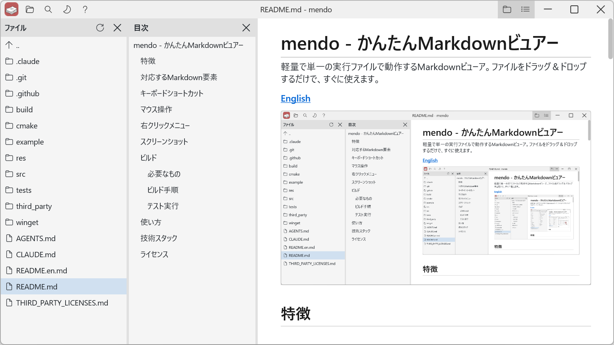
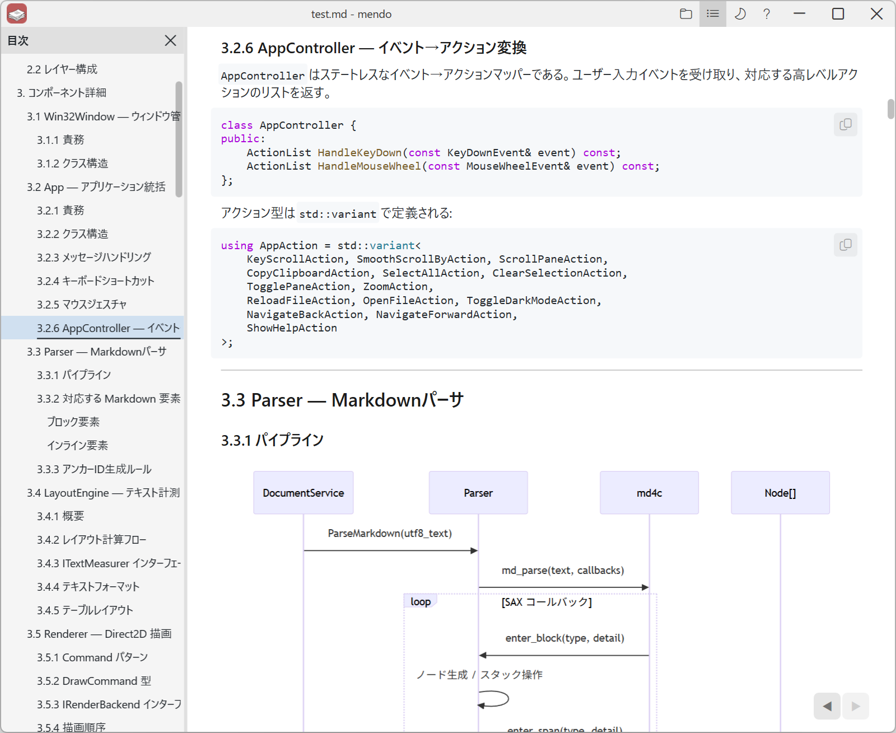
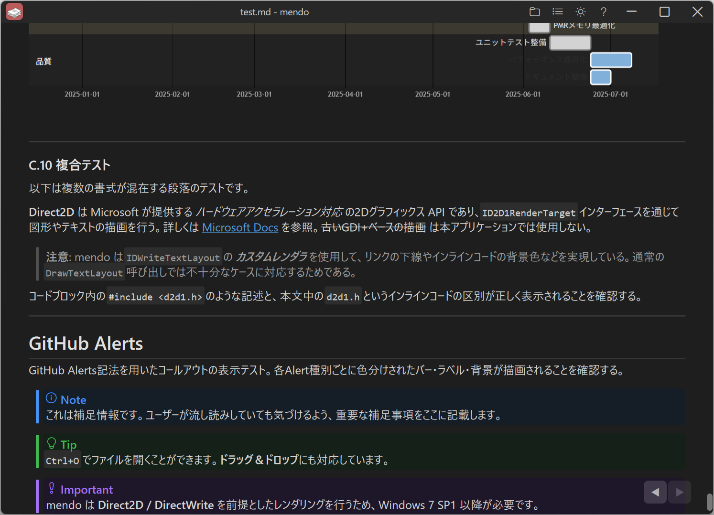

# mendo - 高速で簡単なMarkdownビュアー

Direct2D/DirectWriteで直接描画するMarkdownビュアーです。高速かつ省メモリで動作します。

**日本語** | [English](docs/README.en.md) | [简体中文](docs/README.zh-CN.md) | [繁體中文](docs/README.zh-TW.md) | [한국어](docs/README.ko.md)



## インストール

[winget](https://learn.microsoft.com/windows/package-manager/winget/) でインストールできます。

```
winget install tanaton.mendo
```

### おすすめの起動方法
エクスプローラーのアドレス欄に `mendo` と入力してEnterキーを押します。

## 特徴

- **高速起動** — ウインドウ生成とファイル処理を並列化する事で高速起動します。
- **省メモリ** — Markdownの描画にブラウザを使わず、Direct2D + DirectWrite で直接描画します。
- **ライブリロード** — 表示中ファイルの変更を検出し、自動で表示を更新します。また、変更位置に自動スクロールします。
- **Mermaid** — `mermaid` コードブロックを図として表示します。（WebView2 + Mermaid.js によるオフスクリーンレンダリング）
- **オフライン動作** — ネットワーク接続無しで動作します。
- **シンタックスハイライト** — 複数のプログラミング言語や設定ファイル等のコードブロックを色分け表示します。
- **画像表示** — ローカルにあるPNG, JPEG, BMP等の画像を表示します。
- **LaTeX** — `$$...$$` のブロック数式と ` ```math ` コードブロックを KaTeX で描画して表示します。（`$$...$$` は `$$...$$` のみからなる段落が対象。テキストと混在する段落は通常テキスト表示）
- **ナビゲーション履歴** — マウスサイドボタン / マウスジェスチャー / タッチパッドスワイプ等でブラウザスタイルの戻る/進むが動作し、スクロール位置も復元します。
- **ドラッグ&ドロップ** — Markdownファイルをウィンドウにドロップして開けます。
- **ファイル内検索** — タイトルバーの検索ボタンや `Ctrl+F` でファイル内を検索できます。
- **見た目の変更** — 各ペインの表示/非表示切り替え、テーマのライト/ダーク切り替え、0.25x〜5.00xの17段階ズーム等、見た目の変更ができます。
- **多言語 UI** — Windows の表示言語に合わせて、画面とヘルプを日本語・英語・簡体字中国語・繁体字中国語・韓国語で表示します。タイトルバーの設定ボタンからも切り替えられます。
- **設定の永続化** — ダークモード・ズームレベル・最後に開いたファイル等を `%LOCALAPPDATA%\mendo\` に保存します。

## 対応するMarkdown要素

| 要素 | 対応状況 |
|---|---|
| 見出し (H1-H6) | ✅ |
| 段落 | ✅ |
| 太字 / 斜体 / 取り消し線 | ✅ |
| インラインコード | ✅ |
| コードブロック (フェンス) | ✅ シンタックスハイライト付き。対応言語: C/C++, C#, Java, Kotlin, Swift, Python, JavaScript, TypeScript, Go, Rust, Zig, Haskell, Clojure, Emacs Lisp, Common Lisp, Scheme/Racket, Lua, Vim script, PHP, Ruby, SQL, HTML, XML, CSS, SCSS, JSON, YAML, TOML, INI, Bash, PowerShell, cmd (バッチ), Dockerfile, Makefile, diff |
| 画像 (PNG / JPEG / BMP) | ✅ 非同期読み込み |
| Mermaidダイアグラム | ✅ WebView2でレンダリング |
| LaTeX数式 (`$$...$$` / ` ```math `) | ✅ ブロック数式のみ。`$$...$$` は段落が `$$...$$` のみで構成される場合に描画、他のテキストと混在する段落はテキスト表示 |
| GitHub Alerts | ✅ Note / Tip / Important / Warning / Caution |
| 脚注 (`[^1]`) | ✅ 文書末尾に番号順で表示、参照と定義を相互にリンク |
| リンク (外部 / ページ内アンカー) | ✅ |
| 順序付きリスト / 箇条書き | ✅ ネスト対応 |
| タスクリスト | ✅ |
| 引用 (Blockquote) | ✅ |
| テーブル | ✅ アライメント対応 |
| 水平線 | ✅ |

## キーボードショートカット

| キー | 操作 |
|---|---|
| `Ctrl+O` | ファイルを開く |
| `Ctrl+C` | 選択テキストをコピー |
| `Ctrl+Shift+C` | 選択テキストを書式付き（HTML）でコピー |
| `Ctrl+A` | 全選択 |
| `Ctrl+1` | ファイルエクスプローラーの表示/非表示 |
| `Ctrl+2` | 目次の表示/非表示 |
| `Ctrl+F` | 検索バーを開く（検索バー内では閉じる） |
| `F3` / `Ctrl+G` | 次の一致へ移動（検索バー内では `Enter` も可） |
| `Shift+F3` / `Ctrl+Shift+G` | 前の一致へ移動（検索バー内では `Shift+Enter` も可） |
| `Ctrl++` / `Ctrl+-` | ズームイン / ズームアウト |
| `Ctrl+0` | ズームをリセット (100%) |
| `Ctrl+マウスホイール` | ポインタの下の領域 (本文・ファイルペイン・目次ペイン) をズームイン / ズームアウト |
| `Alt+←` | 戻る |
| `Alt+→` | 進む |
| `F1` | 操作ガイドを表示 |
| `F5` | 再読み込み |
| `↑` `↓` | スクロール |
| `Page Up` `Page Down` | ページスクロール |
| `Home` `End` | 先頭/末尾へ移動 |
| `Esc` | 検索バーを閉じる / 選択解除 |

## マウス操作

| 操作 | 動作 |
|---|---|
| ドラッグ | テキスト範囲選択 |
| ダブルクリック | 単語選択 |
| 右クリック+左右ドラッグ | マウスジェスチャーで戻る/進む |
| タッチパッド水平スワイプ | 戻る / 進む |
| サイドボタン | 戻る / 進む |
| スプリッタードラッグ | ペイン幅の調整 |
| リンクをクリック | 外部リンクをブラウザで開く / ページ内アンカーにジャンプ |
| コードブロックのコピーボタン | コードブロックの内容を書式付きでコピー |
| 図 (Mermaid / 数式) のボタン | PNG画像として保存 / クリップボードにコピー |

## 右クリックメニュー

| 項目 | 操作 |
|---|---|
| ← → ボタン | 戻る / 進む |
| エディタで開く | 現在のファイルを既定のエディタで開く |
| コピー | 選択テキストをコピー（テキスト選択時のみ） |
| 書式付きコピー | 選択テキストをHTMLリッチテキストでコピー。WordやOutlook等に貼ると書式を保持（テキスト選択時のみ） |
| ダークモード | ライト/ダークテーマの切り替え |
| ファイルペイン | ファイルエクスプローラーの表示/非表示 |
| 目次ペイン | 目次の表示/非表示 |

## スクリーンショット





## ビルド

### 必要なもの

- Windows 10 以降
- Visual Studio 2026 (MSVC, C++23対応)
- CMake 4.2+（Visual Studio 2026 ジェネレータ対応版）

### ビルド手順

```
cmake -B build
cmake --build build --config Release
```

生成される実行ファイル: `build/Release/mendo.exe`

テストなしでビルドする場合:

```
cmake -B build -DMENDO_BUILD_TESTS=OFF
cmake --build build --config Release
```

### テスト実行

```
cmake --build build --config Release
build/tests/Release/mendo_tests.exe
```

### ベンチマーク（開発者向け）

[Google Benchmark](https://github.com/google/benchmark) v1.10.0 でパースやレイアウトの所要時間を測ります。既定（OFF）のビルドには含まれません。

```
cmake -B build_bench -DMENDO_BUILD_BENCHMARKS=ON
cmake --build build_bench --config Release --target mendo_bench
build_bench/bench/Release/mendo_bench.exe --benchmark_filter=FromMarkdown
```

### Tracyプロファイラ有効ビルド（開発者向け）

[Tracy](https://github.com/wolfpld/tracy) v0.14.1 を組み込み、フレーム時間・ゾーン計測・カウンタ時系列プロットを取得できます。Tracy GUI 接続前は計測コードが no-op になる `TRACY_ON_DEMAND` モードで組み込まれます。

```
cmake -B build_tracy -DMENDO_USE_TRACY=ON
cmake --build build_tracy --config Release
```

## 使い方

```
mendo.exe [ファイルパス | フォルダパス]
```

| 引数 | 表示するファイル | ファイルペインのフォルダ |
|---|---|---|
| なし | 前回のファイル | カレントフォルダ |
| ファイル | 指定したファイル | そのファイルのフォルダ |
| フォルダ | 前回のファイル | 指定したフォルダ |

カレントフォルダがシステムフォルダや mendo.exe のフォルダのとき（スタートメニューから起動した場合など）は、前回のファイルのフォルダを表示します。ファイルペイン上部のボタンで、表示中のファイルのフォルダへ移動できます。

前回のファイルがない場合は、`Ctrl+O` またはドラッグ&ドロップでファイルを開けます。

## 技術スタック

| レイヤー | 技術 |
|---|---|
| 言語 | C++23 (MSVC) |
| GUI | Win32 API |
| 2D描画 | Direct2D (`ID2D1DeviceContext`) |
| テキスト描画 | DirectWrite (`IDWriteTextLayout`) |
| ダイアグラム | WebView2 + [Mermaid.js](https://mermaid.js.org/) |
| 数式 | [KaTeX](https://katex.org/) (Mermaid経由) |
| Markdownパーサ | [md4c](https://github.com/mity/md4c) (SAX型コールバック) |
| テスト | Google Test v1.18.0 |
| ベンチマーク | Google Benchmark v1.10.0 |
| ビルド | CMake 4.2+ |

## ライセンス

[MIT](LICENSE)

サードパーティライブラリのライセンスについては [THIRD_PARTY_LICENSES.md](THIRD_PARTY_LICENSES.md) を参照してください。
