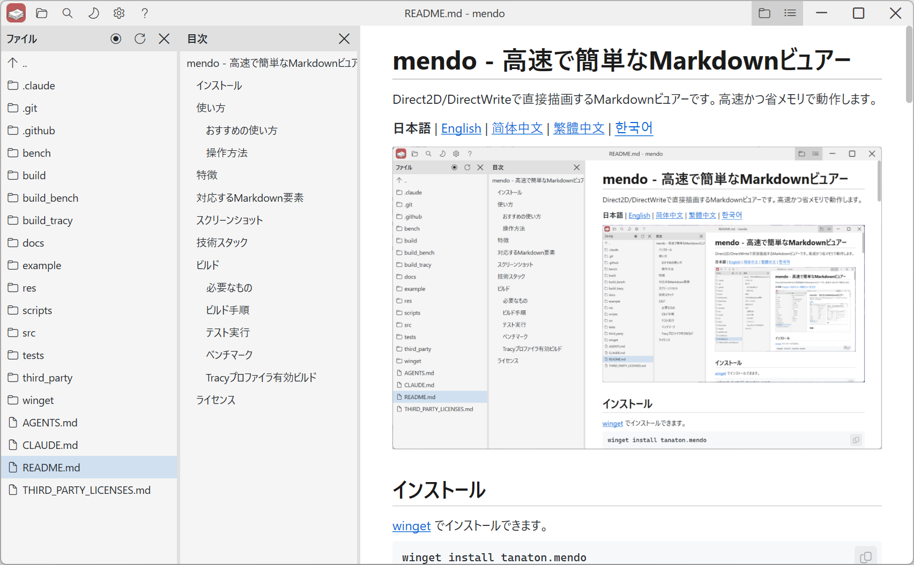
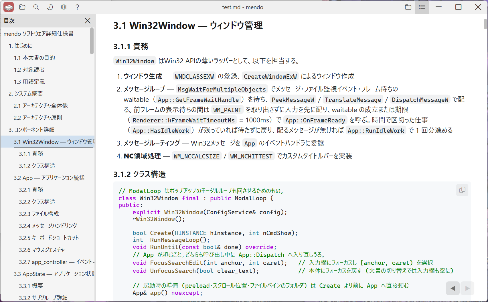
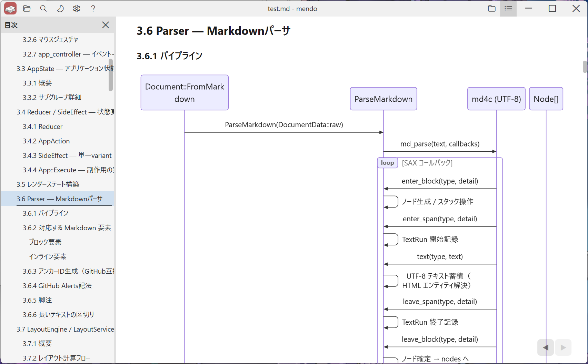
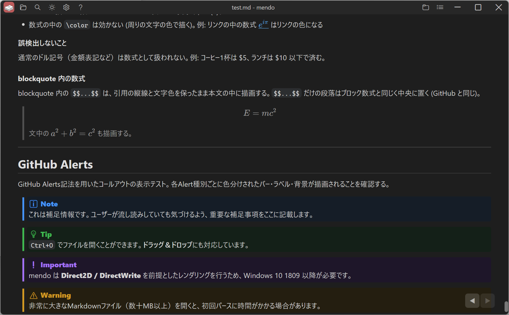

# mendo - 高速で簡単なMarkdownビュアー

Direct2D/DirectWriteで直接描画するMarkdownビュアーです。高速かつ省メモリで動作します。

**日本語** | [English](docs/README.en.md) | [简体中文](docs/README.zh-CN.md) | [繁體中文](docs/README.zh-TW.md) | [한국어](docs/README.ko.md)



## インストール

[winget](https://learn.microsoft.com/windows/package-manager/winget/) でインストールできます。

```
winget install tanaton.mendo
```

## 使い方

```
mendo.exe [ファイルパス | フォルダパス] [--anchor 見出し]
```

| 引数 | 表示するファイル | ファイルペインのフォルダ |
|---|---|---|
| なし | 前回のファイル | カレントフォルダ |
| ファイル | 指定したファイル | そのファイルのフォルダ |
| フォルダ | 前回のファイル | 指定したフォルダ |

カレントフォルダがシステムフォルダや mendo.exe のフォルダのとき（スタートメニューから起動した場合など）は、前回のファイルのフォルダを表示します。

ファイルパスの後ろに `--anchor 見出し` を付けると、開いたファイルのその見出しへ移動します。見出しはリンクの `#` より後ろと同じ書き方です（例: `mendo.exe README.md --anchor 使い方`）。

`Ctrl+O` またはドラッグ&ドロップでファイルを開けます。

### おすすめの使い方

エクスプローラーのアドレス欄に `mendo` と入力してEnterキーを押します。

### 操作方法

[mendo 操作ガイド](res/help_ja.md)

## 特徴

- **高速起動** — ウインドウ生成とファイル処理を並列化する事で高速起動します。
- **省メモリ** — Markdownの描画にブラウザを使わず、Direct2D + DirectWrite で直接描画します。
- **ライブリロード** — 表示中ファイルの変更を検出し、自動で表示を更新します。また、変更位置に自動スクロールします。
- **Mermaid** — ` ```mermaid ` コードブロックを図として表示します。
- **数学記法** — `$$...$$` のブロック数式、` ```math ` コードブロック、文中の `$...$` を数式として表示します。
- **オフライン動作** — ネットワーク接続無しで動作します。
- **シンタックスハイライト** — 複数のプログラミング言語や設定ファイル等のコードブロックを色分け表示します。
- **画像表示** — ローカルにあるPNG, JPEG, BMP等の画像を表示します。
- **ナビゲーション履歴** — マウスサイドボタン / マウスジェスチャー / タッチパッドスワイプ等でブラウザスタイルの戻る/進むが動作し、スクロール位置も復元します。
- **ドラッグ&ドロップ** — Markdownファイルをウィンドウにドロップして開けます。
- **ファイル内検索** — タイトルバーの検索ボタンや `Ctrl+F` でファイル内を検索できます。
- **見た目の変更** — 各ペインの表示/非表示切り替え、テーマのライト/ダーク切り替え、0.25x〜5.00xの17段階ズーム等、見た目の変更ができます。
- **多言語 UI** — Windows の表示言語に合わせて、画面とヘルプを日本語・英語・簡体字中国語・繁体字中国語・韓国語で表示します。タイトルバーの設定ボタンからも切り替えられます。
- **設定の永続化** — ダークモード・ズームレベル・最後に開いたファイル等を `%LOCALAPPDATA%\mendo\` に保存します。

## 対応するMarkdown要素

| 要素 | 対応状況 |
|---|---|
| 見出し (H1-H6) | ✅ |
| 段落 | ✅ |
| 太字 / 斜体 / 取り消し線 | ✅ |
| インラインコード | ✅ |
| コードブロック (フェンス) | ✅ シンタックスハイライト付き。対応言語: C/C++, C#, Java, Kotlin, Swift, Python, JavaScript, TypeScript, Go, Rust, Zig, Haskell, Clojure, Emacs Lisp, Common Lisp, Scheme/Racket, Lua, Vim script, PHP, Ruby, SQL, HTML, XML, CSS, SCSS, JSON, YAML, TOML, INI, Bash, PowerShell, cmd (バッチ), Dockerfile, Makefile, diff |
| 画像 (PNG / JPEG / BMP) | ✅ 非同期読み込み |
| Mermaidダイアグラム | ✅ Mermaid 12.1.0 に組み込まれている図に対応 |
| 数学記法 (`$...$` / `$$...$$` / ` ```math `) | ✅ すべてディスプレイ形式で描画し、`$$...$$` のみの段落と ` ```math ` はブロック数式にする |
| GitHub Alerts | ✅ Note / Tip / Important / Warning / Caution |
| 脚注 (`[^1]`) | ✅ 文書末尾に番号順で表示、参照と定義を相互にリンク |
| リンク (外部 / ページ内アンカー / ローカルの Markdown) | ✅ |
| 順序付きリスト / 箇条書き | ✅ ネスト対応 |
| タスクリスト | ✅ |
| 引用 (Blockquote) | ✅ |
| テーブル | ✅ アライメント対応 |
| 水平線 | ✅ |

## スクリーンショット







## 技術スタック

| レイヤー | 技術 |
|---|---|
| 言語 | C++23 (MSVC) |
| GUI | Win32 API |
| 2D描画 | Direct2D (`ID2D1DeviceContext`) |
| テキスト描画 | DirectWrite (`IDWriteTextLayout`) |
| Markdownパーサ | [md4c](https://github.com/mity/md4c) (SAX型コールバック) |
| Mermaidダイアグラム | [pele](https://pele.run/) + [QuickJS-ng](https://github.com/quickjs-ng/quickjs) |
| 数学記法 | [KaTeX](https://katex.org/) + [QuickJS-ng](https://github.com/quickjs-ng/quickjs) |
| テスト | Google Test v1.18.0 |
| ベンチマーク | Google Benchmark v1.10.0 |
| ビルド | CMake 4.2+ |

## ビルド

### 必要なもの

- Windows 10 以降
- Visual Studio 2026 (MSVC, C++23対応)
- CMake 4.2+（Visual Studio 2026 ジェネレータ対応版）

### ビルド手順

```
cmake -B build
cmake --build build --config Release
```

生成される実行ファイル: `build/Release/mendo.exe`

テストなしでビルドする場合:

```
cmake -B build -DMENDO_BUILD_TESTS=OFF
cmake --build build --config Release
```

### テスト実行

```
cmake --build build --config Release
build/tests/Release/mendo_tests.exe
```

### ベンチマーク

[Google Benchmark](https://github.com/google/benchmark) v1.10.0 でパースやレイアウトの所要時間を測ります。既定（OFF）のビルドには含まれません。

```
cmake -B build_bench -DMENDO_BUILD_BENCHMARKS=ON
cmake --build build_bench --config Release --target mendo_bench
build_bench/bench/Release/mendo_bench.exe --benchmark_filter=FromMarkdown
```

### Tracyプロファイラ有効ビルド

[Tracy](https://github.com/wolfpld/tracy) v0.15.0 を組み込み、フレーム時間・ゾーン計測・カウンタ時系列プロットを取得できます。Tracy GUI 接続前は計測コードが no-op になる `TRACY_ON_DEMAND` モードで組み込まれます。

```
cmake -B build_tracy -DMENDO_USE_TRACY=ON
cmake --build build_tracy --config Release
```

## ライセンス

[MIT](LICENSE)

サードパーティライブラリのライセンスについては [THIRD_PARTY_LICENSES.md](THIRD_PARTY_LICENSES.md) を参照してください。
