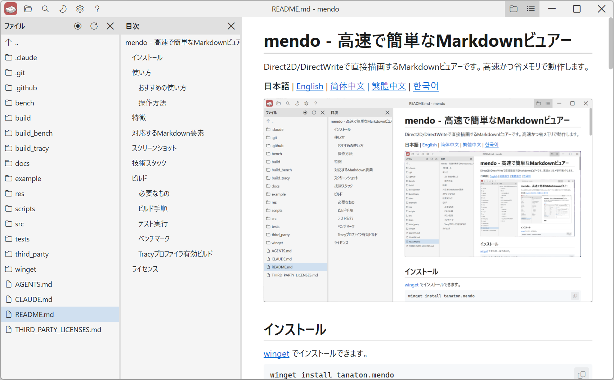
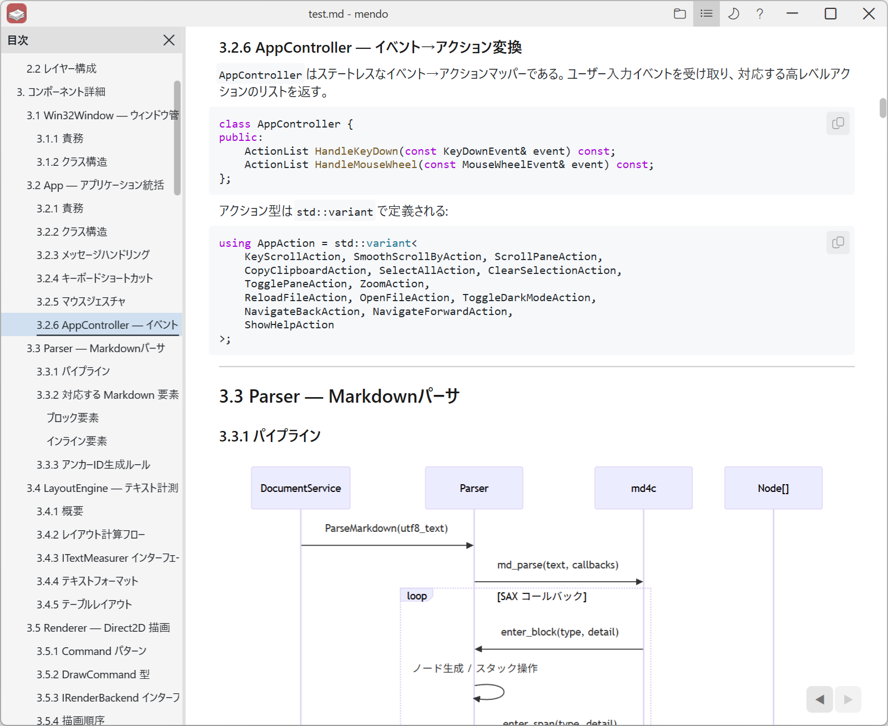
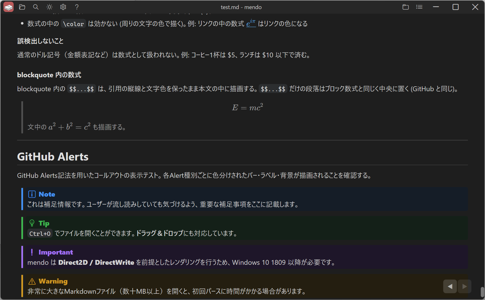

# mendo - Fast and simple Markdown viewer

A Markdown viewer that renders directly with Direct2D/DirectWrite. It is fast and uses little memory.

[日本語](../README.md) | **English** | [简体中文](README.zh-CN.md) | [繁體中文](README.zh-TW.md) | [한국어](README.ko.md)



## Installation

Install via [winget](https://learn.microsoft.com/windows/package-manager/winget/):

```
winget install tanaton.mendo
```

## Usage

```
mendo.exe [filepath | folderpath] [--anchor heading]
```

| Argument | Document shown | File pane folder |
|---|---|---|
| none | last opened file | current directory |
| file | the given file | the file's folder |
| folder | last opened file | the given folder |

When the current directory is a system folder or mendo.exe's folder (e.g. launched from the Start menu), the last file's folder is shown instead.

Add `--anchor <heading>` after the file path to jump to that heading in the opened file. Write the heading the same way as the part after `#` in a link (e.g. `mendo.exe README.md --anchor usage`).

You can open a file with `Ctrl+O` or drag & drop.

### Recommended usage

Type `mendo` into the File Explorer address bar and press Enter.

### Controls

[mendo User Guide](../res/help_en.md)

## Features

- **Fast startup** — Window creation and file processing run in parallel for a quick launch.
- **Low memory usage** — Markdown is drawn directly with Direct2D + DirectWrite, without a browser engine.
- **Live reload** — Detects changes to the open file, updates the view automatically, and scrolls to the changed position.
- **Mermaid** — Renders `mermaid` code blocks as diagrams ([pele](https://pele.run/) runs on [QuickJS-ng](https://github.com/quickjs-ng/quickjs) and the result is drawn with Direct2D).
- **Offline** — Works without a network connection.
- **Syntax highlighting** — Colors code blocks in many programming languages, configuration file formats, and more.
- **Images** — Displays local PNG, JPEG, BMP, and other images.
- **LaTeX** — Renders `$$...$$` block equations, ` ```math ` code blocks, and inline `$...$` math with KaTeX. (A paragraph consisting solely of `$$...$$` and a ` ```math ` block are rendered as centered block equations. Selecting and copying math gives the LaTeX source without the `$` delimiters.)
- **Navigation history** — Browser-style back/forward via mouse side buttons, mouse gestures, touchpad swipe, and more, with scroll position restored.
- **Drag & Drop** — Drop a Markdown file onto the window to open it.
- **In-file search** — Search within the file from the title bar search button or `Ctrl+F`.
- **Customizable view** — Show/hide each pane, switch between light and dark themes, zoom in 17 steps from 0.25x to 5.00x, and more.
- **Multilingual UI** — Shows the UI and help in Japanese, English, Simplified Chinese, Traditional Chinese, or Korean to match the Windows display language. You can also switch it from the settings button in the title bar.
- **Persistent settings** — Dark mode, zoom level, last opened file, and more are saved to `%LOCALAPPDATA%\mendo\`.

## Supported Markdown Elements

| Element | Status |
|---|---|
| Headings (H1-H6) | Supported |
| Paragraphs | Supported |
| Bold / Italic / Strikethrough | Supported |
| Inline code | Supported |
| Fenced code blocks | Supported (with syntax highlighting). Languages: C/C++, C#, Java, Kotlin, Swift, Python, JavaScript, TypeScript, Go, Rust, Zig, Haskell, Clojure, Emacs Lisp, Common Lisp, Scheme/Racket, Lua, Vim script, PHP, Ruby, SQL, HTML, XML, CSS, SCSS, JSON, YAML, TOML, INI, Bash, PowerShell, cmd (batch), Dockerfile, Makefile, diff |
| Images (PNG / JPEG / BMP) | Supported (async loading) |
| Mermaid diagrams | Supported (pele + QuickJS-ng, drawn with Direct2D) |
| LaTeX math (`$...$` / `$$...$$` / ` ```math `) | ✅ Rendered in the surrounding text color (`\color` has no effect) and always in display style. A paragraph consisting solely of `$$...$$` and a ` ```math ` block are rendered as block equations. |
| GitHub Alerts | Supported (Note / Tip / Important / Warning / Caution) |
| Footnotes (`[^1]`) | Supported (listed at the end of the document, with links between references and definitions) |
| Links (external / page anchors / local Markdown files) | Supported |
| Ordered / Unordered lists | Supported (nested) |
| Task lists | Supported |
| Blockquotes | Supported |
| Tables | Supported (with alignment) |
| Horizontal rules | Supported |

## Screenshots





## Tech Stack

| Layer | Technology |
|---|---|
| Language | C++23 (MSVC) |
| GUI | Win32 API |
| 2D rendering | Direct2D (`ID2D1DeviceContext`) |
| Text rendering | DirectWrite (`IDWriteTextLayout`) |
| Markdown parser | [md4c](https://github.com/mity/md4c) (SAX-style callbacks) |
| Diagrams | [pele](https://pele.run/) + [QuickJS-ng](https://github.com/quickjs-ng/quickjs) |
| Math | [KaTeX](https://katex.org/) + [QuickJS-ng](https://github.com/quickjs-ng/quickjs) |
| Tests | Google Test v1.18.0 |
| Benchmarks | Google Benchmark v1.10.0 |
| Build | CMake 4.2+ |

## Build

### Requirements

- Windows 10 or later
- Visual Studio 2026 (MSVC, C++23)
- CMake 4.2+ (required for the Visual Studio 2026 generator)

### Build Steps

```
cmake -B build
cmake --build build --config Release
```

Output: `build/Release/mendo.exe`

Build without tests:

```
cmake -B build -DMENDO_BUILD_TESTS=OFF
cmake --build build --config Release
```

### Run Tests

```
cmake --build build --config Release
build/tests/Release/mendo_tests.exe
```

### Benchmarks

Measures parsing and layout times with [Google Benchmark](https://github.com/google/benchmark) v1.10.0. Not included in the default (OFF) build.

```
cmake -B build_bench -DMENDO_BUILD_BENCHMARKS=ON
cmake --build build_bench --config Release --target mendo_bench
build_bench/bench/Release/mendo_bench.exe --benchmark_filter=FromMarkdown
```

### Build with Tracy Profiler

Embeds [Tracy](https://github.com/wolfpld/tracy) v0.14.1 for frame timing, zone tracing, and counter time-series plots. Tracy is built in `TRACY_ON_DEMAND` mode, so instrumentation is a no-op until a Tracy GUI client connects.

```
cmake -B build_tracy -DMENDO_USE_TRACY=ON
cmake --build build_tracy --config Release
```

## License

[MIT](../LICENSE)

See [THIRD_PARTY_LICENSES.md](../THIRD_PARTY_LICENSES.md) for third-party library licenses.
