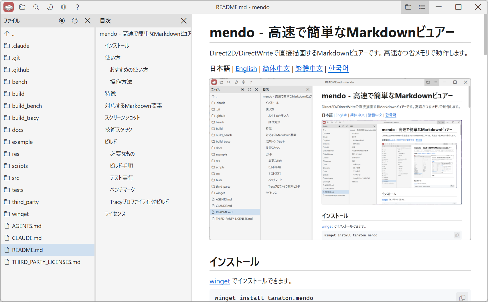
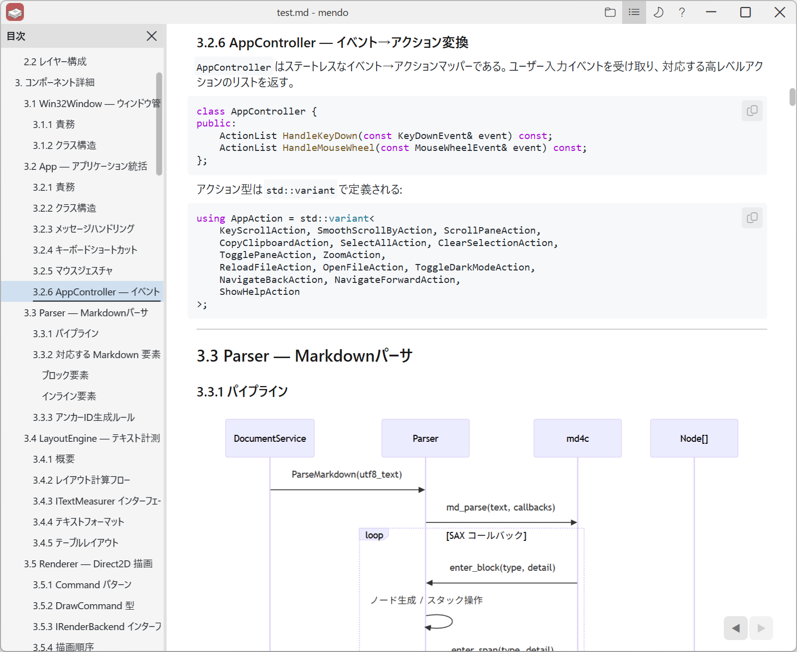
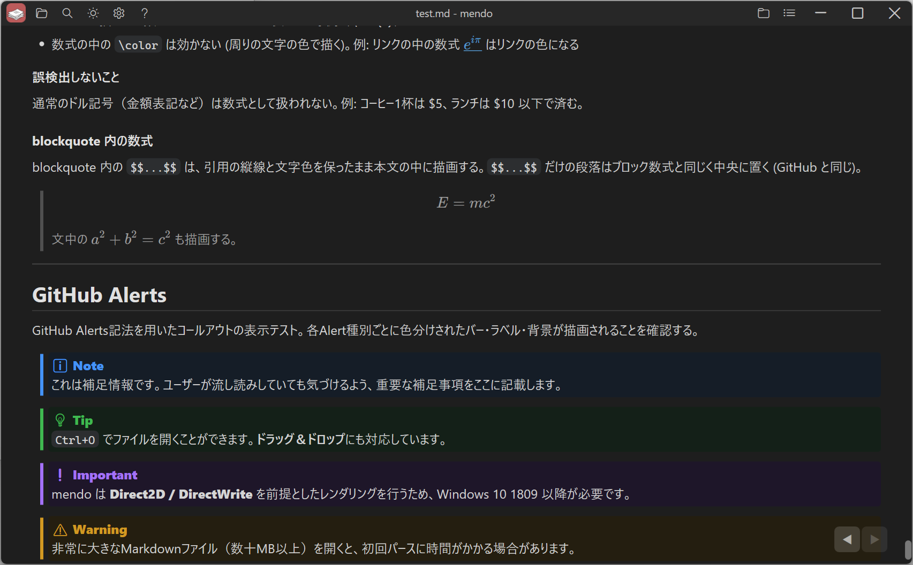

# mendo - 빠르고 간단한 Markdown 뷰어

Direct2D/DirectWrite로 직접 그리는 Markdown 뷰어입니다. 빠르고 메모리를 적게 사용합니다.

[日本語](../README.md) | [English](README.en.md) | [简体中文](README.zh-CN.md) | [繁體中文](README.zh-TW.md) | **한국어**



## 설치

[winget](https://learn.microsoft.com/windows/package-manager/winget/)으로 설치할 수 있습니다.

```
winget install tanaton.mendo
```

## 사용법

```
mendo.exe [파일 경로 | 폴더 경로] [--anchor 제목]
```

| 인수 | 표시할 파일 | 파일 창의 폴더 |
|---|---|---|
| 없음 | 마지막으로 연 파일 | 현재 폴더 |
| 파일 | 지정한 파일 | 그 파일이 있는 폴더 |
| 폴더 | 마지막으로 연 파일 | 지정한 폴더 |

현재 폴더가 시스템 폴더나 mendo.exe가 있는 폴더일 때(시작 메뉴에서 실행한 경우 등)는 마지막으로 연 파일이 있는 폴더를 표시합니다.

파일 경로 뒤에 `--anchor 제목`을 붙이면 연 파일의 그 제목으로 이동합니다. 제목은 링크의 `#` 뒤와 같은 방식으로 씁니다 (예: `mendo.exe README.md --anchor 사용법`).

`Ctrl+O`나 끌어서 놓기로 파일을 열 수 있습니다.

### 추천하는 사용법

파일 탐색기의 주소 표시줄에 `mendo`를 입력하고 Enter 키를 누릅니다.

### 조작 방법

[mendo 사용 안내](../res/help_ko.md)

## 특징

- **빠른 시작** — 창 생성과 파일 처리를 병렬로 진행하여 빠르게 시작합니다.
- **적은 메모리 사용** — 브라우저 엔진을 쓰지 않고 Direct2D + DirectWrite로 Markdown을 직접 그립니다.
- **실시간 다시 불러오기** — 열려 있는 파일의 변경을 감지하면 자동으로 표시를 갱신하고 변경된 위치로 스크롤합니다.
- **Mermaid** — `mermaid` 코드 블록을 다이어그램으로 표시합니다. ([pele](https://pele.run/)를 [QuickJS-ng](https://github.com/quickjs-ng/quickjs)에서 실행하고 Direct2D로 그림)
- **오프라인 동작** — 네트워크 연결 없이 동작합니다.
- **구문 강조** — 여러 프로그래밍 언어와 설정 파일 형식 등의 코드 블록을 색으로 구분해 표시합니다.
- **이미지 표시** — 로컬의 PNG, JPEG, BMP 등의 이미지를 표시합니다.
- **LaTeX** — `$$...$$` 블록 수식, ` ```math ` 코드 블록, 문장 안의 `$...$` 인라인 수식을 KaTeX로 렌더링합니다. (`$$...$$`로만 이루어진 단락과 ` ```math `는 가운데 정렬된 블록 수식으로 렌더링합니다. 수식을 선택해 복사하면 `$`를 뺀 LaTeX 문자열이 됩니다.)
- **탐색 기록** — 마우스 측면 버튼, 마우스 제스처, 터치패드 스와이프 등으로 브라우저처럼 뒤로 / 앞으로 이동하며 스크롤 위치도 복원합니다.
- **끌어서 놓기** — Markdown 파일을 창에 끌어다 놓으면 열립니다.
- **파일 내 검색** — 제목 표시줄의 검색 버튼이나 `Ctrl+F`로 파일 안을 검색합니다.
- **보기 사용자 지정** — 각 창의 표시 / 숨기기, 라이트 / 다크 테마 전환, 0.25x~5.00x의 17단계 확대/축소 등을 바꿀 수 있습니다.
- **다국어 UI** — Windows 표시 언어에 맞춰 화면과 도움말을 일본어, 영어, 중국어 간체, 중국어 번체, 한국어로 표시합니다. 제목 표시줄의 설정 버튼에서도 바꿀 수 있습니다.
- **설정 저장** — 다크 모드, 확대/축소 배율, 마지막으로 연 파일 등을 `%LOCALAPPDATA%\mendo\`에 저장합니다.

## 지원하는 Markdown 요소

| 요소 | 지원 여부 |
|---|---|
| 제목 (H1-H6) | ✅ |
| 단락 | ✅ |
| 굵게 / 기울임꼴 / 취소선 | ✅ |
| 인라인 코드 | ✅ |
| 코드 블록 (펜스) | ✅ 구문 강조 지원. 지원 언어: C/C++, C#, Java, Kotlin, Swift, Python, JavaScript, TypeScript, Go, Rust, Zig, Haskell, Clojure, Emacs Lisp, Common Lisp, Scheme/Racket, Lua, Vim script, PHP, Ruby, SQL, HTML, XML, CSS, SCSS, JSON, YAML, TOML, INI, Bash, PowerShell, cmd (배치), Dockerfile, Makefile, diff |
| 이미지 (PNG / JPEG / BMP) | ✅ 비동기 불러오기 |
| Mermaid 다이어그램 | ✅ pele + QuickJS-ng, Direct2D로 그림 |
| LaTeX 수식 (`$...$` / `$$...$$` / ` ```math `) | ✅ 본문 색으로 렌더링 (`\color`는 무시). 모두 디스플레이 형식으로 렌더링하며, `$$...$$`로만 이루어진 단락과 ` ```math `는 블록 수식 |
| GitHub Alerts | ✅ Note / Tip / Important / Warning / Caution |
| 각주 (`[^1]`) | ✅ 문서 끝에 번호순으로 표시하며, 참조와 정의를 서로 연결 |
| 링크 (외부 / 페이지 내 앵커 / 로컬 Markdown 파일) | ✅ |
| 번호 매기기 목록 / 글머리 기호 목록 | ✅ 중첩 지원 |
| 작업 목록 | ✅ |
| 인용 (Blockquote) | ✅ |
| 표 | ✅ 정렬 지원 |
| 가로줄 | ✅ |

## 스크린샷





## 기술 스택

| 계층 | 기술 |
|---|---|
| 언어 | C++23 (MSVC) |
| GUI | Win32 API |
| 2D 그리기 | Direct2D (`ID2D1DeviceContext`) |
| 텍스트 그리기 | DirectWrite (`IDWriteTextLayout`) |
| Markdown 파서 | [md4c](https://github.com/mity/md4c) (SAX 방식 콜백) |
| 다이어그램 | [pele](https://pele.run/) + [QuickJS-ng](https://github.com/quickjs-ng/quickjs) |
| 수식 | [KaTeX](https://katex.org/) + [QuickJS-ng](https://github.com/quickjs-ng/quickjs) |
| 테스트 | Google Test v1.18.0 |
| 벤치마크 | Google Benchmark v1.10.0 |
| 빌드 | CMake 4.2+ |

## 빌드

### 필요한 것

- Windows 10 이상
- Visual Studio 2026 (MSVC, C++23 지원)
- CMake 4.2+ (Visual Studio 2026 생성기를 지원하는 버전)

### 빌드 절차

```
cmake -B build
cmake --build build --config Release
```

생성되는 실행 파일: `build/Release/mendo.exe`

테스트 없이 빌드하는 경우:

```
cmake -B build -DMENDO_BUILD_TESTS=OFF
cmake --build build --config Release
```

### 테스트 실행

```
cmake --build build --config Release
build/tests/Release/mendo_tests.exe
```

### 벤치마크

[Google Benchmark](https://github.com/google/benchmark) v1.10.0으로 파싱과 레이아웃에 걸리는 시간을 측정합니다. 기본값(OFF) 빌드에는 포함되지 않습니다.

```
cmake -B build_bench -DMENDO_BUILD_BENCHMARKS=ON
cmake --build build_bench --config Release --target mendo_bench
build_bench/bench/Release/mendo_bench.exe --benchmark_filter=FromMarkdown
```

### Tracy 프로파일러를 켠 빌드

[Tracy](https://github.com/wolfpld/tracy) v0.15.0을 포함하여 프레임 시간, 구간 측정, 카운터 시계열 그래프를 얻을 수 있습니다. Tracy는 `TRACY_ON_DEMAND` 모드로 포함되므로 Tracy GUI가 연결되기 전까지 측정 코드는 아무것도 하지 않습니다.

```
cmake -B build_tracy -DMENDO_USE_TRACY=ON
cmake --build build_tracy --config Release
```

## 라이선스

[MIT](../LICENSE)

서드파티 라이브러리의 라이선스는 [THIRD_PARTY_LICENSES.md](../THIRD_PARTY_LICENSES.md)를 참고하세요.
