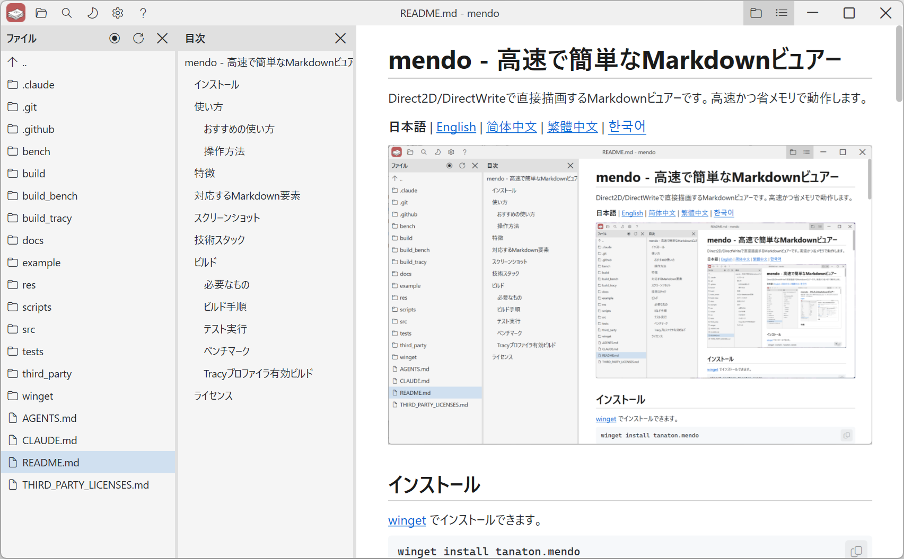
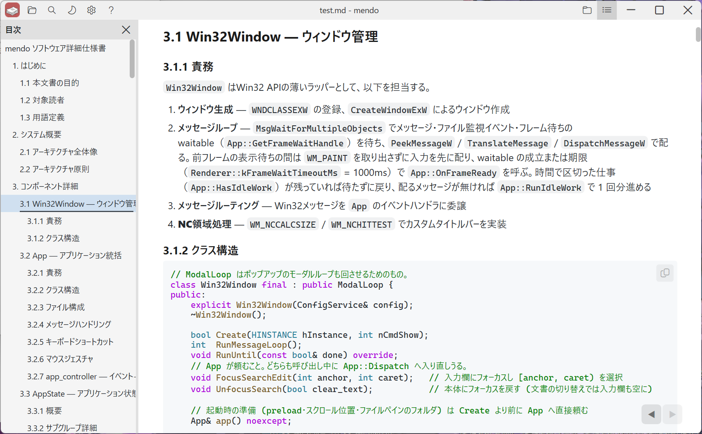
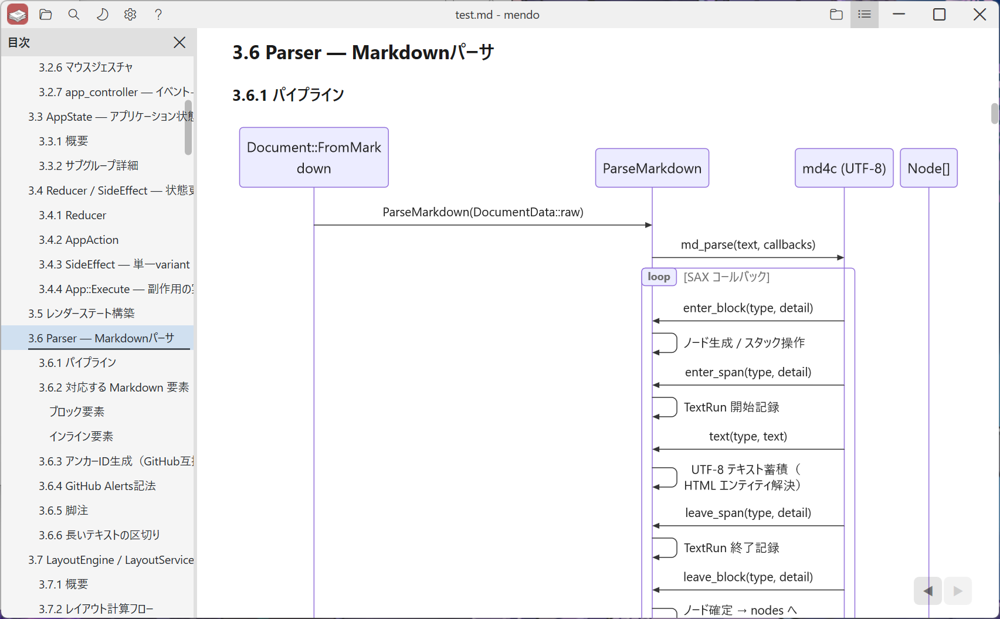
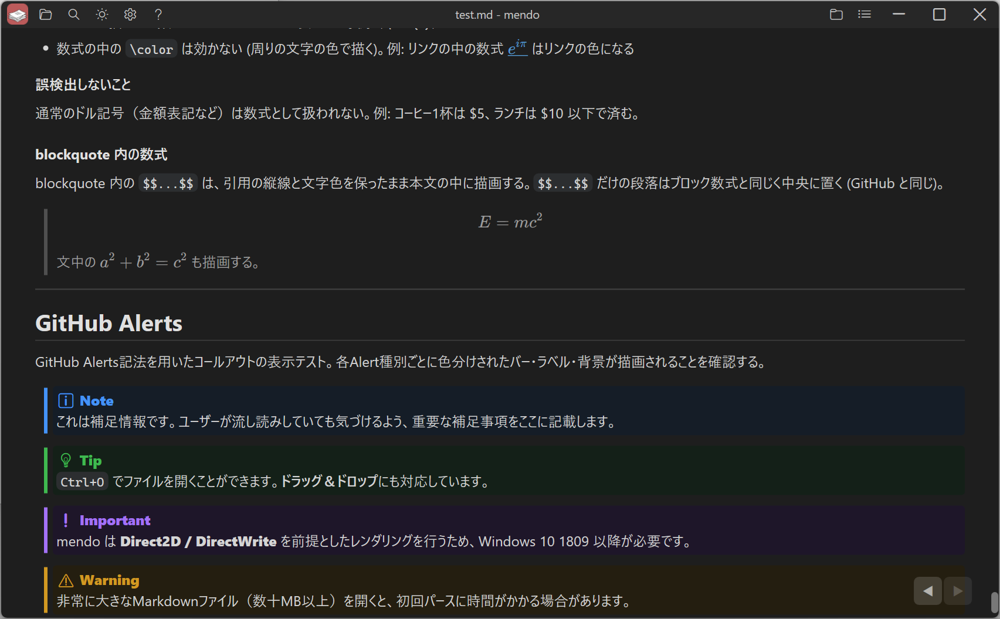

# mendo - 快速、简单的 Markdown 查看器

使用 Direct2D/DirectWrite 直接绘制的 Markdown 查看器。运行速度快，占用内存少。

[日本語](../README.md) | [English](README.en.md) | **简体中文** | [繁體中文](README.zh-TW.md) | [한국어](README.ko.md)



## 安装

可以通过 [winget](https://learn.microsoft.com/windows/package-manager/winget/) 安装：

```
winget install tanaton.mendo
```

## 特性

- **快速启动** — 窗口创建与文件处理并行进行，启动迅速。
- **低内存占用** — 不使用浏览器引擎，通过 Direct2D + DirectWrite 直接绘制 Markdown。
- **实时重新加载** — 检测到打开的文件发生变化时自动更新显示，并滚动到变化的位置。
- **Mermaid** — 将 ` ```mermaid ` 代码块显示为图表。
- **数学公式** — 将 `$$...$$` 块级公式、` ```math ` 代码块和行内 `$...$` 显示为公式。
- **离线运行** — 无需网络连接即可使用。
- **语法高亮** — 为多种编程语言、配置文件格式等的代码块着色。
- **图像显示** — 显示本地的 PNG、JPEG、BMP 等图像。
- **导航历史** — 支持鼠标侧键、鼠标手势、触摸板滑动等浏览器式的后退 / 前进，并恢复滚动位置。
- **拖放** — 将 Markdown 文件拖放到窗口中即可打开。
- **文件内搜索** — 通过标题栏的搜索按钮或 `Ctrl+F` 在文件内搜索。
- **外观自定义** — 可切换各窗格的显示 / 隐藏、切换浅色 / 深色主题、在 0.25x 到 5.00x 之间以 17 级缩放等。
- **多语言界面** — 根据 Windows 的显示语言，以日语、英语、简体中文、繁体中文或韩语显示界面和帮助。也可以通过标题栏的设置按钮切换。
- **设置持久化** — 深色模式、缩放级别、上次打开的文件等保存在 `%LOCALAPPDATA%\mendo\` 中。

## 用法

```
mendo.exe [文件路径 | 文件夹路径] [--anchor 标题]
```

| 参数 | 显示的文件 | 文件窗格的文件夹 |
|---|---|---|
| 无 | 上次打开的文件 | 当前文件夹 |
| 文件 | 指定的文件 | 该文件所在的文件夹 |
| 文件夹 | 上次打开的文件 | 指定的文件夹 |

当前文件夹是系统文件夹或 mendo.exe 所在的文件夹时（例如从开始菜单启动），会显示上次打开的文件所在的文件夹。

在文件路径后加上 `--anchor 标题`，会跳到所打开文件中的该标题。标题的写法与链接中 `#` 之后的部分相同（例如：`mendo.exe README.md --anchor 用法`）。

可以按 `Ctrl+O` 或拖放来打开文件。

### 推荐的使用方式

在文件资源管理器的地址栏中输入 `mendo` 并按 Enter 键。

### 操作方法

[mendo 使用指南](../res/help_zh.md)

## 支持的 Markdown 元素

| 元素 | 支持情况 |
|---|---|
| 标题 (H1-H6) | ✅ |
| 段落 | ✅ |
| 粗体 / 斜体 / 删除线 | ✅ |
| 行内代码 | ✅ |
| 代码块（围栏） | ✅ 带语法高亮。支持的语言：C/C++, C#, Java, Kotlin, Swift, Python, JavaScript, TypeScript, Go, Rust, Zig, Haskell, Clojure, Emacs Lisp, Common Lisp, Scheme/Racket, Lua, Vim script, PHP, Ruby, SQL, HTML, XML, CSS, SCSS, JSON, YAML, TOML, INI, Bash, PowerShell, cmd（批处理）, Dockerfile, Makefile, diff |
| 图像 (PNG / JPEG / BMP) | ✅ 异步加载 |
| Mermaid 图表 | ✅ 支持 Mermaid 12.1.0 内置的图表 |
| 数学公式 (`$...$` / `$$...$$` / ` ```math `) | ✅ 全部以展示样式渲染，只由 `$$...$$` 构成的段落和 ` ```math ` 渲染为块级公式 |
| GitHub Alerts | ✅ Note / Tip / Important / Warning / Caution |
| 脚注 (`[^1]`) | ✅ 按编号显示在文档末尾，引用与定义相互链接 |
| 链接（外部 / 页内锚点 / 本地 Markdown 文件） | ✅ |
| 有序列表 / 无序列表 | ✅ 支持嵌套 |
| 任务列表 | ✅ |
| 引用 (Blockquote) | ✅ |
| 表格 | ✅ 支持对齐 |
| 水平线 | ✅ |

## 截图







## 技术栈

| 层 | 技术 |
|---|---|
| 语言 | C++23 (MSVC) |
| GUI | Win32 API |
| 2D 绘制 | Direct2D (`ID2D1DeviceContext`) |
| 文本绘制 | DirectWrite (`IDWriteTextLayout`) |
| Markdown 解析器 | [md4c](https://github.com/mity/md4c)（SAX 式回调） |
| Mermaid 图表 | [pele](https://pele.run/) + [QuickJS-ng](https://github.com/quickjs-ng/quickjs) |
| 数学公式 | [KaTeX](https://katex.org/) + [QuickJS-ng](https://github.com/quickjs-ng/quickjs) |
| 测试 | Google Test v1.18.0 |
| 基准测试 | Google Benchmark v1.10.0 |
| 构建 | CMake 4.2+ |

## 构建

### 环境要求

- Windows 10 或更高版本
- Visual Studio 2026（MSVC，支持 C++23）
- CMake 4.2+（支持 Visual Studio 2026 生成器的版本）

### 构建步骤

```
cmake -B build
cmake --build build --config Release
```

生成的可执行文件：`build/Release/mendo.exe`

不构建测试时：

```
cmake -B build -DMENDO_BUILD_TESTS=OFF
cmake --build build --config Release
```

### 运行测试

```
cmake --build build --config Release
build/tests/Release/mendo_tests.exe
```

### 基准测试

使用 [Google Benchmark](https://github.com/google/benchmark) v1.10.0 测量解析和布局的耗时。默认（OFF）的构建不包含它。

```
cmake -B build_bench -DMENDO_BUILD_BENCHMARKS=ON
cmake --build build_bench --config Release --target mendo_bench
build_bench/bench/Release/mendo_bench.exe --benchmark_filter=FromMarkdown
```

### 启用 Tracy 性能分析器的构建

集成 [Tracy](https://github.com/wolfpld/tracy) v0.15.0，可获取帧时间、区段计时和计数器时间序列图。Tracy 以 `TRACY_ON_DEMAND` 模式集成，在 Tracy GUI 连接之前，计测代码不执行任何操作。

```
cmake -B build_tracy -DMENDO_USE_TRACY=ON
cmake --build build_tracy --config Release
```

## 许可证

[MIT](../LICENSE)

第三方库的许可证请参阅 [THIRD_PARTY_LICENSES.md](../THIRD_PARTY_LICENSES.md)。
