# mendo ソフトウェア詳細仕様書

## 1. はじめに

### 1.1 本文書の目的

本文書は **mendo** の詳細なソフトウェア仕様を記述する。本アプリケーションは、Webブラウザを使わず **Direct2D / DirectWrite** による自前レンダリングで高速なMarkdown表示を実現するWindows向けネイティブビュアーである。

### 1.2 対象読者

- 開発者・コントリビュータ
- テスト担当者
- プロジェクト管理者

### 1.3 用語定義

| 略語 | 正式名称 | 説明 |
|:-----|:---------|:-----|
| D2D | Direct2D | Microsoftの2Dグラフィックス API |
| DWrite | DirectWrite | テキストレイアウト・描画 API |
| md4c | Markdown for C | SAX型コールバック方式のCパーサ |
| WIC | Windows Imaging Component | 画像デコード・エンコードAPI |
| DPI | Dots Per Inch | 画面解像度の単位 |
| DIP | Device Independent Pixel | 論理ピクセル単位 |
| TOC | Table of Contents | 目次 |
| SAX | Simple API for XML | イベント駆動型パーサ方式 |
| PMR | Polymorphic Memory Resource | C++17 のアロケータ抽象 |
| LRU | Least Recently Used | キャッシュエビクションポリシー |

---

## 2. システム概要

### 2.1 アーキテクチャ全体像

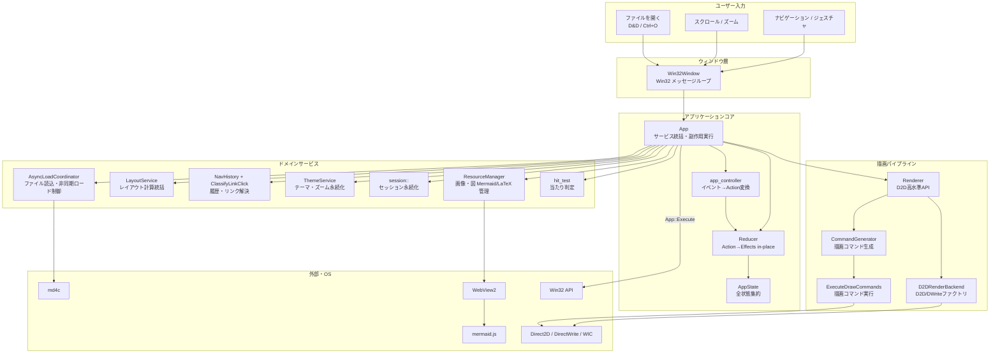

### 2.2 アーキテクチャ原則

mendo は **状態と振る舞いを明確に分離** する設計を採用している。

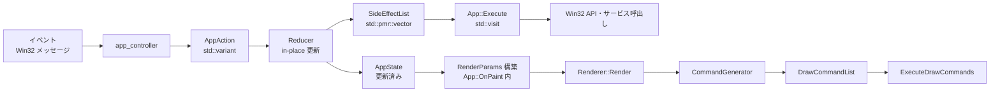

| 設計原則 | 実装場所 |
|:---------|:--------|
| **状態の単一の真実源** | `AppState`（`src/app/app_state.h`） |
| **アクション駆動** | `AppAction = std::variant<...>`（`src/app/app_events.h`） |
| **副作用の明示化** | `SideEffect`（単一variant、`src/app/side_effect.h`） |
| **副作用の実行の一元化** | `App::Execute`（`src/app/app.cpp`） |
| **DirectWrite 計測の抽象化** | `ITextMeasurer`（`src/layout/layout.h`） |
| **WebView2 依存の隔離** | `IMermaidRenderer`（`src/mermaid/mermaid_renderer_interface.h`） |
| **D2D ファクトリ・デバイスの集約** | `D2DRenderBackend`（`src/render/d2d_render_backend.h`） |
| **ロジックとUI層の分離** | `mendo_core`（テスト可能）vs `mendo`（Win32/D2D 具象） |

---

## 3. コンポーネント詳細

### 3.1 Win32Window — ウィンドウ管理

#### 3.1.1 責務

`Win32Window` はWin32 APIの薄いラッパーとして、以下を担当する。

1. **ウィンドウ生成** — `WNDCLASSEXW` の登録、`CreateWindowExW` によるウィンドウ作成
2. **メッセージループ** — `MsgWaitForMultipleObjects` でメッセージ・ファイル監視イベント・フレーム待ちの waitable（`App::GetFrameWaitHandle`）を待ち、`PeekMessageW` / `TranslateMessage` / `DispatchMessageW` で配る。前フレームの表示待ちの間は `WM_PAINT` を取り出さずに入力を先に配り、waitable の成立または期限（`D2DRenderBackend::kFrameWaitTimeoutMs` = 1000ms）で `App::OnFrameReady` を呼ぶ。時間で区切った仕事（`App::HasIdleWork`）が残っていれば待たずに戻り、配るメッセージが無ければ `App::RunIdleWork` で 1 回分進める
3. **メッセージルーティング** — Win32メッセージを `App` のイベントハンドラに委譲
4. **NC領域処理** — `WM_NCCALCSIZE` / `WM_NCHITTEST` でカスタムタイトルバーを実装

#### 3.1.2 クラス構造

```cpp
// App が本体のウィンドウに頼むこと (app.h)。どれも呼び出し中に App::Dispatch へ入り直しうる。
class WindowHost : public ModalLoop {
public:
    virtual void FocusSearchEdit(int anchor, int caret) = 0;   // 入力欄にフォーカスし [anchor, caret) を選択
    virtual void UnfocusSearch(bool clear_text) = 0;           // 本体にフォーカスを戻す (文書の切り替えでは入力欄も空に)
};

class Win32Window final : public WindowHost {
public:
    explicit Win32Window(ConfigService& config);
    ~Win32Window();

    bool Create(HINSTANCE hInstance, int nCmdShow);
    int  RunMessageLoop();
    void RunUntil(const bool& done) override;
    void FocusSearchEdit(int anchor, int caret) override;
    void UnfocusSearch(bool clear_text) override;

    // 起動時の準備 (preload・スクロール位置・ファイルペインのフォルダ) は Create より前に App へ直接頼む
    App& app() noexcept;

private:
    static LRESULT CALLBACK WndProc(HWND, UINT, WPARAM, LPARAM);
    LRESULT HandleMessage(UINT msg, WPARAM wParam, LPARAM lParam);
    LRESULT OnNcCalcSize(WPARAM wParam, LPARAM lParam);
    LRESULT HitTestNonClient(POINT pt);   // スクリーン座標での WM_NCHITTEST の結果
    LRESULT HitTestResizeFrame(POINT pt) const noexcept;
    LRESULT HitTestTitleBar(POINT pt) const noexcept;
    std::optional<LRESULT> TryHandleMouseMessage(UINT msg, WPARAM wp, LPARAM lp);
    void OnContextMenu(int screen_x, int screen_y);
    POINT KeyboardContextMenuPoint() const;
    void OnSize(WPARAM wParam, LPARAM lParam);
    void UpdateDwmFrame();
    void InitSystemMenu();
    void ResetWindowPlacement();
    void SaveWindowPlacement();
    bool RestoreWindowPlacement(int nCmdShow);
    static LRESULT CALLBACK SearchEditProc(HWND, UINT, WPARAM, LPARAM, UINT_PTR, DWORD_PTR);
    LRESULT OnSearchEditKeyDown(HWND edit, WPARAM wParam, LPARAM lParam);
    void OnSearchEditChanged();
    bool EnsureSearchEdit();
    void RepositionSearchEdit();   // 開くとき・WM_SIZE・IME の変換開始で置き直す
    void SyncSearchCaretFromEdit();
    void UpdateDpiMetricsCache();

    HWND hwnd_ = nullptr;
    HWND search_edit_ = nullptr;
    bool tracking_mouse_ = false;
    bool was_minimized_ = false;
    int  cached_nchit_border_ = 4;
    int  cached_nchit_frame_y_ = 8;
    int  cached_nchit_right_border_ = 8;

    ConfigService& config_;
    std::unique_ptr<App> app_;
};
```

`Win32Window` は `ConfigService` の参照を受け取り、内部で `App` を `unique_ptr` で保持する。`Create` は `App::Init` の後、ウィンドウを DWM でクロークしたまま配置の復元 → `App::LoadInitialDocument` → `App::CreateRenderDevice` と進め、デバイス作成を待つ間に届いた `PARSE_COMPLETE` があれば取り込んでから初回描画（`UpdateWindow`）し、クロークを解く。検索バーの実体は Win32 の Edit コントロール（`search_edit_`）で、サブクラス化（`SearchEditProc`）して IME・キャレット同期を行う。Edit は comctl32 を読み込ませるので、起動時には作らず、初めて検索欄にフォーカスするときに `EnsureSearchEdit` で作る。

`App` は `Win32Window` を `WindowHost` として受け取り、検索欄のフォーカス（`effect::SearchFocus` / `SearchUnfocus`）をその場で頼む（メッセージを投げて後で処理させない）。描画後にホバーを引き直すときの非クライアント判定は、`WM_NCHITTEST` を送って引く。フォーカスの移動や入力欄の書き換えは `EN_CHANGE`・`WM_IME_ENDCOMPOSITION`・選択の同期を通じて `App::Dispatch` に入り直すが、`Dispatch` は副作用の一覧を呼び出しごとに持つので、外側の `Execute` の途中でも壊れない。文書の切り替えでは `DocumentOpenedAction` の reducer が先にクエリを空にしているので、入力欄を空にした `EN_CHANGE` は何もせず終わる。入力欄のドラッグ選択ではマウスが動くたびに `SearchFocus` が来るので、既にフォーカスがあれば選択（`EM_SETSEL`）を変えるだけにする。見えない Edit の置き場所は IME の変換窓の位置にしか効かないので、開くとき・`WM_SIZE`・変換の開始（`WM_IME_STARTCOMPOSITION`）で置き直す。

### 3.2 App — アプリケーション統括

#### 3.2.1 責務

`App` はアプリケーション全体の統括を担う。状態は `AppState` に集約し、振る舞いはサービス群に委譲する。

1. **サービス所有** — 各種サービスの生成・接続・ライフサイクル管理
2. **イベントディスパッチ** — Win32イベントを `app_controller` 経由で `AppAction` に変換、`Reducer` に渡す
3. **副作用実行** — `Reducer` が返した `SideEffectList` を `App::Execute` が `std::visit` で Win32 API 呼び出しや App メンバ・サービスの呼び出しに振り分ける
4. **描画起点** — `OnPaint` で各レンダーステートを構築し、`RenderParams` にまとめて `Renderer::Render` に渡す

#### 3.2.2 クラス構造

```cpp
// ResourceManager と reducer が問い合わせる窓口 (ResourceManagerHost / NodeLayoutAccess) も App が受ける。
class App final : private ResourceManagerHost, private NodeLayoutAccess {
public:
    App(ConfigService& config, WindowHost& window) noexcept;
    bool Init(HWND hwnd);

    // 起動時に main から (Win32Window::app() で) 呼ばれる
    void SetInitialDirectory(std::wstring_view dir_path);   // Init 前
    void StartPreloadAsync(std::pmr::wstring path);         // Init 前
    void RestoreScrollPosition();                           // 保存したスクロール位置を戻す位置にする
    void LoadInitialDocument();   // preload を取り込む。無ければヘルプを開く
    bool CreateRenderDevice();    // LoadInitialDocument の後、初回描画の前

    // 状態を変えるだけの Win32 メッセージ (サイズ・アクティブ化・キャプチャ喪失・横ホイール・戻る/進むボタン・
    // マウスが出た・検索欄の入力/選択/IME/閉じる/次/前) は、Win32Window がアクションにして直接渡す
    void Dispatch(const AppAction& action);   // Reduce → Execute

    // Win32Window から呼ばれるイベントハンドラ (アクションにする前にヒットテストなどが要るもの)
    void OnPaint();
    void OnMinimize();
    void OnMouseWheel(int px, int py, int delta, bool ctrl);
    void OnKeyDown(WPARAM key);
    void OnDropFiles(HDROP hDrop);

    void OnLButtonDown(int px, int py, bool is_double_click);   // is_double_click は WM_LBUTTONDBLCLK
    void OnLButtonUp(int px, int py);
    void OnMouseMove(int px, int py);
    void OnMouseHover(int px, int py);
    void OnContextMenu(int screen_x, int screen_y);
    bool OnRButtonDown(int px, int py);
    bool OnRButtonUp(int px, int py);
    void OnRButtonMove(int px, int py);

    HANDLE GetFileWatchEvent() const noexcept;
    void OnFileWatchEvent();
    // 前フレームの表示待ちの間だけ非 null。メッセージループはこれを待つ間 WM_PAINT を配らない
    HANDLE GetFrameWaitHandle() const noexcept;
    void OnFrameReady() noexcept;

    void HandleTimer(UINT_PTR timer_id);
    void OnAppImageLoaded();
    void OnParseComplete();
    void OnMermaidDiskLoaded();
    void OnDestroy();

    // 検索欄の EDIT の置き場所
    constexpr bool IsSearchBarVisible() const noexcept;
    RECT GetSearchEditRect();

    // Win32Window の NC ヒットテスト・コンテキストメニュー判定用
    constexpr float GetDpiScale() const noexcept;
    TitleBarHitZone TitleBarHitTest(float dip_x, float dip_y) const noexcept;
    bool IsOverMdScrollbar(float dip_x, float dip_y);

private:
    // reducer が返した副作用を実行する
    void Execute(const SideEffectList& effects);
    void Execute(const SideEffect& effect);

    void LoadMarkdownFile(std::wstring_view path);

    // Win32 ハンドル
    HWND hwnd_ = nullptr;
    SystemCursors cursors_;
    Tooltip       tooltip_;   // ウィンドウ。表示対象は InteractionState::tooltip

    // コアサービス
    Renderer           renderer_;
    TaskScheduler      scheduler_;          // 汎用ワーカー（ファイル読み込み/画像/Mermaid/キャッシュ書き込み）
    TaskScheduler      layout_scheduler_;   // レイアウト計測専用ワーカー
    MermaidFileCache   file_cache_;
    // ~MermaidRenderer の CancelPending が in-flight コールバック経由で
    // clipboard_manager_ に触るため、mermaid_renderer_ より先に宣言し後に破棄させる。
    // クリップボード/画像保存 (コードコピー・PNG 保存・SVG コピー)。SVG の
    // 非同期コピー用のキャッシュもこの中に閉じている。
    ClipboardManager   clipboard_manager_;
    MermaidRenderer    mermaid_renderer_;
    ImageLoader        image_loader_;
    FileWatcher        file_watcher_;
    ConfigService&     config_;
    ThemeService       theme_service_{ config_ };
    // 起動時の読み込み (preload) も Init より前にここで始め、通知先は LoadInitialDocument の Attach で渡す。
    AsyncLoadCoordinator load_coordinator_;
    // スピナーは読み込みが長引いたときだけ出し、出ている間はタイマーごとに回す。
    bool               spinner_shown_ = false;
    float              spinner_angle_ = 0.0f;
    PrefixShrinkRetry  prefix_shrink_retry_;   // 末尾が縮んだリロードを延期する回数の上限管理

    // 全状態集約
    AppState state_;

    // 計測。テーマは theme_service_ のものを参照する
    DWriteTextMeasurer measurer_;
    LayoutEngine       layout_engine_;

    // 振る舞い
    LayoutService   layout_service_{ layout_engine_, state_.view.viewport };
    ResourceManager resource_manager_;
};
```

#### 3.2.3 ファイル構成

`App` は責務ごとにファイル分割されている。

| ファイル | 担当 |
|:---------|:-----|
| `app.h / app.cpp` | `App`（`ResourceManagerHost` と `NodeLayoutAccess` を private 継承し、タイマー操作・ペイン寸法・テーマ・再レイアウト・ノードの計測の問い合わせを自分で受ける）。`.cpp` はコアロジック（`Init`, `CreateRenderDevice`, `LoadInitialDocument`, `Dispatch`, `Execute`, `OnPaint`, `HandleTimer`, `OnDestroy`）、レイアウト・スクロール関連ヘルパー（`EnsureScrollTarget`, `RelayoutViewport`, `RequestDeferredLayout`, `OnDeferredLayout` 等）、空き時間の仕事（`HasIdleWork` / `RunIdleWork`）、テーマ・ズーム変更の適用（`ApplyZoom` / `ToggleDarkMode`）、カスタムコンテキストメニュー処理 |
| `app_file.cpp` | `LoadMarkdownFile`, `StartPreloadAsync`, `BeginAsyncLoad`, `OnParseComplete`、文書の表示（`OpenDocument`）とリロードでの差し替え（`ReloadDocument`。どちらも中で `ReplaceDocument` を使い、後始末は reducer のアクションに任せる）、リロードの開始（`ReloadCurrentFile`）、`ShowHelpResource` |
| `app_mouse.cpp` | マウス入力ハンドラ（`OnMouseMove`, `OnMouseWheel`, `OnRButton*`, ドラッグ系統括）、クリック処理（`OnLButtonDown/Up`, `HandleMdPaneClick`, `HandleLinkClick` 等）、ホバー処理（`OnMouseHover`, `HoverMdPane`, `ResolveMdPaneHit`） |
| `clipboard_manager.h / .cpp` | `ClipboardManager`（コピー/PNG 保存/SVG コピーを集約。 SVG のキャッシュを内包） |
| `app_controller.cpp` | `app_controller::HandleKeyDown`（宣言は `app_events.h`） |
| `reducer.h / .cpp` | `Reduce(state, action, layout)`（in-place 更新、副作用リストを返す。計測は `NodeLayoutAccess` で App に頼む）と、ドメイン別の `Reduce*` 関数（スクロール・入力・ナビゲーション・検索・UI・システム）。`Reduce*` と、左ドラッグの終了とキャプチャ解放をまとめた `EndLeftDrag` は無名名前空間に置く |
| `side_effect.h` | `SideEffect`（`effect::*` の variant）と `SideEffectList`。実行は `App::Execute` |
| `resource_manager.h` / `.cpp` | 画像・図（Mermaid / LaTeX）・ビットマップ管理と、App に頼むことの抽象インターフェース `ResourceManagerHost` |
| `reload_flow.h` | `PlanParseComplete`（非同期ロード完了時の分岐判定。純粋関数） |
| `startup_plan.h / .cpp` | `DecideStartupPlan`（起動引数・前回ファイル・カレントディレクトリから初期表示を決める） |
| `app_constants.h` | タイマー ID・カスタムメッセージ・閾値定数 |

#### 3.2.4 メッセージハンドリング

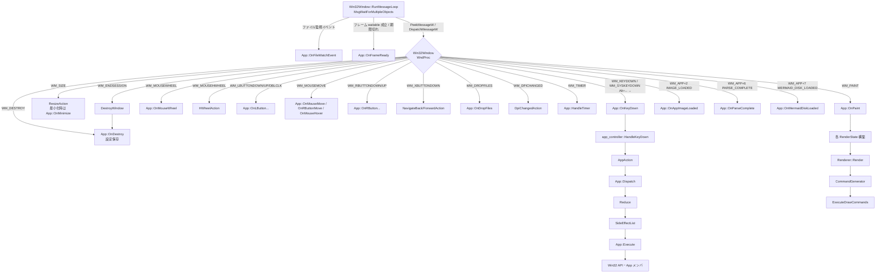

`WM_MOUSEMOVE` は `MK_LBUTTON` なら `OnMouseMove`（左ドラッグ）、`MK_RBUTTON` なら `OnRButtonMove`（ジェスチャ）、どちらでもなければ `OnMouseHover` に振り分ける。`WM_MOUSEWHEEL` は Ctrl 併用ならズーム、Shift 併用なら向きを反転して `HWheelAction`（横スクロール）にする。状態を変えるだけのメッセージ（`WM_SIZE`・`WM_ACTIVATE`・`WM_ENTERSIZEMOVE` / `WM_EXITSIZEMOVE`・`WM_CAPTURECHANGED`・`WM_MOUSELEAVE`・`WM_MOUSEHWHEEL`・`WM_XBUTTONDOWN`・検索欄の入力と選択と IME）は、`Win32Window` がアクションにして `App::Dispatch` に直接渡す。前フレームの表示待ちの間、メッセージループは `WM_PAINT` を取り出さずに入力・ポスト・送信メッセージだけを配る（3.1.1 参照）。`WM_ENDSESSION` ではログオフ・シャットダウン時に `WM_DESTROY` が来ないままプロセスが終わるため、`DestroyWindow` で終了処理（設定保存）を通す。モーダルループ中かは `WM_ENTERMENULOOP` / `WM_EXITMENULOOP`（システムメニューはアイコンのクリック・Alt+Space・キャプションの右クリックのどれでも、自前のポップアップは `PopupWindow::RunModal` が送る）から `App::OnModalLoop` が 1 つのフラグで持ち、その間は描画後のホバーの引き直し・右クリックのジェスチャー・`WM_CONTEXTMENU` の独自メニューを止める。

#### 3.2.5 キーボードショートカット

`app_controller::HandleKeyDown()` がキー入力を `AppAction` に変換する。

| キー | アクション | 備考 |
|:-----|:-----------|:-----|
| `F1` | `ShowHelpAction` | 内蔵ヘルプ表示 |
| `F3` | `SearchNextAction` | 次の検索結果 |
| `Shift+F3` | `SearchPrevAction` | 前の検索結果 |
| `F5` | `ReloadFileAction` | 再読み込み |
| `Esc` | `ClearSelectionAction` | 選択解除（検索バー表示中は検索バーを閉じる） |
| `Ctrl+O` | `OpenFileAction` | OpenFileDialog |
| `Ctrl+A` | `SelectAllAction` | 全選択 |
| `Ctrl+C` | `CopyClipboardAction` | プレーンテキストコピー |
| `Ctrl+Shift+C` | `CopyFormattedClipboardAction` | 書式付きコピー (HTML) |
| `Ctrl+F` | `OpenSearchBarAction` | 検索バー表示 |
| `Ctrl+G` | `SearchNextAction` | 次の検索結果 |
| `Ctrl+Shift+G` | `SearchPrevAction` | 前の検索結果 |
| `Ctrl+1` | `TogglePaneAction(File)` | ファイルペイン切替 |
| `Ctrl+2` | `TogglePaneAction(Toc)` | TOCペイン切替 |
| `Ctrl++` / `Ctrl+=` | `ZoomAction(In)` | ズームイン（テンキーの `+` も可） |
| `Ctrl+-` | `ZoomAction(Out)` | ズームアウト（テンキーの `-` も可） |
| `Ctrl+0` | `ZoomAction(Reset)` | ズーム100%（テンキーの `0` も可） |
| `Ctrl+ホイール` | `ZoomAction(In/Out)` | ポインタの下の領域（本文・ファイルペイン・目次ペイン）をホイール方向で増減（端数の扱いは 3.2.7） |
| `Alt+←` | `NavigateBackAction` | 戻る（`WM_SYSKEYDOWN` で届く） |
| `Alt+→` | `NavigateForwardAction` | 進む（同上） |
| `↑` / `↓` | `KeyScrollAction(LineUp/Down)` | 1行スクロール |
| `Home` / `End` | `KeyScrollAction(Home/End)` | 先頭/末尾 |
| `PageUp` / `PageDown` | `KeyScrollAction(PageUp/Down)` | 1ページ |

#### 3.2.6 マウスジェスチャ

| 操作 | 動作 | 実装 |
|:-----|:-----|:-----|
| 右ドラッグ左 | ナビゲーション戻る | `MouseGesture`（30px以上の水平移動） |
| 右ドラッグ右 | ナビゲーション進む | 同上 |
| 右クリック（移動なし） | コンテキストメニュー | `ContextMenu` |
| Xボタン戻る/進む | ナビゲーション戻る/進む | `WM_XBUTTONDOWN` |
| ダブルクリック | 単語選択 (本文の上だけ。ボタン・スクロールバー・スプリッタは 1 回目と同じ) | `OnLButtonDown`（`is_double_click`） |
| タッチパッド水平スワイプ | ナビゲーション戻る/進む | `SwipeDetector`（`WM_MOUSEHWHEEL`） |

#### 3.2.7 app_controller — イベント→アクション変換

`app_controller` はステートレスなマッパー（namespace + 自由関数）である。宣言は `app_events.h`、実装は `app_controller.cpp` に置く。必要な状態は呼び出し側が持って渡す。Win32 / D2D 依存なし、完全にテスト可能。

```cpp
struct KeyDownEvent {
    int  key;
    bool ctrl  = false;
    bool shift = false;
    bool alt   = false;
};

namespace app_controller {
    AppAction HandleKeyDown(const KeyDownEvent& event);
}
```

`KeyDownEvent` は `app_events.h` で定義されるプラットフォーム非依存の入力イベント。Win32 の `GetKeyState` 確認結果は呼び出し側でバンドルしてから渡す。縦ホイールは状態 (Ctrl+ホイールの端数) を使うので、`App::OnMouseWheel` がポインタの下の領域を添えて `MouseWheelAction` にし、reducer が扱う（3.4.2）。

---

### 3.3 AppState — アプリケーション状態の集約

#### 3.3.1 概要

`AppState` はアプリケーションの **すべての状態** を保持する単一構造体。サブグループ別にネストされる。

```cpp
struct DocumentState {
    Document    doc;
    LayoutCache layout_cache;
};

// 進行中の左ボタンドラッグ。マウスキャプチャはこれが None でない間だけ持つ (右ボタンのジェスチャーを除く)。
struct LeftDragState {
    LeftDrag kind = LeftDrag::None;  // TextSelect / Splitter / PaneScrollbar / MdScrollbar / BlockHScroll / SearchInput
    PaneTarget pane     = PaneTarget::File;  // Splitter / PaneScrollbar: 対象のサイドペイン
    float grip_offset   = 0.0f;      // スクロールバー: つまみを掴んだ位置 (つまみ上端から)
    int   block_node    = -1;        // BlockHScroll: 対象ノードと開始時の x・横スクロール量
    float start_x       = 0.0f;
    float start_scroll  = 0.0f;
    int   search_anchor = 0;         // SearchInput: 選択の起点 (キャレット位置)
};

struct ViewState {
    ViewportManager   viewport;
    PaneController    panes;
    ScrollRestoration scroll_restore;
    NavHistory        nav_history;

    // ブロック単位の横スクロール。キーは BlockHScrollGeometry::scroll_key (ノードインデックス。
    // 区切ったコードブロックは並びの先頭)。
    // 永続化しない (ファイルロード/リロードでクリア)。スクロールバー本体は
    // 「ホバー中とドラッグ中のブロック」だけ描画するので、map のサイズは
    // ユーザー操作実績分に限定される。
    std::pmr::unordered_map<int, float> block_scroll_x;
    HoverHighlights hover;             // マウス位置でのホバー強調の全体。描画はここから読む
    int             active_toc_index = -1;
    LeftDragState   drag;

    constexpr int HDragNode() const noexcept;  // 横スクロールをドラッグ中のブロック。無ければ -1
    float GetBlockScrollX(const BlockHScrollGeometry& geom) const noexcept;  // geom.scroll_key のスクロール量
    void  ResetForNewDocument();          // 別文書への切替時。サイドペインのスクロールも先頭へ戻す
};

// ViewState::hover の型 (app_events.h)。既定値はどこにもホバーしていない状態。
struct HoverHighlights {
    TitleBarHitZone  titlebar   = TitleBarHitZone::None;
    SearchBarHitZone search_bar = SearchBarHitZone::None;
    NavDirection     nav        = NavDirection::None;
    OverlayButtonHit overlay_button{};             // コピー / 保存ボタン
    int              h_block = -1;                 // 横スクロールバーを出すブロック
    std::array<int, 2>              side_index{ -1, -1 };  // PaneTarget 順 (File, Toc)
    std::array<PaneHeaderButton, 2> side_button{};
};

struct InteractionState {
    MouseGesture   gesture;
    SwipeDetector  swipe_detector;
    LastHoverPos   last_hover_pos;
    TooltipTarget  tooltip;   // 表示中か表示待ちの対象 (zone と key だけ)。文言とウィンドウ (Tooltip) は App が持つ
    int            zoom_wheel_accum = 0;   // Ctrl+ホイールの delta の端数。変えるのは reducer (MouseWheelAction) だけ
};

struct SearchGroup {
    SearchState       search_state;
    int               caret_pos = -1;
    int               selection_start = -1;
    std::pmr::wstring ime_composition;
    std::pmr::wstring query_wide;
    bool              scroll_after_search = false;
};

struct WindowState {
    TitleBar       titlebar;
    bool           is_sizing = false;
    // 移動だけのサイズ変更ループでは終了時のレイアウト処理 (SettleViewport) を省くため。
    bool           size_changed_in_sizing = false;
    bool           window_active = true;
    float          cached_dpi_scale = 1.0f;
    // 直近の WM_SIZE のクライアント領域 (物理 px)。同じ大きさの WM_SIZE を無視するために使う。
    uint32_t       client_width  = 0;
    uint32_t       client_height = 0;
};

struct AppState {
    DocumentState    document;     // ドキュメント + LayoutCache
    ViewState        view;         // ViewportManager + PaneController + ScrollRestoration + NavHistory + ホバー + 左ドラッグ + 横スクロール
    InteractionState interaction;  // MouseGesture + SwipeDetector + TooltipTarget + Ctrl+ホイールの端数
    SearchGroup      search;       // SearchState + 入力欄の表示状態 (3.21.2)
    WindowState      window;       // TitleBar + DPI

    // ThemeService 所有 Theme への非所有参照。App::Init (RestoreTheme) で設定され、
    // ダークモードとズームの切り替えは同じ Theme を書き換えるのでポインタは安定。
    // reducer が spacing_above 等を参照するのに使う。
    const Theme*     theme = nullptr;

    FileExplorer     file_explorer;
    ContextMenu      ctx_menu;

    // ペインレイアウトのキャッシュ。 `Invalidate()` で次回再計算を強制する。
    PaneLayoutCache   pane_layout_cache;
};

// AppState 関連のフリー関数
// ViewportManager::CurrentTarget の薄いラッパ (inline)
ScrollTarget SnapshotVisibleTarget(const AppState& state) noexcept;
```

履歴の積み込み（`CurrentNavEntry` / `PushCurrentNavEntry`）は reducer だけが使うので、`reducer.cpp` の無名名前空間に置く。`PushCurrentNavEntry` は `load_path` が現在と別のファイルなら、ロード失敗（`LoadFailedAction`）で取り消す仮の履歴にする。

左ボタンのドラッグ（テキスト選択・スプリッタ・各スクロールバー・ブロック横スクロール・検索入力）は種類を問わず `ViewState::drag` 1 つで表す。ドラッグ中かどうかは `drag.kind != LeftDrag::None` だけで決まり、終了時は reducer 内の `EndLeftDrag` が `drag` をクリアしてキャプチャを解放させる。ホバー状態も `ViewState::hover` 1 つにまとまっており、App がヒットテストで求めた `PointerHover`（`HoverHighlights` + ツールチップ対象）を `PointerHoverAction` で渡すと Reducer がまとめて反映する。

#### 3.3.2 サブグループ詳細

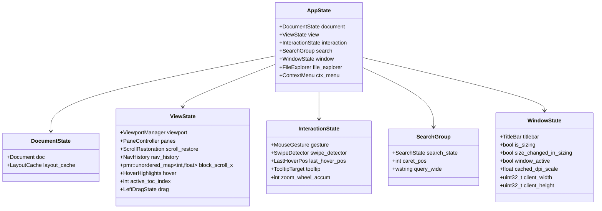

---

### 3.4 Reducer / SideEffect — 状態更新と副作用

#### 3.4.1 Reducer

```cpp
// reducer が App に計測を頼む窓口。計測 (DirectWrite) は App が持つ。
class NodeLayoutAccess {
public:
    // node_index のノードを計測済みにする (検索マッチの行の位置を引けるようにする)。見ている位置は保つ。
    virtual void EnsureNodeLayout(int node_index) = 0;
};

// Reducer: UI イベント由来の状態遷移ハブ。
// 現在の状態を in-place で変更し、実行すべき副作用のリストを返す。一覧の領域は resource から取る。
SideEffectList Reduce(AppState& state, const AppAction& action, NodeLayoutAccess& layout,
                      std::pmr::memory_resource* resource = std::pmr::get_default_resource());
```

`AppState` はデータだけを持ち、reducer が App の機能を使うのは `NodeLayoutAccess` の計測だけである（検索マッチへスクロールする前に、そのノードの行の位置を引けるようにする）。窓口は `Reduce` の引数で渡すので、渡し忘れはコンパイルで分かる。本番は App 自身（ResourceManager の窓口と同じく private 継承した受け口）が `LayoutService::EnsureNodeLayout` へ渡し、テストは計測を頼まれても何もしない `Reduce(state, action)`（`reducer_harness.h`）か、計測の結果を差し込むものを渡す。

`Reducer` は `AppState` を **in-place で変更** し、実行すべき副作用の `SideEffectList` を返す。テーマ定数は `AppState::theme`（`ThemeService` 所有 `Theme` への安定ポインタ）経由で参照する。ペインレイアウトは `AppState::pane_layout_cache`（`PaneLayoutCache`）にキャッシュされ、値が古くなったら `pane_layout_cache.Invalidate()` で次回再計算を強制する。

> **Note**: 関数型「純粋関数」スタイル（新 state を返す）ではなく in-place 更新スタイルを採用するのは、`AppState` 内部の `std::pmr::vector<Node>` や `std::pmr::deque` などの大型コンテナを毎回コピーすると性能上のオーバーヘッドが大きいためである。`SideEffectList` のみが新規 vector として生成される。

#### 3.4.2 AppAction

`AppAction` は `std::variant` で 62 種類のアクションを保持する（コマンド系、マウス・ドラッグ系、システム、タイマー、検索の 5 グループ）。ファイル変更通知・画像読み込み完了・パース完了は Reducer を通さず、`App` が直接処理する。文書の読み込みと差し替えは `App` が持ち、差し替えた後のビュー状態の後始末（番号に結び付いた一時状態・検索・ペインのスクロール・ファイル一覧・スクロールの復元）は `DocumentOpenedAction` / `DocumentReloadedAction` / `ReloadSettledAction` で reducer に任せる。

```cpp
using AppAction = std::variant<
    // コマンド系
    NoOpAction, KeyScrollAction, MouseWheelAction,
    CopyClipboardAction, CopyFormattedClipboardAction,
    SelectAllAction, SelectWordAction, ClearSelectionAction,
    TogglePaneAction, ZoomAction,
    ReloadFileAction, OpenFileAction, ToggleDarkModeAction,
    NavigateBackAction, NavigateForwardAction,
    ShowHelpAction,
    OpenSearchBarAction, CloseSearchBarAction,
    SearchNextAction, SearchPrevAction,
    // マウス・ドラッグ系
    PointerHoverAction, MouseLeaveAction,
    SplitterDragStartedAction, SplitterDragMovedAction, LeftDragEndedAction,
    SearchInputDragStartedAction, SearchInputDragMovedAction,
    MdScrollbarDragStartedAction, MdScrollbarDragMovedAction,
    PaneScrollbarDragStartedAction, PaneScrollbarDragMovedAction,
    TextSelectionStartedAction, TextSelectionMovedAction, TextSelectionEndedAction,
    RightClickGestureStartedAction, RightClickGestureMovedAction, RightClickGestureCompletedAction,
    FilePaneDirectoryClickedAction, FilePaneRevealCurrentFileAction,
    TocItemClickedAction, NavigateAnchorAction,
    DocumentOpenedAction, DocumentReloadedAction, ReloadSettledAction, LoadFailedAction, HWheelAction,
    BlockHScrollDragStartedAction, BlockHScrollDragMovedAction,
    OpenPathAction,
    InvalidateHoverAction,
    // システム
    ResizeAction, DpiChangedAction, ActivateAction,
    EnterSizeMoveAction, ExitSizeMoveAction, CaptureChangedAction,
    // タイマー
    SwipeOverlayTimeoutAction,
    // 検索
    SearchTextChangedAction, SearchContinueAction, ToggleCaseSensitiveAction, ToggleHighlightAction,
    SearchSelectionAction, ImeCompositionAction>;
```

`SplitterDragMovedAction` / `PaneScrollbarDragMovedAction` が運ぶのはマウスの `dip_x` / `dip_y` だけである。どのペインのスプリッタ・スクロールバーをドラッグ中かは `ViewState::drag`（`kind` と `pane`）、ウィンドウ幅は `WindowState::WidthDip` から Reducer が読む。ドラッグの開始は `BeginLeftDrag` が `drag` を設定して `SetCapture` を積む。

`OpenPathAction` は D&D・ファイルペインのクリック・ファイルダイアログに共通で、履歴を積んでからファイルを開く。縦ホイールは `MouseWheelAction`（生の delta・Ctrl・ポインタの下の領域・`tick`）1 つで、Ctrl ならその領域（スプリッタの上は本文）をズームし、そうでなければスクロールする。Ctrl+ホイールは高分解能ホイールやピンチが `WHEEL_DELTA` 未満の delta を連発しても `InteractionState::zoom_wheel_accum` に 1 ノッチ分たまるまでズームせず、向きが反転したら端数を捨てる。スクロールは同時に `tick` で `SwipeDetector` の軸ロックを更新する（表示中のスワイプオーバーレイは消す）。`SearchContinueAction` は時間で区切った検索を、メッセージループの空き時間に 1 回分進める。

ドラッグの終了は、テキスト選択以外は種類を問わず `LeftDragEndedAction` 1 つである。Reducer が `drag.kind` を見て後処理（スプリッタと Markdown スクロールバーなら `SettleViewport`、ブロック横スクロールなら再描画）を分け、`EndLeftDrag` で終える。テキスト選択の終了は、終点で選択を確定する `TextSelectionEndedAction` が担う。

#### 3.4.3 SideEffect — 単一variant

`SideEffect` は全 effect 型を 1 段の variant に束ねる。論理グループ（Ui / Window / Navigation / Layout / Timer）はコメント区切りで表現し、実行側（`App::Execute`）も同じ並びの単一 visitor で処理する。Effect 型は `namespace effect`（`side_effect.h`）に集約されている。

```cpp
using SideEffect = std::variant<
    // Ui
    effect::InvalidateWindow,
    effect::SetCapture, effect::ReleaseCapture,
    effect::ClipboardWrite, effect::ClipboardWriteHtml,
    effect::SetTooltip,
    effect::ShowContextMenu, effect::Beep,
    // Window
    effect::SearchFocus, effect::SearchUnfocus,
    effect::SetWindowPosition, effect::ApplyZoom, effect::ToggleDarkMode,
    effect::SettleViewport, effect::PerformSizingUpdate,
    effect::RendererResize, effect::RendererSetDpi,
    // Navigation
    effect::LoadFile, effect::ReloadFile, effect::OpenFileDialog,
    effect::CancelOtherFileLoad,
    // Layout
    effect::BitmapManage,
    // Timer
    effect::SetTimer, effect::KillTimer>;

using SideEffectList = std::pmr::vector<SideEffect>;
```

再描画要求は `effect::InvalidateWindow`（ウィンドウ全体の `InvalidateRect(hwnd, nullptr, FALSE)`）に一本化されている。タイトルバーや Markdown ペインだけを部分無効化する effect は持たない。`OnPaint` は `rcPaint` を見ずに毎回全面を描き、`FLIP_DISCARD` のスワップチェーンでは部分描画もできないため、無効化矩形を絞っても描画量は減らないからである。

`PushEffect<T>(effects, e)` は effect を `SideEffectList` に追加するヘルパーで、最初の 1 件で 4 件分を予約する。一覧の領域は `Reduce` の第 3 引数の `memory_resource` から取る（既定は既定のリソースで、テストはこちら）。`App::Dispatch` は呼び出しごとにスタックの 1KiB を `monotonic_buffer_resource` にして渡す。マウスの移動・ホイール・ドラッグは 1 イベントごとに副作用を積み、一覧の確保と解放が `Reduce` の 3〜4 割（1 イベント約 25ns）を占めていたため（`BM_ReduceEvents` の `*_stack` と比べる）。effect が持つ文字列は `std::variant` が allocator を受け継がないので既定のリソースのままで、領域より長生きしない。同じ `InvalidateWindow` が 2 回積まれることはあるが、`InvalidateRect` は冪等で、マウスの移動・ホイール・ドラッグの経路では起きない（`dup_invalidate/event` = 0）ので重複は除かない。テストで使う `HasEffect<T>(effects)` は `std::holds_alternative`、`GetEffect<T>(side_effect)` は `std::get_if` の薄いラッパである（`tests/test_helpers.h`）。

#### 3.4.4 App::Execute — 副作用の実行

`App::Dispatch` は `Reduce` が返した `SideEffectList` をそのまま `App::Execute` に渡す。`App::Execute(const SideEffect&)`（`app.cpp`）は `overloaded` の単一 `std::visit` で 1 件ずつ処理し、Win32 API もアプリ内ロジックも App のメンバから直接呼ぶ。間に抽象インターフェースは挟まない。Reducer は Win32 に依存しないので、テストは `Reduce` が返す `SideEffectList` の中身を検証する。

```cpp
void App::Dispatch(const AppAction& action)
{
    // 副作用の一覧は呼び出しごとのスタックの領域から取る (入れ子の Dispatch も自分の領域を持つ)
    alignas(std::max_align_t) std::array<std::byte, 1024> buffer;
    std::pmr::monotonic_buffer_resource arena(buffer.data(), buffer.size());
    auto effects = Reduce(state_, action, *this, &arena);   // 入口で pane_layout_cache を確定させる。計測は App (NodeLayoutAccess) に頼む
    Execute(effects);   // 各要素を Execute(const SideEffect&) へ
}
```

| グループ | effect | 実行内容 |
|:--|:--|:--|
| Ui | `InvalidateWindow` / `SetCapture` / `ReleaseCapture` | `InvalidateRect(hwnd_, nullptr, FALSE)` / `::SetCapture(hwnd_)` / `::ReleaseCapture()` |
| | `ClipboardWrite` / `ClipboardWriteHtml` | `WriteClipboardText` / `WriteClipboardHtml`（`clipboard_util.h`。CF_UNICODETEXT 用の UTF-16 変換もここで行う） |
| | `SetTooltip` | `tooltip_.SetText` で出ているものを隠して文言を差し替え、文言があれば `TOOLTIP` タイマーを張る / 空ならタイマーを止める |
| | `ShowContextMenu` | `App::OnContextMenu` |
| | `Beep` | `MessageBeep(MB_OK)`（検索の折り返し） |
| Window | `SearchFocus` / `SearchUnfocus` | `WindowHost::FocusSearchEdit` / `UnfocusSearch` をその場で呼ぶ（`Win32Window` が検索ボックスを操作する） |
| | `SetWindowPosition` | `SetWindowPos` |
| | `ApplyZoom` / `ToggleDarkMode` | `App::ApplyZoom` / `App::ToggleDarkMode` |
| | `SettleViewport` / `PerformSizingUpdate` | `App::SettleViewport` / `ClampScrollToContent` と再描画 |
| | `RendererResize` / `RendererSetDpi` | `Renderer::Resize(width, height, live)` / `Renderer::SetDpi` |
| Navigation | `LoadFile` / `ReloadFile` / `OpenFileDialog` / `CancelOtherFileLoad` | `App::LoadMarkdownFile` / `ReloadCurrentFile` / `OpenFileDialog` / `CancelOtherFileLoad` |
| Layout | `BitmapManage` | `ResourceManager::ScheduleBitmapManage` |
| Timer | `SetTimer` / `KillTimer` | `::SetTimer` / `::KillTimer`（ID は `app_timer::Id`） |

---

### 3.5 レンダーステート構築

各レンダーステート（`SidePaneState`, `TitleBarRenderState`, `SearchBarRenderState`, `GestureRenderState`）は `src/render/render_params.h` に定義される値型で、`App::OnPaint`（`src/app/app.cpp`）が毎フレーム組み立て、`RenderParams` にまとめて `Renderer::Render` に渡す。`SidePaneState` / `TitleBarRenderState` は `App::BuildSidePaneState` / `App::BuildTitleBarRenderState`、`GestureRenderState` は `ResolveGestureOverlay`（`app_state.h`）、`SearchBarRenderState` は `BuildSearchBarRenderState`（`reducer.h`）が作る。トーストの文言は `RenderParams::toast_message` にそのまま入れる。ホバー強調はどれも `ViewState::hover` から詰める。本文ペインの入力（ノード・レイアウト・選択・スクロール位置・ホバー・ブロックの横スクロール・検索マッチと現在のマッチ・検索の世代）は `MdPaneParams` にまとめて `RenderParams::md` に入れ、`Renderer` はそれをそのまま `CommandGenerator::GenerateMdPane` に渡す。ロード中は `RenderParams::loading_angle` にスピナーの角度を入れ、`Renderer::Render` が Markdown ペインの代わりにスピナーを描く。

Markdown ペインの描画コマンドは `Renderer`（具象、`renderer.cpp`）が `CommandGenerator` を直接呼んで作り（テーマ・本文の文字列の書式 `MdPaneFormats`・`TextLayoutCache` は `Init` で 1 回だけ渡し、`Renderer` が持つものを参照させる。1 回の `GenerateMdPane` の間に使う値は `FrameContext` のメンバに置く）、自由関数 `ExecuteDrawCommands`（宣言は `draw_command.h`、実装は `command_executor.cpp`）で描く。タイトルバーとサイドペインのコマンドは `Renderer::PrepareChrome` が別リスト（`chrome_cmds_`）に作る。組み立て自体は `command_generator.h` の自由関数 `chrome::EmitTitleBar` / `chrome::EmitSidePanes` が行い（重ね描きの `overlay::` と同じく HWND やデバイスなしでテストできる）、`Renderer` は書式とキャッシュを渡すだけである。

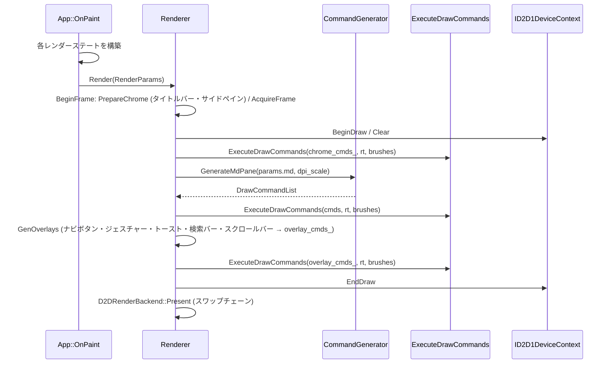

---

### 3.6 Parser — Markdownパーサ

#### 3.6.1 パイプライン

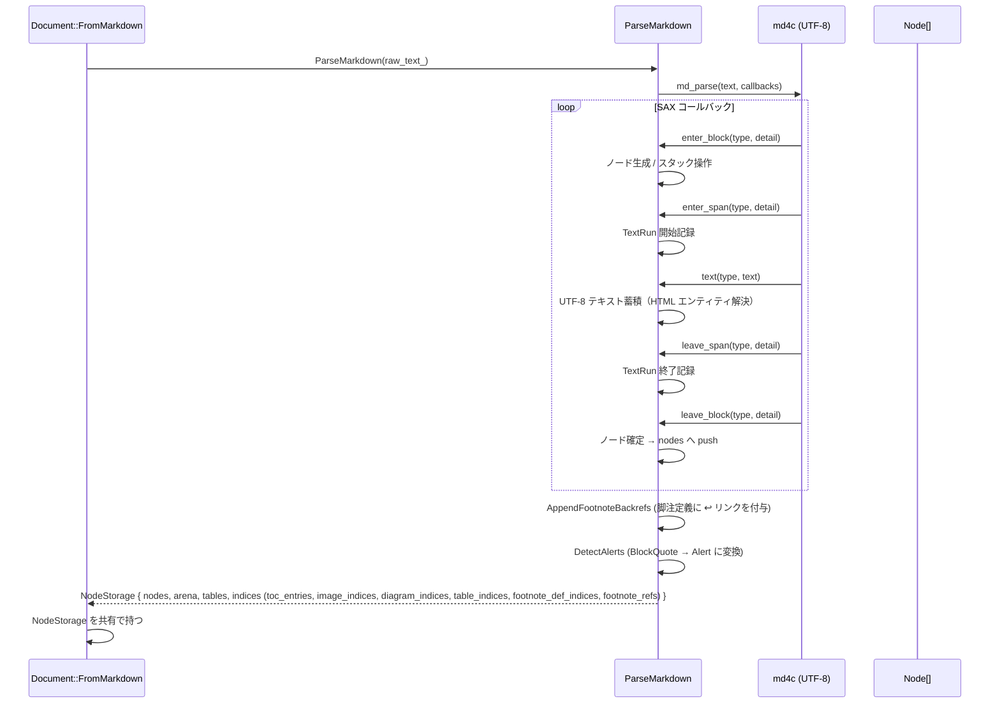

```cpp
// パース中に作る特殊ノードの索引。
struct NodeIndices {
    std::pmr::vector<TocEntry> toc_entries;    // 見出し (文書順)。そのまま目次になる
    std::pmr::vector<size_t> image_indices;
    std::pmr::vector<size_t> diagram_indices;
    std::pmr::vector<size_t> table_indices;
    std::pmr::vector<int32_t>     footnote_def_indices; // [id - 1] が脚注 id の定義ノード
    std::pmr::vector<FootnoteRef> footnote_refs;        // 脚注参照の位置 (文書順)
};

// パーサーの出力。ノードと、ノードが指すもの (テキスト・runs・リンク URL を置いた arena とテーブル) と索引。
// ノードは arena を指すので、nodes だけを取り出すときは arena ごと持ち続ける。
struct NodeStorage {
    std::pmr::vector<Node> nodes;
    TextArena arena;
    std::pmr::vector<std::unique_ptr<NodeTableData>> tables;
    NodeIndices indices;
};

NodeStorage ParseMarkdown(std::string_view markdown_text, std::stop_token stop_token = {}, TaskScheduler* scheduler = nullptr);
// ノードは入力テキストを参照するため、一時文字列 (std::string / std::pmr::string の右辺値) を渡す版は delete。
```

md4c は **UTF-8 モード** (`MD_CHAR=char`) で起動するため、入力は UTF-8 byte 列。ワーカーの `LoadFile` が UTF-8 のまま読み込んで `Document::FromNormalizedMarkdown(text, path, stop_token, scheduler)` に渡す経路と、埋め込みリソース（ヘルプ）から 2 引数版 `Document::FromMarkdown(utf8, path)` で直接渡す経路がある。ノードのテキストは原文と一致すれば原文（`raw_text_`）をそのまま指し、装飾や文字参照で一致しないものだけ `TextArena` にコピーする。リンクの `href`・画像の `src`・コードブロックの言語指定は md4c が属性として渡すので、`AttributeText` が文字参照（`&amp;` 等）を解いてから使う。

パース中のスクラッチ文字列・リンク URL の索引・リスト番号スタックなどはパーサ専用の arena / pool を持たず、既定リソース（`new_delete_resource`）から確保する。ノード配列などは `ReserveForInput` が入力サイズから容量を予約し、ノード数は `kInputBytesPerNode = 128`（実測 246〜283 byte/ノードの文書が予約内に収まる）で見積もる。予約を使い切ったら `GrowNodes` が読み終えた入力の割合から最終的なノード数を見積もって 1 回で広げる。パース後は、ノード配列の容量が要素数の 1.25 倍を超えて余っているときだけ `shrink_to_fit` で詰める。`TextArena` はチャンクを積み足すので予約しない。

#### 3.6.2 対応する Markdown 要素

##### ブロック要素

- **見出し** (`# H1` 〜 `###### H6`) — 6段階、アンカーID自動生成
- **段落** — 通常テキスト
- **コードブロック** — フェンス記法 (```), 言語指定対応
- **図** — ` ```mermaid ` / ` ```math ` のコードブロックと `$$...$$` だけの段落は `NodeType::Diagram` として図で表示
- **引用** (`>`) — ネスト対応、GitHub Alerts記法対応
- **水平線** (`---`, `***`, `___`)
- **順序付きリスト** (`1.`, `2.`, ...)
- **順序なしリスト** (`-`, `*`, `+`)
- **タスクリスト** (`- [ ]`, `- [x]`)
- **テーブル** — GFM拡張、列アライメント対応
- **脚注定義** (`[^label]: 本文`) — 文書末尾に参照順の番号付きリストとして表示

##### インライン要素

- **太字** (`**bold**`)
- **斜体** (`*italic*`)
- **取り消し線** (`~~strike~~`)
- **インラインコード** (`` `code` ``)
- **リンク** (`[text](url)`)
- **画像** (``) — 非同期読み込み
- **太字+斜体** (`***both***`)
- **脚注参照** (`[^label]`) — `[1]` 形式で脚注定義へのリンク

#### 3.6.3 アンカーID生成（GitHub互換）

```cpp
// 1. 全角英数字 → 半角英数字
// 2. 大文字 → 小文字
// 3. スペース・アンダースコア → ハイフン
// 4. 英数字・ハイフン・CJK文字以外を除去
// 5. 連続ハイフンを単一ハイフンに圧縮
// 6. 先頭・末尾のハイフンを除去
//
// 例:
// "Hello World"     → "hello-world"
// "C++ コード例"    → "c-コード例"
// "第1章: 概要"     → "第1章-概要"
```

本体が使うのは結果を呼び出し側のバッファに書く `GenerateAnchorIdInto(text, slug)`（`core/anchor.h`）だけ。新しい文字列を返す `GenerateAnchorId` はテストからしか使わないので、テスト用ヘルパー（`tests/document_test_helpers.h`）に置く。

#### 3.6.4 GitHub Alerts記法

引用ブロック先頭の `[!NOTE]` `[!TIP]` `[!IMPORTANT]` `[!WARNING]` `[!CAUTION]` を検出し、マーカーをアイコンとラベルに置き換え、`alert_type` を設定したうえで `set_alert_label_length` でラベル部分の長さを記録する（描画エフェクト適用範囲に使う）。同じ引用グループの後続ノードには `alert_type` だけを伝播する（ラベル長は 0）。`ParseMarkdown` の最後に、集めた BlockQuote ノード（`blockquote_indices`）ごとに `parser.cpp` 内部の `DetectAlertAt` が処理する。書き換えたテキストと runs は `TextArena` に置く。

#### 3.6.5 脚注

md4c の `MD_FLAG_FOOTNOTES`（v0.6.0 で `MD_DIALECT_GITHUB` に追加）を有効にし、GitHub と同じ見た目に組み立てる[^spec-admonitions]。

| md4c のコールバック | mendo での扱い |
|:--|:--|
| `MD_SPAN_FOOTNOTE_REF` | 脚注番号を `[1]` のテキストとして補い、`#user-content-fn-1` へのリンクにする |
| `MD_BLOCK_FOOTNOTE_DEF_SECTION` | 水平線ノードを置き、続く定義をリストの深さ 1 に入れる |
| `MD_BLOCK_FOOTNOTE_DEF` | 番号付きの `ListItem` ノードにする（番号 = 脚注番号） |

- 参照ごとの番号 (`ref_id`) は md4c の値を使わず自前で数える[^spec-refcount]。
- 定義の末尾には参照へ戻る `↩` リンク（2 回目以降の参照は `↩2` …）を付ける。後の定義の中の参照は前の定義を閉じた後に届くため、`AppendFootnoteBackrefs` がパース後にまとめて付ける。
- 定義ノードは文書末尾に並ぶが原文では途中にあるので、ソース位置を記録しない。ソース位置の単調増加は `FindNodeBySourceOffset` の二分探索の前提。
- 参照されない定義は表示せず、定義の無い `[^x]` はテキストのまま残す。

#### 3.6.6 長いテキストの区切り

段落・引用・コードブロック（図を除く）のテキストは、`kTextChunkTarget`（16KB、`parser.h`）前後で区切って同じ種別のノードの並びにする。DirectWrite は 1 段落の行分割が長さに対して二乗に近く遅くなり（空行の無い 4MB のテキストで 28 秒）、1 ノードのままだと並列に計測できず、見えている間は解放もできないため。区切りはパース中に、テキストを足しながら決める（装飾の範囲が区切りをまたがず、続きのノードのソース位置も原文と正確に対応する）。

- 改行（ソフト改行・`<br>`・コードの行末）が目安の `kTextChunkWindow`（2KB）手前を過ぎたら、そこで区切る。区切るのは後に本文が続くときだけで、末尾に空のノードは作らない。
- 1 行が長ければ目安の前後 2KB にある空白の直後で、空白も無ければ和文の句読点（、。，．！？）の直後で、どちらも無ければ目安の長さ（UTF-8 の文字の境目）で区切る。区切ったノードは別のレイアウトなので、行の途中で区切るとそこで改行して見える。
- コードブロックは折り返さないので、足す行がノード 1 つに収まる限り、その行の前の改行で区切る（行の頭の字下げは続きのノードへ移す）。収まらない長い行だけを行の途中で区切る。
- ソフト改行の代わりの空白は前のノードの末尾に残す。`\n` は取り除き、続きのノードに `kNewlineBeforeChunk` を立てる。
- 見出し・リスト項目・図・表は区切らない（記号や下線が増え、図は 1 つのコードから描く）。

並びは見た目もコピーも 1 つのブロックとして扱う。

| 使う側 | 扱い |
|:--|:--|
| 間隔 | `GetSpacingAbove` / `GetSpacingBelow` は継ぎ目で 0 を返す |
| コードブロックの背景 | `NodeBoxPadTop` / `NodeBoxPadBottom` は継ぎ目ではみ出さず、`GenCodeBlockBg` は継ぎ目の側の角を丸めない |
| コピーボタン | 先頭のノードにだけ置き、`ClipboardManager::CopyCodeBlock` が並び全体をコピーする |
| 横スクロール | `GetBlockHScrollGeometry` が並びの先頭を `scroll_key` として返し、幅は並びのうち計測済みの部分の最大にする |
| 構文の色分け | パーサが並びを前から字句解析し（`AnnotateCodeChunkLeads`）、続きのノードの先頭を占める前からのトークンの長さと種類を `Node::code_lead_length` / `code_lead_type` に残す。`TokenizeCodeNode` はそれを先頭に置き、その後ろからトークン化する（ブロックコメントや文字列が何ノードにまたがっても色が崩れない）。区間に分けて worker で並列に解析し、区間の境目をトークンがまたいだ所だけ順に解析し直す |
| 検索 | 改行を挟まない継ぎ目をまたぐマッチは前のノードに置き、続きのノードへはみ出す長さを `SearchMatch::next_length_w` に持つ。ハイライトは両方のノードに描く |
| 語の選択 | `FindNodeWordBoundaries` が、改行を挟まない継ぎ目で切れた語を並びの続く限り隣のノードへ伸ばす |
| コピー | `ExtractSelectedText` は継ぎ目に元の改行だけを戻し、`ExtractSelectedTextAsHtml` は並びを 1 つの `<p>` / `<pre>` にまとめる |

[^spec-admonitions]: 同じく追加された `MD_FLAG_ADMONITIONS` は使わない。ネストした引用でも Alert として扱うなど、`DetectAlerts`（GitHub 準拠）と挙動が違うため。
[^spec-refcount]: md4c はテーブル行の判定でもインラインを解析するため、表の中の参照が二重に数えられ、`ref_id` / `ref_count` が実際の参照数とずれる。

---

### 3.7 LayoutEngine / LayoutService — テキスト計測

#### 3.7.1 概要

`LayoutEngine` は `ITextMeasurer` インターフェース経由で各ノードを計測し、`LayoutCache` に格納する。`LayoutService` が `LayoutEngine` と `ViewportManager` を結合し、スクロール target 管理付きのレイアウト操作を提供する。

```cpp
// 計測とライフサイクルを 1 つのインターフェースにまとめる (src/layout/layout.h)。
// 計測は const で、複数の worker から同じインスタンスを呼んでよい。
// lifecycle 系 (RecreateFormats / SetTheme / SetScheduler) は UI スレッドからのみ呼ぶ。
class ITextMeasurer {
public:
    virtual ~ITextMeasurer() = default;

    virtual bool RecreateFormats() = 0;
    // 計測に使うテーマ。ズームや色の切り替えは同じ Theme を書き換えるので、渡すのは 1 回でよい。
    void SetTheme(const Theme& theme) noexcept;
    const Theme& GetTheme() const noexcept;
    // 並列計測 (ノード単位 / 巨大テーブルのセル単位) に使う scheduler。nullptr なら直列。
    // scheduler の Shutdown より前に nullptr へ戻す契約。
    void SetScheduler(TaskScheduler* scheduler) noexcept;
    TaskScheduler* Scheduler() const noexcept;

    // 並列計測では worker ごとに別ノード・別 entry を渡す。
    // ビットマップを描くノード (IsBitmapDrawNode) は渡さない。
    virtual void MeasureNode(const Node& node, NodeLayoutEntry& entry, float max_width,
                             YRange viewport) const = 0;
    // 幅不変のまま行単位 evict されたテーブルの、viewport 内の evict 行だけセルを再生成する。
    virtual TableRestoreResult RestoreEvictedTableRows(const Node& node, NodeLayoutEntry& entry,
                                                       float max_width, YRange viewport) const;
};

// 計測結果を entry に確定させ、測れたかを返す。画像・図ノードは BitmapNodeHeight で高さを決める。
bool MeasureEntry(const ITextMeasurer& measurer, const Node& node, NodeLayoutEntry& entry,
                  float node_width, YRange viewport, float entry_top,
                  const DiagramEntry* bitmap, const Theme& theme);

class LayoutEngine {
public:
    static constexpr float kWidthChangeThreshold = 2.0f;

    // theme は measurer に渡し、以後は measurer が持つものを使う。scheduler と書式の作り直しは measurer に直接頼む。
    bool Init(ITextMeasurer* measurer, const Theme& theme);

    // 本文幅かズームが推定時から変わって全ノードを dirty にしたら true。
    bool Reestimate(const std::pmr::vector<Node>& nodes, LayoutCache& cache, float viewport_width);
    bool EnsureVisibleLayout(const std::pmr::vector<Node>& nodes, LayoutCache& cache, float viewport_width,
                             float viewport_top, float viewport_bottom);
    bool ProcessDirtyBatch(const std::pmr::vector<Node>& nodes, LayoutCache& cache,
                           float viewport_width, LayoutDeadline deadline, YRange range);
};

class LayoutService {
public:
    LayoutService(LayoutEngine& engine, ViewportManager& viewport) noexcept;

    void ViewportLayout(const Document& doc, LayoutCache& cache, float width, float height);
    // 可視範囲の上下 height * buffer_screens まで。height が 0 でも全域にはしない。
    bool ProcessDirtyBatch(const Document& doc, LayoutCache& cache, float width, LayoutDeadline deadline,
                           float height, float buffer_screens);
    bool EnsureVisibleLayout(const Document& doc, LayoutCache& cache, float width, float height);
    // 画面外の node も計測する。
    bool EnsureNodeLayout(const Document& doc, LayoutCache& cache, float width, int node);
    void RecomputeAfterDiagram(const Document& doc, LayoutCache& cache, layout::HeightChangeRange changed) noexcept;
};
```

本番実装は `DWriteTextMeasurer`（DirectWrite を使用）。書式は `SetFactory` の後に `RecreateFormats` で作る。計測に使うテーマと scheduler は `ITextMeasurer` が 1 か所で持ち、`LayoutEngine` はそれを読む（テーマは `LayoutEngine::Init`、scheduler は `ITextMeasurer::SetScheduler` で渡す）。テーマは `ThemeService` が持つ今のテーマで、ズームと色の切り替えは同じ場所を書き換えるので渡し直さない。テスト時はモックに差し替えられる。`RecreateFormats` を呼んだスレッド（UI スレッド）は共有ファクトリで、それ以外の計測ワーカーはスレッドごとの ISOLATED ファクトリと書式（`thread_local`、`RecreateFormats` の世代番号が変わったら作り直す）で測る。共有ファクトリを全スレッドで使うと、ファクトリ内部の競合で 4 本を超えると遅くなるため（`test.md` x8 の全計測で、共有は 8 本 705ms・16 本 1480ms、分けると 410ms・260ms）。`RecomputeYPositions` / `EstimateNodeHeight` / `EstimateNodeHeights` / `MakeEstimatedLayoutCache` などのフリー関数（`layout_computer.h` の `layout` 名前空間）で Y 座標再計算と高さ推定（DirectWrite 計測前の暫定値）を提供する。リロードでは `CarryOverUnchanged` が、先頭・末尾から中身の一致する範囲（`FindUnchangedEnds` の結果。非同期リロードでは worker が数えて渡す）の計測結果を、旧キャッシュから区間ごとに引き継ぐ（`LayoutCache::TakeEntries`）。グローバル名前空間への `using` エイリアスは置かず、使う側の .cpp が必要な名前だけを `using layout::X;` で取り込む。

計測用の scheduler は Mermaid 等の共有 scheduler とは別に立て、ワーカー数は `LayoutWorkerCount`（コア数 − 1 を 2〜8 本に収める。16 本はさらに速いがファクトリの分だけ commit が約 11% 増える）で決める。`App::Init` は scheduler を渡した後に `DWriteTextMeasurer::WarmUp` で、各ワーカーにファクトリと書式を作らせ、本文・コード・見出し 1 つの書式の小さなレイアウトを作って捨てる。最初の計測がフォントの読み込みとフォールバックの解決を待たないようにするためで、作り終えたワーカーは全員がそろうまで待ち、1 本に 1 つずつ行き渡らせる。

幅が変わったときに既存の text_layout を作り直さずに済む経路は 2 つある。改行でしか折れておらず最も長い行が新しい幅に収まるノードは、組み直しても行が同じなので幅を付け替えない（`SetMaxWidth` の後の `GetMetrics` は作り直しとほぼ同じだけかかる。リサイズ時の計測し直しが `test.md` で 174ms → 143ms、README で 6.0ms → 3.1ms）。それ以外は `SetMaxWidth` で組み直す（作り直しより 1〜16% 速いだけだが、装飾の付け直しが要らない）。

計測後の確定処理は `MeasureEntry` 1 か所にまとめている。実測値を `cached_width` / `cached_height` に残し、計測失敗回数 `measure_failures` を 0 に戻す。例外で測れなかったときも、書式やレイアウトを作れず測れなかった（`MeasureNode` が nullopt）ときも、`NodeLayoutEntry::RecordMeasureFailure` が失敗を数え、`kMaxMeasureAttempts` 回で dirty を外して諦める（描画のたびに同じノードを測り直して失敗し続けない）。ビットマップを描くノード（画像・図、`IsBitmapDrawNode`）は `ITextMeasurer` に渡さず、`layout::BitmapNodeHeight` が `DiagramEntry` の寸法から表示高さを決める（寸法が届くまでは現在値、それも無ければプレースホルダーの高さ）。

推定に使った本文幅とズームは `LayoutCache::EstimateBasis` に残る。本文幅が `kWidthChangeThreshold`（2 DIP）を超えて変わるかズームが変わると、`Reestimate` が全ノードを dirty にして推定値で Y を組み直す（DirectWrite は呼ばない）。ズームでは `LayoutCache::InvalidateAllLayouts` が全レイアウトを捨てて `EstimateBasis` を空に戻すので、次の `Reestimate` が必ず推定し直す。ワーカーが表示と同じ幅で推定したキャッシュは UI スレッドで推定し直さない（幅を知らない起動時の先読みだけ推定し直す）。`LayoutService::ViewportLayout` は `Reestimate` の後に `ViewportManager::ApplyScrollTarget` で見ていた位置を当て直してから可視範囲を計測する。ズームや幅変更で推定し直すと Y がずれるため、古い `scroll_y` のまま計測すると見えない範囲を 1 画面分ムダに計測してしまう。幅が変わったときは、残っている表の行（上下 8 画面分）が全部組み直しになるので、計測の前に画面外の行を捨て（`EvictInvisibleTableRows`）、見えたときに作らせる（2 万行 6 列の表の中で幅を変えたときの可視範囲のレイアウトが 3.7ms → 0.55ms）。

ダーティノードの計測は `LayoutEngine::MeasurePass`（private）に一本化されている。`MeasurePass` は範囲内の dirty を集めて `layout::MeasureIndicesParallel`（`layout.cpp`）で期限（`LayoutDeadline`）まで計測し、幅不変のまま行単位で evict されたテーブルは `RestoreEvictedTableRows` で戻し、高さが変わった区間だけ `RecomputeYPositions` で組み直す。`ProcessDirtyBatch` は `YRange`（可視範囲 ± `buffer_screens` 画面、`layout::BufferedRange`）内の dirty を期限まで計測する 1 回の `MeasurePass` である。期限は各ワーカーが次のノードを取る前に見て、過ぎていたら手を付けずに dirty のまま残す。ただし 1 ノード目は期限を過ぎていても計測するので、呼び出しごとに必ず進む。`EnsureVisibleLayout` は計測で高さが変わると範囲に入るノードも変わるため、範囲内の dirty が無くなるまで `MeasurePass` を繰り返す（失敗し続けるノードに備えて最大 8 回）。`MeasureIndicesParallel` は `ParallelFor` に 1 ノード単位で配り、1 画面分（数十ノード）の dirty でも全 worker に行き渡らせる。scheduler が null なら同じ関数が呼び出しスレッドで直列に計測する。例外はノード単位で捕まえ、失敗回数が `LayoutCache::kMaxMeasureAttempts` に達したノードは dirty を下ろして諦める。CodeBlock のトークン化と、リンク色・アラートラベル色の描画効果（`BrushEffect`）・インラインコード背景の付与は worker が担当ノードの `NodeLayoutEntry` へ直接書き込み、UI スレッドでの集約は行わない（`Tokenize` 完了後に代入するので、例外時に途中のトークンが残らない）。Y の範囲は文書座標・エントリのローカル座標とも `YRange`（`layout_cache.h`）で表し、「全部」（`YRange::All()`）と「空」（`YRange::None()`）を名前で書き分けて既定値は持たせない。`ProcessDirtyBatch` の `range` を省くと可視範囲で絞らず全 dirty を対象にする。可視範囲の上下に何画面か足した範囲は、計測・evict・図の要求とも `layout::BufferedRange` で作る。

計測待ちの dirty が残っているかは `LayoutCache::HasDirtyNodes` が持ち、キャッシュと一緒に動く。`Reestimate` / `EnsureVisibleLayout` / `ProcessDirtyBatch` が更新し、`EnsureVisibleLayout` は走査しない範囲外に dirty が残っていると保守的に仮定する。

遅延レイアウト（`App::OnDeferredLayout`）はメッセージループの空き時間（`App::RunIdleWork`）に、4ms の期限で `ProcessDirtyBatch` を 1 回呼んで進める。件数で細かく区切ると、区切るたびに走査・Y の組み直し・ワーカーの待ち合わせが挟まるためである（`test.md` x4 の全計測で、32 件ずつだと一度に測る 165ms が 290ms になった）。`ResourceManager::EVICT_BUFFER_SCREENS`（2 画面）を `buffer_screens` に渡すため、画面外の計測は前後 2 画面までに限られる。範囲外へジャンプした場合は `EnsureVisibleLayout` が同期計測で拾う。

#### 3.7.2 レイアウト計算フロー

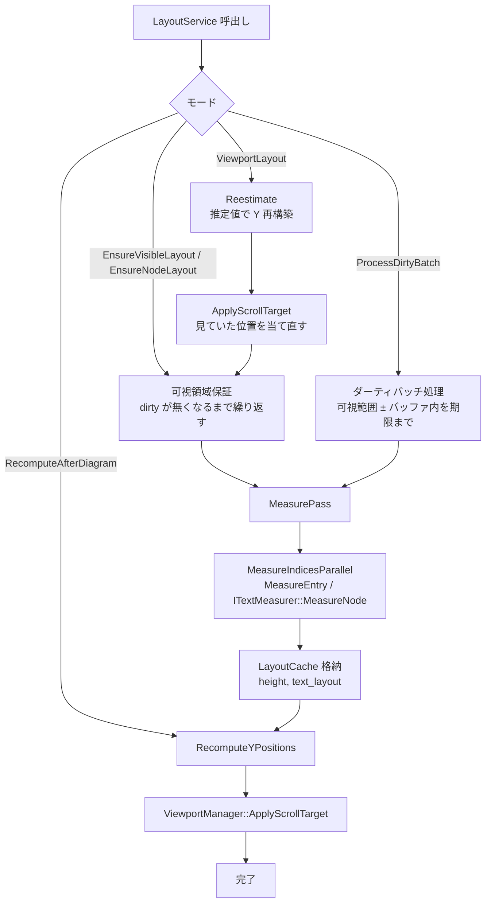

#### 3.7.3 テキストフォーマット

| 用途 | フォントファミリ | 既定サイズ (DIP) |
|:-----|:----------------|:-----------------|
| H1 | Segoe UI | 32 |
| H2 | Segoe UI | 26 |
| H3 | Segoe UI | 22 |
| H4 | Segoe UI | 18 |
| H5 | Segoe UI | 16 |
| H6 | Segoe UI | 14 |
| 本文 | Segoe UI | 16 |
| コード | Cascadia Mono → Consolas → Courier New | 14 |
| アイコン | Segoe Fluent Icons → Segoe MDL2 Assets | 用途ごとに異なる |

コードとアイコンのフォントは `theme_palette.h` の候補リスト（`kMonospaceFontCandidates` / `kIconFontCandidates`）で決まる。起動時に `ThemeService::Init` が先頭から実在するものを選び（テーマ間で共通なので 1 回だけ。ダークモードとズームの切り替えでは引き継ぐ）、どれも無ければ末尾を使う。HTML コピーのコードブロックの `font-family` も同じリストからコンパイル時に組み立てる。

本文は GitHub (Windows) と同じく英数字を Segoe UI で組み、Segoe UI に無い漢字・かな・全角記号は DirectWrite のシステムフォールバックに任せる。フォールバック先は書式のロケール `i18n::TextLocale()` で決まり、OS の表示言語が中国語・韓国語でなければ `ja-jp`（Yu Gothic UI）、簡体字なら `zh-cn`（Microsoft YaHei UI）、繁体字なら `zh-tw` / `zh-hk`（Microsoft JhengHei UI）、韓国語なら `ko-kr`（Malgun Gothic）になる。描画先は不透明なので `D2D1_ALPHA_MODE_IGNORE` で作り、文字は ClearType で描く。

> **Note**: 本文側のフォントサイズと余白はズーム倍率 (`Theme::zoom`) で乗算される。サイドペイン（ファイル一覧・目次）の項目はペインごとの倍率で別に拡大する（3.9.3）。窓枠（タイトルバー）・サイドペインのヘッダー・検索バーは固定サイズである。

---

### 3.8 Renderer — Direct2D 描画

#### 3.8.1 Command パターン

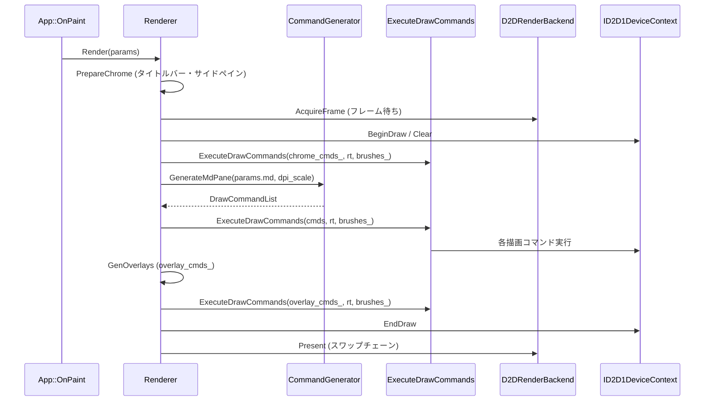

#### 3.8.2 DrawCommand 型

```cpp
using DrawCommand = std::variant<
    FillRectCmd,
    FillRoundedRectCmd,   // opacity あり
    DrawRoundedRectCmd,   // 枠線 (検索欄のフォーカス枠)
    DrawLineCmd,
    DrawTextLayoutCmd,    // opacity あり
    DrawBitmapCmd,
    FillEllipseCmd,       // opacity あり (スピナーの点)
    DrawEllipseCmd,
    DrawGeometryCmd,      // 一筆描きの線 (ジェスチャーの軌跡)、opacity あり
    PushClipCmd,
    PopClipCmd,
    SetTransformCmd
>;

using DrawCommandList = std::pmr::vector<DrawCommand>;

using FixedBrushArray = std::array<Microsoft::WRL::ComPtr<ID2D1SolidColorBrush>, std::to_underlying(BrushId::Count)>;

// 該当ブラシが未作成のコマンドは描かない。rt は null にしない (実装は command_executor.cpp)。
void ExecuteDrawCommands(const DrawCommandList& cmds, ID2D1RenderTarget* rt, const FixedBrushArray& brushes);
```

`DrawCommandList` は `DrawCommand` variant の単一 `std::pmr::vector` である。毎フレーム構築して 1 回読むだけのリストなので、型別ベクタや発行順テーブルは持たない。`CommandGenerator` は毎フレーム `cmds_` を clear して容量を使い回し、自由関数 `ExecuteDrawCommands` は先頭から `std::visit` で順に実行する。

各コマンドは値型で、`IDWriteTextLayout*` や `ID2D1Bitmap*` などのポインタは **非所有**（ライフタイムは `LayoutCache` / `TextLayoutCache` / `Renderer` が管理）。色はすべて `BrushId`（`brush_id.h`）で固定ブラシを指し、`Renderer` が保持する `FixedBrushArray` を `ExecuteDrawCommands` が配列ルックアップで引く。半透明は `opacity` で掛ける。アラートの背景も固定ブラシ（`AlertNoteBg` 〜 `AlertCautionBg`）、オーバーレイボタンは白黒の固定ブラシ（`OverlayBrushId`）に不透明度を掛けて描くので、コマンドが任意の色を持つことはない。ブラシが未作成のコマンドは描かない。

`DrawTextLayoutCmd` はすべて `ID2D1RenderTarget::DrawTextLayout` ではなく、自前の `IDWriteTextRenderer`（`VisibleRunRenderer`）を渡した `IDWriteTextLayout::Draw` で描く。テキストレイアウトに付く描画効果は計測ワーカーが `SetDrawingEffect` で付けた `BrushEffect`（リンク色・アラートラベル色）で、デバイスに依存しない印なので、デバイスを作り直しても付け直さずに済む。描画時に `BrushEffect::IdOf` で固定ブラシへ置き換える。

レイアウトが可視範囲より高い場合（巨大なコードブロックなど）、`CommandGenerator` がコマンドに可視の縦範囲（`cull_top` / `cull_bottom`、クリップ範囲と同じ）を載せ、`VisibleRunRenderer` は範囲外のグリフラン・下線・取り消し線を飛ばす（D2D の `DrawTextLayout` は画面外も含め全ランを処理し、1 万行のコードブロックで 1 フレーム約 20ms かかる）。低いレイアウトでは範囲を既定の無限のままにする。

コードブロックの構文色も描画時に付ける。`DrawTextLayoutCmd::syntax_tokens`（同じ `NodeLayoutEntry` が持つ UTF-16 位置のトークン、非所有）があれば、`VisibleRunRenderer` はグリフランを `clusterMap` でトークン境界に分け、種別ごとの固定ブラシ（`SyntaxKeyword` 〜 `SyntaxDeleted`）で描く。右から左のランも分割し、境界がクラスタ（合字等）の途中にあればそのクラスタは後ろのトークンの色になる。`SetDrawingEffect` は 1 回ごとに既存の範囲数に比例して重くなり、巨大なコードブロックで O(n²) になるため構文色には使わない。トークンは計測ワーカーが text_layout と一緒に作り、トークン間の空白だけの隙間は直前のトークンに含めて同種をまとめ、グリフランの分割を減らしておく。

#### 3.8.3 D2DRenderBackend

D3D11 デバイス + DXGI フリップモデルのスワップチェーン上の `ID2D1DeviceContext`、D2D / DirectWrite / WIC ファクトリ、DPI を保持する（`src/render/d2d_render_backend.h`）。抽象インターフェースは持たず、`Renderer` がメンバとして持つ。ブラシとテキストフォーマットは `Renderer` 側で管理する。ヘッダは D3D11 / DXGI / D2D 1.1 / WIC の型を前方宣言だけで持ち（デストラクタと型変換の要る取得関数は .cpp）、`d3d11.h` / `dxgi1_2.h` / `d2d1_1.h` / `wincodec.h` は `d2d_render_backend.cpp` と、デバイスコンテキストを直接使う `renderer.cpp` / `renderer_resources.cpp` だけが読む。`renderer.h` を通して `app.h` を読む翻訳単位（`app*.cpp`・`window.cpp`）へ D3D11 のヘッダを広げないため。

```cpp
class D2DRenderBackend final {
public:
    // デバイスとスワップチェーンは作らない (CreateDevice で作る)。
    bool Init(HWND hwnd);
    bool CreateDevice();
    void Resize(UINT width, UINT height, bool live = false) noexcept;
    void SetDpi(float dpi) noexcept;
    float GetDpi() const noexcept;
    D2D1_SIZE_F GetSize() const noexcept;

    void AcquireFrame() noexcept;
    static constexpr DWORD kFrameWaitTimeoutMs = 1000;
    HANDLE FrameWaitHandle() const noexcept;
    void MarkFrameAcquired() noexcept;
    void Present() noexcept;
    void Trim() noexcept;
    bool IsDeviceLost() const noexcept;

    ID2D1Factory* GetD2DFactory() const noexcept;
    ID2D1DeviceContext* GetRenderTarget() const noexcept;
    IDWriteFactory* GetDWriteFactory() const noexcept;
    IWICImagingFactory* GetWICFactory() const noexcept;
};
```

- **デバイス作成**: D3D デバイスの作成（数十 ms）は `PrefetchD3DDevice` で wWinMain の冒頭から起動処理と重ね、`Renderer::CreateDevice` → `D2DRenderBackend::CreateDevice` で受け取る。作り直しに失敗している間はロスト扱いのままにする。
- **フレーム待ち**: Frame Latency Waitable Object のシグナルで次のフレームを描いてよいかを判断する。メッセージループが `FrameWaitHandle` を待って `MarkFrameAcquired` で記録し、取れていなければ `Renderer::BeginFrame` から `AcquireFrame` が最大 `kFrameWaitTimeoutMs`（1 秒）待つ。取れたら Present するまで取れた扱いのままにし、表示されなかったフレームの後で待ち直さない。
- **リサイズ**: ライブリサイズ中（`live`）は `ResizeBuffers` をせず、モニタ全体の大きさのバッファを使い回して表示範囲（source size）だけを変える。
- **デバイスロスト**: `Present` が `DXGI_ERROR_DEVICE_REMOVED` / `RESET` / `HUNG` / `DRIVER_INTERNAL_ERROR` を返すと `IsDeviceLost` が true になり、`Renderer` が次フレーム冒頭の `HandleDeviceLost` で作り直す。
- **最小化**: `Trim` で D2D の内部キャッシュとドライバ側の一時確保を手放す（`Renderer::TrimForMinimize`）。

#### 3.8.4 Renderer ファイル構成

| ファイル | 担当 |
|:---------|:-----|
| `renderer.cpp` | フレームの開始・終了（`BeginFrame` / `EndFrame`）とデバイスロスト復旧、Markdown ペイン描画統括、タイトルバーとサイドペインのコマンド（`PrepareChrome` が `chrome::` を呼ぶ）、本文に重ねるコマンドの組み立て（`GenOverlays`、ジェスチャーの軌跡） |
| `renderer_resources.cpp` | 固定ブラシ・ペイン用フォーマット管理、アプリアイコン |

#### 3.8.5 描画順（`Renderer::Render`）

1. 背景クリア
2. カスタムタイトルバー・ファイルペイン / TOCペイン・スプリッタ（`PrepareChrome` が `chrome_cmds_` に積み、`ExecuteDrawCommands` で実行）
3. Markdownコンテンツ（`GenerateMdPane` → `ExecuteDrawCommands`）
   - 引用ブロックのバー・背景（`GenBlockQuoteGroupDecorations`、グループ単位でノードより先に描く）
   - 以下、ノードごとに文書順（`GenerateNode`）
   - コードブロック背景 → テキスト（構文色は描画時に付ける）→ コピーボタン
   - テーブル（行背景・グリッド線・セル）
   - 水平線 / 見出し下線 / リスト記号 / タスクチェックボックス
   - 画像・Mermaidダイアグラムビットマップ → 保存 / コピーボタン
   - テキストを持つノードはインラインコード背景 → 検索ハイライト → テキスト選択ハイライト → テキストの順
   - テーブル・コードブロックの横スクロールバー（ホバー中・ドラッグ中のブロックのみ）
4. 以下は `GenOverlays` が本文の後に実行する別リスト（`overlay_cmds_`）に積む
5. ナビゲーションボタン（戻る/進むオーバーレイ、`overlay::EmitNavButtons`）
6. マウスジェスチャトレイル（`GenGestureTrail`、`DrawGeometryCmd`）
7. スワイプオーバーレイ（`overlay::EmitGestureOverlay`）
8. トースト通知（`overlay::EmitToast`）
9. 検索バー（下部ドッキング、`overlay::EmitSearchBar`）
10. Markdownペインのスクロールバーのつまみ（`VScrollThumb`。サイドペインのつまみも同じ関数で作る）

オーバーレイボタン（コピー / 保存）はホバーの有無にかかわらず描き、ホバー中だけ濃くする。矩形は `layout::ForEachOverlayButton` が列挙し、描画とヒットテストで同じ矩形を使う。

読み込み中（`RenderParams::loading_angle` がある）は 3 の代わりに 5 のスピナー（`overlay::EmitLoadingSpinner`）を積み、7・8（ジェスチャオーバーレイ・トースト）だけを重ねる。コンテキストメニューはこのシーケンスとは別経路で描画される。

`Renderer` はすべてをコマンドにして `ExecuteDrawCommands` で描き、レンダーターゲットへ直接描くのは `BeginDraw` / `Clear` / `EndDraw` だけである。半透明は各コマンドの `opacity`、未作成のブラシは executor がまとめて扱う。スピナー・ナビボタン・ジェスチャー・トースト・検索バーの組み立ては `command_generator.h` の `overlay` 名前空間の関数に、スクロールバーのつまみは `VScrollThumb` にあり、デバイス無しでテストできる。検索欄の文字列は `SearchInputLayout`（`command_generator.h`。DirectWrite のファクトリと書式だけを使い、デバイスに依存しない）がレイアウトを作って選択範囲とキャレットの位置を測り、その結果（`SearchInputMetrics`）を `overlay::EmitSearchBar` に渡す。入力欄のクリックとドラッグの文字位置も同じクラスの `HitTest` が求める。ジェスチャーの軌跡は D2D のジオメトリを作るので `Renderer` に残る。タイトルバーとサイドペインはデバイスに依存しないコマンド列なので、デバイスの作成前に `PrepareChrome` を呼んで最初のフレームの文字レイアウトを先に作れる（`App::CreateRenderDevice`）。

描画コストを抑えるためのキャッシュ:

- **サイドペインの項目テキスト**: 可視項目は数十個なのでオフスクリーンに溜めず毎フレームコマンドに積む。左寄せ NO_WRAP の項目名・見出しはレイアウト幅を固定して `TextLayoutCache` に載せ、はみ出しはクリップで切るため、スプリッタのドラッグ中もレイアウトを作り直さない。
- **短い文字列**: `DrawText` は呼び出しごとに内部でテキストレイアウトを作るため使わない。アイコン・リスト番号・プレースホルダ・タイトル・ナビボタン・ジェスチャー・トースト・検索バーのラベルや件数は、(書式, 文字列, 箱の大きさ) ごとに `TextLayoutCache`（`text_layouts_`、`CommandGenerator` と共有）に作り置き、文字列と書式が同じ間は使い回す。中央に置くものは中央揃え書式のレイアウトを幅/高さ 0 で作って矩形中心に置き（`TextLayoutCache::EmitCentered`）、固定サイズの箱が必要なものは箱サイズで作って左上に置く（`TextLayoutCache::Emit`）。`Renderer`、`CommandGenerator::EmitText`、`overlay` の関数がこれで積む。項目数が `kMaxEntries`（512）を超えたら `BeginFrame` で直前のフレームに使わなかったものを捨てる。言語の切り替えで書式を全部作り直す `RecreateAllTextFormats` はまとめて破棄する。ズームでは大きさがズームに従う書式（本文とジェスチャー）だけを作り直し、キャッシュは残す（キーが書式を参照で持つので、古い書式のレイアウトを引くことはなく、上限で捨てられる）。タイトルバーやサイドペインのレイアウトを作り直さずに済む（80 個ほどで約 2.7ms）。
- **検索入力欄**: IME の合成中テキストを挿入した表示テキストと幅が前フレームと同じ間は `SearchInputLayout` のレイアウトを使い回す。ドラッグ選択中のヒットテストも、文字列と幅が同じならこのレイアウトを引く。

---

### 3.9 Theme — テーマシステム

#### 3.9.1 テーマ構造

```cpp
struct Theme {
    // 固定ブラシ (BrushId) ごとの色。半透明の重ね色や固定色も含め、テーマを作るときに全部決める。
    std::array<D2D1_COLOR_F, BRUSH_COUNT> colors{};
    // テーマを作るときに決める (背景の明るさからは推さない)。
    bool dark = false;
    constexpr const D2D1_COLOR_F& Color(BrushId id) const noexcept;

    // フォント
    std::wstring font_family;     // "Segoe UI"
    std::wstring monospace_font;  // kMonospaceFontCandidates から解決した名前
    std::wstring icon_font;       // kIconFontCandidates から解決した名前

    // フォントサイズ (DIP)
    float font_size_body;
    float font_size_h[6];
    float font_size_code;

    // スペーシング
    float margin_left, margin_right, margin_top, margin_bottom;
    float paragraph_spacing, list_item_spacing;
    float heading_spacing_above;
    float heading_spacing_below;       // h3〜h6 の下マージン
    float heading_spacing_below_h1h2;  // h1/h2 の下マージン (下線+次行余白を確保)
    float code_block_spacing_above, code_block_padding;
    float indent_width, blockquote_bar_width;
    float list_bullet_offset, list_bullet_radius, hr_thickness, h2_underline_thickness;

    // ペインレイアウト（本文のズームの対象外。一覧の項目はペインごとの倍率を掛けて使う）
    float pane_item_height;
    float pane_header_height;
    float splitter_width;
    float pane_font_size;

    // ズーム (1.0 = 100%)
    float zoom = 1.0f;

    constexpr float ContentWidth(float viewport_width) const noexcept;
    float GetHeadingSize(int level) const noexcept;
    constexpr float GetHeadingUnderlineThickness(int level) const noexcept;
    void ApplyZoom(float new_zoom) noexcept;
};
```

色は描画の固定ブラシと同じ添字の `colors` 1 つに持つ。`BuildLightTheme` / `BuildDarkTheme` が `dark` を決め、背景（`BrushId::Background`、`Clear` に使う）・本文・見出し・コード・アラート（`AlertBrushIdFromIndex` / `AlertBgBrushIdFromIndex` の連番）・シンタックス（`SyntaxTokenType` の Keyword 以降と同じ順に並べ、`SyntaxBrushId` が差で引く）・タイトルバー・ペイン・検索の色に加えて、両テーマ共通の固定色（選択・閉じるボタンの赤・オーバーレイの白黒・ジェスチャーの背景と軌跡）と、`dark` で決まる重ね色（表のストライプ・スクロールバーのつまみ）もここで入れる。`Renderer::RecreateBrushes` は `colors` を添字順に 1 回なめてブラシに写すだけ。ポップアップ（コンテキストメニュー・設定ダイアログ）も `Color(BrushId::Text)` などから自前のブラシを作る。

Reducer は `AppState::theme`（`ThemeService` 所有 `Theme` への非所有ポインタ）経由で寸法を直接参照する。

#### 3.9.2 ThemeService — テーマ管理サービス

```cpp
class ThemeService {
public:
    explicit ThemeService(ConfigService& config) noexcept;
    constexpr bool IsDarkMode() const noexcept;
    // 今のテーマ。描画・計測・ポップアップ・reducer はこれを参照で持つ (アドレスは変わらない)。
    constexpr const Theme& GetTheme() const noexcept;
    // 起動時の先読みの推定用。今のライト/ダークのベーステーマに zoom を掛ける。フォントは候補の先頭のまま。
    Theme CreateTheme(ZoomLevel zoom) const;
    // 今のテーマを作り、フォントを実在する候補に決める。
    void Init(bool dark, ZoomLevel zoom);
    bool ToggleDarkMode();          // 色だけが変わる (ライトとダークの違いは色だけ)
    void ApplyZoom(ZoomLevel zoom); // 寸法だけが変わる
    void SaveDarkMode();
    bool LoadDarkMode() const;
    void SaveZoomLevel(ZoomLevel zoom);
    ZoomLevel LoadZoomLevel() const;
};
```

今のテーマは `ThemeService` が 1 つだけ持ち、`Renderer`（`const Theme*`）・`DWriteTextMeasurer` / `LayoutEngine`・`AppState::theme`・ポップアップ（`PopupEnv::theme`）はそれを参照する。切り替えは同じ場所を書き換え、ベーステーマから作り直すので倍率の累積誤差は溜まらない。起動時は `App::Init` が `LoadDarkMode` / `LoadZoomLevel` の値で `ThemeService::Init` を呼び、テーマを作ってフォントを決めてから `Renderer::Init(hwnd, theme)` に渡す。書式とブラシは 1 回の生成で済み、ライトテーマで作ってから作り直す二重生成を避ける。フォントの解決は DirectWrite の共有ファクトリだけを使い、D3D デバイスを待つより前に済む。

ライト/ダークの切替はフォントと寸法が共通なので色だけの変更として扱う。`ThemeService::ToggleDarkMode` の後の `Renderer::OnThemeColorsChanged` は書式やテキストレイアウトを作り直さず、固定ブラシの色を `SetColor` で差し替えるだけである（ズーム変更は `ThemeService::ApplyZoom` の後に計測側の `RecreateFormats` と `Renderer::OnThemeMetricsChanged` で書式を作り直す。描画側が作り直すのは本文とジェスチャーの書式だけ）。テキストレイアウトに付けた描画効果はブラシ ID の印（`BrushEffect`）なので付け直しも要らない。Reducer 側（`ReduceToggleDarkMode`）もテキストレイアウトと描画エフェクトを維持し、テーマ色を焼き込んだ Mermaid ビットマップだけを `LayoutCache::InvalidateDiagramBitmaps` で破棄する。

#### 3.9.3 ズームシステム

17段階の離散的なズームレベル（`ui_types.h::ZOOM_STEPS`）。段は `ZoomLevel` が持ち、本文（`ViewportManager`）・ファイルペイン・目次ペイン（`PaneController`）がそれぞれ 1 つずつ持つ。

| インデックス | 倍率 | インデックス | 倍率 |
|:------------|:------|:------------|:------|
| 0 | 0.25x | 9 | 1.25x |
| 1 | 0.33x | 10 | 1.50x |
| 2 | 0.50x | 11 | 1.75x |
| 3 | 0.67x | 12 | 2.00x |
| 4 | 0.75x | 13 | 2.50x |
| 5 | 0.80x | 14 | 3.00x |
| 6 | 0.90x | 15 | 4.00x |
| 7 | **1.00x** (default) | 16 | 5.00x |
| 8 | 1.10x | | |

`ZOOM_DEFAULT_INDEX = 7`、`ZOOM_STEP_COUNT = 17`。

ズーム変更では `ReduceZoom` が可視先頭のノードとノード内オフセット（ズーム比でスケール）を scroll target に置いて全ノードのレイアウトを無効化し、`ThemeService::ApplyZoom` が zoom=1.0 の基準テーマから倍率を掛けて今のテーマを作り直し（累積適用による誤差を避ける）、`App::ApplyZoom` が計測と描画の書式を作り直す。続く `App::RelayoutViewport(RelayoutResources::Diagrams)` の `LayoutService::ViewportLayout` が推定し直した Y で見ていた位置を当て直してから可視範囲を計測する（3.7.1）。

本文のズームは Markdown 本文だけに掛かる。`Theme::ApplyZoom` は本文のフォントサイズと余白のみを倍し、サイドペインの `pane_item_height` / `pane_header_height` / `splitter_width` / `pane_font_size` は据え置く。ペイン幅もズーム倍率でスケールせず、`ReduceZoom` は `pane_layout_cache` を無効化しない。保存するペイン幅はズームを含まない DIP 値である。

サイドペインはペインごとの倍率で一覧の項目（行の高さ `SidePaneItemHeight`・文字・アイコン・目次の字下げ）だけを拡大する。ヘッダーとペイン幅は変えない。`ZoomAction::pane` があれば `ReduceSidePaneZoom` がそのペインの段を動かし、先頭に見えていた項目が残るようスクロール位置を倍率の比で動かす。本文は組み直さない。Renderer はペインごとの一覧の書式（`pane_list_fmt_`）を描画時の倍率で作り直す。`TextLayoutCache` はキーで書式を参照して持つので、書式を作り直してもキャッシュを捨てる必要はない（解放したアドレスが新しい書式に使い回されない）。図の保存・コピーのボタンは、ポインタが画像の矩形の上にあるとき（`hit_test::DiagramImageHitTest`）だけ出す。Ctrl+ホイールはポインタの下の領域を、右クリックメニューの「ズーム」の行（ブラウザのメニューと同じ − / 倍率 / + / 元に戻す）は右クリックした領域をズームする。ズームの行のボタンはメニューを閉じず、`ContextMenuParams::on_zoom` で `ZoomAction` を流す。メニューと設定ダイアログのモーダルループは本体のメッセージループ（`ModalLoop`、`Win32Window` が実装）で回すので、開いている間も本体の描画・タイマー・通知・ファイル監視・空き時間の仕事が進む（保存すれば裏で読み直される）。倍率の表示と押せるかは開いている間に変わるので、`ZoomLevel` から都度求める。

---

### 3.10 Syntax — シンタックスハイライト

#### 3.10.1 対応言語

```mermaid
graph LR
    subgraph 対応言語
        CPP[C / C++]
        PY[Python]
        JS[JavaScript]
        TS[TypeScript]
        GO[Go]
        RS[Rust]
        BASH[Bash]
        PS[PowerShell]
        CMD[Cmd]
        JSON[JSON / JSONC / JSON5]
        JVM[Java / Kotlin]
        CS[C#]
        SW[Swift]
        PHP[PHP]
        RB[Ruby]
        SQL[SQL]
        CONF[YAML / TOML / INI]
        WEB[HTML / XML / CSS / SCSS]
        DIFF[diff]
        BUILD[Dockerfile / Makefile]
        ZIG[Zig]
        HS[Haskell]
        LISP[Clojure / Emacs Lisp / Common Lisp / Scheme・Racket]
        LUA[Lua]
        VIM[Vim script / Vim9 script]
        MER[Mermaid]
    end

    subgraph トークンタイプ
        KW[Keyword]
        TY[Type]
        ST[String]
        NU[Number]
        CM[Comment]
        PP[Preprocessor]
        FN[Function]
        IN[Inserted]
        DE[Deleted]
    end

    CPP --> KW & TY & ST & NU & CM & PP & FN
    PY --> KW & TY & ST & NU & CM
    JS --> KW & TY & ST & NU & CM & FN
    TS --> KW & TY & ST & NU & CM & FN
    GO --> KW & TY & ST & NU & CM & FN
    RS --> KW & TY & ST & NU & CM & FN
    BASH --> KW & ST & NU & CM
    PS --> KW & TY & ST & NU & CM
    CMD --> KW & ST & CM
    JSON --> KW & ST & NU
    JVM --> KW & TY & ST & NU & CM & FN
    CS --> KW & TY & ST & NU & CM & PP & FN
    SW --> KW & TY & ST & NU & CM & PP & FN
    PHP --> KW & TY & ST & NU & CM & FN
    RB --> KW & TY & ST & NU & CM & FN
    SQL --> KW & TY & ST & NU & CM & FN
    CONF --> KW & TY & ST & NU & CM & PP
    WEB --> KW & TY & ST & NU & CM & PP & FN
    DIFF --> KW & TY & CM & IN & DE
    BUILD --> KW & TY & ST & NU & CM & FN
    ZIG --> KW & TY & ST & NU & CM & FN
    HS --> KW & TY & ST & NU & CM & PP & FN
    LISP --> KW & TY & ST & NU & CM & PP & FN
    LUA --> KW & TY & ST & NU & CM & FN
    VIM --> KW & TY & ST & NU & CM & PP & FN
```

`SyntaxTokenType` には `Plain` も定義されているが、トークナイザは `Plain` トークンを出力しない。描画も HTML 化もトークン間の隙間を既定色のテキストとして扱うため、出力しても同じ結果になるうえトークン数の大半を占めるだけだからである。トークンは計測で text_layout を作るときに一緒に作り、UTF-16 位置に直し、空白だけの隙間を直前のトークンに含めて隣り合う同種をまとめてから `NodeLayoutEntry` に置き、画面外で layout を捨てるときに一緒に捨てる。描画は `VisibleRunRenderer`（`command_executor.cpp`）がグリフランをトークン境界で分けて種別の色で描く（3.8.2）。書式付きコピーは表示の有無に関係なくその場でトークン化する。

C++ の生文字列 `R"delim(...)delim"` は、`R"` の直後から規格どおり最大 16 文字・空白/括弧/`\` を含まない区切りの範囲だけ `(` を探す。上限なしに探すと `(` の無い `R"` が続く文書で末尾までの走査を繰り返し、O(n²) になるためである。

JSON 系は ` ```json ` / ` ```jsonc ` / ` ```json5 ` の言語タグで認識される。`true` / `false` / `null` をキーワードとしてハイライトする。

Java / C# / Kotlin / Swift / PHP / Ruby / SQL は C++ 等と同じ汎用 lexer (`TokenizeRange<LexerConfig>`) に設定フラグを足して扱う。C# の逐語的文字列 `@"..."`、SQL の `--` コメント、PHP 8 の属性 `#[...]` と `$` 付きの変数名（`$class` をキーワードにしない）、Ruby の `=begin` / `=end` がそのためのフラグである。トリプルクォート文字列は `TripleQuote` で、`\` をエスケープにする形（Python / Java / Swift）、しない形（Kotlin の raw string）、開きと同じ数以上の `"` で閉じる形（C# 11 の raw string literal）を読み分ける。数値リテラルは `'` に加えて `_` も桁区切りとして受け付ける。

YAML / TOML / INI / HTML / XML / CSS / SCSS / diff / Dockerfile / Makefile は、キーと値・タグと属性・セレクタと宣言・行頭の記号といった行や宣言の構造で色が決まるため専用 lexer を持つ。設定ファイル系の値はスカラー全体で数値・定数を判定し、`1.2.3` や `node:18-alpine` の一部だけを数値として色付けしない。埋め込み言語は汎用 lexer を範囲指定で呼んで色付けする（HTML の `<script>` / `<style>` を JS / CSS、Dockerfile の命令引数と Makefile のレシピ行をシェル）。diff の追加行・削除行には専用のトークン種別 `Inserted` / `Deleted` を使う。ハンク内では `-- ` を消した行も `--- ` で始まるので、`--- ` `+++ ` `@@` の 3 行が並ぶときだけ次のファイルのヘッダとみなす。YAML のブロックスカラー（`|` / `>`）の本文は、行内で最後に現れた `-` かキーの桁より深い行とする。TOML の `'''` は `\` をエスケープにしない。

Zig は汎用 lexer に `\\` の行文字列と `@import` 等の組み込み関数のフラグを足して扱う。Haskell は専用 lexer で、`'` を識別子の一部 (`foldl'`)・文字リテラル・型レベルの昇格 (`'True`) に読み分け、記号と隣り合う `--` は演算子として扱う。大文字始まりの識別子を型・コンストラクタ、行頭の小文字始まりを定義名とする。Lisp 系 4 方言は 1 つの lexer を方言ごとのキーワード表と字句フラグ（大文字小文字の区別、`?a` / `\a` の文字リテラル、`cond` の節）で使い分ける。`-` や `?` を含むシンボルを 1 語として読み、リスト先頭の呼び出し位置を Function、特殊形式を Keyword にする。定義名（`defun foo` の `foo`）は Function とし、引数リストと `let` の束縛リストは呼び出しと見ない。

Lua は汎用 lexer に長括弧（`[[ ]]` / `[==[ ]==]` の文字列と `--[[ ]]` のコメント）のフラグを足して扱う。Vim script は専用 lexer で、行頭と `|` の後をコマンド位置として読み、コマンド名（省略形を含む）を Keyword、`g:` / `s:` / `a:` 等のスコープ付き変数と `&option` / `$ENV` / `@r` を Type、`<CR>` 等のキー表記を Preprocessor にする。`"` は行頭ならコメント、式の中では同じ行に閉じの `"` があれば文字列、無ければ行末コメントとみなす。マッピングコマンドの引数はキー列なのでキー表記だけを色付けし、`lua << EOF` の本文は Lua として、`let x =<< END` の本文は文字列として色付けする。`<<` はコマンド（`let` は代入の `=`）の直後に来たときだけ本文の始まりとみなし、行の途中のシフト演算子や文字列中の `<<` では始めない。先頭のコマンドが `vim9script` の文書（と ` ```vim9 `）は Vim9 script として `#` をコメント、`"` を文字列とする。

キーワードリストは `syntax_keywords.h` に集約され、長さでバケット分けしたソート済み配列（`BucketedTable<N>`）で持つ。判定は `word.size()` で該当バケットへ直接ジャンプし、バケット内を `std::ranges::binary_search` で二分探索する。なお `SyntaxLanguage` には図形言語として `Mermaid` に加え `LatexMath`（数式、トークン化対象外）もある。`LatexMath` になるのは ` ```math ` コードブロックと、`$$...$$` だけの段落である。どちらの言語のブロックもパーサが `NodeType::Diagram` のノードにする。

---

### 3.11 ファイルI/O — LoadFile / FileWatcher / AsyncLoadCoordinator

#### 3.11.1 ファイル読み込み

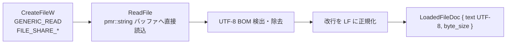

```cpp
enum class FileLoadError : uint8_t {
    NotFound,    // ファイルが見つからない、またはアクセス拒否
    TooLarge,    // ファイルサイズが上限 (async_load_coordinator.cpp の MAX_FILE_SIZE、~2GB-1) を超過
    ReadFailed,  // 読み込み中の I/O エラー
};

struct LoadedFileDoc {
    std::pmr::string text;           // UTF-8 (BOM 除去・LF 正規化済み)
    size_t           byte_size = 0;  // BOM 込みのファイルバイト数
};

// ワーカーだけが呼ぶ自由関数 (async_load_coordinator.h)。stop_token は差し替え口の型に合わせて受けるだけ。
std::expected<LoadedFileDoc, FileLoadError>
    LoadFile(const std::pmr::wstring& path, const std::stop_token& stop_token);
```

- 共有モード: `FILE_SHARE_READ | FILE_SHARE_WRITE | FILE_SHARE_DELETE`
- 他プロセスが編集中でも読み取り可能
- `ReadFile` で `std::pmr::string` バッファへ直接読み込み、UTF-16 変換は行わず **UTF-8 のまま** 返す（md4c も UTF-8 モードで動くため変換不要）
- 改行は LF に正規化して返す。`Document` とリロード差分はこの出力が LF のみであることを前提にする
- 上限は ~2GB-1（md4c が `int` を取るため、`INT_MAX` 超は `TooLarge` として弾く）
- ファイル選択ダイアログは `FileDialogService`（`src/io/file_dialog_service.h`）に分離されている

#### 3.11.2 FileWatcher — ファイル変更監視

`ReadDirectoryChangesW` による非同期ディレクトリ監視。対象ファイルの親ディレクトリを監視し、ファイル名一致（大小無視。通知が 8.3 短縮名で来る場合に備えて短縮名とも照合）で変更を検出する。

```cpp
class FileWatcher {
public:
    using ChangeCallback = std::move_only_function<void()>;

    void StartWatching(const std::pmr::wstring& file_path, ChangeCallback callback);
    void StopWatching() noexcept;
    void CheckForChanges();
    void ResumeWatching();
    // paused 中に溜めた通知を捨てる。読み直しを始める直前に呼ぶ。
    constexpr void DiscardPendingChange() noexcept;
    // 通知済みの変更を読まずに取りやめたときに呼び、次の ResumeWatching で通知し直させる。
    constexpr void RequeueIfPaused() noexcept;
    constexpr HANDLE GetEventHandle() const noexcept;  // read_pending 中のみ非nullptr
};
```

`MsgWaitForMultipleObjects` で `EventHandle` を監視し、変化時は `App::OnFileWatchEvent` が `FileWatcher::CheckForChanges` を直接呼ぶ（Reducer は通さない）。変更を検出したコールバックはデバウンスタイマーを張り直し、タイマー満了でリロードする。

通知を出すと `ResumeWatching` まで paused になり、その間の通知は 1 件に溜めて Resume 時に通知し直す。リロードを始める直前に `DiscardPendingChange` で溜めた通知を捨てる（これから読む内容に含まれるため）。別ファイルのロード中でリロードを見送ったときや、別ファイルを開き始めて進行中のリロードを取り消したときは `RequeueIfPaused` で積み直し、そのロードが取り消し・失敗で終わったときの `ResumeWatching` で読み直させる。

| 定数 | 値 | 用途 |
|:-----|:---|:-----|
| `FILE_RELOAD_DEBOUNCE_MS` | 200ms | ファイル変更通知のデバウンス |
| `FILE_RELOAD_RETRY_MS` | 50ms | truncate→rewrite 検出後の短縮リトライ |

ReadDirectoryChangesW の通知バッファは 64KB 確保（バッファ溢れで通知喪失を防ぐため）。

#### 3.11.3 AsyncLoadCoordinator — 非同期ロード制御

```cpp
// ワーカースレッドでのパース結果。cache は doc 向けに EstimateNodeHeights 済み。
struct AsyncLoadResult {
    Document    doc;
    LayoutCache cache;
    // 同一ファイルのリロードで、worker がパース前に差分判定まで済ませた結果。
    // 旧文書のノードと比べて変わらなかった先頭と末尾のノード数 (ends) も worker で数えて持つ。
    std::optional<ReloadCheck> reload;
    // 読み終えた後もファイルが伸びている (エディタの書き込み途中)。worker が結果を出す直前に確かめる。
    bool still_growing = false;
};

// 同一ファイルのリロードで worker に渡す旧文書。text はパース前の差分判定、nodes はパース後の比較に使う。
struct ReloadBase {
    std::shared_ptr<const std::pmr::string> text;
    std::weak_ptr<const NodeStorage> nodes;
};

// 非同期ロード 1 回分の結果。成功時は AsyncLoadResult、失敗時はその理由。
using AsyncLoadOutcome = std::expected<AsyncLoadResult, FileLoadError>;

// App が直接持つ (load_coordinator_)。全 public API は UI スレッドから呼ぶ。
class AsyncLoadCoordinator {
public:
    bool IsActive() const noexcept;
    const std::pmr::wstring& LoadingPath() const noexcept;  // IsActive の間だけ意味を持つ

    // 進行中の読み込み (preload を含む) の stop_source に request_stop してから新しく始める。
    void Start(TaskScheduler& scheduler, std::pmr::wstring path, Theme theme,
               float content_width = 0.0f, ReloadBase reload_base = {});

    enum class AttachResult { None, AppliedSync, AttachedAsync };
    AttachResult Attach(HWND hwnd, UINT msg_id);  // 通知先を渡す。以後の Start の結果もここへ送る

    std::optional<AsyncLoadOutcome> Take() noexcept;
    void Cancel() noexcept;
};
```

ファイルの読み込みとパースは大きさによらず（ヘルプを除いて）ワーカーで行い、UI スレッドはファイルに触れない（ネットワーク上のファイルで止まらない）。スピナーの状態（`spinner_shown_` / `spinner_angle_`）は `App` が持つ。スピナーは、読み込みが `LOADING_SPINNER_DELAY_MS`（150ms）より長引いたときだけ出す（`App::ScheduleLoadingAnimation` が `LOADING_ANIM` タイマーを遅延付きで張り、最初の発火でスピナーを始める）。すぐ終わる読み込みでちらつかせないためである。読み込みのタスクは `TaskScheduler::PostFront` で、画像のデコードや図の読み込みの待ちより先に実行させる（リロードは旧文書の表示を続けるので、それらの待ちを捨てられない）。

非同期ロードはワーカースレッドで Document を構築し、推定高さまで埋めた `LayoutCache` を返す。同一ファイルのリロードでは、パース後に旧文書のノード（`Document::ShareNodes` の弱参照）と比べ、変わらなかった先頭と末尾のノード数（`UnchangedEnds`）も worker で数える（100MB で約 20ms を UI スレッドから外す）。パース中に UI が旧文書を手放していれば数えず、`App::ReloadDocument` が数え直す。ワーカーは自分の `stop_token` の確認と mutex 保護の `outcome_` への書き込みだけを行う。`Start` と `Cancel` は必ず旧 `stop_source` に `request_stop` するので、停止を要求された token を持つ worker が古い worker であり、`Publish` は lock 内で stop を確かめてから書く。成功と失敗は `AsyncLoadOutcome`（`std::expected`）1 つで運ぶので、結果とエラーが両方入っている状態や、片方だけ取り残される状態は起きない。UI スレッドは `App::OnParseComplete` で `Take` を 1 回呼んで受け取る。

起動時の読み込みは、ウィンドウを作る前に `App::StartPreloadAsync` が通知先なしで `Start` する。ウィンドウ作成後の `App::LoadInitialDocument` が `Attach` で通知先を渡し、結果がもう出ていれば `AppliedSync` を返してその場で `OnParseComplete` を呼び（直後の同期 `WM_PAINT` で初回フレームが空にならないように）、まだなら `AttachedAsync` で完了時に `PARSE_COMPLETE` を送らせる。読み込んでいなければ `None` でヘルプを表示する。

#### 3.11.4 対応ファイル形式

| フィルタ名 | 拡張子 |
|:----------|:-------|
| Markdown Files | `*.md`, `*.markdown`, `*.mkd`, `*.txt` |
| All Files | `*.*` |

---

### 3.12 MermaidRenderer / MermaidFileCache

#### 3.12.1 アーキテクチャ

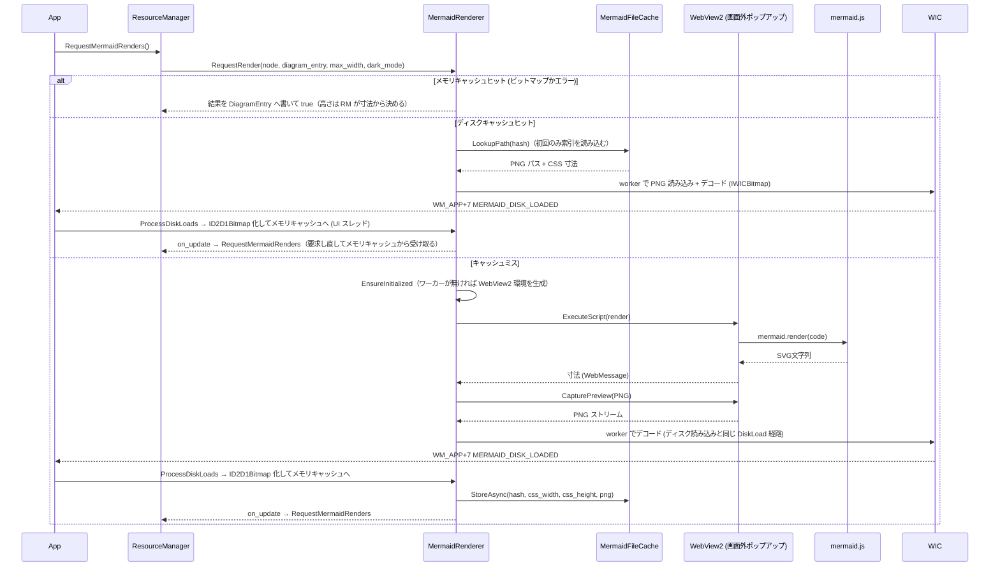

#### 3.12.2 IMermaidRenderer インターフェース

```cpp
class IMermaidRenderer {
public:
    // svg 非空: 成功 / 空かつ cancelled=false: レンダリング失敗 / 空かつ cancelled=true: 終了時に破棄
    using SvgCallback = std::move_only_function<void(std::pmr::wstring svg, bool cancelled)>;

    virtual ~IMermaidRenderer() = default;

    // 結果 (ビットマップかエラー) が出ていれば diagram_entry に書いて true。まだなら描画を始めて false
    // (始めていれば何もしない)。結果が出たら初期化時に渡した通知で知らせ、呼び出し側が要求し直す。
    // 要求と結果はコードのハッシュで引くので、ノードや diagram_entry を持ち続けない。
    virtual bool RequestRender(const Node& node, DiagramEntry& diagram_entry,
                               float max_width, bool dark_mode) = 0;
    // SVG をクリップボード用に取得する。PNG レンダリングと同じワーカー枠を共有する。code は UTF-8。
    virtual void RequestSvg(std::string_view code, float max_width, bool dark_mode,
                            SvgCallback callback) = 0;
    // 描画待ちの表示用要求と、ディスクキャッシュの読み込み待ちを捨てる (描画中と SVG 要求は維持)。捨てた図は再要求される。
    virtual void DropQueued() {}
};
```

`ResourceManager` は描画タイマー（`MERMAID_BATCH`）・`FlushPendingResources`・結果の通知（`on_update` から `RequestMermaidRenders`）から、再レイアウトしない `RequestVisibleDiagrams` で可視範囲 → 下 → 上の順に図を走査し、1 図ずつ `RequestDiagramRender` で要求する。その場で結果が出た図の高さは `height_changed_` に溜め、呼び出し側が再レイアウトを 1 回にまとめる（`RequestMermaidRenders` は直後に、`FlushPendingResources` は画像の適用とあわせて）。大きく移動したとき・幅やテーマが変わったとき・文書を切り替えたときは `DropQueued` で不要になった描画待ちを捨てる。

要求と結果のキーは、ノードのテキストと言語で決まる `DiagramCodeHash` に量子化幅とテーマを混ぜた `DiagramRequestHash`（`NodeDiagramHash` と同じ値で、ディスクキャッシュのキーにもなる）。mermaid は既定で `useMaxWidth` なので、幅の上限より狭く描けた図（`IsWidthFree`）はどの幅でも同じ結果になる。その結果は幅を混ぜない `DiagramWidthFreeHash` で持ち、メモリ（`FindCached`）でもディスク（`MermaidFileCache::LookupDiagram`）でも先に引いて、いまの幅の上限より狭いときだけ使う。ウィンドウやペインの幅を変えて開き直しても、描き直すのは幅に縛られる図（gantt など）とエラーだけになる。コード部分は `DiagramEntry::code_hash` に覚え、幅・テーマの変更で結果を捨てても残すので、要求し直すたびにテキストを読み直さない。結果はビットマップかエラーの `CachedResult` 1 型で、`TranspositionCache`（`MAX_CACHE_ENTRIES` = 128 件、`MAX_CACHE_BYTES` = 64MB）1 つに持つ。同じコードは同じ結果になるので、失敗も成功と同じく覚えて描き直さない。待ち・読み込み中・描画中の要求は `inflight_`（ハッシュの集合）で重複を弾く。要求はコードを UTF-8 のまま持ち、UTF-16 への変換と LaTeX の flowchart への包みは `RenderInWorker` で描く直前に行う。

`mendo_core` には `IMermaidRenderer` 抽象のみが入り、WebView2 を呼び出す具象 `MermaidRenderer` は `mendo` 実行ファイル側に分離されている。`MermaidRenderer` は最大 2 ワーカー（`MAX_WORKERS`、独立した WebView2 インスタンス）を並行稼働させ、PNG/SVG を同時にレンダリングできる。ワーカーは最初 1 つだけ起動し、全ワーカーが描画中で待ちが溜まったときに `MaybeGrowWorkers` で増やす。

PNG のデコードは UI スレッドで行わない。ディスクキャッシュから読む場合も、WebView2 の `CapturePreview` で描画した直後の PNG も同じ `DiskLoad` 経路に流し、バックグラウンド `TaskScheduler` でファイル読み込み（キャプチャ時は不要）と WIC デコードを済ませた `IWICBitmap` を作る。完了は `app_msg::MERMAID_DISK_LOADED` で通知され、UI スレッドの `ProcessDiskLoads` が `CreateBitmapFromWicBitmap` で `ID2D1Bitmap` 化してメモリキャッシュに入れ、結果が出たものがあれば `on_update_` をまとめて 1 回呼ぶ。1 回の転送は `kUploadSliceBudget`（4ms）までで、残した分は `HasLeftoverDiskLoads` が真になり、メッセージループの空き時間（`App::RunIdleWork`）で続ける。キャプチャ由来の PNG はこのときディスクキャッシュへ `StoreAsync` される。ディスクから読めなかった・デコードできなかった図は WebView2 での描画に回し、キャプチャ直後の PNG がデコードできなければエラーとして確定させる。ディスクキャッシュの読み込みは `DropQueued` / `CancelPending` で世代（`disk_drop_gen_`）を進めて取り消す（ImageLoader の `drop_gen_` と同じ）。worker は世代が変わっていれば読まずに返し、UI は要求中の印だけを外す。描画直後の PNG はディスクへ保存したいので取り消さない。

WebView2 の環境は `--disable-gpu` を付けて作る（`CoreWebView2EnvironmentOptions::put_AdditionalBrowserArguments`）。図は SVG 1 枚をオフスクリーンで描いて写すだけなので GPU で描く利点が無く、GPU プロセスが GPU ドライバを読み込んで D3D11 デバイスを作るコストと、キャプチャのときの GPU からの読み戻しだけが残るためである。シーケンス図 1 つで mendo + WebView2 の commit が 262MB → 171MB（GPU プロセスだけで 118MB → 22MB）、描き終わるまでも 1〜2 割縮む。写した図と数式は GPU ありと同じ。

描画要求が無いまま `IDLE_SHUTDOWN_MS`（60 秒）経つと、`app_timer::Id::MERMAID_IDLE` → `App::HandleTimer` → `OnIdleTimer` で全ワーカーと WebView2 環境（browser / renderer / GPU プロセス）をまとめて閉じ、準備完了の印 (`ready_`) も戻す。待ちキューが空になるたび（`ProcessQueue` 末尾）にタイマーを張り直し、待ちや描画中のワーカーが残っていれば閉じるのを見送る。次の描画要求で `EnsureInitialized` から作り直し、準備完了の通知（`on_update_`）は再初期化のたびに呼ばれて未描画の図を再要求させる。

#### 3.12.3 MermaidFileCache — 永続キャッシュ

```cpp
class MermaidFileCache {
public:
    struct CacheEntry {
        float css_width  = 0.0f;
        float css_height = 0.0f;
    };

    // 索引の読み込みは初回利用まで遅らせる (ディスクに触れない)。
    void Init(float current_dpr, TaskScheduler& scheduler);
    // 以降の参照・保存のキーに混ぜる DPR を差し替える。別の DPR のエントリは LRU で淘汰させる。
    void SetDpr(float dpr) noexcept;
    // PNG のパスと寸法を返し LRU を更新する。読み込みは呼び出し側 (worker) が行う。
    bool LookupPath(uint64_t key, CacheEntry& entry, std::filesystem::path& png_path);
    // ファイルが確実に存在しない場合のみ索引から除く。
    void OnReadFailed(uint64_t key, DWORD read_error);
    bool LookupDimensions(uint64_t key, CacheEntry& entry);
    // png_data は表示側 (メモリキャッシュ / DiagramEntry) と共有し、書き込み用にコピーしない。
    // PngBytes は utility.h の std::shared_ptr<const std::pmr::vector<uint8_t>>。
    void StoreAsync(uint64_t key, float css_width, float css_height, PngBytes png_data);
    void SaveIndex();   // 索引に変更が無ければ書かない
    void SetCacheDir(const std::filesystem::path& dir);
    void SetLimits(size_t max_entries, uint64_t max_total_size);
    void Shutdown();

    // 索引が未読み込みならここで読み込むため非 const。
    size_t   EntryCount();
    uint64_t TotalSize();

private:
    static constexpr uint32_t MAGIC   = 0x4D454D43u;  // "MEMC"
    static constexpr uint32_t VERSION = 1;
    static constexpr size_t   DEFAULT_MAX_ENTRIES    = 4096;
    static constexpr uint64_t DEFAULT_MAX_TOTAL_SIZE = 1ULL * 1024 * 1024 * 1024; // 1GB
};
```

外部キーは内部で DPR 量子化値（1/100 単位、典型値 100/125/150/175/200）に定数 `0x9E3779B97F4A7C15` を乗じた値と XOR して内部キーに変換し、DPR ごとに独立したエントリとして保存する。これにより DPI 変更/モニタ切替時に全消去を発生させない。DPR は `Init` 時には画面外のワーカー位置のモニタから推定し（`MermaidRenderer::EstimateWorkerDpr`）、ワーカーの準備完了で実際に描く DPR が届いたら `SetDpr` で差し替える。書き込みは `TaskScheduler` のワーカースレッドで非同期実行される。`pending_writes_`（書き込み中のキー → 書き込み中に追い出されたか）で同じキーの 2 本目の書き込みを出さず、書き込み中に追い出されたエントリの PNG は着地後にワーカーが消すので、索引に無いファイルは残らない。書き込み中のキーは読み込みに失敗しても `OnReadFailed` で索引から除かない。

索引（`index.bin`）は `Init` では読まず、`LookupPath` / `LookupDimensions` / `StoreAsync` などの初回利用時に、唯一の入口 `Index()` で読み込む。図を含まない文書の起動ではディスクに触れない。索引・合計サイズ・LRU シーケンス・変更フラグは `IndexState` にまとめ、`std::optional<IndexState>`（未読み込みは `nullopt`）で持つ。変更系の操作（`Add` / `Remove` / `Touch`）は `IndexState` 自身が `dirty` を立てる。索引本体は `std::pmr::unordered_map<uint64_t, IndexEntry>` 1 本で、各エントリが `last_used`（単調増加シーケンス）を持つ。追い出しは満杯時にしか起きないため、LRU 順の補助構造は持たず `last_used` の線形走査で最古を探す。終了時の `SaveIndex` は未読み込み（`nullopt`）か変更が無ければ書き戻さないので、空の索引でディスクを上書きすることは構造上起きない。

#### 3.12.4 初期化

WebView2 は起動時には作らず、最初の描画要求（`RequestRender` / `RequestSvg`）で `EnsureInitialized` が立ち上げる。

1. 画面外に置いたポップアップウィンドウを作成（`CapturePreview` は可視状態を要求するため非表示にはしない）
2. WebView2 環境とコントローラを非同期に生成。環境の生成に失敗したら `MERMAID_INIT_RETRY` タイマーで `ENV_RETRY_INTERVAL_MS`（500ms）おきに `MAX_ENV_RETRIES`（3 回）まで再試行し、上限に達したら待ちの要求を失敗で完了させて未初期化に戻す
3. `https://app.local/index.html` へ `Navigate` し、`WebResourceRequested` で HTML テンプレート（`IDR_MERMAID_HTML`）と mermaid の ESM ファイル（`.mjs`）を RCDATA から無圧縮のまま配信する
4. 最初のワーカーの準備完了で `ready_` を立て `on_update_` を呼ぶ。準備前の描画要求は捨てているので、これで図の描画を要求し直させる

---

### 3.13 NavHistory / リンク解決 — ナビゲーション

#### 3.13.1 NavHistory — 履歴スタック

ブラウザスタイルの戻る/進む履歴。純粋ロジック・Win32 依存なし。

```cpp
struct NavEntry {
    std::pmr::wstring file_path;
    int   node   = -1;     // ノードインデックス（位置の安定基準）
    float offset = 0.0f;   // ノード先頭からのピクセルオフセット

    NavEntry() = default;
    NavEntry(std::wstring_view fp, int n = -1, float off = 0.0f);
};

class NavHistory {
public:
    static constexpr size_t MAX_HISTORY = 1024;

    NavHistory() = default;
    explicit NavHistory(size_t max_history);   // テストで上限を差し替える

    void Push(NavEntry current);
    // 別ファイルを開く前の仮の Push。ロード結果で確定 (Commit) か取り消し (Rollback) をする。
    void PushPending(NavEntry current);
    void CommitPending() noexcept;
    void RollbackPending();
    bool GoBack(NavEntry current, NavEntry& out);     // 仮の操作として積む
    bool GoForward(NavEntry current, NavEntry& out);  // 同上

    bool   CanGoBack() const noexcept;
    bool   CanGoForward() const noexcept;
    size_t BackSize() const noexcept;
    size_t ForwardSize() const noexcept;
    void   Clear() noexcept;

private:
    std::pmr::deque<NavEntry> back_stack_;
    std::pmr::deque<NavEntry> forward_stack_;
    std::pmr::vector<PendingOp> pending_;   // 確定待ちの操作 (古い順)
    size_t max_history_ = MAX_HISTORY;
};
```

戻る/進むスタックは `NavEntry` をそのまま `std::pmr::deque` に積み、各エントリがファイルパスを持つ（履歴は最大 1024 件程度なので、パスのインターン化は行わない）。容量を超えたら最古のエントリを捨てる。位置はノード単位で表現するため、ファイルが編集されて絶対 y 座標が変わっても同一ノードに戻れる。

別ファイルへの移動（`PushPending` と、別ファイルへの `GoBack` / `GoForward`）は確定待ちの操作として `pending_` に残し、ロードが終わったら `DocumentOpenedAction` で `CommitPending`、取り消し・失敗（`LoadFailedAction` や次のロードの開始）なら `RollbackPending` で元に戻す。開けなかったファイルの分だけ履歴が重複したり、戻る/進むの位置がずれたりしないためである。ロード中に次の操作が来たら、ロード中の文書はまだ表示されていないので、`PushPending` は前の仮の操作を取り消してから積み直し、戻る/進むの連続はロード中の移動先を起点に続ける（続けた操作は `RollbackPending` でまとめて取り消す）。表示中のファイル内への戻る/進むはロードを伴わないので、その場で `CommitPending` する。`Push` や `Clear` は確定待ちを捨てる。同じファイルの開き直しはリロードとして終わり確定が来ないので、`PushPending` ではなく `Push` で積む。

#### 3.13.2 リンク解決

リンククリックは `nav.h` のフリー関数 `ClassifyLinkClick(url)` で解析し、結果に応じて `App::HandleLinkClick` がアンカーへのスクロール（`NavigateAnchorAction`）と外部 URL を `ShellExecuteW` で開く処理を分岐する。`#` で始まる URL がアンカー、`http://` / `https://` / `mailto:` で始まる URL（`IsSafeUrlScheme`）が外部 URL で、それ以外（相対パスや `file://` を含む）は何もしない。外部 URL は関連付けのコマンドに差し込まれるので、`"` と空白・制御文字を `%XX` にしてから渡す。リンクから別ファイルへは遷移しない。別ファイルへの遷移（履歴の戻る/進む、ファイルペイン・ダイアログ・D&D で開く操作）は Markdown ファイルパスを `LoadFile` 副作用として発行する。

```cpp
struct LinkClickResult {
    enum class Type : uint8_t { None, Anchor, ExternalUrl };
    Type             type = Type::None;
    std::pmr::string target;   // Anchor: アンカー名 (UTF-8、先頭 '#' を除きパーセントデコード済み)
                               // ExternalUrl: URL (UTF-8)。ShellExecuteW に渡す直前で wstring 化する。
};

LinkClickResult  ClassifyLinkClick(std::string_view url);
bool             IsSafeUrlScheme(std::string_view url) noexcept;
// md4c は URL をエンコードされたまま渡すので、ファイルパスやアンカーとして引く前に通す。
std::pmr::string PercentDecode(std::string_view s);
```

リンク切れのアンカーでは履歴を積まない（進む履歴が消えて、戻っても同じ位置になるため）。

脚注のリンク (`#user-content-fn-N` / `#user-content-fnref-N[-M]`) も Anchor として扱う。`Document::FindAnchorIndex` が見出しの索引より先に `FindFootnoteAnchor` で照合する[^spec-anchor-format]。

[^spec-anchor-format]: アンカーは GitHub が出力する HTML の id と同じ形式。N は脚注番号、M は同じ脚注への何回目の参照か（1 回目は省略）。

#### 3.13.3 ナビゲーションフロー

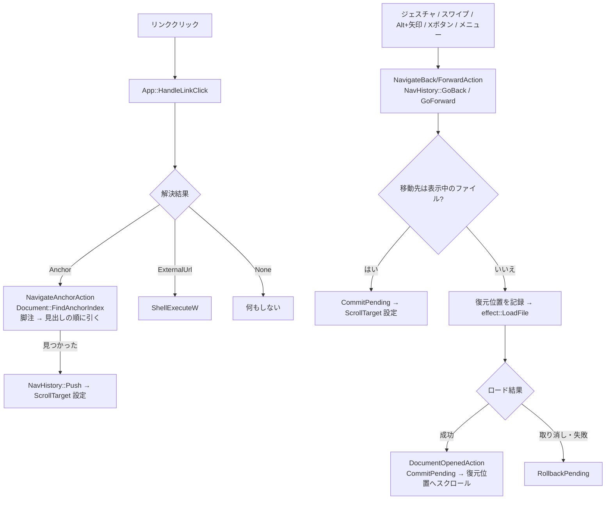

---

### 3.14 MouseGesture — マウスジェスチャ

#### 3.14.1 状態遷移

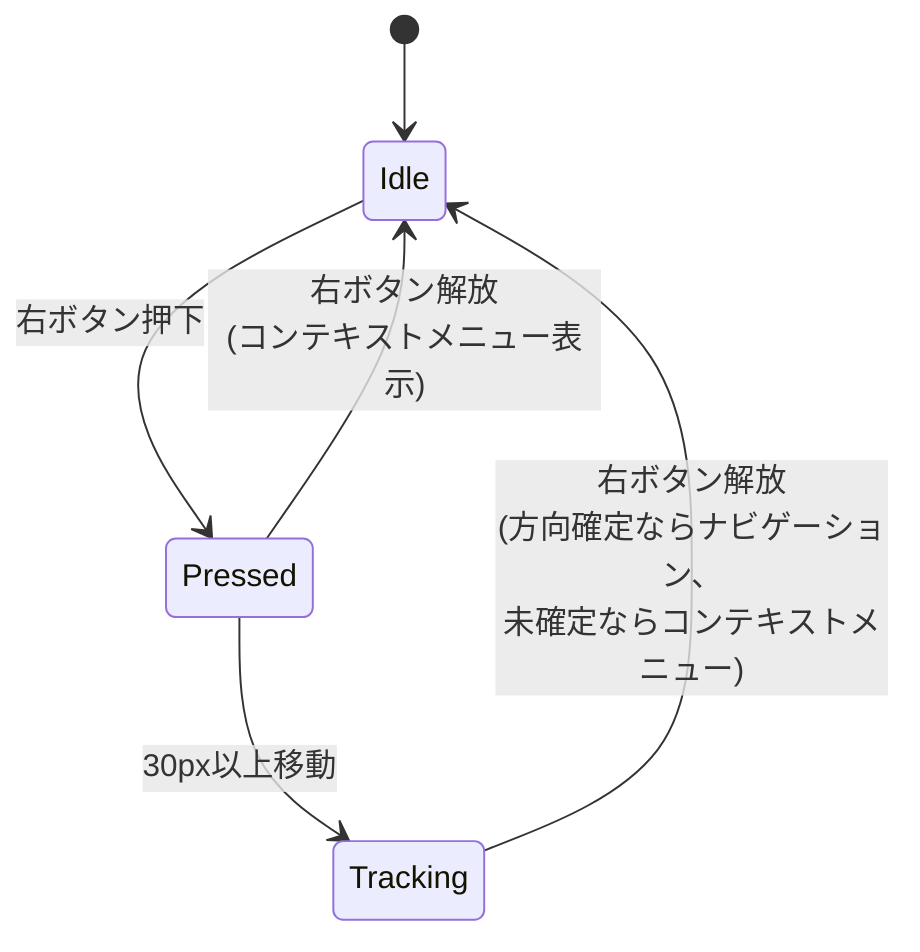

#### 3.14.2 パラメータ

| パラメータ | 値 | 説明 |
|:----------|:---|:-----|
| `GESTURE_THRESHOLD` | 30.0f (DIP) | ジェスチャ開始の移動距離閾値 |
| `MIN_POINT_DISTANCE` | 2.0f | トレイル軌跡のサンプリング最小距離 |
| `TRAIL_MAX_POINTS` | 512 | トレイル軌跡の最大ポイント数 |

左へのドラッグは `NavDirection::Back`、右へのドラッグは `NavDirection::Forward` になる。ジェスチャ・スワイプ・オーバーレイ描画は向きを同じ `NavDirection` で受け渡し、符号付き整数や別の列挙との変換は挟まない。

---

### 3.15 SwipeDetector — タッチパッドスワイプ検出

`WM_MOUSEHWHEEL` の累積デルタに基づくスワイプ検出。

```cpp
// util/ui_types.h。MouseGesture::GetDirection・GestureRenderState::direction・ナビボタンのホバーも同じ型を使う。
enum class NavDirection : uint8_t { None, Back, Forward };

class SwipeDetector {
public:
    constexpr void OnHWheel(int delta, uint64_t now_ms) noexcept;
    constexpr NavDirection Commit() noexcept;
    constexpr void NotifyVScroll(uint64_t now_ms) noexcept;
    constexpr void Reset() noexcept;
    constexpr bool IsOverlayVisible() const noexcept;
    // 右スワイプで戻る、左スワイプで進む。
    constexpr NavDirection GetOverlayDirection() const noexcept;

    static constexpr int      TRIGGER_THRESHOLD = 400;
    static constexpr uint64_t AXIS_LOCK_MS      = 200;
    static constexpr uint64_t RESET_TIMEOUT_MS  = 500;
    static constexpr uint64_t COMMIT_TIMEOUT_MS = 150;
};
```

| パラメータ | 値 | 説明 |
|:----------|:---|:-----|
| `TRIGGER_THRESHOLD` | 400 | 発火の累積デルタ閾値（WHEEL_DELTA単位） |
| `AXIS_LOCK_MS` | 200ms | 縦スクロール後の軸ロック期間 |
| `RESET_TIMEOUT_MS` | 500ms | 入力なしで蓄積をリセットするタイムアウト |
| `COMMIT_TIMEOUT_MS` | 150ms | 指を離してから発火までの待機 |

---

### 3.16 ViewportManager — ビューポート管理

スクロール・選択・ズームの純粋な状態管理。Win32依存なし。

```cpp
struct ScrollTarget {
    int   node   = -1;       // -1 = 無効
    float offset = 0.0f;     // ノード先頭からのピクセル距離
    constexpr bool IsValid() const noexcept;
};

// 見出しノードを md ペイン上端の heading_spacing_above 分だけ下に配置する ScrollTarget。
constexpr ScrollTarget MakeHeadingTopTarget(int node, float heading_spacing_above) noexcept;

class ViewportManager {
public:
    // スクロール
    // スクロール上限は持たず、AppState から求めた max_scroll を呼び出し側が渡す (MdMaxScroll)。
    constexpr float GetScrollY() const noexcept;
    constexpr void  ScrollTo(float position, float max_scroll) noexcept;      // scroll_target を無効化
    constexpr void  ClampAndDetach(float max_scroll) noexcept;               // scroll_y をクランプし target を無効化
    constexpr void  DirectScrollBy(float delta, float max_scroll) noexcept;   // 同上
    constexpr void  ClampScroll(float max_scroll) noexcept;                  // target は残す
    constexpr int   FindFirstVisibleNode(const LayoutCache& cache) const noexcept;
    // 可視先頭ノード基準の現在位置。ノードが無ければ node=-1, offset=scroll_y
    constexpr ScrollTarget CurrentTarget(const LayoutCache& cache) const noexcept;
    constexpr void  SetScrollY(float y) noexcept;            // クランプしない。target は無効化

    // ScrollTarget — ノード相対位置によるスクロール復元
    constexpr void SetScrollTarget(int node, float offset) noexcept;
    constexpr bool HasScrollTarget() const noexcept;
    constexpr const ScrollTarget& GetScrollTarget() const noexcept;
    constexpr void ApplyScrollTarget(const LayoutCache& cache) noexcept;
    constexpr void EnsureScrollTarget(const LayoutCache& cache) noexcept;

    // 選択 (deducing this で const/非 const を1本に集約)
    constexpr auto& GetSelection(this auto& self) noexcept;
    constexpr void SetSelection(const TextSelection& sel) noexcept;
    constexpr void SelectAll(const std::pmr::vector<Node>& nodes) noexcept;
    constexpr void ClearSelection() noexcept;

    // ズーム — 段 (SetIndex は [0, ZOOM_STEP_COUNT) に必ず clamp、Step / CanStep / Percent) は ZoomLevel が持つ
    constexpr ZoomLevel& Zoom() noexcept;
};
```

`ScrollTarget` は **「ノード i の先頭から offset ピクセル下」** という相対位置を保持する。ファイル再読み込み・ズーム・DPI 変更でレイアウトが変わっても、同じノードに戻ることで「見ている位置を保つ」を実現する。ノード数は `LayoutCache` のエントリ数で数える。文書のノードとキャッシュのエントリは常に同数で（文書を差し替える `ReplaceDocument` が assert で確かめる）、ノード数を別の引数で渡して突き合わせることはしない。`ZoomLevel::SetIndex` は外部入力経路から不正値が来ても out-of-bounds にならないよう setter 側で必ず clamp する。テキスト選択のドラッグ中かどうかはここでは持たず、`ViewState::drag`（`LeftDrag::TextSelect`、3.3）で表す。

---

### 3.17 PaneController — ペイン管理

3ペイン（File / TOC / Markdown）の表示状態・幅・スクロールを管理する。Win32依存なし。ペインの配置とゾーン判定と一緒に `src/util/pane_layout.h / .cpp` に置く。File / TOC の個別メソッドは持たず、`PaneTarget` 引数で共通化する。ホバーは `ViewState::hover`（`HoverHighlights` の `side_index` / `side_button`）、スプリッタやスクロールバーのドラッグは `ViewState::drag`（`LeftDragState`）が持つ（3.3）。

```cpp
class PaneController {
public:
    // 表示切替
    constexpr bool IsSidePaneVisible(PaneTarget t) const noexcept;
    constexpr void SetSidePaneVisible(PaneTarget t, bool v) noexcept;
    constexpr void ToggleSidePane(PaneTarget t) noexcept;

    // 幅
    constexpr float GetSidePaneWidth(PaneTarget t) const noexcept;
    constexpr void  SetSidePaneWidth(PaneTarget t, float w) noexcept;  // PANE_MIN_WIDTH に clamp

    // スクロール
    constexpr ScrollState&       SidePaneScroll(PaneTarget t) noexcept;
    constexpr const ScrollState& SidePaneScroll(PaneTarget t) const noexcept;
    constexpr void ResetScrollStates() noexcept;
    bool ScrollSidePaneBy(PaneTarget t, float delta, float max_scroll) noexcept;  // 変化した場合 true

    // スプリッタ — edge のペインの右端にあるスプリッタを dip_x へ動かす
    void DragSplitterTo(PaneTarget edge, float dip_x, float total_width,
                        float splitter_w) noexcept;

    // レイアウト（幅はズーム倍率を含まない DIP 値）。表示状態も PaneLayout に写す
    PaneLayout ComputeLayout(float total_w, float total_h, float splitter_w,
                             float top_offset = 0.0f) const noexcept;
};

struct PaneLayout {
    PaneRect file_rect, toc_rect, md_rect;
    bool show_file = false;   // 隠したペインの矩形は空なので、ゾーン判定は表示中かをこちらで見る
    bool show_toc  = false;
};

PaneZone DetectPaneZone(float dip_x, const PaneLayout& layout, float splitter_width) noexcept;
```

スプリッタのドラッグでは、reducer が `LeftDrag::Splitter` の対象ペイン（`LeftDragState::pane`）をそのまま `DragSplitterTo` に渡す。座標からのゾーン判定はメンバではなくフリー関数 `DetectPaneZone` が `PaneLayout` だけから行う（ホバー・ホイール・クリックで共有）。幅の既定値 `SIDE_PANE_DEFAULT_WIDTH = 220.0f` と下限 `SIDE_PANE_MIN_WIDTH = 100.0f` は `ui_types.h`、Markdown ペインの最小幅 `MD_PANE_MIN_WIDTH = 200.0f` は `src/util/ui_constants.h` の inline 定数として定義される。「MD ペインに `MD_PANE_MIN_WIDTH` を残し、表示中のペインのスプリッタを除いた幅をサイドペインで分ける」規則は、保存幅がウィンドウより広いときの表示幅の縮小（`ComputeLayout`）とスプリッタのドラッグの上限（`DragSplitterTo`）が同じ関数で共有する。

#### 3.17.1 ペイン構成

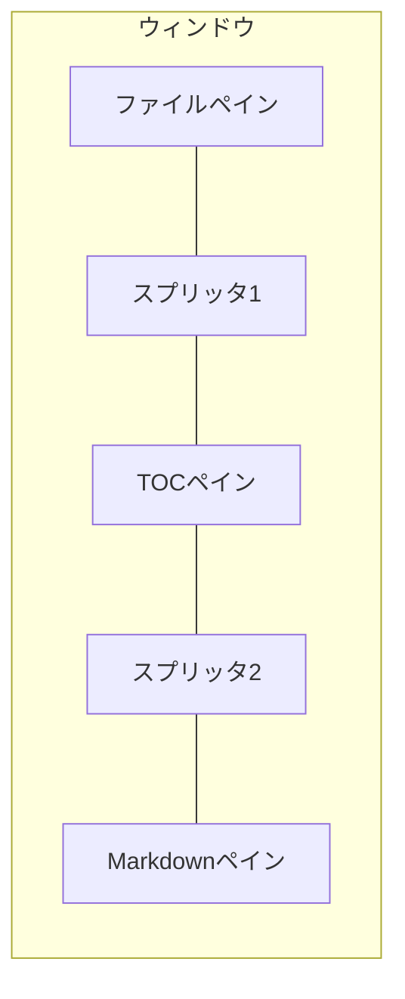

| ペイン | 既定幅 | 最小幅 | 内容 |
|:-------|:-------|:-------|:-----|
| ファイルペイン | 220px | 100px | ディレクトリ内のファイル一覧 |
| TOCペイン | 220px | 100px | 見出しベースの目次 |
| Markdownペイン | 残り全幅 | 200px | Markdownコンテンツ |
| スプリッタ | テーマ依存（`Theme::splitter_width`） | — | ペイン間の境界線 |

ファイルペインの一覧は `FileExplorer`（`AppState::file_explorer`）が持つ。`SetDirectory` / `Refresh` は一覧を古いと印すだけで、列挙は次の `EnsureListed` まで遅らせる。`EnsureListed` を呼ぶのは表示中のファイルペインの描画（`App::BuildSidePaneState`）・起動時・「現在のファイルを表示」だけなので、非表示の間は列挙しない（起動時やファイルを開くたびの UI スレッド I/O を省く）。`GetEntries` は副作用の無い accessor。列挙し直すたびに世代 (`GetGeneration`) が進み、ツールチップは項目 index と世代の組で対象を識別する。

---

### 3.18 hit_test — ヒットテスト

```cpp
struct MdPaneHitContext {
    const std::pmr::vector<Node>& nodes;
    const LayoutCache&            cache;
    const Theme&                  theme;
    float    scroll_y;
    PaneRect md_rect;
    float    dpi_scale;
    int      screen_x;
    int      screen_y;
    // ボタン位置とブロック横スクロールの clamp に使う
    float content_width = 0.0f;
    // ブロック単位の横スクロール量。null は全ノード 0 として扱う。
    const std::pmr::unordered_map<int, float>* block_scroll_x = nullptr;
};

// MD ペインのヒットテスト。状態を持たない純粋関数群 (src/input/hit_test_service.h)。
namespace hit_test {

struct HitResult {
    static constexpr uint32_t kNoChar = std::numeric_limits<uint32_t>::max();

    int      node_index = -1;
    // キャレット位置 (選択の端)。文字の右半分を指すとその文字の後ろになる。
    uint32_t text_pos   = 0;
    // 点の下にある文字の位置 (リンクの判定)。文字の上でなければ kNoChar。
    uint32_t char_pos   = kNoChar;
};

HitResult HitTest(const MdPaneHitContext& ctx) noexcept;
// HitTest と同じノードを返す。文字位置は求めない。
int HitNode(const MdPaneHitContext& ctx) noexcept;
HitResult HitTestTable(const Node& node, const NodeLayoutEntry& entry,
                       float entry_text_top, int node_index, const Theme& theme,
                       float dip_x, float dip_y, float h_scroll_x = 0.0f) noexcept;

NavDirection NavButtonHitTest(float dip_x, float dip_y, const PaneRect& md_rect) noexcept;

// 可視ノードのオーバーレイボタン (コードのコピー / 図の保存・コピー) のうちマウス位置にあるもの。
OverlayButtonHit OverlayButtonHitTest(const MdPaneHitContext& ctx) noexcept;
bool BlockHScrollbarHitTest(const MdPaneHitContext& ctx, int node_index, float visible_width) noexcept;

} // namespace hit_test

// src/util/ui_types.h — コードブロック・図の右上に重ねるボタン
enum class OverlayButton : uint8_t { None, CodeCopy, DiagramSave, DiagramCopy };

// マウス座標は 1 点なので同時に当たるのは 1 つだけ。
struct OverlayButtonHit {
    int           node = -1;
    OverlayButton kind = OverlayButton::None;
    constexpr bool Any() const noexcept;   // kind != None
    bool operator==(const OverlayButtonHit&) const = default;
};
```

オーバーレイボタンの矩形は `layout::ForEachOverlayButton`（`layout/layout_computer.h`）が `fn(rect, kind)` で列挙し、描画（`CommandGenerator::GenOverlayButtons`）と `OverlayButtonHitTest` が同じ矩形を使う。コードブロックはコピー 1 つ、ビットマップを持つ図（`NodeType::Diagram`）は保存とコピーの 2 つを並べる。

テーブルの行・列の判定（`FindTableRow` / `FindTableCol`）は `TableLayoutData` の累積配列（`row_cum_y` / `col_cum_x`）だけを二分探索する。幾何が揃っていない（未計測、または `InvalidateGeometry` の後）ときはヒットなしとして扱い、行高さを推定し直して線形に探す経路は持たない。セル本文の原点は描画と同じ `TableCellTextOrigin` で求める。

本文はペイン基準の座標（ペイン原点 `md_rect.x/y` は描画変換に乗る）で描くので、マウス座標は `ScreenToPaneDip` で一度だけ「ペイン左端基準の X とドキュメント Y」に変換し、ノードやボタン、ブロック横スクロールバーの矩形はドキュメント座標のまま比べる。可視範囲はどこでも `[scroll_y, scroll_y + md_rect.height]` で一致する。

`hit_test` は状態を持たず、ヒット結果のキャッシュもしない。呼ばれるたびに判定する（`HitTestPoint` は 1 万行のコードブロックでも数〜十数 µs で済むため）。ホバー中のナビボタンは、ジェスチャやスワイプが示す履歴移動の向きと同じ `NavDirection`（`util/ui_types.h`、`{ None, Back, Forward }`）で表す。

ホバーとクリックは同じ `App::ResolveMdPaneHit` で「点が MD ペインのどの領域を指すか」を決める。優先順位は 検索バー → ナビボタン → オーバーレイボタン（コピー / ダイアグラムコピー / 保存）→ スクロールバー → 本文 で、縮小表示でボタンがスクロールバーのヒット余白に掛かってもボタンが勝つ。結果は `App::MdPaneHit`（`kind` と、検索バーのゾーン・ナビボタン・`OverlayButtonHit`）で返す。ホバー表示（カーソルとツールチップ）とクリックの結果は常に一致する。ホバーでは判定結果を `PointerHover` に書いて `PointerHoverAction` で reducer に渡し、reducer が `ViewState::hover` に反映する。

リンクは `FindLinkHitAtPosition`（`core/selection_html.h`）で URL とその添字（`node.view_link_urls()` の位置）を一度に求める。ツールチップはこの添字で対象を識別し、URL 文字列から添字を探し直さない。

---

### 3.19 ConfigService / session:: — 設定永続化

#### 3.19.1 保存先・形式

```
%LOCALAPPDATA%\mendo\settings.ini
```

`IniParser` で読み書きし、セクション+キーの2階層でアクセスする。書き込みは `*.tmp` → `MoveFileExW(MOVEFILE_REPLACE_EXISTING)` の原子的差し替え。書き出しはアプリ終了時 (WM_DESTROY) に集約し、読み込み後に値が変わっていなければ書かない。ログオフ・シャットダウンでは WM_DESTROY が来ないため、WM_ENDSESSION で `DestroyWindow` を呼んで同じ終了処理を通す。

#### 3.19.2 保存項目

| セクション | キー | 型 | 既定値 | 説明 |
|:-----------|:-----|:---|:------|:-----|
| `General` | `Language` | `wstring` | （OS自動判定） | UI言語 (`ja` / `en` / `zh`) |
| `View` | `DarkMode` | `bool` | `false` | ダークモード |
| `View` | `ZoomLevel` | `int` | `7` (1.00x) | ズームインデックス |
| `Window` | `X` / `Y` | `int` | `0` | 通常表示時のウィンドウ位置 |
| `Window` | `Width` / `Height` | `int` | `0`（未保存） | 通常表示時のウィンドウサイズ。未保存なら OS 既定の位置に既定サイズ（1600×900）で開く |
| `Window` | `Maximized` | `bool` | `false` | 最大化状態（最小化中に閉じたときは最小化前の状態） |
| `Pane` | `ShowFile` | `bool` | `true` | ファイルペイン表示 |
| `Pane` | `ShowToc` | `bool` | `true` | TOCペイン表示 |
| `Pane` | `FileWidth` | `int` | `220` (DIP、ズーム非適用) | ファイルペイン幅 |
| `Pane` | `TocWidth` | `int` | `220` (DIP、ズーム非適用) | TOCペイン幅 |
| `Pane` | `FileZoomLevel` | `int` | `7` (1.00x) | ファイルペインのズームインデックス |
| `Pane` | `TocZoomLevel` | `int` | `7` (1.00x) | TOCペインのズームインデックス |
| `Session` | `LastFile` | `wstring` | 空文字列 | 最後に開いたファイルパス |
| `Session` | `ScrollNode` | `int` | `-1` | スクロール位置（ノードインデックス） |
| `Session` | `ScrollOffset` | `int` | `0` | スクロール位置（ノード内オフセット） |

#### 3.19.3 ConfigService — 設定永続化

設定 (settings.ini) のメモリ上マップとディスク永続化を保持する。インスタンスごとに独立した状態を持つので、テストでは新しいインスタンスを使うだけで分離できる。

```cpp
class ConfigService {
public:
    ConfigService() noexcept = default;

    // 設定ディレクトリ
    void SetConfigDirOverride(const std::filesystem::path& dir);    // テスト用
    const std::filesystem::path& GetConfigDir() const;
    // 区切り文字や ".." を含む名前は拒否する。
    std::filesystem::path GetConfigPath(std::wstring_view filename) const;

    // ディスク永続化
    void Load();
    void Flush();        // 変更があればメモリ上のデータを書き出す（WM_DESTROY 時に呼ぶ）

    // 型付きアクセサ
    void SaveBool(std::string_view section, std::string_view key, bool value);
    bool LoadBool(std::string_view section, std::string_view key, bool default_value = false) const;

    void SaveInt(std::string_view section, std::string_view key, int value);
    int  LoadInt(std::string_view section, std::string_view key, int def, int min_v, int max_v) const;

    void              SaveWString(std::string_view section, std::string_view key, std::wstring_view value);
    std::pmr::wstring LoadWString(std::string_view section, std::string_view key) const;
};
```

LocalAppData は環境変数 `LOCALAPPDATA` を優先し（`SHGetKnownFolderPath` は初回に `windows.storage.dll` のロード等で ms 単位かかるため）、取れない・絶対パスでない場合だけ `SHGetKnownFolderPath` にフォールバックする。結果は private static 関数 `DefaultConfigDir()` の関数ローカル static で一度だけ解決し、override 未設定時の問い合わせをプロセス全体で 1 回に抑える（別スレッドから `GetConfigDir` を呼んでも安全）。

`Save*` は既存値と同じなら何もせず、値が変わったときだけ `dirty_` を立てる。`Flush` は `dirty_` が立っていなければ書き込まず、書き込みに成功したら `dirty_` を下ろす。終了のたびに同期書き込み（`FlushFileBuffers` + `MOVEFILE_WRITE_THROUGH`）が走るのを、設定を変えたセッションだけに限るためである。

#### 3.19.4 session::

セッション状態（最後に開いたファイル、ペイン構成、スクロール位置、言語）の永続化を担当する自由関数群（`config_service.h`）。`ConfigService` のセクション "Session" / "Pane" / "General" を排他的に扱う。状態を持たないのでクラスにしない。

```cpp
namespace session {
void              SaveLastFilePath(ConfigService& config, std::wstring_view path);
// UNC・デバイスパスと実在しないパスは空。ネットワークドライブは切断時に止まらないよう存在を確かめない。
std::pmr::wstring LoadLastFilePath(const ConfigService& config);

// 表示・幅・倍率を PaneController と直接やり取りする。幅はズーム倍率を含まない DIP 値 (SIDE_PANE_MIN_WIDTH 以上)。
void SavePanes(ConfigService& config, const PaneController& panes);
void LoadPanes(const ConfigService& config, PaneController& panes);

struct ScrollPosition {
    int node   = -1;
    int offset = 0;
};
void           SaveScrollPosition(ConfigService& config, int node, float offset);
ScrollPosition LoadScrollPosition(const ConfigService& config);

void              SaveLanguage(ConfigService& config, std::wstring_view lang_key);   // 空は OS に合わせる
std::pmr::wstring LoadLanguage(const ConfigService& config);
}
```

`session::SaveScrollPosition` はノード内オフセット（`SnapshotVisibleTarget` の `offset`）を整数に丸めて永続化する（`Session.ScrollOffset` セクションキー）。

---

### 3.20 TitleBar — カスタムタイトルバー

#### 3.20.1 概要

Win32 標準タイトルバーを `WM_NCCALCSIZE` で非表示にし、Direct2D で自前描画したカスタムタイトルバーに置き換える。ファイルを開く・検索・テーマ切替・ヘルプ・ファイル/目次ペイン切替・最小化/最大化/閉じるボタンを含む。

```cpp
// OpenFile..Close はボタン。連続した値であることを TitleBarButtonIndex が前提にする。
enum class TitleBarHitZone : uint8_t {
    None, Caption, Icon,
    OpenFile, Help, ThemeToggle, Search,
    FileToggle, TocToggle,
    Minimize, Maximize, Close,
};

constexpr bool IsTitleBarButton(TitleBarHitZone zone) noexcept;   // OpenFile..Close か
inline constexpr size_t kTitleBarButtonCount = /* OpenFile..Close の個数 */;
constexpr size_t TitleBarButtonIndex(TitleBarHitZone zone) noexcept;  // zone - OpenFile

// TitleBarButtonIndex で引くボタン矩形。
using TitleBarButtons = std::array<DipRect, kTitleBarButtonCount>;
constexpr auto& TitleBarButtonRect(auto& buttons, TitleBarHitZone zone) noexcept;

class TitleBar {
public:
    static constexpr float BASE_HEIGHT       = 32.0f;
    static constexpr float BUTTON_WIDTH      = 32.0f;
    static constexpr float ICON_LEFT_MARGIN  = 8.0f;
    static constexpr float ICON_SIZE         = 24.0f;
    static constexpr float ICON_RIGHT_GAP    = 4.0f;
    // キャプションボタン（最小化/最大化/閉じる）はタイトルバーの全高を使う
    static constexpr float CAPTION_BTN_WIDTH = 46.0f;
    // アイコンの位置は幅に依存しない。
    static constexpr DipRect ICON_RECT{ ICON_LEFT_MARGIN, (BASE_HEIGHT - ICON_SIZE) / 2.0f, ICON_LEFT_MARGIN + ICON_SIZE,
                                        (BASE_HEIGHT + ICON_SIZE) / 2.0f };

    void UpdateLayout(float window_width_dip) noexcept;
    TitleBarHitZone HitTest(float dip_x, float dip_y) const noexcept;

    constexpr const DipRect& GetButton(TitleBarHitZone zone) const noexcept;
    constexpr const DipRect& GetTitleTextRect() const noexcept;
};
```

ボタン矩形はボタンごとのメンバではなく `TitleBarButtons` 配列 1 つで持ち、`TitleBarHitZone` から `TitleBarButtonIndex` で引く。ヒットテストと描画（`TitleBarRenderState::buttons` と `Button(zone)`）は同じ配列を使い、`WM_NCHITTEST` は `IsTitleBarButton` でボタンかどうかを判定する。狭幅でボタン同士が重なったときは、`HitTest` がキャプションボタン（閉じる・最大化・最小化）を優先する。

`TitleBar` はホバー状態を持たない。ホバー中のゾーンは `ViewState::hover.titlebar` が持ち、`TitleBarRenderState::hovered_zone` で描画に渡す。

#### 3.20.2 ボタン配置

```
┌────────────────────────────────────────────────────────────────────┐
│ [Icon] [Open] [Search] [Theme] [Help] ←タイトル→ [File] [TOC] [─][□][×]│
│  左側グループ                                        右側グループ        │
└────────────────────────────────────────────────────────────────────┘
```

- **左側**（アイコンの右から）: OpenFile → Search → ThemeToggle → Help
- **右側**（右端から）: Close ← Maximize ← Minimize ← TocToggle ← FileToggle
- **タイトルテキスト**: 左側グループの右端から FileToggle の左端まで

---

### 3.21 SearchState / 検索バー — 検索

#### 3.21.1 SearchState（ドメインロジック）

```cpp
struct SearchMatch {
    int      node_index;
    uint32_t start;          // node.text（またはセル.text）内の UTF-8 byte オフセット
    uint32_t length;         // UTF-8 byte 長
    int      table_row = -1; // テーブルセル用（-1 なら通常ノード）
    int      table_col = -1;
    uint32_t start_w  = 0;   // UTF-16 code unit 範囲（描画ハイライト用）
    uint32_t length_w = 0;
};

class SearchState {
public:
    constexpr bool IsVisible() const noexcept;
    constexpr void Show() noexcept;
    void Hide() noexcept;       // visible_ = false + ClearMatches
    void Reset() noexcept;      // Hide + クエリも空にする

    constexpr uint32_t GetGeneration() const noexcept;  // 描画側のハイライトキャッシュ判定用

    constexpr const std::pmr::string&              GetQuery() const noexcept;  // UTF-8
    constexpr const std::pmr::vector<SearchMatch>& GetMatches() const noexcept;
    constexpr int GetCurrentMatchIndex() const noexcept;
    constexpr int GetMatchCount() const noexcept;

    constexpr bool IsCaseSensitive() const noexcept;
    constexpr void SetCaseSensitive(bool v) noexcept;
    constexpr void ToggleCaseSensitive() noexcept;
    constexpr bool IsHighlightEnabled() const noexcept;
    constexpr void ToggleHighlightEnabled() noexcept;

    void SetQuery(std::string_view query);
    void ExecuteSearch(const std::pmr::vector<Node>& nodes);
    bool NextMatch() noexcept;  // ラップ時 true
    bool PrevMatch() noexcept;  // ラップ時 true
    void SetCurrentMatchNear(float scroll_y, const LayoutCache& cache) noexcept;
};
```

一致件数の上限は private 定数 `MAX_MATCHES = 10000`。

`generation_` は `ExecuteSearch / Hide / Reset` のたびにインクリメントされる世代カウンタ。0 は未初期化センチネルとして扱い、32-bit ラップアラウンドで 0 に戻ったときは 1 へ補正する。

大文字小文字を無視する検索でも文書の小文字コピーは持たない。クエリだけを ASCII 小文字にし、`ascii_util::FindAsciiCaseInsensitive` が走査しながら文書側を畳み込む（畳み込むのは ASCII 英字だけ）。クエリに ASCII 英字が無ければ通常一致と結果が同じなので、畳み込みを省いて `ascii_util::Find` を使う。テーブルは `concat_text` を 1 回だけ走査し、セル区切りをまたぐヒットを除いてセル単位のマッチに振り分ける。UTF-16 位置（`start_w` / `length_w`）は `Utf16OffsetCursor` が最初のヒットから前方へ数えて求め、ノード全文を UTF-16 に変換しない。パーサが改行を挟まずに区切った継ぎ目では、前のノードの末尾とクエリ長 − 1 バイトの続きだけをつないで探し、またぐマッチを前のノードに置く（3.6.6）。

#### 3.21.2 検索バー（UI制御）

検索バーの UI 状態（キャレット、選択範囲、IME 組成文字列、入力欄の UTF-16 クエリ）は `SearchGroup`（`app_state.h`）がデータとして持ち、変えるのは reducer だけ（`reducer.cpp` の検索バーの関数群）。再描画・フォーカス・ビープは `effect::InvalidateWindow` / `SearchFocus` / `SearchUnfocus` / `Beep` として積み、`App::Execute` に任せる。表示中は常に入力欄がフォーカスを持つ。ホバーは `ViewState::hover.search_bar`（`App` が `SearchBarRenderState::hovered` に詰める）、入力欄のドラッグ選択は `ViewState::drag`（`LeftDrag::SearchInput`、起点は `search_anchor`）が持つ（3.3）。

マッチへスクロールするときの MD ペイン高さとスクロール上限は `AppState` から求める（`pane_layout_cache` の `md_rect.height` と `MdMaxScroll(state)`）。App に頼むのはマッチのノードの計測だけで、`Reduce` の引数 `NodeLayoutAccess&` で頼む（3.4.1）。タイマーは持たない。キャレットは点滅させず、フォーカス中かつウィンドウがアクティブな間は常時表示する（点滅タイマーが約 530ms ごとに全画面再描画を起こしていたため廃止した）。`SearchBarRenderState::caret_visible` は `BuildSearchBarRenderState` が `WindowState::window_active` から詰める。

```cpp
struct SearchGroup {
    SearchState search_state;
    int caret_pos = -1;          // EDIT の選択 [selection_start, caret_pos)。-1 はテキスト末尾
    int selection_start = -1;
    std::pmr::wstring ime_composition;
    std::pmr::wstring query_wide;   // SearchState::GetQuery() の UTF-16 版
    bool scroll_after_search = false;
};

// reducer.h。開閉・次/前・入力・選択・IME・大文字小文字・ハイライト・検索の続き・文書の差し替えはアクションで Reduce に通す。
SearchBarRenderState BuildSearchBarRenderState(const AppState& state);   // hovered と caret_visible は App が詰める
```

テストは `tests/test_search_bar.cpp` がアクションを `Reduce` に通して確かめる。

`SearchTextChangedAction` は入力が前回と同じなら何もしない（文書の切替で入力欄を空にしたときの `EN_CHANGE` など）。空になったらその場でマッチを消す。それ以外は入力のたびにすぐ検索を始める。検索は `kSearchSliceBudget`（8ms）ずつ区切って進み、残りは `App::HasIdleWork` が `SearchState::IsSearching` を見て、メッセージループの空き時間に `SearchContinueAction` で続けるので、大きな文書でも入力や描画を待たせない（デバウンスは持たない）。

途中のマッチは見せない。調べている間は前回の結果（件数・ハイライト。0 件なら赤背景も）を見せ続け、調べ終えたときにまとめて差し替える。初めての検索を調べ終えるまでは `SearchState::HasResult` が偽で、`SearchBarRenderState::total_matches` を -1 にして赤背景も件数も出さない。リロードでは `App::ReloadDocument` が `CarryOverUnchanged` の求めた先頭・末尾の一致範囲（`UnchangedEnds`）を `DocumentReloadedAction` で（変更箇所が見えるスクロール位置と一緒に）渡し、reducer が `SearchState::KeepMatchesOfUnchangedNodes` で変わらなかったノードのマッチだけを新しい番号で残す。スクロール位置と見えている範囲のレイアウトが決まったら（`ReloadSettledAction`）調べ直す。保存のたびに件数が 0 に戻ってハイライトが消えるちらつきを出さず、同期の再検索で UI を止めることもないためである。

別文書（ヘルプを含む）へ切り替えると、`DocumentOpenedAction` を受けた reducer が検索バーを常に閉じ、クエリとマッチも空にしてから入力欄を空にさせる（`effect::SearchUnfocus{ clear_text = true }`。そのときの `EN_CHANGE` はクエリが既に空なので何もせず終わる）。旧文書のマッチ位置を新しいノードに使わないためである。

ホバー領域は `SearchBarHitZone`（`ui_constants.h`）で定義され、None / Up / Down / CaseSensitive / Highlight / Close / Input の 7 値。Input はホバー強調が無いので None と同じに扱う。

#### 3.21.3 検索バーUI

下部にドッキングされ、以下のコントロールを含む。

- テキスト入力（IME対応）
- 前へ / 次へボタン
- 大文字小文字区別トグル
- ハイライト切替トグル
- 閉じるボタン
- 一致件数表示（`X / Y`）

| 対象 | 色 | アルファ |
|:-----|:---|:--------|
| 現在の一致 | オレンジ系 (`BrushId::SearchHighlightCurrent`) | 60%（ダーク 55%） |
| その他の一致 | 黄色系 (`BrushId::SearchHighlight`) | 40%（ダーク 35%） |
| 一致なし入力背景 | 薄赤、ダークは暗い赤 (`BrushId::SearchNoMatchBg`) | — |

---

### 3.22 ContextMenu — カスタムコンテキストメニュー

`ContextMenu` は Win32 のシステムメニューの代わりに、Direct2D で自前描画するカスタムコンテキストメニュー。実装は `context_menu.cpp`（mendo_core 入り）にまとまっている。

```cpp
struct ContextMenuParams {
    int   screen_x = 0;
    int   screen_y = 0;
    float dpi_scale = 1.0f;
    bool  can_go_back = false;
    bool  can_go_forward = false;
    bool  has_file = false;
    bool  has_selection = false;
    bool  dark_mode_checked = false;
    bool  file_pane_checked = false;
    bool  toc_pane_checked = false;
    bool  show_file_items = false;  // MdPaneの場合のみtrue
    const ZoomLevel* zoom = nullptr;  // 右クリックした領域の倍率。無ければズームの行を出さない
    std::function<void(ZoomDirection)> on_zoom;
    const Theme* theme = nullptr;
    ID2D1Factory*   d2d_factory = nullptr;
    IDWriteFactory* dwrite_factory = nullptr;
};

class ContextMenu {
public:
    static int Show(HWND owner, const ContextMenuParams& params);  // 選んだ項目の ID。選ばずに閉じたら 0
    struct Impl;  // context_menu_impl.h。開くたびに作る (項目・レイアウト・HitTest / NavHitTest / ZoomHitTest)
};
```

#### 3.22.1 メニュー構成

```
┌──────────────────────────────────┐
│ ← [戻る]  [進む] →               │  NavRow（横並び）
├──────────────────────────────────┤
│ エディタで開く                    │  ※ MdPaneのみ。ファイルあり時のみ有効
│ コピー                           │  ※ MdPaneのみ。選択あり時のみ有効
│ 書式付きコピー                    │  ※ MdPaneのみ。HTML形式、選択あり時のみ有効
├──────────────────────────────────┤  ※ MdPaneのみ
│ ☑ ダークモード                    │
├──────────────────────────────────┤
│ ☑ ファイルペイン                  │
│ ☑ 目次ペイン                     │
└──────────────────────────────────┘
```

---

### 3.23 ImageLoader — 非同期画像読み込み

WIC を使用した非同期画像読み込み。ワーカースレッドでデコードし、UIスレッドで `ID2D1Bitmap` に変換する。

```cpp
class ImageLoader {
public:
    ~ImageLoader();

    // デコード結果が届いたら hwnd へ msg_id を投げる。wic が null なら false を返し、
    // 以降の RequestLoadAsync はデコードせず失敗扱いになる。
    bool Init(IWICImagingFactory* wic, HWND hwnd, UINT msg_id, TaskScheduler& scheduler);
    // UI スレッドからのみ。デバイスロストでの差し替えでは、旧 rt 向けのデコードとビットマップを捨てる。
    void SetRenderTarget(ID2D1RenderTarget* rt);

    struct CachedImage {
        Microsoft::WRL::ComPtr<ID2D1Bitmap> bitmap;
        // 縮小前の原寸 (物理 px)。表示の DIP は DPI で変わるので DipSize で求める。
        float pixel_width  = 0.0f;
        float pixel_height = 0.0f;
        // この幅 (物理 px) までは縮小によるぼけ無しで描ける。原寸でデコードしていれば上限なし。
        UINT sharp_width_px = UINT_MAX;
    };
    // ヒットしたら順位を上げる。次の挿入・Clear まで有効。
    const CachedImage* FindCachedImage(const std::wstring& abs_path);
    // 今の DPI での表示寸法 (画像の 1 px を物理 1 px で描く)。
    D2D1_SIZE_F DipSize(const CachedImage& image) const noexcept;
    // max_width_dip: 表示幅。これを量子化した物理 px まで縮小してデコードする。0 は原寸。
    void RequestLoadAsync(const std::wstring& abs_path, float max_width_dip);
    // 表示幅が広がり、キャッシュの解像度では足りなくなったか。
    bool NeedsSharperDecode(const CachedImage& image, float max_width_dip) const noexcept;
    // deadline を過ぎた分は残し、HasLeftoverUploads が真になる。戻り値: 結果を 1 件以上取り込んだか (失敗も含む)。
    bool ProcessCompletedDecodes(std::chrono::steady_clock::time_point deadline = std::chrono::steady_clock::now() + kUploadSliceBudget);
    bool HasLeftoverUploads() const noexcept;   // UI スレッド専用
    // 始まっていないデコードを捨てる。始まったものは要求中のまま残し、結果はキャッシュに入れる。
    void DropQueued();
    // 始まったものも含めて結果を捨てる。
    void CancelPending();

    void ClearCache();             // failed_paths_ もクリア
    void ResetFailedPaths();
    size_t CacheSize() const noexcept;
    void Shutdown();

#ifdef MENDO_TESTING
    // bitmap を持たない寸法だけの項目を入れる。キャッシュ動作のテスト専用。
    void InsertCacheEntryForTest(const std::wstring& path, float width, float height);
#endif
};
```

キャッシュ（`TranspositionCache`）は絶対パス → `CachedImage` で保持し、件数（最大 128、private 定数 `MAX_CACHE_ENTRIES`）とビットマップの合計バイト数（128MB、`MAX_CACHE_BYTES`）の両方で上限を掛ける。`RequestLoadAsync` は同じパスが要求中なら何もせず（`pending_paths_`）、`kMaxImageRetries`（3）回失敗したパスは要求しない。ワーカーは `TaskScheduler` 上でファイル（上限 256MB、`MAX_IMAGE_FILE_SIZE`）を読んで WIC デコードし、結果を `completed_`（`PostedInbox`。自前の mutex で守る）に積んでウィンドウへ `msg_id`（`app_msg::IMAGE_LOADED`）を投げる。UI スレッドの `ProcessCompletedDecodes` が `ID2D1Bitmap` に変換してキャッシュに入れ、要求中・失敗の記録を 1 回のロックでまとめて更新し、何か取り込んだかを返す。呼び出し側（`ResourceManager::OnImagesDecoded` / `FlushPendingResources`）がそれを見て画像の適用と再レイアウトを 1 回だけ行う。1 回の転送は `kUploadSliceBudget`（4ms）までで、残した分は `HasLeftoverUploads` が真になり、メッセージループの空き時間（`App::RunIdleWork`）で続ける。新しい結果は投函で知らせるので、空き時間の判定でキューを覗くためにロックは取らない。画像の読み込みはこの非同期経路だけで、UI スレッドで原寸デコードする同期 API は持たない。

待ちの捨て方は 2 通りある。`DropQueued` はデコードを始めていない要求だけを捨て、始めたものは要求中のまま残して結果をキャッシュに入れる。キーがパスなので文書をまたいでも結果を使え、結果が届く前に同じパスを要求し直しても二重に読まない。文書の切替と大きなジャンプ（3.26）で使う。`CancelPending` は始めたものも含めて結果を捨て、要求中・失敗の記録も消す。デバイスロスト（`ClearCache` と組で使う）と終了時に使う。リロードではキャッシュを捨てず、`ResetFailedPaths` で失敗記録だけを消す。

ワーカーは表示幅（物理 px を 256 px 単位に切り上げたもの）と GPU ビットマップの最大辺に収まるよう縮小デコードする（`wic_util::ComputeDecodeSize` / `DecodeToWicBitmap`）。幅で縮めた画像は `sharp_width_px` にその幅を記録し、表示幅が広がると `NeedsSharperDecode` で読み直しを判定する。アルファを持たないフレーム（JPEG などの 24bpp BGR / 8bpp Gray）は PBGRA への形式変換より先に縮小し、JPEG デコーダの縮小デコード（`IWICBitmapSourceTransform`）を効かせる。アルファ付き形式は straight alpha のまま補間すると縁がにじむため、変換後に縮小する。使わないメタデータを先読みしないよう、デコーダは `WICDecodeMetadataCacheOnDemand` で作る。

形式は拡張子ではなく先頭バイトで判定し（`wic_util::SniffImageContainer`）、その形式のデコーダだけを使う。WIC の内容判定に任せると、HEIF・RAW や他社製コーデックなどインストール済みのどのデコーダもプロセス内で動かせてしまうため、ブラウザが表示する形式に限る。どれにも当たらなければ失敗扱いにする。

| 形式 | 先頭バイト |
|:-----|:------|
| PNG | `89 'PNG' 0D 0A 1A 0A` |
| JPEG | `FF D8 FF` |
| GIF | `'GIF8'` |
| BMP | `'BM'` |
| WebP | `'RIFF'` + 8 バイト目から `'WEBP'` |
| ICO | `00 00 01 00` |

---

### 3.24 トースト通知

一定時間だけ表示する通知。文言は `App::toast_message_`（空なら非表示）が持ち、reducer は通さない。`App::ShowToast` が文言を入れると同時に `app_timer::Id::TOAST` を `TOAST_DURATION_MS`（1300ms）で仕掛け、`App::HandleTimer` がタイマーを止めて文言を空にし、描き直させる。フェードは毎フレームの全画面再描画を伴うのでせず、描き直すのは表示と消去の 2 回だけ。描画は `RenderParams::toast_message` を `overlay::EmitToast` が積む。

---

### 3.25 Tooltip — ツールチップ

Win32 の `TOOLTIPS_CLASS` を `TTF_TRACK` モードでラップし、マウスホバー時のツールチップを表示する。

```cpp
struct TooltipTarget {
    enum class Zone : uint8_t {
        None, TitleBarButton, SearchBarButton,
        FilePaneItem, FilePaneButton,
        TocPaneItem,  TocPaneButton,
        MdLink, MdImage,
        OverlayButton,   // key は OverlayButton
        NavButton,
    };

    Zone     zone = Zone::None;
    uint64_t key  = 0;   // zone 内の対象識別子 (項目 index・ボタン種別など)

    constexpr bool operator==(const TooltipTarget&) const noexcept = default;
    constexpr bool IsEmpty() const noexcept;     // zone == Zone::None
};

// ポインタの下で求めたツールチップ (PointerHover::tooltip)。text は対象が変わった時だけ作る
struct TooltipHover {
    TooltipTarget     target;
    std::pmr::wstring text;
};

// current と同じ対象なら fill / text を使わず、表示文字列を作らない
TooltipHover MakeTooltip(const TooltipTarget& current, TooltipTarget::Zone zone, uint64_t key, Fill&& fill);
TooltipHover MakeTooltip(const TooltipTarget& current, TooltipTarget::Zone zone, uint64_t key, std::wstring_view text);

class Tooltip {
public:
    Tooltip() = default;
    ~Tooltip();
    Tooltip(const Tooltip&) = delete;
    Tooltip& operator=(const Tooltip&) = delete;

    void Init(HWND parent_hwnd);
    void SetText(std::wstring_view text);   // 隠して、次の Show で出す文言にする。空なら出さない
    void Show();                            // 表示時点のカーソル位置に出す
    void ApplyDarkMode(bool dark);

private:
    void Hide();
    bool EnsureWindow();   // 最初の表示までウィンドウを作らない

    HWND              hwnd_   = nullptr;
    HWND              parent_ = nullptr;
    std::pmr::wstring text_;
    bool              visible_ = false;
    bool          dark_    = false;
};
```

`Tooltip`（ウィンドウと表示する文言）は `App::tooltip_` が持ち、`AppState` は表示中か表示待ちの対象（`InteractionState::tooltip`、`TooltipTarget` の `zone` と `key`）だけを持つ。Win32 の `TOOLTIPS_CLASS` を `TTF_TRACK` モードでラップし、最大幅 600px、カーソルから 20px 下にオフセット、DPI スケーリング対応。`HWND` はヘッダで `<windows.h>` を巻き込まないよう前方宣言（`struct HWND__; using HWND = HWND__*;`）で扱う。

`TooltipTarget` の同一判定は `zone` と `key` だけで行う。`key` は表示文字列の内容ではなく対象の番号で、リンクは「ノード番号とリンクの添字」、画像はノード番号、ファイルペインの項目は「`FileExplorer` の世代と項目 index」、目次の項目は index、各ボタンはボタン種別から作る。ホバー処理（`App::BuildMdContentTooltip` / `BuildSidePaneTooltip` など）は現在の対象と異なるときだけ `text` を組み立てる（確保と UTF-8→UTF-16 変換をマウス移動のたびに行わない）。番号は文書が変わると別の対象を指すので、文書を差し替えると `DocumentOpenedAction` / `DocumentReloadedAction` の reducer（`ResetPerNodeTransientState`）が現在の対象を捨ててツールチップを隠させる。

ホバーの結果が別の対象なら reducer が `InteractionState::tooltip` を書き換えて `effect::SetTooltip{ text }` を出す。消すとき（スクロール・ウィンドウ外へ出た・非アクティブ化・文書の差し替え）は空の `SetTooltip` で、対象が無ければ隠れているので出さない。`App::Execute` は `tooltip_.SetText` で出ているものを隠して文言を差し替え、文言があれば `app_timer::Id::TOOLTIP`（`TOOLTIP_DELAY_MS` = 500ms）を仕掛け、`App::HandleTimer` がタイマーを止めて `tooltip_.Show()` する（reducer を通さない）。`Show` は保存した座標ではなく表示時点の `GetCursorPos` を使うので、待つ間に同じ対象の中でカーソルが動いても最新の位置に出る。

---

### 3.26 ResourceManager — 画像・Mermaidリソース管理

App から画像読み込み、Mermaid の描画要求、ビットマップ解放の責務を分離する。

App への依頼は抽象インターフェース `ResourceManagerHost`（`resource_manager.h`）越しに行い、App がこれを private 継承して受ける。メンバ関数の本体は `resource_manager.cpp` に置き、ヘッダは依存先を前方宣言だけで持つ（`app.h` を読む翻訳単位に `mermaid_util.h`・`string_convert.h` などを広げないため）。

```cpp
// ResourceManager が App に頼むこと。
class ResourceManagerHost {
public:
    virtual void SetTimer(app_timer::Id id, UINT ms) = 0;
    virtual void KillTimer(app_timer::Id id) = 0;
    virtual float MdContentWidth() = 0;
    virtual float MdPaneHeight() = 0;
    virtual const Theme& GetTheme() = 0;
    // 画像・図の高さが changed の範囲で変わった。見ている位置を保って Y を組み直し、再描画させる。
    virtual void RecomputeLayout(layout::HeightChangeRange changed) = 0;

protected:
    ~ResourceManagerHost() = default;
};

class ResourceManager {
public:
    // 遅延レイアウトの計測範囲も兼ねる。
    static constexpr float EVICT_BUFFER_SCREENS    = 2.0f;
    // evict 範囲より広く先読みすると、evict 直後の flush で範囲外を毎回読み直す。
    static constexpr float PREFETCH_BUFFER_SCREENS = 2.0f;
    static_assert(PREFETCH_BUFFER_SCREENS <= EVICT_BUFFER_SCREENS);

    // 依存は ResourceManagerDeps 構造体 (doc / cache / viewport / image_loader /
    // mermaid / mermaid_file_cache の 6 ポインタ) に集約して受け取る。
    constexpr void Init(const ResourceManagerDeps& deps, ResourceManagerHost& host) noexcept;

    // 画像
    bool ApplyCachedImagesForReload(VisibleRange range);   // range の全画像。未キャッシュは無視。高さを変えたら true
    // リロード直後のスクロール位置計算用に、range の図の推定高さをディスクキャッシュにある寸法で上書きする。
    bool ApplyMermaidCacheHeightsForReload(VisibleRange range);
    void LoadImages();   // 可視範囲。未キャッシュは読み込みを起動
    // 届いたデコード結果を取り込み、あれば適用して再レイアウトを 1 回行う (IMAGE_LOADED・空き時間・デバイス作成直後)。
    void OnImagesDecoded(std::chrono::steady_clock::time_point deadline = std::chrono::steady_clock::now() + kUploadSliceBudget);

    // Mermaid
    // 可視分を要求し、高さが変わったら再レイアウトを 1 回だけ行う。
    // 図の結果が出た通知 (MermaidRenderer の初期化時に渡すラムダ) からも呼び、待っていた図を要求し直す。
    void RequestMermaidRenders();
    void CancelMermaidBatch();
    void ScheduleMermaidBatch();    // MERMAID_BATCH タイマー (FRAME_INTERVAL_MS) を仕掛ける
    void ProcessMermaidBatch();     // タイマーを止めて RequestMermaidRenders

    // ビットマップ管理
    void EvictOffscreenBitmaps();
    // 届いたデコード結果も 1 回の画像の適用でまとめ、図と合わせて再レイアウトを 1 回にする。
    void FlushPendingResources();
    void ScheduleBitmapManage();
    void OnBitmapManageTimer();

private:
    // 再レイアウトはしない。高さが変わったノードは height_changed_ に溜まる。
    int  RequestVisibleDiagrams();
    // indices の先読み範囲を、可視部分 → 下側 → 上側の 3 区間に分ける。
    std::array<std::span<const size_t>, 3> PrioritizedSlices(std::span<const size_t> indices, float screens);
    // 前回の要求位置から EVICT_BUFFER_SCREENS 画面を越えて移動していたら、図と画像の待ちを捨てる。
    void DropQueuesIfJumped();
    // 解決結果は src 単位で覚える。開かない src も空文字列で覚える。
    const std::wstring* ResolveImagePath(std::string_view src, const std::pmr::wstring& doc_dir);
};
```

画像の実寸（読み込んだビットマップの幅・高さ）は `DiagramEntry` だけが持ち、文書モデルの `Node` には書き込まない。画像の適用 (`LoadImages` / `FlushPendingResources`) はキャッシュに当たった画像の寸法を今の DPI で DIP にして `DiagramEntry` に入れ、表示高さを決め（DPI が変われば同じビットマップでも寸法を当て直す）（`layout::BitmapDisplayHeight`、最大幅を超えるときだけアスペクト比を保って縮小）、幅変更やズームの再計測では `MeasureEntry` が `BitmapNodeHeight` でその寸法から高さを求め直す。画像の最大幅は `layout::NodeContentWidth(node, theme, content_width)` で、レイアウト計算と同じ字下げを使う。Mermaid の描画要求も `const Node&` と `DiagramEntry&` を渡すだけで、`Document` を書き換える経路は無い。

画像パスの解決結果は src をキーに覚え、文書フォルダが変わったときだけ捨てる（同じフォルダでのリロードでは解決し直さない）。リモート（`://` を含む）・ローカル以外・解決に失敗した src も空文字列で覚える。src はパーセントデコードしてから UTF-16 に変換し、相対パスは `\\?\` を外した文書フォルダ（`path_util::ToWin32Path`）と結合する。

画像と図は `PrioritizedSlices` で、先読み範囲（可視範囲 ± `PREFETCH_BUFFER_SCREENS` 画面）を見えている分 → 下側 → 上側の順に要求する。要求キューは FIFO なので、スクロール位置の復元やジャンプの直後に画面より上の分が先に処理されないようにするためである。前回の要求位置から `EVICT_BUFFER_SCREENS` 画面を越えて移動していたら（TOC ジャンプや Ctrl+End）、`DropQueuesIfJumped` が図の描画待ち（`IMermaidRenderer::DropQueued`）と画像のデコード待ち（`ImageLoader::DropQueued`）を捨てる。

図は `IMermaidRenderer::RequestRender` で要求する。結果（ビットマップかエラー）が出ていればその場で `DiagramEntry` に書かれ、高さを決める。まだなら描画が始まり、結果が出ると `MermaidRenderer` が初期化時に渡された通知で `RequestMermaidRenders` を呼び、待っていた図を要求し直させる。要求と結果はコードのハッシュで引くので、リロード・幅・テーマの変更でも出来上がった結果を使い回す（3.12）。`RequestVisibleDiagrams` 自体は再レイアウトせず、高さの変化を `height_changed_` に溜める。`RequestMermaidRenders` はその後に見ている位置を保つ再レイアウト（`ResourceManagerHost::RecomputeLayout`）を 1 回だけ行い、`FlushPendingResources` は画像の適用と合わせて再レイアウトを 1 回にまとめる。量子化した本文幅が変わると、`InvalidateMermaidForWidthChange` が新旧どちらの幅にも収まる図以外を作り直し対象にし、旧幅の描画待ちを捨てる。

可視範囲外のビットマップは解放する（前後 `EVICT_BUFFER_SCREENS` = 2 画面分は保持、`PREFETCH_BUFFER_SCREENS` = 2 画面分は先読み）。先読み範囲は evict 範囲を超えない（超えると evict 直後の flush で範囲外の画像/図を毎回読み直す）。`EVICT_BUFFER_SCREENS` は遅延レイアウトの計測範囲も兼ね、範囲外へのスクロールは `EnsureVisibleLayout` が同期計測で拾う。text_layout と表のセルは、文書の大きさによらず前後 `LAYOUT_EVICT_BUFFER_SCREENS`（8 画面）の外で捨てる。2 画面と比べてメモリに差が出ず、少し戻るだけで作り直しになるのを避けられる。小さい文書で全部残すと、1MB の文書を読み終えたときに物理メモリが約 4 割増えたため、全部残す扱いは持たない。`ScheduleBitmapManage` は前回の flush から 50ms 以上経っていれば、スクロールの停止を待たずに evict と flush を行い、`BITMAP_MANAGE` タイマー（150ms）を仕掛け直す。スクロール停止後の `OnBitmapManageTimer` は evict → flush を行い、flush でリソースを適用してレイアウトが変わったときだけ再描画を要求する（evict 対象は可視範囲外なので見た目は変わらない）。タイマー ID は `app_constants.h` の `app_timer::Id` enum で集約管理される。

別文書への切替では、`App::CancelPendingResources` が `CancelMermaidBatch` と図・画像の `DropQueued` を呼び、始まっていない要求だけを捨てる。別のファイルを読み始めた時点で捨て、文書を差し替えずに終わったら（失敗・取り消し・開いている文書への戻り・読み直しの見送り）`App::RequestDroppedResourcesAgain` が表示を続ける文書のぶんを要求し直す。開いている文書を開き直したときは捨てない。リロードでは描画・デコードの待ちも結果も捨てない（図はコードのハッシュ、画像はパスがキーなので、そのまま使える）。編集で画像が置かれた可能性があるので、画像の失敗記録（`ResetFailedPaths`）だけを消す。

---

### 3.27 補助コンポーネント

#### 3.27.1 ScrollRestoration — スクロール位置復元

```cpp
struct ScrollRestoration {
    int   pending_restore_node    = -1;
    int   pending_restore_offset  = 0;

    constexpr bool HasNodeRestore() const noexcept;
    constexpr void SetNodeRestore(int node, int offset) noexcept;
    constexpr void ClearNodeRestore() noexcept;
};
```

セッション復元・ファイル切替時のスクロール復元情報を保持する（`src/util/ui_types.h`、`ViewState::scroll_restore`）。

#### 3.27.2 SystemCursors — カーソルハンドルキャッシュ

```cpp
struct SystemCursors {
    HCURSOR arrow   = nullptr;
    HCURSOR hand    = nullptr;
    HCURSOR ibeam   = nullptr;
    HCURSOR size_we = nullptr;

    void Load() noexcept;
};
```

`LoadCursorW` の呼び出しを初期化時に一度だけ行う（`src/app/app.h`、`App::cursors_`）。

#### 3.27.3 LastHoverPos — 同一座標ホバーの抑止

```cpp
struct LastHoverPos {
    static constexpr POINT kUnsetPos{ LONG_MIN, LONG_MIN };  // sentinel

    POINT pos = kUnsetPos;

    constexpr void Reset() noexcept;
    // 完全同一座標の連続ディスパッチを抑止
    constexpr bool IsRepeat(int px, int py) noexcept;
};
```

OS は同一座標の `WM_MOUSEMOVE` を繰り返し送ることがあるため、直前と完全に同じ座標のホバー処理だけを捨てる前段フィルタである。距離・時間による間引きやヒットテスト結果のキャッシュは行わない（`HitTestPoint` は 1 万行のコードブロックでも数〜十数 µs で、間引きはカーソル形状やリンク状態の更新を遅らせるだけだったため）。スクロール、リフローや文書の差し替え（`InvalidateHitPositions`）、ウィンドウ外への移動で reducer の `InvalidateHover` が `Reset()` し、同じ座標でも次のマウス移動で再評価される。`src/ui/last_hover_pos.h` に置き、`InteractionState::last_hover_pos` が持つ。

---

### 3.28 ユーティリティ

#### 3.28.1 TranspositionCache — 固定長キャッシュ

容量をコンパイル時に固定した `std::array` 上の循環バッファ実装（ヒープ確保なし）。LRU ではなく、順序は self-organizing list（transposition rule）で保ち、ヒットしたエントリを 1 つ前と入れ替えて前へ寄せる。新規 `Insert` は先頭位置を 1 つずらすだけの O(1) で、満杯なら末尾を捨てる。非スレッド安全。

```cpp
template <typename Key, typename Value, size_t MaxEntries>
class TranspositionCache {
public:
    constexpr TranspositionCache() = default;
    constexpr auto* Find(this auto& self, const Key& key);  // 無ければ nullptr。非 const ならヒットを前へ寄せる
    constexpr void  Insert(const Key& key, Value value);
    // 合計コストが budget 以下になるまで末尾から捨てる (最低 1 件は残す)
    template <class CostFn>
    constexpr void  TrimToBudget(size_t budget, CostFn cost);
    constexpr void  Clear();
    constexpr size_t Size() const noexcept;
};
```

#### 3.28.2 UniqueResource — RAII ハンドルラッパー

ポリシーベースの汎用 RAII リソースラッパー。

```cpp
template<typename Traits>
class UniqueResource {
public:
    explicit UniqueResource(handle_t h) noexcept;
    explicit operator bool() const noexcept;
    handle_t get() const noexcept;
    handle_t release() noexcept;
    void reset(handle_t h = Traits::invalid()) noexcept;
};

// 定義済み (win_handle.h)
using UniqueHandle       = UniqueResource<HandleTraits>;        // CloseHandle (INVALID_HANDLE_VALUE)
using UniqueEventHandle  = UniqueResource<EventHandleTraits>;   // CloseHandle (nullptr)
using UniqueFindHandle   = UniqueResource<FindHandleTraits>;    // FindClose
using UniqueCoTaskMemStr = UniqueResource<CoTaskMemStrTraits>;  // CoTaskMemFree
using UniqueGlobalMem    = UniqueResource<GlobalMemTraits>;     // GlobalFree

// GMEM_MOVEABLE で確保し、ロック中の領域へ fill(void* dst) -> bool で書かせる。失敗したら空
template <class Fill>
UniqueGlobalMem AllocGlobalFilled(size_t size, Fill&& fill);
```

クリップボード関連のユーティリティは `src/util/clipboard_util.h` に分離されている。どの書き込みも、バッファを全部確保してからクリップボードを開く（確保に失敗しても既存の内容を壊さない）:

- `ClipboardSession`: RAII で `OpenClipboard` + `EmptyClipboard` / `CloseClipboard` を扱う
- `BuildGlobalZeroTerminated<CharT>(text)`: 末尾 NUL 付きの `UniqueGlobalMem` を作る
- `BuildGlobalWideFromUtf8(utf8)`: UTF-8 を GlobalAlloc 先へ直接 UTF-16 変換する（巨大な全選択コピーで中間 wstring を持たない）
- `BuildGlobalCfHtml(fragment_utf8)`: CF_HTML 形式のペイロードを GlobalAlloc 先に直接組み立てる
- `CommitClipboardGlobal(format, mem)`: `SetClipboardData` に成功したら所有権を手放す
- `WriteClipboardText(hwnd, text_utf8)`: `CF_UNICODETEXT` 書き込み
- `WriteClipboardHtml(hwnd, fragment_utf8, plain_text_utf8)`: CF_HTML + CF_UNICODETEXT を同時書き込み
- `WriteClipboardDiagram(hwnd, dib, svg_text)`: `image/svg+xml` + `CF_DIB` + `CF_UNICODETEXT` を同時書き込み（Office や Inkscape がベクタ画像として認識）。`DibTotalBytes` / `WriteDibHeader` で 32bpp トップダウンの DIB を組む

#### 3.28.3 TaskScheduler — ワーカースレッドプール

```cpp
// Mermaid / 画像デコード等で共有する scheduler のワーカー数。コア数の半分を 2〜4 に収める。
constexpr int SharedWorkerCount(unsigned int cores) noexcept;
// レイアウト計測用 scheduler のワーカー数。コア数 - 1 を 2〜8 に収める (コア数 0 は 2)。
constexpr int LayoutWorkerCount(unsigned int cores) noexcept;

class TaskScheduler {
public:
    // スレッド数を記録するだけで、ワーカーはまだ起動しない。二重 Init は最初の指定を維持する。
    void Init(int thread_count);
    // スレッドセーフ。キューが MAX_PENDING_TASKS (1024) を超えると破棄して false。
    // 初回の Post でワーカーを起動する。
    bool Post(std::move_only_function<void()> task);
    // 待っているタスクより先に実行させる。上限は見ない。Shutdown 後だけ false。
    bool PostFront(std::move_only_function<void()> task);
    // 起動前でも Init で指定した数を返す (ParallelFor の分割数に使うため)。
    size_t WorkerCount() const noexcept;
    void Shutdown();
};
```

`App::Init` は `std::thread::hardware_concurrency()` を上の 2 関数に渡して、レイアウト用（`layout_scheduler_`）とバックグラウンド用（`scheduler_`）のワーカー数を決める。ワーカー数の規則は `task_scheduler.h` の 2 関数だけにあり、呼び出し側では計算しない。レイアウト用の上限 8 は、ワーカーごとの ISOLATED ファクトリで本数なりに速くなる（3.7.1）が、ファクトリ 1 つで約 0.4MB 増え、16 本では `test.md` 表示時の commit が約 11% 増えるため。ふだんの計測は可視範囲の数十ノードで、8 本でも余る。バックグラウンド用の `Init` は `App::InitSharedScheduler` にまとめてあり、起動時の読み込み（`App::StartPreloadAsync`、`App::Init` より前に呼ばれる）と `App::Init` の両方から呼ぶ（2 回目は何もしない）。

ワーカーは初回 `Post` で指定数をまとめて起動する。レイアウト用は `App::Init` が scheduler を渡した後の `DWriteTextMeasurer::WarmUp`（各ワーカーにファクトリと書式を作らせ、本文・コード・見出し 1 つの書式で小さなテキストレイアウトを作る）を `Post` するので、起動直後にワーカーとフォントが温まる。バックグラウンド用は起動時の読み込みや画像・Mermaid の要求が来るまで起動しない。各ワーカースレッドは `CoInitializeEx(COINIT_MULTITHREADED)` を自動呼び出しする。バックグラウンド用は `MermaidFileCache` の非同期書き込み、`AsyncLoadCoordinator` のバックグラウンドロードなどに使用される。

#### 3.28.4 IniParser — INIファイルパーサ

ヘッダオンリーの軽量パーサ。`[Section]` と `Key=Value` 形式をサポートし、`;` / `#` コメントを無視する。

```cpp
namespace ini {
    using IniData = std::map<std::string,
                             std::map<std::string, std::string, std::less<>>,
                             std::less<>>;

    IniData     Parse(std::string_view text);
    std::string Serialize(const IniData& data);
}
```

#### 3.28.5 i18n — 国際化

UI文字列のローカライズ。日本語 (`ja`) / 英語 (`en`) / 簡体字中国語 (`zh`) の3言語をサポート。

```cpp
namespace i18n {
    struct Strings { /* 文字列フィールド多数 */ };

    void Init(std::wstring_view config_lang) noexcept;
    const Strings& S() noexcept;
    std::wstring_view GetLangKey() noexcept;
    const wchar_t* TextLocale() noexcept;  // 本文の書式に渡すロケール
}
```

言語は `Strings` 定義済みインスタンス（`kAllStrings` = `kJa` / `kEn` / `kZh`）へのポインタで選択し、`std::atomic<const Strings*>` で保持する。`config_lang` がいずれかの `Strings::lang_key`（`"ja"` / `"en"` / `"zh"`）なら直接選択、空または未知の場合は `GetUserDefaultUILanguage()` から自動判定する（日本語 → `kJa`、簡体字の地域 → `kZh`、それ以外 → `kEn`）。繁体字の文言は持たないので、繁体字の地域は英語になる。

`TextLocale()` は UI の言語設定とは別に OS の表示言語から決める。`Theme::text_locale` がこれを持ち、本文と同じ書体を使う書式（本文・見出し・コード・ペイン・メニュー）に渡す。

#### 3.28.6 StringConvert — 文字列変換ユーティリティ

UTF-8 ↔ ワイド文字変換のヘッダオンリーユーティリティ。

```cpp
namespace string_convert {
    void Utf8ToWide(std::string_view utf8, std::pmr::wstring& out);
    std::pmr::wstring Utf8ToWide(std::string_view utf8);
    // std::string / std::pmr::string の両方に書ける
    template <typename Alloc>
    void WideToUtf8(std::wstring_view wide, std::basic_string<char, std::char_traits<char>, Alloc>& out);
    std::string WideToUtf8(std::wstring_view wide);
}
```

#### 3.28.7 Profiler — パフォーマンス計測

Tracy プロファイラベースの計測マクロ（`src/util/profiler.h`）。`MENDO_PROFILE(label)` は `ZoneNamedN(...)` に展開される。ほかにフレーム境界の `MENDO_FRAME_MARK()`、数値プロットの `MENDO_PLOT`、カウンタの `MENDO_COUNT_INC` / `MENDO_COUNT_SET`、Tracy 有効時だけ展開する `MENDO_IF_TRACY(...)`、ログの `MENDO_TRACE` / `MENDO_TRACEF` / `MENDO_STATF` を持つ。CMake オプション `-DMENDO_USE_TRACY=ON` で有効化され、既定 OFF では全マクロが no-op（`((void)0)` か空）に展開される。

---

### 3.29 UIConstants / DipRect

#### 3.29.1 UIConstants

`ui_constants.h` には UI 全体で共有される定数とヘルパー関数を集約する。描画とヒットテストで同じ矩形を使うものはここに式を置く。

| 定数グループ | 内容 |
|:------------|:-----|
| Spinner | ローディングスピナーの半径・ドット数・回転速度 |
| DPI | `DpiScaleFrom` / `DipToPixel` / `PixelToDip` |
| Table | セルパディング・ボーダー幅・ストライプのアルファ・行高さ係数 |
| NodeWidth | `MIN_NODE_CONTENT_WIDTH` と `ShrinkKeepingMinContent`（深いネストでも本文幅を残す） |
| NavButton | 戻る/進むボタンのサイズ・マージン・角丸 |
| CopyButton | コピー/保存ボタンのサイズ・マージン・間隔と `OverlayButtonRect`（図のボタンは右から保存・コピー） |
| Diagram | `MIN_DIAGRAM_PLACEHOLDER_HEIGHT` と `MermaidBitmapRect`（縮小 + 中央寄せ） |
| Scrollbar | 縦スクロールバー・ブロック横スクロールバーの位置・つまみ幅・ヒット矩形 |
| ScrollSnap | ピクセルスナップ関数 |
| PaneButton | ペイン閉じる/更新/現在のファイルの場所へ移動ボタンと見出しの矩形計算 |
| SearchBar | 検索バーの寸法と `ComputeSearchBarLayout` / `HitTestSearchBar`（`SearchBarHitZone`） |
| MouseScroll | `MOUSE_WHEEL_SCROLL_MULTIPLIER` / `HSCROLL_DIP_PER_NOTCH` などのホイール量 |

#### 3.29.2 DipRect

```cpp
struct DipRect {
    float left = 0.0f, top = 0.0f, right = 0.0f, bottom = 0.0f;
};

// 点包含判定はフリー関数 (任意の Rect 型に使えるテンプレート)。D2D に合わせ右辺・下辺は含まない
template <class Rect>
constexpr bool PointInRect(float x, float y, const Rect& r) noexcept;
// 右辺・下辺を含む版
template <class Rect>
constexpr bool PointInRectInclusive(float x, float y, const Rect& r) noexcept;
```

タイトルバーボタンやコンテキストメニューなど、`<d2d1.h>` を取り込まずに DIP 単位の矩形を扱う箇所で使用する（`src/util/ui_types.h`）。

---

## 4. データ構造

### 4.1 Node

ドメイン中核となるパース出力。レイアウト情報は `LayoutCache` に分離されている。md4c が UTF-8 モードで動作するため、テキストは UTF-8（`GetText()` は `std::string_view`）で保持される。

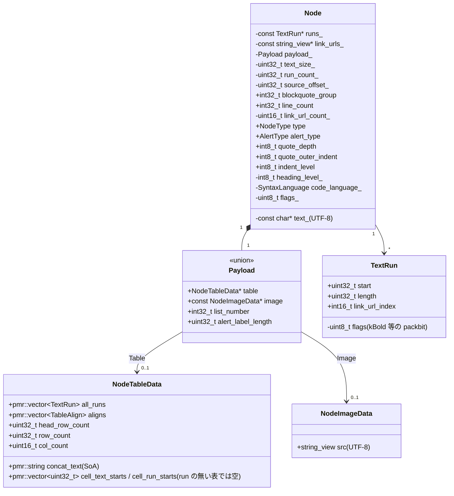

`NodeImageData` が持つのは Markdown に書かれた `src` だけである。読み込んだ画像の幅・高さはパース結果ではないので `Node` には置かず、`LayoutCache` の `DiagramEntry` が持つ（[4.2](#42-layoutcache)）。

`Node` は自分では何も所有しない trivially copyable なビューで、`static_assert(sizeof(Node) == 64)` と `static_assert(std::is_trivially_copyable_v<Node>)` で退行を検出する。ノード種別ごとのデータは 8B の union `payload_` に 1 つだけ置き、どれを読むかは `type` で決まる（`list_number` と `alert_label_length` は `flags_` の `kListOrdered` / `kHasAlertLabel` で判定する）。Table は `Document` が `unique_ptr` で所有する `NodeTableData` を、Image は `TextArena` に置いた `NodeImageData` を指す。`heading_level` / `code_language` / `flags_` は末尾の 1 バイト領域に置く。`heading_level` と `code_language` は不変条件を持たない素のフィールドで、設定するのは見出し (`heading_level`) と CodeBlock・Diagram (`code_language`) だけなので、ほかのノードでは既定値の 0 / `SyntaxLanguage::None` のまま。`flags_` は `kListOrdered`・`kTaskChecked`・`kHasChildBlocks`（loose list の LI が中身を子ブロックに持つ）・`kHasAlertLabel` と、長いテキストを区切ったノードの並びを表す `kContinuesPrev`・`kContinuesNext`・`kNewlineBeforeChunk`（3.6.6）を持つ。

> **Why**: ノード配列の伸長やパース後の詰め直しを memcpy で済ませるため、ノードには所有するメンバを置かない。`TextArena` のチャンク化と合わせて、100MB の文書でパース後のコミットが 162MB → 82MB に減った。

テキスト・`runs`・リンク URL はノード自身では持たず、「先頭ポインタ + 長さ / 件数」で外部の領域を指す（長さと件数は 4B / 2B 領域にまとめて 64B に収める）。原文をそのまま表示できるノードは `Document` の `raw_text_` を、加工が要るノード（SOFTBR の空白化、HTML entity、Alert など）のテキストと全ノードの `runs`・URL 配列は `Document` が持つ `TextArena` を指す。Table ノードのテキストは `NodeTableData::concat_text` 全体を指すので、表の本文も `GetText()` で取れる。`TextArena` はチャンクを積み足すだけのバンプアロケータで、個別には解放しない。チャンクは 4KB から倍々に広げて 1MB で頭打ちにし、256KB を超える要求は専用に確保する（小さな文書で大きく確保せず、使い残しを末尾のチャンク 1 個分程度に抑えるため）。URL 配列の要素と画像の `src` は `string_view` で、md4c の href / src が原文を指していればそのまま、参照定義の展開や脚注 URL のように原文の外にあるものだけ arena へコピーする。パース中はテキスト・`runs`・URL を `ParseContext` のスクラッチに貯め、ノード確定時に arena へ 1 回だけコピーするので、ノードごとの確保・解放がほぼ無く、旧文書の破棄も arena の塊を返すだけで済む。ソース位置は `uint32_t source_offset_` に明示的に持ち、`SourceOffset()` で取り出す。`TextRun` の装飾は個別 bool ではなく `uint8_t flags` に packbit され、`bold()` / `italic()` / `code()` / `strikethrough()` アクセサで判定する。

アクセサは `payload_` と `flags_` への薄いラッパーとして提供される:

```cpp
NodeTableData* table_data() noexcept;            // Table 以外・未設定は nullptr (const 版は const を返す)
const NodeImageData* image_data() const noexcept;
bool has_table() const noexcept;
bool has_image() const noexcept;
int8_t heading_level = 0;                        // 素のフィールド。Heading 以外は 0
SyntaxLanguage code_language = SyntaxLanguage::None;   // 素のフィールド。未設定は None
int32_t list_number() const noexcept;            // 順序なしリストは 0
bool list_ordered() const noexcept;
bool task_checked() const noexcept;
bool has_child_blocks() const noexcept;
uint32_t alert_label_length() const noexcept;    // ラベルを持たない (Alert の伝播先) ノードは 0
bool continues_prev() const noexcept;            // 区切ったテキストの続き (前のノードと同じブロック)
bool continues_next() const noexcept;            // 次のノードが続き
bool newline_before_chunk() const noexcept;      // 前のノードとの間の改行を、区切るときに取り除いた
uint32_t code_lead_length() const noexcept;      // 区切ったコードの続きで、前から続くトークンが先頭から占める長さ (無ければ 0)
SyntaxTokenType code_lead_type() const noexcept; // その種類 (kHasCodeLead が立っていなければ Plain)
void set_list_number(int32_t number) noexcept;   // payload に書いて kListOrdered を立てる
void set_alert_label_length(uint32_t length) noexcept;
```

リロードで中身が同じノードの計測結果を引き継ぐときの照合（`FindUnchangedEnds`、`document_utils.h`。比較本体は `document_utils.cpp` 内部の `NodeContentEquals`）は、ノードが指す先の内容（テキスト・`runs`・URL・画像の `src`・表）と `flags_`、区切ったコードの続きの先頭のトークン（`code_lead_*`）を比べる。表は `NodeTableData` の既定の `operator==` で比べる。

### 4.2 LayoutCache

レイアウト情報を Node から分離して管理する。

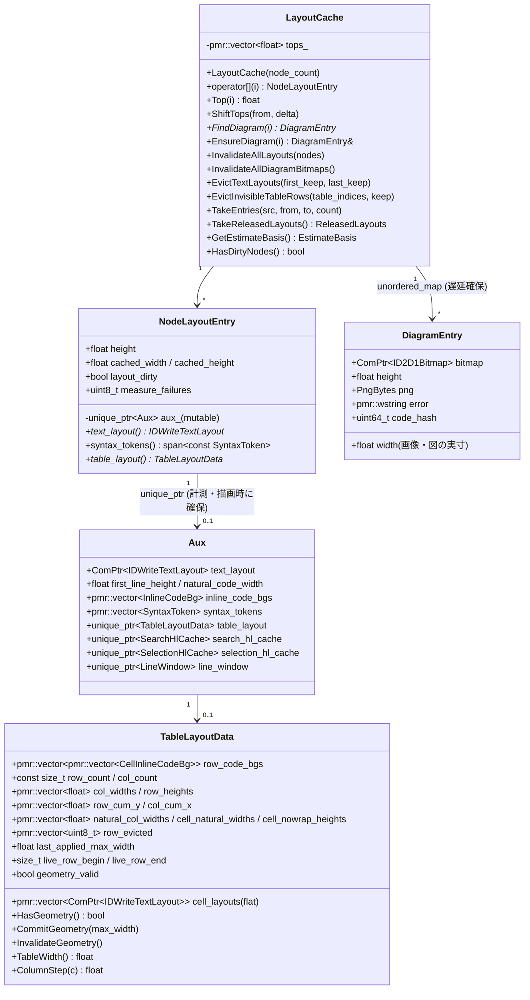

`NodeLayoutEntry` は全ノード分並ぶので、全ノードで要る高さ・実測キャッシュ・dirty フラグだけを直に持ち (24B)、テキストレイアウトやエフェクト状態など計測・描画したノードでしか使わないものは `Aux` に置いて必要になったときに確保する。既定値を書く setter（`set_first_line_height(0.0f)` など）は `Aux` を確保しない。evict では `Aux` ごと解放し (行単位 evict するテーブルは列幅・行高さを残す)、ズームの全無効化ではテーブル幾何も含めて捨てる (旧倍率の幾何は計測で全部作り直すので使い道がない)。`IDWriteTextLayout` の解放は 1 個 2〜3µs かかり、ズームや巨大な表の evict では数千〜数十万個になるので、捨てたレイアウトは `ReleasedLayouts` に溜め、`App::RunIdleWork` が多ければワーカーへ渡して解放する。文書を差し替えたときの旧 `LayoutCache` も、D2D のビットマップを持つ図だけ UI スレッドで捨て（`ReleaseDiagrams`）、残りはワーカーで捨てる。ノードの Y 位置は `entries_` とは別の連続配列 `tops_` に持つ（SoA）ので、高さが変わったときの後続ノードの一括シフト（`ShiftTops`）がエントリ全体をなめない。CodeBlock の構文トークン（`syntax_tokens`、UTF-16 位置）は計測ワーカーが `text_layout` と一緒に作り、描画時のグリフランの色分けに使う。

遅延レイアウトで計測する dirty が残っているかは `LayoutCache` 自身が `HasDirtyNodes()` として持ち、`LayoutEngine` が計測のたびに決め直す。キャッシュと一緒に動くので、推定直後（true）のキャッシュを文書ごと差し替えても遅延レイアウトが拾う。

`TableLayoutData` は `unique_ptr` でテーブルノードのみ確保される。セルレイアウトはフラット配列 `[row * col_count + col]` で持ち、`natural_col_widths` / `cell_natural_widths` などをまとめて管理する。セルのレイアウトは自然幅を測るために無限幅で作り（列の揃えは作るときに付ける）、左揃えで列幅に収まるセルはそのまま使う（`ApplyCellWidth`。折り返さないので行組みは同じで、列幅を付けると組み直しになる）。幅が変わったかはレイアウト自身の `GetMaxWidth` で判定し、変わらなければ `GetMetrics` が計測済みの高さを返すだけなので、セルごとの高さや適用幅は持たない。エントリは中身の同じノードの間でしか移らないので、行数と列数は確保したときに決まり、セル単位・行単位の配列もそのときに表の大きさで確保する。全セルを測り終えたかは行の累積位置があるか（`HasRowGeometry`。積むのは全セルを測った後の `CommitGeometry` だけ）で分かる。描画とヒットテストに要る幾何（`col_widths` / `row_heights` / `col_cum_x` / `row_cum_y`）が揃っているか（`HasGeometry`、幅も合っているかは `GeometryValidAt`）はフラグで持つ。幾何は計測完了時（`FinalizeTableLayout` の `CommitGeometry`）に揃い、`entry.height` だけを推定値で伸ばしたときなどは `InvalidateGeometry` で無効にして次の計測で作り直す。揃っていないテーブルは描かず、ヒットテストもしない（推定の行高さで描く線形のフォールバックは持たない）。表の総幅は `TableWidth`（`col_cum_x` の末尾）、列の刻み幅は `ColumnStep`、セル本文の原点は `TableCellTextOrigin` で求め、描画とヒットテストが同じ式を使う。インラインコードの背景は行ごとの配列 `row_code_bgs`（各行は列の昇順）で持ち、インラインコードを含むテーブルだけ `row_count` 分確保して行の計測で作り直す。描画は行の背景を列の昇順に読み進め、セルごとに行の全件を見ない。行単位 evict（`EvictInvisibleTableRows`）はセルレイアウトが生存しうる行範囲 `[live_row_begin, live_row_end)` のうち keep 範囲外の差分だけを捨て、背景は幅が変わらない限り有効なので残す。初回の計測（`MeasureTableCells`）は列幅を決めるために全セルを測るが、`kMaxKeptTableCells`（1024）を超える表はセルの自然幅と折り返さない高さ（`cell_nowrap_heights`）だけを残してレイアウトを捨て、全行を evict 済みにする（セルのレイアウトは 1 個 7KB ほどあり、5 万行 6 列の表で 2GB になる）。このとき列ごとに中身（テキストと装飾）が同じセルは最初の 1 つだけを測り、残りはその値を使う（`FindRepresentativeCells`。状態や種別のような同じ値が並ぶ表では計測が 4 割ほど縮む）。見出し行は書式が違うので対象にしない。evict 中の行の高さは、列幅に収まるセルは折り返さない高さそのもの、収まらないセルは折り返しの行数を見積もった値で、行が可視になって `RestoreEvictedTableRows` が作り直したときに実測へ揃える。

`DiagramEntry` の `width` / `height` は読み込んだ画像・描画した図の実寸で、再計測（幅変更・ズーム）でも表示高さの計算に使う。デバイスロスト時の `InvalidateAllDiagramBitmaps()` はビットマップを捨てても画像の寸法は残す。`png` はクリップボードコピー用の元 PNG データ（`PngBytes` = `shared_ptr<const pmr::vector<uint8_t>>`）。`error` は描画失敗時の表示用メッセージで、空でなければ再要求しない（リロード・幅変更・テーマ変更・デバイスロストで消えて再試行の契機になる）。`code_hash` は図のコード部分のハッシュで、結果を捨てても残し、要求し直すたびにテキストを読み直さない。`DiagramEntry` は画像/図のノードでしか使わないため、`diagrams_` は全ノード分の枠を持たず、ノード番号をキーにした `std::pmr::unordered_map<size_t, DiagramEntry>` として持つ。要素の位置はほかの要素の追加で動かないので、Mermaid の処理待ちが持つポインタも有効なまま。確保は結果を書き込む `EnsureDiagram(i)` だけが行い、読み取り・描画・破棄は未確保なら `nullptr` を返す `FindDiagram(i)` を使うので、表示していない画像/図ノードには確保しない。検索ヒットがあるノードでのみ `search_hl_cache` が確保される（フレーム間キャッシュ、`SearchState::generation_` と一致する間は HitTestTextRange を再計算しない）。検索・選択ハイライトは、本文 `text_layout` のうち可視範囲の上下に 1 画面ずつ足した行のテキスト範囲（`line_window`）を共有し、可視範囲がその窓に収まる間は引き直さない。

### 4.3 Document

```cpp
class Document {
public:
    constexpr Document() noexcept = default;
    Document(Document&&) noexcept = default;   // move-only
    Document& operator=(Document&&) noexcept = default;

    // text は LF 正規化済みの UTF-8 (LoadFile の出力)。scheduler はパースの一部を並列にする先
    static Document FromNormalizedMarkdown(std::pmr::string text, std::wstring_view path,
                                           std::stop_token stop_token = {}, TaskScheduler* scheduler = nullptr);
    // LF 正規化を内蔵した版 (ヘルプの埋め込みリソース / テスト用)
    static Document FromMarkdown(std::pmr::string utf8, std::wstring_view path);

    const std::pmr::vector<Node>&           GetNodes() const noexcept;  // 書き換え用のアクセサは持たない
    // 非同期リロードの worker が旧ノードと比べるための弱参照
    std::weak_ptr<const NodeStorage>        ShareNodes() const noexcept;
    constexpr const std::pmr::wstring&      GetFilePath() const noexcept;
    bool                                    HasBackingFile() const noexcept;    // 空パスとヘルプの仮想パスは false
    const std::pmr::vector<TocEntry>&       GetToc() const noexcept;    // 文書順の見出し
    bool                                    IsEmpty() const noexcept;
    std::string_view                        GetRawText() const noexcept;        // リロード差分比較用 (UTF-8)
    // 同一性 (ポインタ一致) で同じテキストかを判定できる共有参照
    const std::shared_ptr<const std::pmr::string>& ShareRawText() const noexcept;
    constexpr const std::pmr::wstring&      GetDirectory() const noexcept;      // キャッシュ済み参照

    // アンカー (ASCII 大文字小文字は無視) を付けた見出し、または脚注の定義 / 参照のノード番号。見つからなければ -1。
    int FindAnchorIndex(std::string_view anchor);
    const std::pmr::vector<size_t>& GetImageNodeIndices() const noexcept;
    const std::pmr::vector<size_t>& GetDiagramNodeIndices() const noexcept;
    const std::pmr::vector<size_t>& GetTableNodeIndices() const noexcept;

private:
    // ノードと、加工したテキスト・全ノードの runs・URL・画像の src を置く arena、Table ノードが指すテーブル本体、
    // TOC・各種ノード番号の索引・脚注
    std::shared_ptr<const NodeStorage> storage_;
    std::shared_ptr<const std::pmr::string> raw_text_;         // パース入力 (LF 正規化済み)
    // ... アンカー索引など
};
```

`Document` は `FromMarkdown` で作ったら中身を変えない。別の内容を表示するときは新しい `Document` を作り、`App::ReplaceDocument` が推定高さ入りの `LayoutCache` と一緒に丸ごと差し替える。このときノード数とキャッシュのエントリ数が等しいことを assert で確かめ、以降の描画・ヒットテスト・スクロール計算はこの一致を前提にする。`Document` は move-only で、ノードは `raw_text_` と `storage_` の arena・テーブルを直接指すが、どちらも共有で持つので move で位置が変わらず、ポインタの付け替えは要らない。`storage_` を共有で持つのは、非同期リロードの worker が UI の文書の差し替えと無関係に旧ノードを読めるようにするためでもある（3.11.3）。

アンカーは文書内リンクのクリック時にしか使わないため、パースでは作らない。`FindAnchorIndex` はクエリを ASCII 小文字に畳み、`HeadingAnchorIndex`（アンカー → ノード番号のハッシュ索引）を引く。無ければ TOC の続きから見出しのスラグを作って github-slugger と同じ規則で連番を付け、見つかるまでだけ索引を延ばす。索引はリンクを辿った文書にだけ作られ、内容を差し替えると捨てる。115MB・見出し 14 万件の文書では、パースが約 65ms 短くなる代わりに、存在しないアンカーを初めて引いたときだけ約 50ms・+19MB かかる。

脚注のアンカー (`user-content-fn-N` / `user-content-fnref-N[-M]`) は、パース時に作った `footnote_def_indices`（脚注番号 → 定義ノード）と `footnote_refs`（参照の位置）を引く。見出しの索引より先に照合するので、脚注のアンカーと同じスラグの見出しがあっても脚注が優先される。

`raw_text_` はパース入力の UTF-8 テキストを常時保持する。これはリロード時の差分比較（`AnalyzeReloadDiff`、差分位置からのスクロール量は `layout_computer.h` の `layout::CalcScrollYForDiff`）用で、ノードレベルでは検出できない編集（空行追加・末尾空白等）も UTF-8 byte オフセット精度で差分位置を求めるため。`raw_text_` は不変の共有文字列で持ち、非同期リロードのワーカーは `ShareRawText()` で旧テキストを受け取って、パースの前に差分を判定する。`raw_text_` は常に LF 正規化済み（`LoadFile` か `FromMarkdown` が `NormalizeNewlines` を通す）なので、リロード diff の新テキストも `LoadFile` で同じ正規化を通してから比較する。これによりファイル全体の改行コードを変換して保存するエディタ（issue #273）でも差分位置が編集行を正しく指し、改行コード変換のみの保存は NoChange としてスクロール位置が維持される。

### 4.4 NodeType / AlertType

```cpp
enum class NodeType : uint8_t {
    Heading, Paragraph, CodeBlock, HorizontalRule,
    ListItem, BlockQuote, Table, TaskListItem, Image,
    Diagram  // Mermaid / LaTeX 等、ビットマップで描くコードブロック。code_language で描画器を選ぶ
};

enum class AlertType : uint8_t {
    None = 0, Note = 1, Tip = 2, Important = 3, Warning = 4, Caution = 5
};
inline constexpr size_t ALERT_TYPE_COUNT = 5;

// テキストではなくビットマップを描くノード (Image / Diagram)
constexpr bool IsBitmapDrawNode(const Node& node) noexcept;
```

### 4.5 TextSelection

```cpp
struct TextSelection {
    int      start_node = -1;
    uint32_t start_pos  = 0;
    int      end_node   = -1;
    uint32_t end_pos    = 0;
    bool     active     = false;

    struct NodeRange { uint32_t start; uint32_t end; };
    // node_index に対応する選択範囲 [start, end)。end は text_size でクランプ済み
    constexpr NodeRange ClampedRange(int node_index, size_t text_size) const noexcept;

    constexpr void Clear() noexcept;
    static constexpr TextSelection MakeOrdered(
        int node_a, uint32_t pos_a,
        int node_b, uint32_t pos_b) noexcept;
};
```

---

## 5. 処理フロー

### 5.1 アプリケーション起動

```mermaid
flowchart TD
    START[wWinMain] --> DLL[SetDefaultDllDirectories<br>System32 限定 + d2d1 / dwrite を先に読む]
    DLL --> D3D[PrefetchD3DDevice<br>D3D11 デバイスを別スレッドで先行作成]
    D3D --> COM[CoInitializeEx<br>COINIT_APARTMENTTHREADED + COINIT_DISABLE_OLE1DDE]
    COM --> CFGLOAD[ConfigService::Load<br>settings.ini読み込み]
    CFGLOAD --> I18NINIT[i18n::Init<br>config.LoadWString General/Language]
    I18NINIT --> PLAN[PlanStartup → DecideStartupPlan<br>引数 __wargv / 前回ファイル / cwd]
    PLAN --> WIN[Win32Window window&#40;config&#41;]
    WIN --> PCHK{document_path<br>あり？}
    PCHK -->|Yes| PRELOAD[StartPreloadAsync<br>共有 scheduler で読み込み + パース + 推定]
    PCHK -->|No| PREP
    PRELOAD --> PREP[restore_scroll か restore_scroll_if_same_file で同一ファイルなら<br>RestoreScrollPosition + SetInitialDirectory]
    PREP --> CREATE[Win32Window::Create]

    CREATE --> REG[RegisterClassExW]
    REG --> WND[CreateWindowExW<br>WS_EX_ACCEPTFILES + WS_EX_NOREDIRECTIONBITMAP]
    WND --> INIT[App::Init]
    INIT --> CFG[ThemeService::LoadDarkMode + LoadZoomLevel<br>の値で Init、テーマを作りフォントを決める]
    CFG --> D2D[Renderer::Init&#40;hwnd, theme&#41;<br>D2D / DWrite / WIC ファクトリ + Formats<br>+ LayoutEngine::Init で計測の書式]
    D2D --> LSCHED[layout_scheduler_.Init + measurer の SetScheduler<br>WarmUp でワーカーとフォントを先に起こす]
    LSCHED --> SCHED[InitSharedScheduler<br>スレッド数の記録のみ、初回 Post で起動]
    SCHED --> FCACHE[MermaidFileCache::Init<br>索引は初回利用まで読まない]
    FCACHE --> MERM[MermaidRenderer::Init<br>WebView2 は初回描画要求で起動]
    MERM --> PANES[RestorePaneState<br>session::LoadPanes]
    PANES --> SHOWW[DWMWA_CLOAK で隠したまま<br>RestoreWindowPlacement / ShowWindow]
    SHOWW --> ATTACH{LoadInitialDocument<br>AttachPreload}

    ATTACH -->|AppliedSync| APPLY[OnParseComplete]
    ATTACH -->|AttachedAsync| WAIT[完了は PARSE_COMPLETE で合流<br>長引けばスピナー]
    ATTACH -->|None| HELP[ShowHelpResource]

    APPLY --> DEV[App::CreateRenderDevice<br>先行作成した D3D デバイスで D2D デバイス + Brushes]
    WAIT --> DEV
    HELP --> DEV
    DEV --> PEEK[PARSE_COMPLETE が届いていれば<br>OnParseComplete]
    PEEK --> SHOW[UpdateWindow → cloak 解除]
    SHOW --> LOOP[RunMessageLoop]
    LOOP --> DESTROY[Win32Window破棄<br>COMオブジェクト解放]
    DESTROY --> EXIT[CoUninitialize]
    EXIT --> END[終了]
```

`DecideStartupPlan` は、ファイル引数ならそのファイル、フォルダ引数・引数なしなら前回ファイルを `document_path` にし、実在しないパスの引数では前回ファイルを復元せずヘルプを出す。ファイルペインのフォルダは、ファイル引数ならその親、フォルダ引数ならそのフォルダ、それ以外は cwd（cwd がシステムフォルダや exe のフォルダなら前回ファイルのフォルダ）にする。ファイル引数が前回ファイルと同じ表記（大文字小文字は区別しない）ならスクロール位置を復元する（`restore_scroll`）。表記が違えば `restore_scroll_if_same_file` を立て、2 ファイルを開く `std::filesystem::equivalent` での確認はプリロードを始めた後に `wWinMain` が行う。描画デバイスの作成（`CreateRenderDevice`）は起動時の読み込みの取り込みより後に置き、デバイスを待つ間に終わった読み込みや画像デコードは最初のフレームに入れる。

### 5.2 ファイル読み込みから描画まで

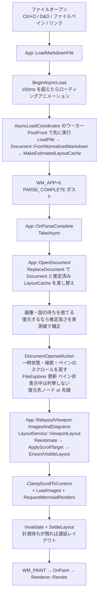

### 5.3 描画フロー

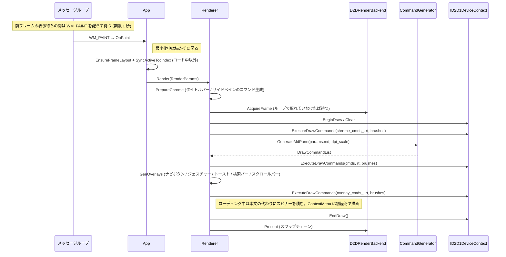

スワップチェーンは `SetMaximumFrameLatency(1)` で、Frame Latency Waitable Object がシグナルするまで次のフレームを描かない。メッセージループはこのハンドルも `MsgWaitForMultipleObjects` で待ち、待つ間は `QS_PAINT` を外して `WM_PAINT` を取り出さず、入力などを先に配る（待つ間の入力を反映して描ける）。期限は `D2DRenderBackend::kFrameWaitTimeoutMs`（1000ms）で、GPU が止まっても抜けられる。モーダルループや `UpdateWindow` からの描画のようにループが待っていない経路では、`Renderer::BeginFrame` の `AcquireFrame` が同じ期限で待つ。

---

## 6. ビルドシステム

### 6.1 CMake 構成

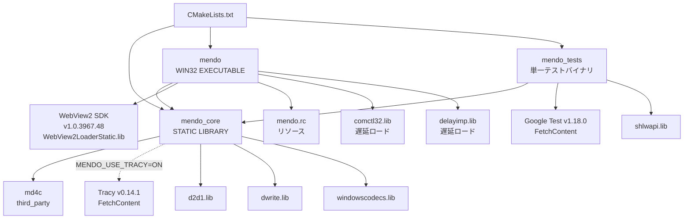

### 6.2 ビルドコマンド

**通常ビルド:**

```bash
cmake -B build
cmake --build build --config Release
```

**テストなしビルド:**

```bash
cmake -B build -DMENDO_BUILD_TESTS=OFF
cmake --build build --config Release
```

**Tracy プロファイラ有効化（既定 OFF）:**

```bash
cmake -B build -DMENDO_USE_TRACY=ON   # Tracy v0.14.1 を FetchContent で取得
```

**テスト実行:**

```bash
build/tests/Release/mendo_tests.exe --gtest_brief=1
```

### 6.3 ビルドターゲット

| ターゲット | 種別 | 説明 |
|:-----------|:-----|:-----|
| `md4c` | 静的ライブラリ | サードパーティ Markdown パーサ |
| `mendo_core` | 静的ライブラリ | テスト可能なコアロジック（WinMain・ウィンドウ・`App`・レンダラ実装を含まない） |
| `mendo` | 実行ファイル (WIN32) | メインアプリケーション |
| `mendo_tests` | テスト | 全テストを含む単一バイナリ |

`mendo_core` には **DirectWrite / WebView2 抽象化越し** のサービスが入る — `ITextMeasurer` / `IMermaidRenderer` を通して使い、`MermaidRenderer`（WebView2）と `Renderer` / `D2DRenderBackend`（Direct2D）、`App` / `Win32Window` は `mendo` 実行ファイル側に置く。`DWriteTextMeasurer` は `mendo_core` に含まれ、`dwrite.lib` への依存を持つ。

### 6.4 mermaid の埋め込み

mermaid は ESM 版（本体の `mermaid.esm.min.mjs` と、図の種類ごとに遅延読み込みされる `chunks/mermaid.esm.min/*.mjs`）を使う。CMake が `third_party/mermaid` 配下の `.mjs` を列挙して、相対パスをそのままリソース名にした RCDATA 定義（`build/generated/mermaid_esm.rc`）を生成し、`res/mendo.rc` がそれを `#include` して無圧縮のまま EXE に埋め込む。`WebResourceRequested` は `index.html` に HTML テンプレートを返し、それ以外は `.mjs` のパスだけを名前でリソースから引いてバイト列をそのまま配信する（見つからなければ 404）。名前で引けるのは ESM ファイルだけなので、数値 ID の他のリソースは返らない。CMake は rc.exe が名前として受け付けないファイル名を構成時にエラーにする。ページは必要なチャンクだけを読み込むので、使わない図の種類のコードはパースしない。ビルド時の圧縮ステップや実行時の展開処理は持たず、`cabinet.lib` にも依存しない。配布は zip なので事前圧縮しても配布サイズはほぼ変わらず、展開（ワーカー起動のたびに 12〜18ms）の方が高くつくためである。

### 6.5 MSVC ビルド最適化

| オプション | 用途 |
|:----------|:-----|
| `/MP` | マルチプロセッサコンパイル |
| `/GL` | Whole Program Optimization (Release) |
| `/Gy` | Function-Level Linking (Release) |
| `/Gw` | グローバルデータの COMDAT 化。`/OPT:REF` で未使用分を除去させる (Release) |
| `/LTCG` | Link-Time Code Generation (Release) |
| `/OPT:REF` | 未参照関数/データの除去 (Release) |
| `/OPT:ICF` | 同一COMDATの統合 (Release) |
| `/MT` | CRT静的リンク（単一exe配布のため） |
| `/DELAYLOAD` | `comdlg32.dll`（ファイルダイアログでしか使わない）、`comctl32.dll`（検索の Edit とツールチップを初めて作るまで要らない）、`shell32.dll`（ドロップ・外部で開く・設定フォルダの取得の予備だけ）と、KnownDLLs に無い `d2d1` / `dwrite` / `d3d11` / `dwmapi` / `uxtheme` を遅延ロード。`/DEPENDENTLOADFLAG:0x800` と `SetDefaultDllDirectories` で System32 からだけ解決させる |

---

## 7. テスト仕様

### 7.1 テストフレームワーク

- **Google Test** v1.18.0（FetchContentで自動取得）
- 単一テストバイナリ `mendo_tests` に全テストをリンク（CTest への個別ケース登録は行っていない）

### 7.2 テスト対象範囲

```mermaid
pie title テストカバレッジ（ファイル数ベース）
    "テスト済みモジュール" : 48
    "UIコード（テスト対象外）" : 13
```

> **テスト対象外**: `main.cpp`, `window/window.cpp`, `app/app.cpp` / `app_file.cpp` / `app_mouse.cpp`（Win32/D2D ハンドラ実装・副作用の実行）, `render/renderer*.cpp`, `render/d2d_render_backend.cpp`, `mermaid/mermaid.cpp`, `ui/context_menu.cpp`（D2D 描画部分） は Win32 / Direct2D / WebView2 依存のためユニットテスト対象外。Mermaid 描画とテキスト計測はインターフェース（`IMermaidRenderer` / `ITextMeasurer`）越しに mendo_core 側でテストされ、描画コマンドは WIC ビットマップのレンダーターゲットで実行して確かめる。

### 7.3 テストソース一覧（抜粋）

| テストファイル | 対象モジュール |
|:--------------|:-------------|
| `test_parser.cpp` | Markdownパーサ |
| `test_layout.cpp` | レイアウトエンジン |
| `test_layout_cache.cpp` | LayoutCache |
| `test_text_measurer.cpp` | ITextMeasurer |
| `test_measurer_parity.cpp` | DWriteTextMeasurer 整合性 |
| `test_syntax.cpp` | シンタックスハイライト |
| `test_theme.cpp` | テーマ定義 |
| `test_theme_service.cpp` | ThemeService |
| `test_document.cpp` | Document |
| `test_document_utils.cpp` | テキスト操作 |
| `test_html_entity.cpp` | HTML 文字参照の解決 |
| `test_anchor.cpp` | アンカーID生成（`GenerateAnchorId` はテスト用ヘルパー `document_test_helpers.h` に置く）・見出しアンカー索引・脚注アンカー |
| `test_toc.cpp` | 目次生成・`FindActiveTocIndex` |
| `test_types.cpp` | 型・データ構造 |
| `test_file_io.cpp` | ファイルI/O ユーティリティ |
| `test_file_explorer.cpp` | FileExplorer |
| `test_session_service.cpp` | session:: |
| `test_config_service.cpp` | ConfigService（設定永続化） |
| `test_ini_parser.cpp` | IniParser |
| `test_locale.cpp` | i18n ロケール |
| `test_string_convert.cpp` | UTF-8 ↔ Wide 変換 |
| `test_pane_layout.cpp` | ペインレイアウト計算・PaneController |
| `test_viewport_manager.cpp` | ViewportManager |
| `test_scroll_restoration.cpp` | ScrollRestoration |
| `test_hit_test_service.cpp` | hit_test |
| `test_last_hover_pos.cpp` | LastHoverPos |
| `test_mouse_gesture.cpp` | MouseGesture・ジェスチャ / スワイプのオーバーレイ状態 |
| `test_swipe_detector.cpp` | SwipeDetector |
| `test_nav_history.cpp` | NavHistory |
| `test_navigation_service.cpp` | リンク解決・ナビゲーション |
| `test_nav_button_format.cpp` | ナビゲーションボタン定数 |
| `test_titlebar.cpp` | TitleBar |
| `test_context_menu.cpp` | ContextMenu |
| `test_search_state.cpp` | SearchState |
| `test_search_bar.cpp` | 検索バー (検索バーのアクションの Reduce) |
| `test_tooltip_target.cpp` | TooltipTarget |
| `test_ui_constants.cpp` | UIConstants |
| `test_copy_button.cpp` | コピーボタン矩形 |
| `test_image.cpp` | ImageLoader |
| `test_help.cpp` | ヘルプドキュメント |
| `test_mermaid_util.cpp` | Mermaidユーティリティ |
| `test_mermaid_file_cache.cpp` | MermaidFileCache |
| `test_app_controller.cpp` | app_controller |
| `test_reducer.cpp` | Reducer |
| `test_resource_manager.cpp` | ResourceManager |
| `test_command_executor.cpp` | CommandExecutor（`ExecuteDrawCommands`、構文色の画素一致） |
| `test_command_generator_frame.cpp` | CommandGenerator フレーム描画 |
| `test_command_generator_content.cpp` | CommandGenerator コンテンツ描画 (モック経路) |
| `test_command_generator_highlight.cpp` | CommandGenerator ハイライト描画 |
| `test_transposition_cache.cpp` | TranspositionCache |
| `test_memory_eviction.cpp` | メモリエビクション |
| `test_task_scheduler.cpp` | TaskScheduler・ワーカー数（`SharedWorkerCount` / `LayoutWorkerCount`） |
| `test_utility.cpp` | ユーティリティ関数（`utility.h`、FNV-1a ハッシュを含む） |
| `test_async_load_coordinator.cpp` | AsyncLoadCoordinator（起動時の先行読み込みと `Attach` を含む） |
| `test_parallel_measure.cpp` | 並列計測と `ProcessDirtyBatch` のダーティバッチ計測（期限・クリップ・計測失敗の再試行） |
| `test_clipboard_manager.cpp` | ClipboardManager |
| `test_block_h_scroll.cpp` | ブロック横スクロール |
| `test_utf8_codec.cpp` | UTF-8 コーデック |

### 7.4 主要テストケース

#### Parser テスト

- [x] 見出し（H1〜H6）
- [x] 段落・太字・斜体・取り消し線・インラインコード
- [x] リンクとURL抽出
- [x] コードブロック（言語指定あり/なし）
- [x] 順序付き/なしリスト（ネスト）
- [x] タスクリスト
- [x] テーブル（アライメント）
- [x] 引用ブロック / GitHub Alerts
- [x] 水平線
- [x] Mermaid / LaTeX ブロックの検出（`NodeType::Diagram`）
- [x] リンク URL・画像 src の文字参照の解決
- [x] 装飾 run 数の上限（4096 個、表はセルごと）

#### Reducer / Effect テスト

- [x] 各 `AppAction` に対する状態遷移
- [x] Effect 発行の妥当性（`HasEffect<T>`, `GetEffect<T>`）
- [x] スクロール／ズーム／ナビゲーションの結合動作

#### NavHistory テスト

- [x] Push / GoBack / GoForward
- [x] 履歴上限（MAX_HISTORY = 1024、超過時は最古を破棄）
- [x] 参照モデルとのランダム操作比較
- [x] ロード中（保留中）に次の移動が重なる連続操作
- [x] ファイル切替時の履歴保持

#### MermaidFileCache テスト

- [x] キャッシュの保存と読み込み（バイナリ形式 `MEMC` v1）
- [x] LRU エビクション（4096エントリ / 1GB上限）
- [x] DPR ごとのエントリ分離（DPR 不一致でも消去しない）
- [x] 索引の遅延読み込み（`Init` でディスクに触れない）と変更時のみの書き戻し

#### 検索テスト

- [x] 検索バーの表示/非表示
- [x] クエリによるテキスト検索と一致件数
- [x] 次/前の一致へのナビゲーション（ラップアラウンド）
- [x] 大文字小文字区別・ハイライト切替
- [x] テーブルセル内の検索
- [x] スクロール位置に基づく最近接一致の選択

#### ビューポートテスト

- [x] ScrollTarget による位置復元
- [x] ズームイン/アウト/リセット
- [x] 全選択/クリア
- [x] max_scroll の同期

---

## 8. DPI対応仕様

### 8.1 DPI認識レベル

**Per-Monitor DPI Awareness V2** を採用（`res/mendo.manifest` の `dpiAwareness` で指定）。

```mermaid
flowchart LR
    START[アプリ起動] --> SET[マニフェスト<br>dpiAwareness = PerMonitorV2]
    SET --> INIT[初期DPIでリソース作成]
    INIT --> MOVE{モニタ間移動？}
    MOVE -->|Yes| WM[WM_DPICHANGED<br>DpiChangedAction]
    WM --> RECREATE[DPI 反映<br>ID2D1DeviceContext::SetDpi]
    RECREATE --> RESIZE[推奨矩形へ移動・リサイズ<br>SetWindowPos]
    RESIZE --> RELAYOUT[WM_SIZE<br>ペインレイアウト再計算]
    RELAYOUT --> REPAINT[再描画]
    REPAINT --> MOVE
    MOVE -->|No| WAIT[メッセージ待ち]
    WAIT --> MOVE
```

### 8.2 DIP変換

すべての座標・サイズはDIPで管理する。

```
物理ピクセル = DIP × (DPI / 96.0)
```

`IDWriteTextLayout` も DIP 単位のため、DPI 変更そのものではブラシ・テキストフォーマットの作り直しや再計測をせず、ハイライト系のキャッシュだけを捨てる。

---

## 9. タイマーIDとカスタムメッセージ

### 9.1 タイマーID（`src/app/app_constants.h`）

```cpp
namespace app_timer {

// Win32 API に渡す際は std::to_underlying でキャスト。1 始まりのギャップなし連番。
enum class Id : UINT_PTR {
    LOADING_ANIM = 1,
    SWIPE_OVERLAY,         // 2
    TOAST,                 // 3
    TOOLTIP,               // 4
    MERMAID_BATCH,         // 5
    BITMAP_MANAGE,         // 6
    MERMAID_INIT_RETRY,    // 7
    FILE_RELOAD_DEBOUNCE,  // 8
    MERMAID_IDLE,          // 9
    DEVICE_RECREATE_RETRY, // 10
    END,  // 番兵。新規タイマーはこの直前に追加する。
};

inline constexpr UINT FRAME_INTERVAL_MS         = 16;   // ~60fps アニメーション用
inline constexpr UINT LOADING_SPINNER_DELAY_MS  = 150;  // 読み込みがこれより長引いたらスピナーを出す
inline constexpr UINT FILE_RELOAD_DEBOUNCE_MS   = 200;  // ファイル変更通知のデバウンス
inline constexpr UINT FILE_RELOAD_RETRY_MS      = 50;   // truncate→rewrite 検出後の短縮リトライ
inline constexpr UINT BITMAP_MANAGE_DELAY_MS    = 150;  // スクロール停止後のビットマップ解放/再構築
inline constexpr UINT TOAST_DURATION_MS         = 1300; // トースト表示時間
inline constexpr UINT DEVICE_RECREATE_RETRY_MS  = 500;  // 描画デバイスの作り直しに失敗した後の再試行間隔

// [kFirstTimer, kLastTimer] の範囲判定に使う
inline constexpr Id kFirstTimer = Id::LOADING_ANIM;
inline constexpr Id kLastTimer  = static_cast<Id>(std::to_underlying(Id::END) - 1);
}
```

遅延レイアウト・検索の続き・GPU 転送のように時間で区切って進める仕事はタイマーを使わない。WM_TIMER は約 15.6ms 刻みでしか発火せず 4〜8ms の仕事の合間が空くので、メッセージループが入力と描画を配り終えた空き時間に `App::RunIdleWork` で進める。

### 9.2 カスタムメッセージ（`src/app/app_constants.h`）

```cpp
namespace app_msg {
inline constexpr UINT IMAGE_LOADED   = WM_APP + 2;  // +1, +3〜+5 は欠番
inline constexpr UINT PARSE_COMPLETE = WM_APP + 6;
inline constexpr UINT MERMAID_DISK_LOADED = WM_APP + 7;  // Mermaid PNG の worker デコード完了
inline constexpr UINT FILE_LISTED    = WM_APP + 8;  // ファイルペインの列挙完了
inline constexpr UINT END            = WM_APP + 9;  // 上限（この値未満が有効範囲）
}
```

検索欄のフォーカスはメッセージにせず、`WindowHost` を通してその場で行う（3.1.2）。ファイルの読み込みは常に非同期で、スピナーは読み込みが `LOADING_SPINNER_DELAY_MS`（150ms）より長引いたときだけ出す。

---

## 10. 非機能要件

### 10.1 パフォーマンス目標

| 項目 | 目標値 |
|:-----|:------|
| 小規模ファイル（< 100行）の初回表示 | < 50ms |
| 大規模ファイル（> 10,000行）の初回表示 | < 500ms |
| スクロール時のフレームレート | 60fps |
| メモリ使用量（1万行ファイル表示時） | < 100MB |
| ファイル変更検出の応答時間 | < 500ms |

### 10.2 対応環境

| 項目 | 要件 |
|:-----|:-----|
| OS | Windows 10 1809 以降 / Windows 11（WebP 画像のデコーダ WebP Image Extension が 1809 以降のため） |
| アーキテクチャ | x64 / arm64 |
| ランタイム | WebView2 Runtime（Mermaid描画に必要） |
| コンパイラ | MSVC (C++23) |
| ビルドツール | CMake 4.2+（Visual Studio 2026 ジェネレータ） |

---

## 11. 付録

### 付録A: ファイル一覧

```
src/
├── main.cpp                       # エントリポイント (wWinMain)
├── pch.h                          # プリコンパイル済みヘッダ
├── app/                           # アプリケーション層
│   ├── app.h / app.cpp            # App 統括（Init / Dispatch / 副作用の実行 Execute / OnPaint / レイアウト / テーマ適用 / コンテキストメニュー）+ SystemCursors + WindowHost
│   ├── app_file.cpp               # LoadMarkdownFile / BeginAsyncLoad / OnParseComplete
│   ├── app_mouse.cpp              # マウス入力ハンドラ (クリック / ホバー / ドラッグ)
│   ├── clipboard_manager.h / .cpp # ClipboardManager (コピー/PNG 保存/SVG コピー)
│   ├── app_state.h                # AppState (全状態集約) + reducer と App が導出するペイン/ブロック情報 + ResolveGestureOverlay
│   ├── reload_flow.h              # 非同期ロード完了時の分岐判定 (純粋関数)
│   ├── startup_plan.h / .cpp      # 起動時の初期表示の決定
│   ├── app_events.h               # AppAction variant + app_controller の宣言
│   ├── app_constants.h            # タイマーID / WM_APP+N / WPARAM 定義
│   ├── app_controller.cpp         # app_controller (Event→Action)
│   ├── reducer.h / reducer.cpp    # Reducer (Action+State→Effects, in-place) + ドメイン別 Reduce*
│   ├── side_effect.h              # SideEffect 単一variant + PushEffect
│   └── resource_manager.h/.cpp    # ResourceManager + ResourceManagerHost
├── window/                        # ウィンドウ層
│   └── window.h / window.cpp      # Win32Window
├── render/                        # 描画層
│   ├── renderer.h / renderer.cpp  # Direct2D 描画統括 (タイトルバー・サイドペイン・オーバーレイのコマンドは command_generator の chrome:: / overlay::)
│   ├── renderer_resources.cpp     # ブラシ・フォーマット
│   ├── d2d_render_backend.h / .cpp # D2DRenderBackend (D3D11 デバイス / スワップチェーン / フレーム待ち)
│   ├── render_params.h            # レンダリングパラメータ (MdPaneParams / RenderParams 等)
│   ├── draw_command.h             # DrawCommand variant + DrawCommandList (pmr::vector) + FixedBrushArray / ExecuteDrawCommands 宣言
│   ├── brush_id.h                 # ブラシ ID 定義
│   ├── text_layout_cache.h        # 繰り返し描く短い文字列のテキストレイアウト作り置き
│   ├── command_generator.h / .cpp # 描画コマンド生成 (テーブル / ハイライトを含む)
│   └── command_executor.cpp       # 描画コマンド実行 (固定ブラシ・可視グリフランの描画と構文色付け)
├── core/                          # コアドメイン
│   ├── document_types.h           # Node (64B), AlertType, NodeType, NodeTableData, TocEntry etc.
│   ├── text_types.h               # TextRun, TextSelection etc.
│   ├── text_arena.h               # TextArena (ノードのテキスト・TextRun・リンク URL を置くチャンク式バンプアロケータ)
│   ├── parser.h / parser.cpp      # Markdown パース (md4c UTF-8) + GitHub Alerts 検出 + ResolveHtmlEntity 宣言
│   ├── anchor.h / anchor.cpp      # 見出しのスラグ生成 + 見出しアンカー索引 + 脚注アンカーの生成・解決
│   ├── html_entities.cpp          # HTML エンティティ解決
│   ├── html_entity_table.h        # HTML5 名前付き文字参照表 (生成コード)
│   ├── unicode_lower_table.h      # 非 ASCII の単純小文字化表 (生成コード)
│   ├── document.h / document.cpp  # Document (ノード一式とパース入力 UTF-8 の保持)
│   ├── document_utils.h / .cpp    # テキスト操作 + 改行の正規化 (NormalizeNewlines) + リロード判定 (AnalyzeReloadDiff / FindNodeBySourceOffset)
│   ├── selection_html.h / .cpp    # 選択範囲の HTML 生成
│   ├── syntax.h / syntax.cpp      # シンタックスハイライト
│   └── syntax_keywords.h          # 言語別キーワード辞書
├── layout/                        # レイアウト層
│   ├── layout.h / layout.cpp      # ITextMeasurer (本番/モック差し替え用) + MeasureEntry + LayoutEngine + LayoutService + ワーカー並列計測 (MeasureIndicesParallel)
│   ├── layout_cache.h / .cpp      # LayoutCache (レイアウトデータ)
│   ├── layout_computer.h / .cpp   # ノード Y 位置・高さ再計算ユーティリティ (layout) + 文書位置と Y 座標の突き合わせ (FindActiveTocIndex / CalcScrollYForDiff)
│   ├── viewport_manager.h         # ViewportManager + ScrollTarget
│   ├── block_h_scroll.h           # ブロック横スクロール幾何計算 + 描画コンテキスト
│   ├── doc_dwrite_bridge.h / .cpp # Document⇔DirectWrite 計測ブリッジ
│   └── dwrite_measurer.h / .cpp   # DirectWrite 実装
├── theme/                         # テーマ層
│   ├── theme.h / theme.cpp        # Theme + theme_palette
│   ├── theme_palette.h            # 配色パレットとフォント候補の定義
│   └── theme_service.h / .cpp     # テーマ管理サービス
├── nav/                           # ナビゲーション層
│   └── nav.h / nav.cpp            # NavHistory + LinkClickResult / ClassifyLinkClick
├── input/                         # 入力処理層
│   ├── hit_test_service.h / .cpp  # hit_test 名前空間の関数群 + MdPaneHitContext
│   ├── mouse_gesture.h            # MouseGesture (ヘッダオンリー)
│   └── swipe_detector.h           # SwipeDetector (ヘッダオンリー)
├── io/                            # I/O層
│   ├── file_dialog_service.h / .cpp # OpenFileDialog 等
│   ├── file_watcher.h / .cpp      # ReadDirectoryChangesW 監視
│   ├── file_explorer.h / .cpp     # ディレクトリブラウザ
│   ├── image_loader.h / .cpp      # 非同期画像読み込み
│   ├── async_load_coordinator.h / .cpp # LoadFile・非同期ロード調停 (stop_token・起動時の先行読み込み)・AsyncLoadResult
│   ├── ini_parser.h               # IniParser (ヘッダオンリー)
│   └── config_service.h / .cpp    # ConfigService + session::
├── mermaid/                       # Mermaid層
│   ├── mermaid.h / mermaid.cpp    # MermaidRenderer (WebView2)
│   ├── mermaid_renderer_interface.h # IMermaidRenderer
│   ├── mermaid_util.h / .cpp      # ヘルパー
│   └── mermaid_file_cache.h / .cpp # 永続キャッシュ (MEMC v1)
├── ui/                            # UI層 (Win32/D2D 依存ありの可視層)
│   ├── titlebar.h / titlebar.cpp  # TitleBar
│   ├── context_menu.h / .cpp      # ContextMenu (D2D描画)
│   ├── context_menu_impl.h        # 内部実装
│   ├── tooltip.h / tooltip.cpp    # Tooltip + TooltipTarget + ApplyDarkModeToWindow
│   ├── search_state.h / .cpp      # SearchState
│   └── last_hover_pos.h           # LastHoverPos (ヘッダオンリー)
└── util/                          # ユーティリティ層 (Win32 依存最小、テスト容易)
    ├── utility.h                  # 汎用ユーティリティ (ScopeGuard / FNV-1a / PngBytes / PmrFormat / overloaded)
    ├── win32_util.h               # Win32 小物 (IsKeyDown / LoadRcData / BindWindowInstance / LogHrFailure)
    ├── string_convert.h           # UTF-8 ↔ Wide 変換 (ヘッダオンリー)
    ├── utf8_codec.h               # UTF-8 低レベルコーデック
    ├── file_io.h / .cpp           # ファイルI/Oヘルパー
    ├── wic_util.h                 # WIC ヘルパー
    ├── d2d_util.h                 # Direct2D ヘルパー
    ├── ascii_util.h               # ASCII 操作
    ├── transposition_cache.h      # TranspositionCache (固定長、transposition rule)
    ├── worker_latch.h             # ワーカー完了同期ラッチ
    ├── parallel_for.h             # scheduler 上の chunk 分割並列実行
    ├── clipboard_util.h           # クリップボード補助
    ├── win_handle.h               # UniqueResource (RAII) + 定義済み traits
    ├── i18n.h                     # 国際化
    ├── resource.h                 # リソースID
    ├── ui_constants.h             # UI 定数 + DIP⇔ピクセル変換・ボタン矩形・SearchBarLayout
    ├── ui_types.h                 # DipPoint / DipRect / PaneRect / ScrollState / ScrollRestoration / OverlayButton / LeftDrag / NavDirection
    ├── pane_layout.h / .cpp       # PaneZone / PaneLayout / PaneController / PaneScrollInfo / PaneLayoutCache
    ├── task_scheduler.h / .cpp    # TaskScheduler + ワーカー数 (SharedWorkerCount / LayoutWorkerCount)
    └── profiler.h                 # パフォーマンス計測
```

### 付録B: 依存ライブラリ

| ライブラリ | バージョン | 用途 | ライセンス |
|:-----------|:----------|:-----|:----------|
| md4c | 0.6.0 | Markdown パース | MIT |
| WebView2 SDK | 1.0.3967.48 | Mermaid描画用ブラウザコントロール | BSD |
| Google Test | 1.18.0 | ユニットテスト | BSD-3-Clause |
| mermaid.js | 12.2.0 | ダイアグラム描画 | MIT |
| Tracy | 0.14.1 | プロファイラ（`MENDO_USE_TRACY=ON` 時のみ） | BSD-3-Clause |

### 付録C: Markdown表示サンプル

本節は mendo の表示テストを兼ねている。

---

#### C.1 見出しレベルテスト

# 見出しレベル1
## 見出しレベル2
### 見出しレベル3
#### 見出しレベル4
##### 見出しレベル5
###### 見出しレベル6

---

#### C.2 テキスト装飾テスト

これは **太字** のテストです。
これは *斜体* のテストです。
これは ***太字かつ斜体*** のテストです。
これは ~~取り消し線~~ のテストです。
これは `インラインコード` のテストです。
これは **太字の中に *斜体* を含む**テストです。

---

#### C.3 リンクテスト

- 外部リンク: [GitHub](https://github.com)
- 内部アンカー: [はじめに](#1-はじめに)
- URLそのまま: https://example.com

---

#### C.4 リストテスト

##### 順序なしリスト

- 項目 A
  - サブ項目 A-1
  - サブ項目 A-2
    - サブサブ項目 A-2-a
    - サブサブ項目 A-2-b
  - サブ項目 A-3
- 項目 B
- 項目 C

##### 順序付きリスト

1. 第一ステップ
2. 第二ステップ
   1. サブステップ 2-1
   2. サブステップ 2-2
3. 第三ステップ

##### タスクリスト

- [x] Markdownパーサ統合 (md4c, UTF-8)
- [x] Direct2D / DirectWrite レンダリング
- [x] サービスアーキテクチャへのリファクタリング
- [x] Reducer / SideEffect による副作用の分離
- [x] AppState による状態集約
- [x] レンダーステート構築の値型化（render_params.h）
- [x] ナビゲーション機能（NavHistory + ClassifyLinkClick 自由関数）
- [x] マウスジェスチャ
- [x] カスタムタイトルバー
- [x] トースト通知
- [x] タッチパッドスワイプ検出
- [x] カスタムコンテキストメニュー
- [x] 非同期画像読み込み（WIC + TaskScheduler）
- [x] ヘルプドキュメント
- [x] 検索機能（インクリメンタル + ASCII の大文字小文字畳み込み）
- [x] 国際化 (i18n: ja/en)
- [x] Mermaid 永続ファイルキャッシュ（MEMC v1, DPR 量子化）
- [x] ツールチップ
- [x] Mermaidダイアグラム保存ボタン + SVG クリップボードコピー
- [x] ファイル監視（ReadDirectoryChangesW + 短縮リトライ）
- [x] session:: によるセッション復元
- [x] 検索バー制御の分離 (SearchGroup のデータと reducer の関数)
- [x] LRUキャッシュ汎用化
- [x] RAIIハンドルラッパー（UniqueResource + ClipboardSession）
- [x] パスインターン化による NavHistory メモリ削減
- [x] Node 拡張データの variant 統合（メモリ削減）
- [x] LoadFile による UTF-8 のままの読み込み
- [x] ライブリロード差分検出（AnalyzeReloadDiff）
- [ ] パフォーマンス最適化
- [ ] ドキュメント整備

---

#### C.5 引用テスト

> これは引用ブロックです。
> 複数行にわたる引用を表示できます。

> **ネストされた引用:**
>
> > 内側の引用です。
> > Direct2D は高速な2Dグラフィックスを提供します。

---

#### C.6 コードブロックテスト

##### C++ コード

```cpp
#include <windows.h>
#include <d2d1.h>
#include <dwrite.h>
#include <string>
#include <vector>

// Direct2D レンダーターゲットの初期化
HRESULT InitializeD2D(HWND hwnd, ID2D1HwndRenderTarget** ppRT) {
    ID2D1Factory* pFactory = nullptr;
    HRESULT hr = D2D1CreateFactory(
        D2D1_FACTORY_TYPE_SINGLE_THREADED,
        &pFactory
    );

    if (SUCCEEDED(hr)) {
        RECT rc;
        GetClientRect(hwnd, &rc);

        D2D1_SIZE_U size = D2D1::SizeU(
            rc.right - rc.left,
            rc.bottom - rc.top
        );

        hr = pFactory->CreateHwndRenderTarget(
            D2D1::RenderTargetProperties(),
            D2D1::HwndRenderTargetProperties(hwnd, size),
            ppRT
        );
    }

    if (pFactory) pFactory->Release();
    return hr;
}

int main() {
    std::vector<std::string> items = {"alpha", "beta", "gamma"};
    for (const auto& item : items) {
        std::cout << item << std::endl;
    }
    return 0;
}
```

##### Python コード

```python
import hashlib
from pathlib import Path
from typing import Optional

class MarkdownParser:
    """Markdownファイルのパーサクラス"""

    def __init__(self, path: str):
        self.path = Path(path)
        self._cache: dict[str, str] = {}

    def parse(self) -> list[dict]:
        """ファイルを読み込みパースする"""
        content = self.path.read_text(encoding="utf-8")
        lines = content.splitlines()

        nodes = []
        for i, line in enumerate(lines):
            if line.startswith("# "):
                nodes.append({
                    "type": "heading",
                    "level": 1,
                    "text": line[2:],
                    "line": i + 1
                })
            elif line.startswith("```"):
                pass

        return nodes

    def get_hash(self) -> Optional[str]:
        """ファイルのSHA-256ハッシュを返す"""
        if not self.path.exists():
            return None
        data = self.path.read_bytes()
        return hashlib.sha256(data).hexdigest()


if __name__ == "__main__":
    parser = MarkdownParser("README.md")
    for node in parser.parse():
        print(f"[L{node['line']}] {node['type']}: {node['text']}")
```

##### JavaScript コード

```javascript
/**
 * Mermaidダイアグラムのレンダリング
 * WebView2経由で呼び出される
 */
async function renderMermaid(code, config) {
    const { mermaid } = await import('./mermaid.esm.min.mjs');

    mermaid.initialize({
        startOnLoad: false,
        theme: config.darkMode ? 'dark' : 'default',
        securityLevel: 'strict',
        fontFamily: '"Yu Gothic UI", sans-serif',
    });

    try {
        const { svg } = await mermaid.render('diagram', code);

        const canvas = document.createElement('canvas');
        const ctx = canvas.getContext('2d');
        const img = new Image();

        return new Promise((resolve, reject) => {
            img.onload = () => {
                canvas.width = img.naturalWidth * 2;
                canvas.height = img.naturalHeight * 2;
                ctx.scale(2, 2);
                ctx.drawImage(img, 0, 0);
                resolve(canvas.toDataURL('image/png'));
            };
            img.onerror = reject;
            img.src = `data:image/svg+xml;charset=utf-8,${encodeURIComponent(svg)}`;
        });
    } catch (error) {
        console.error('Mermaid render failed:', error.message);
        return null;
    }
}
```

##### TypeScript コード

```typescript
import { readFileSync } from 'fs';
import * as path from 'path';

interface MarkdownNode {
    type: 'heading' | 'paragraph' | 'code_block';
    level?: number;
    text: string;
    language?: string;
}

type ParseResult = {
    nodes: MarkdownNode[];
    metadata: Record<string, unknown>;
};

class MarkdownLoader {
    private cache = new Map<string, ParseResult>();

    constructor(private readonly basePath: string) {}

    async load(filename: string): Promise<ParseResult> {
        const fullPath = path.join(this.basePath, filename);
        const cached = this.cache.get(fullPath);
        if (cached !== undefined) {
            return cached;
        }

        const content: string = readFileSync(fullPath, 'utf-8');
        const nodes: MarkdownNode[] = this.parse(content);
        const result: ParseResult = { nodes, metadata: {} };
        this.cache.set(fullPath, result);
        return result;
    }

    private parse(content: string): MarkdownNode[] {
        const lines = content.split('\n');
        const nodes: MarkdownNode[] = [];
        for (const line of lines) {
            if (line.startsWith('# ')) {
                nodes.push({ type: 'heading', level: 1, text: line.slice(2) });
            } else if (line.trim().length > 0) {
                nodes.push({ type: 'paragraph', text: line });
            }
        }
        return nodes;
    }
}

const loader = new MarkdownLoader('./docs');
loader.load('README.md').then((result) => {
    console.log(`ノード数: ${result.nodes.length}`);
});
```

##### Go コード

```go
package main

import (
	"bufio"
	"fmt"
	"os"
	"strings"
)

type MarkdownNode struct {
	Type  string
	Level int
	Text  string
}

func ParseMarkdown(content string) []MarkdownNode {
	var nodes []MarkdownNode
	scanner := bufio.NewScanner(strings.NewReader(content))

	for scanner.Scan() {
		line := scanner.Text()
		switch {
		case strings.HasPrefix(line, "# "):
			nodes = append(nodes, MarkdownNode{
				Type:  "heading",
				Level: 1,
				Text:  line[2:],
			})
		case strings.HasPrefix(line, "```"):
			lang := strings.TrimPrefix(line, "```")
			nodes = append(nodes, MarkdownNode{
				Type: "code_fence",
				Text: lang,
			})
		default:
			if len(strings.TrimSpace(line)) > 0 {
				nodes = append(nodes, MarkdownNode{
					Type: "paragraph",
					Text: line,
				})
			}
		}
	}
	return nodes
}

func main() {
	data, err := os.ReadFile("README.md")
	if err != nil {
		fmt.Fprintf(os.Stderr, "読み込みエラー: %v\n", err)
		os.Exit(1)
	}

	nodes := ParseMarkdown(string(data))
	for i, node := range nodes {
		fmt.Printf("[%d] %s: %s\n", i, node.Type, node.Text)
	}
}
```

##### Rust コード

```rust
use std::fs;
use std::io::{self};
use std::path::Path;
use std::collections::HashMap;

#[derive(Debug, Clone)]
enum NodeType {
    Heading(u8),
    Paragraph,
    CodeBlock(String),
}

#[derive(Debug, Clone)]
struct MarkdownNode {
    node_type: NodeType,
    text: String,
}

struct Parser {
    cache: HashMap<String, Vec<MarkdownNode>>,
}

impl Parser {
    fn new() -> Self {
        Parser { cache: HashMap::new() }
    }

    fn parse_file(&mut self, path: &Path) -> io::Result<&Vec<MarkdownNode>> {
        let key = path.to_string_lossy().to_string();
        if !self.cache.contains_key(&key) {
            let content = fs::read_to_string(path)?;
            let nodes = self.parse(&content);
            self.cache.insert(key.clone(), nodes);
        }
        Ok(self.cache.get(&key).unwrap())
    }

    fn parse(&self, content: &str) -> Vec<MarkdownNode> {
        let mut nodes = Vec::new();
        for line in content.lines() {
            if let Some(text) = line.strip_prefix("# ") {
                nodes.push(MarkdownNode {
                    node_type: NodeType::Heading(1),
                    text: text.to_string(),
                });
            } else if !line.trim().is_empty() {
                nodes.push(MarkdownNode {
                    node_type: NodeType::Paragraph,
                    text: line.to_string(),
                });
            }
        }
        nodes
    }
}

fn main() -> io::Result<()> {
    let mut parser = Parser::new();
    let path = Path::new("README.md");
    let nodes = parser.parse_file(path)?;

    for (i, node) in nodes.iter().enumerate() {
        println!("[{}] {:?}: {}", i, node.node_type, node.text);
    }
    Ok(())
}
```

##### Bash コード

```bash
#!/bin/bash
# Markdownファイルの見出しを抽出するスクリプト

set -euo pipefail

readonly SCRIPT_DIR="$(cd "$(dirname "${BASH_SOURCE[0]}")" && pwd)"
readonly DEFAULT_EXT="*.md"

usage() {
    echo "Usage: $(basename "$0") [-d directory] [-l level] [-h]"
    echo "  -d  検索ディレクトリ"
    echo "  -l  見出しレベル (1-6)"
    echo "  -h  ヘルプ"
    exit 0
}

extract_headings() {
    local file="$1"
    local level="${2:-}"

    if [[ ! -f "$file" ]]; then
        echo "エラー: ファイルが見つかりません: $file" >&2
        return 1
    fi

    local pattern="^#{1,6} "
    if [[ -n "$level" ]]; then
        pattern="^#{${level}} "
    fi

    grep -nE "$pattern" "$file" | while IFS=: read -r lineno content; do
        local depth="${content%%[! #]*}"
        depth="${#depth}"
        printf "  L%-4d [H%d] %s\n" "$lineno" "$depth" "${content#*# }"
    done
}

main() {
    local dir="."
    local level=""

    while getopts "d:l:h" opt; do
        case "$opt" in
            d) dir="$OPTARG" ;;
            l) level="$OPTARG" ;;
            h) usage ;;
            *) usage ;;
        esac
    done

    echo "=== Markdown見出し一覧 ==="
    find "$dir" -name "$DEFAULT_EXT" -type f | sort | while read -r file; do
        echo ""
        echo "📄 $file"
        extract_headings "$file" "$level"
    done
}

main "$@"
```

##### PowerShell コード

```powershell
#Requires -Version 5.1
<#
.SYNOPSIS
    Markdownファイルの解析ユーティリティ
.DESCRIPTION
    指定ディレクトリ内のMarkdownファイルから見出しとリンクを抽出する
#>

[CmdletBinding()]
param(
    [Parameter(Position = 0)]
    [string]$Path = ".",

    [ValidateRange(1, 6)]
    [int]$HeadingLevel = 0,

    [switch]$IncludeLinks
)

class MarkdownInfo {
    [string]$File
    [System.Collections.Generic.List[hashtable]]$Headings
    [System.Collections.Generic.List[hashtable]]$Links

    MarkdownInfo([string]$file) {
        $this.File = $file
        $this.Headings = [System.Collections.Generic.List[hashtable]]::new()
        $this.Links = [System.Collections.Generic.List[hashtable]]::new()
    }
}

function Get-MarkdownHeadings {
    [CmdletBinding()]
    param(
        [Parameter(Mandatory, ValueFromPipeline)]
        [string]$FilePath,

        [int]$Level = 0
    )

    process {
        $info = [MarkdownInfo]::new($FilePath)
        $lineNum = 0

        foreach ($line in Get-Content -Path $FilePath -Encoding UTF8) {
            $lineNum++

            if ($line -match '^(#{1,6})\s+(.+)$') {
                $depth = $Matches[1].Length
                if ($Level -eq 0 -or $depth -eq $Level) {
                    $info.Headings.Add(@{
                        Line  = $lineNum
                        Level = $depth
                        Text  = $Matches[2]
                    })
                }
            }

            if ($line -match '\[([^\]]+)\]\(([^)]+)\)') {
                $info.Links.Add(@{
                    Line = $lineNum
                    Text = $Matches[1]
                    Url  = $Matches[2]
                })
            }
        }

        Write-Output $info
    }
}

$mdFiles = Get-ChildItem -Path $Path -Filter "*.md" -Recurse -File
Write-Host "=== Markdown解析結果 ===" -ForegroundColor Cyan

foreach ($file in $mdFiles) {
    $result = $file.FullName | Get-MarkdownHeadings -Level $HeadingLevel
    Write-Host "`n$($result.File)" -ForegroundColor Green

    foreach ($h in $result.Headings) {
        $indent = "  " * $h.Level
        Write-Host "${indent}[H$($h.Level)] L$($h.Line): $($h.Text)"
    }

    if ($IncludeLinks -and $result.Links.Count -gt 0) {
        Write-Host "  --- リンク ---" -ForegroundColor Yellow
        foreach ($link in $result.Links) {
            Write-Host "  L$($link.Line): [$($link.Text)]($($link.Url))"
        }
    }
}
```

##### Cmd (バッチ) コード

```cmd
@echo off
rem Markdownファイルの見出しを簡易抽出するバッチスクリプト
setlocal enabledelayedexpansion

set "TARGET_DIR=%~1"
if "%TARGET_DIR%"=="" set "TARGET_DIR=."

echo === Markdown 見出し抽出ツール ===
echo 対象ディレクトリ: %TARGET_DIR%
echo.

set "FILE_COUNT=0"
set "HEADING_COUNT=0"

for /r "%TARGET_DIR%" %%f in (*.md) do (
    set /a FILE_COUNT+=1
    echo ファイル: %%f
    set "LINE_NUM=0"

    for /f "usebackq delims=" %%l in ("%%f") do (
        set /a LINE_NUM+=1
        set "LINE=%%l"

        if "!LINE:~0,2!"=="# " (
            echo   L!LINE_NUM!: [H1] !LINE:~2!
            set /a HEADING_COUNT+=1
        )
        if "!LINE:~0,3!"=="## " (
            echo   L!LINE_NUM!: [H2] !LINE:~3!
            set /a HEADING_COUNT+=1
        )
        if "!LINE:~0,4!"=="### " (
            echo   L!LINE_NUM!: [H3] !LINE:~4!
            set /a HEADING_COUNT+=1
        )
    )
    echo.
)

echo === 結果 ===
echo ファイル数: %FILE_COUNT%
echo 見出し数:   %HEADING_COUNT%

endlocal
exit /b 0
```

##### JSON コード

```json
{
  "name": "mendo",
  "version": "0.1.0",
  "description": "Direct2D / DirectWrite による高速 Markdown ビュアー",
  "platform": {
    "os": "Windows",
    "minVersion": "10.0.17763",
    "architecture": ["x64"]
  },
  "build": {
    "language": "C++23",
    "compiler": "MSVC",
    "system": "CMake",
    "minCmakeVersion": "3.20"
  },
  "features": {
    "rendering": true,
    "syntaxHighlight": true,
    "mermaid": true,
    "search": true,
    "darkMode": true,
    "i18n": ["ja", "en"],
    "experimental": null
  },
  "dependencies": [
    { "name": "md4c",        "version": "latest",       "license": "MIT" },
    { "name": "WebView2",    "version": "1.0.2903.40",  "license": "BSD" },
    { "name": "WIL",         "version": "1.0.240803.1", "license": "MIT" },
    { "name": "Google Test", "version": "1.18.0",       "license": "BSD-3-Clause" }
  ],
  "performance": {
    "smallFileMs": 50,
    "largeFileMs": 500,
    "targetFps": 60,
    "memoryBudgetMB": 100,
    "fileSizeLimitGB": 4
  },
  "zoomSteps": [
    0.25, 0.33, 0.50, 0.67, 0.75, 0.80, 0.90,
    1.00,
    1.10, 1.25, 1.50, 1.75, 2.00, 2.50, 3.00, 4.00, 5.00
  ]
}
```

##### JSONC コード（コメント・末尾カンマ対応）

```jsonc
{
  // タイマーIDの一覧（src/app/app_constants.h と一致）
  "timers": {
    "LOADING_ANIM":          1,
    "SWIPE_OVERLAY":         2,
    "TOAST":                 3,
    "TOOLTIP":               4,
    "MERMAID_BATCH":         5,
    "BITMAP_MANAGE":         6,
    "MERMAID_INIT_RETRY":    7,
    "FILE_RELOAD_DEBOUNCE":  8,
    "MERMAID_IDLE":          9,
    "DEVICE_RECREATE_RETRY": 10,
  },
  /* カスタム Win32 メッセージ
     WM_APP+N の形式で識別子を採番している (+1, +3〜+5 は欠番) */
  "messages": {
    "IMAGE_LOADED":        "WM_APP+2",
    "PARSE_COMPLETE":      "WM_APP+6",
    "MERMAID_DISK_LOADED": "WM_APP+7",
  },
}
```

##### Java コード

```java
import java.util.List;

/** 行数を数える */
public final class LineCounter {
    private static final long LIMIT = 1_000_000L;

    @Override
    public String toString() {
        return """
            LineCounter(limit=%d)
            """.formatted(LIMIT);
    }

    public static int count(List<String> lines) {
        int n = 0;
        for (String line : lines) {
            if (!line.isBlank()) n++;
        }
        return n;
    }
}
```

##### C# コード

```csharp
#region Paths
namespace Mendo.Tools;

public record DocEntry(string Path, int Lines);

public static class DocScanner
{
    private const string Root = @"C:\Users\docs\";

    public static async Task<List<DocEntry>> ScanAsync(string pattern = "*.md")
    {
        var result = new List<DocEntry>();
        foreach (var file in Directory.EnumerateFiles(Root, pattern))
        {
            var lines = await File.ReadAllLinesAsync(file);
            result.Add(new DocEntry(file, lines.Length));
        }
        decimal ratio = 0.5m;
        Console.WriteLine($"found {result.Count} files ({ratio})");
        return result;
    }
}
#endregion
```

##### Kotlin コード

```kotlin
data class Heading(val level: Int, val text: String)

fun parseHeadings(lines: List<String>): List<Heading> =
    lines.filter { it.startsWith("#") }
        .map { line ->
            val level = line.takeWhile { it == '#' }.length
            Heading(level, line.drop(level).trim())
        }

val template = """
    # ${'$'}title
""".trimIndent()
```

##### Swift コード

```swift
import Foundation

struct Heading {
    let level: Int
    var text: String
}

#if DEBUG
let verbose = true
#endif

func parse(_ line: String) -> Heading? {
    guard line.hasPrefix("#") else { return nil }
    let level = line.prefix { $0 == "#" }.count
    return Heading(level: level, text: String(line.dropFirst(level)))
}
```

##### PHP コード

```php
<?php
declare(strict_types=1);

#[Route('/docs/{name}')]
function renderDoc(string $name): string
{
    // 拡張子を補う
    $path = __DIR__ . "/docs/{$name}.md"; # 相対パス
    if (!file_exists($path)) {
        throw new RuntimeException("not found: $name");
    }
    return htmlspecialchars(file_get_contents($path));
}
```

##### Ruby コード

```ruby
=begin
見出しを抽出するスクリプト
=end
require 'set'

class HeadingExtractor
  attr_reader :levels

  def initialize(levels = 1..3)
    @levels = levels
  end

  def extract(text)
    text.each_line.filter_map do |line|
      next unless line.start_with?('#') # 見出し行だけ
      level = line[/\A#+/].size
      [level, line.strip] if @levels.include?(level)
    end
  end
end

puts HeadingExtractor.new.extract(File.read("README.md")).inspect
```

##### SQL コード

```sql
-- 最近更新されたドキュメント
CREATE TABLE documents (
    id INTEGER PRIMARY KEY,
    path VARCHAR(260) NOT NULL UNIQUE,
    updated_at TIMESTAMP DEFAULT CURRENT_TIMESTAMP
);

/* 直近 10 件 */
SELECT d.path, COUNT(h.id) AS headings
FROM documents d
LEFT JOIN headings h ON h.doc_id = d.id
WHERE d.updated_at > '2026-01-01' AND `d`.`path` LIKE '%.md'
GROUP BY d.path
ORDER BY headings DESC
LIMIT 10;
```

##### YAML コード

```yaml
# GitHub Actions のワークフロー
name: build
on:
  push:
    branches: [main, "release/*"]
env:
  BUILD_TYPE: Release
  RETRY: 3
  VERBOSE: false
defaults: &defaults
  shell: pwsh
jobs:
  build:
    runs-on: windows-latest
    timeout-minutes: 30
    steps:
      - uses: actions/checkout@v4
      - name: Configure
        <<: *defaults
        run: |
          cmake -B build
          cmake --build build --config Release
      - name: Test
        run: build/tests/Release/mendo_tests.exe --gtest_brief=1 # 簡潔な出力
```

##### TOML コード

```toml
# Cargo.toml
[package]
name = "mendo-tools"
version = "0.1.0"
edition = "2021"
released = 2026-10-17T09:00:00+09:00
description = """
Markdown を扱う
補助ツール群
"""

[dependencies]
serde = { version = "1.0", features = ["derive"] }
regex = "1"

[[bin]]
name = 'mendo-scan'
path = 'src/main.rs'
test = false
```

##### INI コード

```ini
; mendo の設定例
[window]
width = 1280
height = 800
maximized = false

[font]
family = "Yu Gothic UI"
size: 14
```

##### HTML コード

```html
<!DOCTYPE html>
<html lang="ja">
<head>
  <meta charset="utf-8">
  <title>mendo &amp; Markdown</title>
  <style>
    body { margin: 0 auto; max-width: 960px; }
    .note:hover { color: #0969da !important; }
  </style>
</head>
<body>
  <!-- 本文 -->
  <p class="note" data-id=42>Hello&nbsp;world</p>
  <input type="checkbox" checked disabled>
  <script>
    const items = document.querySelectorAll(".note");
    for (const el of items) {
      el.addEventListener("click", () => console.log(el.dataset.id));
    }
  </script>
</body>
</html>
```

##### XML コード

```xml
<?xml version="1.0" encoding="utf-8"?>
<Project Sdk="Microsoft.NET.Sdk">
  <!-- ビルド設定 -->
  <PropertyGroup>
    <TargetFramework>net9.0</TargetFramework>
    <Nullable>enable</Nullable>
  </PropertyGroup>
  <ItemGroup>
    <None Include="docs\**\*.md" CopyToOutputDirectory="PreserveNewest" />
  </ItemGroup>
  <Description><![CDATA[a < b && c > d]]></Description>
</Project>
```

##### CSS コード

```css
/* ライトテーマ */
@import url("base.css");

:root {
  --accent: #0969da;
}

.markdown-body h1,
.markdown-body h2::after {
  border-bottom: 1px solid rgba(0, 0, 0, 0.1);
  margin: 1.5em 0 16px;
}

@media (max-width: 600px) {
  .markdown-body {
    padding: 0 8px;
    background: url(data/bg.png) no-repeat;
    font-family: "Segoe UI", sans-serif !important;
  }
}
```

##### SCSS コード

```scss
$accent: #0969da;
$radius: 6px;

// ボタン
.button {
  border-radius: $radius;
  color: $accent;

  &:hover {
    color: darken($accent, 10%);
  }

  &--primary {
    background: $accent;
  }
}
```

##### diff コード

```diff
diff --git a/src/core/syntax.cpp b/src/core/syntax.cpp
index 1a2b3c4..5d6e7f8 100644
--- a/src/core/syntax.cpp
+++ b/src/core/syntax.cpp
@@ -496,6 +496,8 @@ SyntaxLanguage DetectLanguage(std::string_view info_string) noexcept
         { "json", SyntaxLanguage::Json },
-        { "mermaid", SyntaxLanguage::Mermaid },
+        { "mermaid", SyntaxLanguage::Mermaid },
+        { "math", SyntaxLanguage::LatexMath },
     };
\ No newline at end of file
```

##### Dockerfile コード

```dockerfile
# syntax=docker/dockerfile:1
FROM node:20-alpine AS build
WORKDIR /app
COPY package*.json ./
RUN npm ci && \
    npm run build

FROM nginx:1.27
ARG PORT=8080
ENV NGINX_PORT=${PORT}
COPY --from=build /app/dist /usr/share/nginx/html
EXPOSE 8080
CMD ["nginx", "-g", "daemon off;"]
```

##### Makefile コード

```makefile
# ビルド設定
CXX      := cl
CXXFLAGS ?= /O2 /std:c++latest
SRCS     := $(wildcard src/*.cpp)
OBJS      = $(SRCS:.cpp=.obj)

.PHONY: all clean

all: mendo.exe

mendo.exe: $(OBJS)
	$(CXX) $(CXXFLAGS) /Fe$@ $^

%.obj: %.cpp
	@echo "compiling $<"
	$(CXX) $(CXXFLAGS) /c $< /Fo$@

ifeq ($(OS),Windows_NT)
RM = del /q
else
RM = rm -f
endif

clean:
	$(RM) $(OBJS) mendo.exe
```

##### Zig コード

```zig
const std = @import("std");

/// 見出しの深さを数える
pub fn headingLevel(line: []const u8) ?u8 {
    var level: u8 = 0;
    for (line) |c| {
        if (c != '#') break;
        level += 1;
    }
    return if (level == 0) null else level;
}

pub fn main() !void {
    const help =
        \\usage: mendo-scan <file>
        \\  "-v" で詳細表示
    ;
    const n: u32 = @intCast(help.len);
    std.debug.print("{d} bytes, max = 0x{X}\n", .{ n, 1_000 });
}
```

##### Haskell コード

```haskell
{-# LANGUAGE OverloadedStrings #-}
module Main where

import qualified Data.Map as M

-- | 見出しを数える
data Heading = Heading { level :: Int, title :: String }
  deriving (Show, Eq)

countHeadings :: [String] -> M.Map Int Int
countHeadings = foldl' step M.empty
  where
    step acc' line = M.insertWith (+) (depth line) 1 acc'
    depth = length . takeWhile (== '#')

{- 入れ子の {- コメント -} も
   ひとまとまり -}
main :: IO ()
main = do
  let xs = ["# a", "## b", "## c"]
  print (countHeadings xs)
  print ('\n', "done")
```

##### Clojure コード

```clojure
(ns mendo.toc
  (:require [clojure.string :as str]))

(defn heading-level
  "見出しの深さを返す。見出しでなければ nil。"
  [line]
  (let [n (count (take-while #(= % \#) line))]
    (when (pos? n) n)))

#_(println "debug")
(def headings (filter heading-level ["# a" "text" "## b"]))
(println (str/join \newline headings) #"\d+" {:count 2})
```

##### Emacs Lisp コード

```elisp
;;; mendo.el --- mendo で開く  -*- lexical-binding: t -*-

(defcustom mendo-executable "mendo.exe"
  "mendo の実行ファイル。"
  :type 'string)

(defun mendo-open-current-file (&optional arg)
  "現在のファイルを mendo で開く。"
  (interactive "P")
  (let ((file (buffer-file-name)))
    (when (and file (not arg))
      (start-process "mendo" nil mendo-executable file))))

(define-key global-map (kbd "C-c m") #'mendo-open-current-file)
(insert ?a ?\n)
```

##### Common Lisp コード

```lisp
(defpackage :mendo-toc
  (:use :cl))
(in-package :mendo-toc)

#| 見出しの一覧を作る
   #| 入れ子のコメント |# |#
(defun heading-level (line)
  "LINE が見出しなら深さを返す。"
  (let ((n (or (position #\# line :test-not #'char=) (length line))))
    (if (plusp n) n nil)))

(defun collect-headings (lines &key (max-level 3))
  (loop for line in lines
        for level = (heading-level line)
        when (and level (<= level max-level))
          collect (cons level line)))

(format t "~a~%" (collect-headings '("# a" "## b") :max-level #x2))
```

##### Scheme / Racket コード

```racket
#lang racket
;; 見出しの深さを数える
(define (heading-level line)
  (let loop ([i 0])
    (cond
      [(and (< i (string-length line))
            (char=? (string-ref line i) #\#))
       (loop (add1 i))]
      [else i])))

#;(displayln "無効化された式")
(define headings
  (filter (λ (l) (> (heading-level l) 0)) '("# a" "text" "## b")))
(displayln (list headings #t 1/2 #:sep ", "))
```

##### Lua コード

```lua
--[[ Neovim の設定例
     mendo で Markdown を開く ]]
local M = {}

local function open_in_mendo(path)
  local cmd = { "mendo.exe", path or vim.fn.expand("%:p") }
  vim.fn.jobstart(cmd, { detach = true })
end

function M.setup(opts)
  opts = opts or {}
  for key, value in pairs(opts) do
    print(key, value) -- 設定の確認
  end
  vim.keymap.set("n", "<leader>m", open_in_mendo, { desc = [[mendo で開く]] })
  return #opts == 0 and nil or 0x10
end

return M
```

##### Vim script コード

```vim
" mendo 連携
set nocompatible
set number          " 行番号を表示
let g:mendo_path = 'C:\Tools\mendo.exe'

function! s:OpenInMendo(...) abort
  let l:file = a:0 > 0 ? a:1 : expand('%:p')
  call job_start([g:mendo_path, l:file])
endfunction

command! -nargs=? Mendo call s:OpenInMendo(<f-args>)
nnoremap <silent> <leader>m :Mendo<CR>

augroup mendo
  autocmd!
  autocmd FileType markdown setlocal spell | echo "spell on"
augroup END

if has('nvim')
  lua << EOF
  require('mendo').setup({ auto_open = false })
EOF
endif
```

##### Vim9 script コード

```vim
vim9script
# mendo 連携 (Vim9)
var count: number = 0

def OpenInMendo(file: string = expand('%:p')): void
  count += 1
  job_start(['mendo.exe', file])  # バックグラウンドで起動
enddef

nnoremap <silent> <leader>m <ScriptCmd>OpenInMendo()<CR>
```

---

#### C.7 テーブルテスト

##### 基本テーブル

| 列1 | 列2 | 列3 |
|-----|-----|-----|
| A1 | B1 | C1 |
| A2 | B2 | C2 |
| A3 | B3 | C3 |

##### アライメント指定テーブル

| 左寄せ | 中央寄せ | 右寄せ |
|:-------|:-------:|-------:|
| apple | banana | cherry |
| 123 | 456 | 789 |
| short | medium length text | extraordinarily long text |

##### テーブル内リンク

| 名前 | リンク | 備考 |
|:-----|:-------|:-----|
| GitHub | [github.com](https://github.com) | 外部リンク |
| はじめに | [1. はじめに](#1-はじめに) | 内部アンカーリンク |
| **太字リンク** | [**Bold Link**](https://example.com) | 太字+リンク |
| 複合 | 前文 [リンク](https://example.com) 後文 | テキスト中のリンク |

##### コンポーネントマトリクス

| # | コンポーネント | 主要ファイル | 配置 | テスト |
|:--|:--------------|:------------|:-----|:------|
| 1 | Win32Window | window.h/cpp | mendo | なし |
| 2 | App | app.h + app_*.cpp | mendo | 部分 |
| 3 | AppState | app_state.h | mendo_core | あり (各サブgrp) |
| 4 | app_controller | app_events.h + app_controller.cpp | mendo_core | あり |
| 5 | Reducer | reducer.h/cpp | mendo_core | あり |
| 6 | SideEffect + App::Execute | side_effect.h + app.cpp | mendo_core (型) / mendo (実行) | Reducer 経由 |
| 7 | Renderer | renderer*.cpp | mendo | なし |
| 8 | CommandGenerator | command_generator.h/cpp | mendo_core | あり |
| 9 | ExecuteDrawCommands | draw_command.h + command_executor.cpp | mendo_core | あり |
| 10 | Parser | parser.cpp + anchor.cpp | mendo_core | あり |
| 11 | LayoutEngine + LayoutService | layout.h/cpp | mendo_core | あり |
| 12 | DWriteTextMeasurer | dwrite_measurer.h/cpp | mendo_core | parity |
| 13 | Document | document.h/cpp | mendo_core | あり |
| 14 | Theme | theme.h/cpp | mendo_core | あり |
| 15 | ThemeService | theme_service.h/cpp | mendo_core | あり |
| 16 | Syntax | syntax.h/cpp | mendo_core | あり |
| 17 | LoadFile | async_load_coordinator.h/cpp | mendo_core | あり |
| 18 | FileWatcher | file_watcher.h/cpp | mendo_core | あり |
| 19 | AsyncLoadCoordinator | async_load_coordinator.h/cpp | mendo_core | あり |
| 20 | FileExplorer | file_explorer.h/cpp | mendo_core | あり |
| 21 | TOC + FindActiveTocIndex | document_types.h + layout_computer.h/cpp | mendo_core | あり |
| 22 | PaneController | pane_layout.h/cpp | mendo_core | あり |
| 23 | ViewportManager | viewport_manager.h | mendo_core | あり |
| 24 | NavHistory + ClassifyLinkClick | nav.h / nav.cpp | mendo_core | あり |
| 25 | MouseGesture | mouse_gesture.h | mendo_core | あり |
| 26 | SwipeDetector | swipe_detector.h | mendo_core | あり |
| 27 | hit_test | hit_test_service.h/cpp | mendo_core | あり |
| 28 | ConfigService + session:: | config_service.h/cpp | mendo_core | あり |
| 29 | MermaidRenderer | mermaid.h/cpp | mendo | なし |
| 30 | MermaidFileCache | mermaid_file_cache.h/cpp | mendo_core | あり |
| 31 | TitleBar | titlebar.h/cpp | mendo_core | あり |
| 32 | ContextMenu | context_menu.h/cpp | mendo_core | あり |
| 33 | トースト | app.h/cpp (App::ShowToast) | mendo | なし |
| 34 | Tooltip + TooltipTarget | tooltip.h/cpp | mendo_core | TooltipTarget のみ |
| 35 | SearchState | search_state.h/cpp | mendo_core | あり |
| 36 | 検索バー | app_state.h (SearchGroup) + reducer.h/cpp | mendo_core | あり |
| 37 | ImageLoader | image_loader.h/cpp | mendo_core | あり |
| 38 | ResourceManager | resource_manager.h/cpp + app.h/cpp (ResourceManagerHost の実装) | mendo_core / mendo (App) | あり |
| 39 | i18n | i18n.h | mendo_core | あり |
| 40 | IniParser | ini_parser.h | mendo_core | あり |
| 41 | TaskScheduler | task_scheduler.h/cpp | mendo_core | あり |
| 42 | TranspositionCache | transposition_cache.h | mendo_core | あり |
| 43 | UniqueResource + Clipboard utils | win_handle.h + clipboard_util.h | mendo_core | なし |
| 44 | LastHoverPos | last_hover_pos.h | mendo_core | あり |
| 45 | ScrollRestoration | ui_types.h 内 | mendo_core | あり |
| 46 | SystemCursors | app.h 内 | mendo_core | なし |
| 47 | UIConstants | ui_constants.h | mendo_core | あり |
| 48 | StringConvert | string_convert.h | mendo_core | あり |
| 49 | Profiler | profiler.h | mendo_core | なし |

---

#### C.8 水平線テスト

上のテキスト

---

中間のテキスト

***

下のテキスト

___

最後のテキスト

---

#### C.9 Mermaid ダイアグラムテスト

##### フローチャート

```mermaid
flowchart TD
    A[開始] --> B{条件分岐}
    B -->|Yes| C[処理A]
    B -->|No| D[処理B]
    C --> E[結果出力]
    D --> E
    E --> F[終了]
```

##### シーケンス図

```mermaid
sequenceDiagram
    actor User as ユーザー
    participant App as mendo
    participant FS as ファイルシステム

    User->>App: ファイルをドロップ
    App->>FS: ファイル読み込み
    FS-->>App: UTF-8テキスト
    App->>App: Markdownパース
    App->>App: レイアウト計算
    App->>App: Direct2D描画
    App-->>User: 画面表示
```

##### クラス図

```mermaid
classDiagram
    class Win32Window {
        -HWND hwnd_
        -unique_ptr~App~ app_
        +Create() bool
        +RunMessageLoop() int
    }

    class App {
        -AppState state_
        -Renderer renderer_
        +Init(hwnd) bool
        +OnPaint()
        +Dispatch(action)
        -Execute(effects)
    }

    class Reducer {
        <<function>>
        +Reduce(state, action, layout) SideEffectList
    }

    class SideEffect {
        <<variant>>
        InvalidateWindow
        SetTimer
        LoadFile
    }

    Win32Window --> App
    App --> Reducer
    Reducer ..> SideEffect
    App ..> SideEffect : visit で実行
```

##### 状態遷移図

```mermaid
stateDiagram-v2
    [*] --> 初期状態
    初期状態 --> ファイル表示中 : ファイルを開く
    ファイル表示中 --> ファイル表示中 : スクロール / ズーム
    ファイル表示中 --> テキスト選択中 : マウスドラッグ
    テキスト選択中 --> ファイル表示中 : マウスリリース
    ファイル表示中 --> ジェスチャ中 : 右ドラッグ開始
    ジェスチャ中 --> ファイル表示中 : ナビゲーション実行 / 中止
    ファイル表示中 --> ファイル表示中 : ファイル変更検出 → 再読み込み
    ファイル表示中 --> 初期状態 : ファイルを閉じる
    初期状態 --> [*]
```

##### ガントチャート

```mermaid
gantt
    title mendo 開発タイムライン
    dateFormat  YYYY-MM-DD
    section 基盤
    プロジェクトセットアップ      :done, a1, 2025-01-01, 7d
    Win32ウィンドウ基盤           :done, a2, after a1, 14d
    Direct2D/DirectWrite初期化    :done, a3, after a2, 7d

    section コア機能
    Markdownパーサ統合            :done, b1, after a3, 14d
    テキストレイアウトエンジン    :done, b2, after b1, 14d
    レンダリングエンジン          :done, b3, after b2, 21d

    section 拡張機能
    シンタックスハイライト        :done, c1, after b3, 7d
    Mermaidダイアグラム           :done, c2, after c1, 14d
    3ペインレイアウト             :done, c3, after c2, 7d
    テーマ・ズーム                :done, c4, after c3, 7d

    section リファクタリング
    サービスアーキテクチャ        :done, e1, after c4, 14d
    Command パターン              :done, e2, after e1, 7d
    Reducer / SideEffect 抽象化   :done, e3, after e2, 14d
    AppState 状態集約             :done, e4, after e3, 7d
    IWin32Host 境界分離           :done, e5, after e4, 7d
    レンダーステート構築の整理    :done, e6, after e5, 5d

    section UI拡張
    カスタムタイトルバー          :done, f1, after e6, 7d
    トースト通知                  :done, f2, after f1, 3d
    タッチパッドスワイプ          :done, f3, after f2, 3d
    カスタムコンテキストメニュー  :done, f4, after f3, 5d
    非同期画像読み込み            :done, f5, after f4, 5d
    検索機能                      :done, f6, after f5, 7d
    Mermaid永続キャッシュ         :done, f7, after f6, 5d
    NavHistory パスインターン     :done, f8, after f7, 3d

    section 品質
    ユニットテスト整備            :done, d1, after f8, 14d
    パフォーマンス最適化          :active, d2, after d1, 14d
    ドキュメント整備              :active, d3, after d1, 7d
```

---

#### C.10 複合テスト

以下は複数の書式が混在する段落のテストです。

**Direct2D** は Microsoft が提供する *ハードウェアアクセラレーション対応* の2Dグラフィックス API であり、`ID2D1RenderTarget` インターフェースを通じて図形やテキストの描画を行う。詳しくは [Microsoft Docs](https://docs.microsoft.com) を参照。~~古いGDI+ベースの描画~~ は本アプリケーションでは使用しない。

> **注意**: mendo は `IDWriteTextLayout` の ***カスタムレンダラ*** を使用して、リンクの下線やインラインコードの背景色などを実現している。通常の `DrawTextLayout` 呼び出しでは不十分なケースに対応するためである。

コードブロック内の `#include <d2d1.h>` のような記述と、本文中の `d2d1.h` というインラインコードの区別が正しく表示されることを確認する。

---

#### C.11 LaTeX 数式テスト

`$$...$$` のみで構成される段落と、文中のインライン `$...$` を KaTeX (mermaid.js にバンドル済み) で描画する。`$$...$$` が他のテキストと混在する段落や blockquote 内の `$$...$$` はテキスト表示にフォールバックする。

##### 基本的な数式

アインシュタインの有名な式:

$$E = mc^2$$

ピタゴラスの定理:

$$a^2 + b^2 = c^2$$

二次方程式の解の公式:

$$x = \frac{-b \pm \sqrt{b^2 - 4ac}}{2a}$$

##### ギリシャ文字・分数・累乗

$$\alpha + \beta = \gamma$$

$$\frac{\partial f}{\partial x} = \lim_{h \to 0} \frac{f(x+h) - f(x)}{h}$$

##### 総和・積分

$$\sum_{n=1}^{\infty} \frac{1}{n^2} = \frac{\pi^2}{6}$$

$$\int_{-\infty}^{\infty} e^{-x^2} \, dx = \sqrt{\pi}$$

##### 行列

$$\begin{pmatrix} a & b \\ c & d \end{pmatrix} \begin{pmatrix} x \\ y \end{pmatrix} = \begin{pmatrix} ax + by \\ cx + dy \end{pmatrix}$$

##### 複数行の数式

$$
\begin{aligned}
(a + b)^2 &= a^2 + 2ab + b^2 \\
(a - b)^2 &= a^2 - 2ab + b^2
\end{aligned}
$$

##### math コードブロック

GitHub / GitLab 互換の ` ```math ` コードブロックも `$$...$$` と同じく KaTeX で描画される。

```math
\begin{aligned}
\nabla \cdot \mathbf{E} &= \frac{\rho}{\varepsilon_0} \\
\nabla \times \mathbf{B} &= \mu_0 \mathbf{J} + \mu_0 \varepsilon_0 \frac{\partial \mathbf{E}}{\partial t}
\end{aligned}
```

##### フォールバック（混在段落）

段落内に数式以外の内容が混じるときは KaTeX 描画されず、`$$` 記号付きのテキストとして表示される。例: 文中に $$x^2 + y^2 = r^2$$ が含まれるこの段落は通常のテキストとして描画される。

##### インライン数式

インライン `$...$` は本文の中に、本文と同じ大きさと色で描画される。例: 変数 $x$ と $y$ の関係は $x = f(y)$ で表される。分数 $\frac{a}{b}$ や総和 $\sum_{i=1}^{n} i$ のように背の高い数式を含む行は高くなる。

- 見出しや表のセルの中でも描画される (見出しでは見出しの大きさになる)
- 選択・コピー・検索は元の `$...$` のテキストのまま扱う。ダブルクリックで数式全体を選ぶ
- 描画が終わるまでの間は元のテキストを表示する
- KaTeX で描けない数式は元のテキストのまま表示する。例: $\frac{a}$
- 数式の中の `\color` は効かない (周りの文字の色で描く)。例: リンクの中の数式 [$e^{i\pi}$](https://example.com) はリンクの色になる

##### 誤検出しないこと

通常のドル記号（金額表記など）は数式として扱われない。例: コーヒー1杯は $5、ランチは $10 以下で済む。

##### blockquote 内の数式（非対応）

blockquote 内の `$$...$$` は引用文脈を保つため KaTeX 描画されない。

> $$E = mc^2$$ — この引用ブロック内の数式はテキスト表示となる。

---

## GitHub Alerts

GitHub Alerts記法を用いたコールアウトの表示テスト。各Alert種別ごとに色分けされたバー・ラベル・背景が描画されることを確認する。

> [!NOTE]
> これは補足情報です。ユーザーが流し読みしていても気づけるよう、重要な補足事項をここに記載します。

> [!TIP]
> `Ctrl+O` でファイルを開くことができます。**ドラッグ＆ドロップ**にも対応しています。

> [!IMPORTANT]
> mendo は **Direct2D / DirectWrite** を前提としたレンダリングを行うため、Windows 10 1809 以降が必要です。

> [!WARNING]
> 非常に大きなMarkdownファイル（数十MB以上）を開くと、初回パースに時間がかかる場合があります。

> [!CAUTION]
> 設定ファイル（`%LOCALAPPDATA%\mendo\settings.ini`）を手動で編集する場合、不正なフォーマットでエントリを記述するとそのエントリは既定値で再生成されます。**編集前にバックアップを取ってください。**

### 複数段落のAlert

> [!NOTE]
> Alert内に複数段落を含めることができます。
>
> 2段落目のテキストもAlert内に表示されます。`インラインコード`や**太字**などの書式も使用可能です。

### 通常の引用ブロックとの共存

> これは通常の引用ブロックです。Alertではないため、従来どおり灰色のバーで表示されます。

> [!TIP]
> 通常の引用ブロックとAlertは同じ文書内で共存できます。

---

## 脚注

GitHub 互換の脚注記法の表示テスト。参照は `[1]` 形式のリンクになり、定義は文書末尾に参照順の番号付きリストとして表示される[^sample-basic]。参照をクリックすると定義へ、定義の `↩` をクリックすると参照へ移動する。

### 名前付きラベルと複数回の参照

ラベルには数字以外も使える[^sample-named]。同じ脚注を何度参照しても番号は同じで[^sample-basic]、定義側には参照の数だけ `↩` `↩2` … が付く。

### さまざまな場所からの参照

- リスト項目の中からの参照[^sample-list]
- **太字の中からの参照[^sample-named]**

> [!TIP]
> Alert の中からも参照できる[^sample-alert]。

| 場所 | 例 |
|:--|:--|
| テーブルセル | セル内の参照[^sample-table] |

### 定義の書式

定義の本文には **太字**・`コード`・リンクを書け、インデントした継続行も同じ脚注に含まれる[^sample-multiline]。

### 脚注として扱われない記法

定義の無い参照 [^sample-undefined] はテキストのまま表示される。どこからも参照されない定義は表示されない。

[^sample-basic]: 基本的な脚注。定義はどこに書いても文書末尾に集められる。
[^sample-named]: 名前付きラベルの脚注。番号はラベルではなく、最初に参照された順で振られる。
[^sample-list]: リスト項目から参照された脚注。
[^sample-alert]: Alert から参照された脚注。脚注の中から別の脚注も参照できる[^sample-basic]。
[^sample-table]: テーブルセルから参照された脚注。md4c の数え方に関わらず `↩` は 1 つだけ付く。
[^sample-multiline]: 1 行目の本文。**太字**、`code`、[md4c](https://github.com/mity/md4c) を含む。
    インデントした継続行も同じ脚注の本文になる。
[^sample-unused]: どこからも参照されないので表示されない。
