# mendo ソフトウェア詳細仕様書

## 1. はじめに

### 1.1 本文書の目的

本文書は **mendo** の詳細なソフトウェア仕様を記述する。本アプリケーションは、Webブラウザを使わず **Direct2D / DirectWrite** による自前レンダリングで高速なMarkdown表示を実現するWindows向けネイティブビュアーである。

### 1.2 対象読者

- 開発者・コントリビュータ
- テスト担当者
- プロジェクト管理者

### 1.3 用語定義

| 略語 | 正式名称 | 説明 |
|:-----|:---------|:-----|
| D2D | Direct2D | Microsoftの2Dグラフィックス API |
| DWrite | DirectWrite | テキストレイアウト・描画 API |
| md4c | Markdown for C | SAX型コールバック方式のCパーサ |
| WIC | Windows Imaging Component | 画像デコード・エンコードAPI |
| DPI | Dots Per Inch | 画面解像度の単位 |
| DIP | Device Independent Pixel | 論理ピクセル単位 |
| TOC | Table of Contents | 目次 |
| SAX | Simple API for XML | イベント駆動型パーサ方式 |
| PMR | Polymorphic Memory Resource | C++17 のアロケータ抽象 |
| LRU | Least Recently Used | キャッシュエビクションポリシー |

---

## 2. システム概要

### 2.1 アーキテクチャ全体像

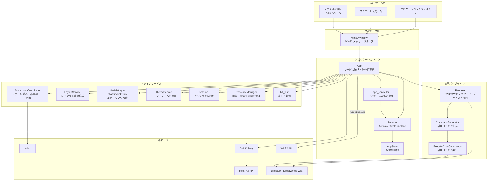

### 2.2 アーキテクチャ原則

mendo は **状態と振る舞いを明確に分離** する設計を採用している。

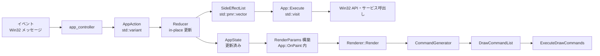

| 設計原則 | 実装場所 |
|:---------|:--------|
| **状態の単一の真実源** | `AppState`（`src/app/app_state.h`） |
| **アクション駆動** | `AppAction = std::variant<...>`（`src/app/app_events.h`） |
| **副作用の明示化** | `SideEffect`（単一variant、`src/app/side_effect.h`） |
| **副作用の実行の一元化** | `App::Execute`（`src/app/app.cpp`） |
| **DirectWrite 計測の抽象化** | `ITextMeasurer`（`src/layout/layout.h`） |
| **図の描画の抽象化** | `IMermaidRenderer`（`src/mermaid/mermaid_renderer_interface.h`） |
| **D2D ファクトリ・デバイスの集約** | `Renderer`（`src/render/renderer.h`。デバイスとスワップチェーンは `renderer_device.cpp`） |
| **ロジックとUI層の分離** | `mendo_core`（テスト可能）vs `mendo`（Win32/D2D 具象） |

---

## 3. コンポーネント詳細

### 3.1 Win32Window — ウィンドウ管理

#### 3.1.1 責務

`Win32Window` はWin32 APIの薄いラッパーとして、以下を担当する。

1. **ウィンドウ生成** — `WNDCLASSEXW` の登録、`CreateWindowExW` によるウィンドウ作成
2. **メッセージループ** — `MsgWaitForMultipleObjects` でメッセージ・ファイル監視イベント（文書と本文中の画像のフォルダ、`App::GetFileWatchEvents`）・フレーム待ちの waitable（`App::GetFrameWaitHandle`）を待ち、`PeekMessageW` / `TranslateMessage` / `DispatchMessageW` で配る。前フレームの表示待ちの間は `WM_PAINT` を取り出さずに入力を先に配り、waitable の成立または期限（`Renderer::kFrameWaitTimeoutMs` = 1000ms）で `App::OnFrameReady` を呼ぶ。時間で区切った仕事（`App::HasIdleWork`）が残っていれば待たずに戻り、配るメッセージが無ければ `App::RunIdleWork` で 1 回分進める
3. **メッセージルーティング** — Win32メッセージを `App` のイベントハンドラに委譲
4. **NC領域処理** — `WM_NCCALCSIZE` / `WM_NCHITTEST` でカスタムタイトルバーを実装

#### 3.1.2 クラス構造

```cpp
// ModalLoop はポップアップのモーダルループも回させるためのもの。
class Win32Window final : public ModalLoop {
public:
    explicit Win32Window(ConfigService& config);
    ~Win32Window();

    bool Create(HINSTANCE hInstance, int nCmdShow);
    int  RunMessageLoop();
    void RunUntil(const bool& done) override;
    // App が頼むこと。どちらも呼び出し中に App::Dispatch へ入り直しうる。
    void FocusSearchEdit(int anchor, int caret);   // 入力欄にフォーカスし [anchor, caret) を選択
    void UnfocusSearch(bool clear_text);           // 本体にフォーカスを戻す (文書の切り替えでは入力欄も空に)

    // 起動時の準備 (preload・スクロール位置・ファイルペインのフォルダ) は Create より前に App へ直接頼む
    App& app() noexcept;

private:
    std::optional<int> PumpMessages(const bool& done);   // RunMessageLoop と RunUntil が回す。WM_QUIT なら終了コード、done なら nullopt
    static LRESULT CALLBACK WndProc(HWND, UINT, WPARAM, LPARAM);
    LRESULT HandleMessage(UINT msg, WPARAM wParam, LPARAM lParam);
    LRESULT OnNcCalcSize(WPARAM wParam, LPARAM lParam);
    LRESULT HitTestNonClient(POINT pt);   // スクリーン座標での WM_NCHITTEST の結果
    LRESULT HitTestResizeFrame(POINT pt) const noexcept;
    LRESULT HitTestTitleBar(POINT pt) const noexcept;
    std::optional<LRESULT> TryHandleMouseMessage(UINT msg, WPARAM wp, LPARAM lp);
    void OnContextMenu(int screen_x, int screen_y);
    POINT KeyboardContextMenuPoint() const;
    void OnSize(WPARAM wParam, LPARAM lParam);
    void UpdateDwmFrame();
    void InitSystemMenu();
    void ResetWindowPlacement();
    void SaveWindowPlacement();
    bool RestoreWindowPlacement(int nCmdShow);
    static LRESULT CALLBACK SearchEditProc(HWND, UINT, WPARAM, LPARAM, UINT_PTR, DWORD_PTR);
    LRESULT OnSearchEditKeyDown(HWND edit, UINT msg, WPARAM wParam, LPARAM lParam);
    void OnSearchEditChanged();
    bool EnsureSearchEdit();
    void RepositionSearchEdit();   // 開くとき・WM_SIZE・IME の変換開始で置き直す
    void SyncSearchCaretFromEdit(std::optional<bool> backward = std::nullopt);   // 向きが分からなければ reducer に推定させる
    // 起動時の読み込みが D3D デバイスの先行作成より先に終われば、可視範囲の計測を作成の裏で済ませる
    void AwaitInitialParseBeforeDevice();
    // 起動時のデバイスに依存しない通知 (FILE_LISTED / INLINE_MATH_REQUESTED) を最初のフレームより前に取り込む
    void TakeStartupMessages();

    HWND hwnd_ = nullptr;
    HWND search_edit_ = nullptr;
    bool tracking_mouse_ = false;
    bool was_minimized_ = false;

    ConfigService& config_;
    std::unique_ptr<App> app_;
};
```

`Win32Window` は `ConfigService` の参照を受け取り、内部で `App` を `unique_ptr` で保持する。`Create` は `App::Init` の後、ウィンドウを DWM でクロークしたまま配置の復元 → `App::LoadInitialDocument` → `App::CreateRenderDevice` と進め、デバイス作成を待つ間に届いた `PARSE_COMPLETE` があれば取り込んでから初回描画（`UpdateWindow`）し、クロークを解く。`CreateRenderDevice` は D3D の作成を待つ間に、本文中の画像のフォルダの監視を開き終えるのも待って画像を頼み、デコードを作成の裏で進めて最初のフレームに入れる（`AwaitImageFoldersBeforeDevice`。5.1）。デバイスに依存しない起動時の通知（ファイルペインの列挙完了 `FILE_LISTED`・インライン数式の描画の依頼 `INLINE_MATH_REQUESTED`）は、デバイスの作成を待つ前と後の `TakeStartupMessages` で取り込む（一覧の行の文字レイアウトと数式の描画を、デバイスの作成と並行して進める）。検索バーの実体は Win32 の Edit コントロール（`search_edit_`）で、サブクラス化（`SearchEditProc`）して IME・キャレット同期を行う。Edit は comctl32 を読み込ませるので、起動時には作らず、初めて検索欄にフォーカスするときに `EnsureSearchEdit` で作る。

`App` は `Win32Window` を参照で受け取り（`app.h` は前方宣言だけで持つ）、検索欄のフォーカス（`effect::SearchFocus` / `SearchUnfocus`）をその場で頼む（メッセージを投げて後で処理させない）。描画後にホバーを引き直すときの非クライアント判定は、`WM_NCHITTEST` を送って引く。フォーカスの移動や入力欄の書き換えは `EN_CHANGE`・`WM_IME_ENDCOMPOSITION`・選択の同期を通じて `App::Dispatch` に入り直すが、`Dispatch` は副作用の一覧を呼び出しごとに持つので、外側の `Execute` の途中でも壊れない。文書の切り替えでは `DocumentOpenedAction` の reducer が先にクエリを空にしているので、入力欄を空にした `EN_CHANGE` は何もせず終わる。入力欄のドラッグ選択ではマウスが動くたびに `SearchFocus` が来るので、既にフォーカスがあれば選択（`EM_SETSEL`）を変えるだけにする。見えない Edit の置き場所は IME の変換窓の位置にしか効かないので、開くとき・`WM_SIZE`・変換の開始（`WM_IME_STARTCOMPOSITION`）で置き直す。

### 3.2 App — アプリケーション統括

#### 3.2.1 責務

`App` はアプリケーション全体の統括を担う。状態は `AppState` に集約し、振る舞いはサービス群に委譲する。

1. **サービス所有** — 各種サービスの生成・接続・ライフサイクル管理
2. **イベントディスパッチ** — Win32イベントを `app_controller` 経由で `AppAction` に変換、`Reducer` に渡す
3. **副作用実行** — `Reducer` が返した `SideEffectList` を `App::Execute` が `std::visit` で Win32 API 呼び出しや App メンバ・サービスの呼び出しに振り分ける
4. **描画起点** — `OnPaint` で各レンダーステートを構築し、`RenderParams` にまとめて `Renderer::Render` に渡す

#### 3.2.2 クラス構造

```cpp
// ResourceManager と reducer が問い合わせる窓口 (ResourceManagerHost / NodeLayoutAccess) も App が受ける。
class App final : private ResourceManagerHost, private NodeLayoutAccess {
public:
    App(ConfigService& config, Win32Window& window) noexcept;
    bool Init(HWND hwnd);

    // 起動時に main から (Win32Window::app() で) 呼ばれる
    void SetInitialDirectory(std::wstring_view dir_path);   // Init 前
    void StartPreloadAsync(std::wstring path);              // Init 前
    void RestoreScrollPosition();                           // 保存したスクロール位置を戻す位置にする
    void SetInitialAnchor(std::wstring_view anchor);        // 起動時の文書を開いたら見出し (--anchor) へ飛ぶ
    void LoadInitialDocument();   // preload を取り込む。無ければヘルプを開く
    bool CreateRenderDevice();    // LoadInitialDocument の後、初回描画の前

    // 状態を変えるだけの Win32 メッセージ (サイズ・アクティブ化・キャプチャ喪失・横ホイール・戻る/進むボタン・
    // マウスが出た・検索欄の入力/選択/IME/閉じる/次/前) は、Win32Window がアクションにして直接渡す
    void Dispatch(const AppAction& action);   // Reduce → Execute

    // Win32Window から呼ばれるイベントハンドラ (アクションにする前にヒットテストなどが要るもの)
    void OnPaint();
    void OnMinimize();
    void OnActivateApp(bool active);   // 別のアプリへ切り替わったら作り置きを捨て、ワーキングセットの削減を予約する
    void OnMouseWheel(int px, int py, int delta, bool ctrl);
    bool OnKeyDown(WPARAM key, LPARAM flags);   // 割り当ての無いキーは false (ウィンドウ側の既定の処理に回す)
    void OnDropFiles(HDROP hDrop);

    void OnLButtonDown(int px, int py, bool is_double_click);   // is_double_click は WM_LBUTTONDBLCLK
    void OnLButtonUp(int px, int py);
    void OnMButtonDown(int px, int py);   // ファイルペインの項目・リンクを新しいウィンドウで開く
    void OnMouseMove(int px, int py);
    void OnMouseHover(int px, int py);
    void OnContextMenu(int screen_x, int screen_y);
    bool OnRButtonDown(int px, int py);
    bool OnRButtonUp(int px, int py);
    void OnRButtonMove(int px, int py);

    // 文書と本文中の画像のフォルダの監視のイベントを out に入れ、数を返す
    static constexpr size_t kMaxFileWatchEvents = 1 + ResourceManager::kMaxImageWatchEvents;
    size_t GetFileWatchEvents(std::span<HANDLE> out) const noexcept;
    void OnFileWatchEvent();
    // 前フレームの表示待ちの間だけ非 null。メッセージループはこれを待つ間 WM_PAINT を配らない
    HANDLE GetFrameWaitHandle() const noexcept;
    void OnFrameReady() noexcept;

    void HandleTimer(UINT_PTR timer_id);
    void OnAppImageLoaded();
    void OnParseComplete();
    void OnMermaidJobDone();
    void OnInlineMathRequested();
    void OnTableMeasured();
    void OnFileListed();
    void OnDestroy();

    // 検索欄の EDIT の置き場所
    constexpr bool IsSearchBarVisible() const noexcept;
    RECT GetSearchEditRect();

    // Win32Window の NC ヒットテスト・コンテキストメニュー判定用
    constexpr float GetDpiScale() const noexcept;
    TitleBarHitZone TitleBarHitTest(float dip_x, float dip_y) const noexcept;
    bool IsOverMdScrollbar(float dip_x, float dip_y);

private:
    // reducer が返した副作用を実行する
    void Execute(const SideEffectList& effects);
    void Execute(const SideEffect& effect);

    void LoadMarkdownFile(std::wstring_view path);

    // Win32 ハンドル
    HWND hwnd_ = nullptr;
    SystemCursors cursors_;
    Tooltip       tooltip_;   // ウィンドウ。表示対象は InteractionState::tooltip

    // コアサービス
    Renderer           renderer_;
    TaskScheduler      scheduler_;          // 汎用ワーカー（ファイル読み込み/画像/Mermaid）
    TaskScheduler      layout_scheduler_;   // レイアウト計測専用ワーカー
    // クリップボード/画像保存 (コードコピー・PNG 保存・図のコピー)。図の画像と SVG は
    // コピー・保存のたびに図の描画命令からその場で作る。
    ClipboardManager   clipboard_manager_;
    MermaidRenderer    mermaid_renderer_;
    ImageLoader        image_loader_;
    FileWatcher        file_watcher_;
    ConfigService&     config_;
    ThemeService       theme_service_;
    // 起動時の読み込み (preload) も Init より前にここで始め、通知先は LoadInitialDocument の Attach で渡す。
    AsyncLoadCoordinator load_coordinator_;
    // スピナーは読み込みが長引いたときだけ出し、出ている間はタイマーごとに回す。
    // LOADING_ANIM のタイマーは Delayed (出すまでの遅延) と Spinning (コマ送り) の間だけ掛かっている。
    std::variant<SpinnerOff, SpinnerDelayed, SpinnerSpinning> spinner_;
    // 表示中のファイルの読み直しの状態機械。末尾を削っただけの保存は何度読み直しても prefix shrink に
    // なるので、延期の回数の上限 (ReloadScheduler::kMaxPrefixShrinkDefers = 10) もこの中で数える
    ReloadScheduler    reload_;

    // 全状態集約
    AppState state_;

    // 計測。テーマは theme_service_ のものを参照する
    DWriteTextMeasurer measurer_;
    // 巨大な表の最初の計測。組むワーカーが measurer_ と layout_scheduler_ を使うので、それより後に宣言する
    TableMeasureJobs   table_jobs_{ layout_scheduler_, measurer_ };
    LayoutEngine       layout_engine_;

    // 振る舞い
    LayoutService   layout_service_{ layout_engine_, state_.view.viewport };
    ResourceManager resource_manager_;
};
```

#### 3.2.3 ファイル構成

`App` は責務ごとにファイル分割されている。

| ファイル | 担当 |
|:---------|:-----|
| `app.h / app.cpp` | `App`（`ResourceManagerHost` と `NodeLayoutAccess` を private 継承し、タイマー操作・再レイアウト・ノードの計測の問い合わせを自分で受ける）。`.cpp` はコアロジック（`Init`, `CreateRenderDevice`, `LoadInitialDocument`, `Dispatch`, `Execute`, `RunCommand`, `OnPaint`, `HandleTimer`, `OnDestroy`）、レイアウト・スクロール関連ヘルパー（レイアウトが変わった後の後始末の入口 `FinishLayout`, `EnsureFrameLayout`, `OnDeferredLayout` 等）、空き時間の仕事（`HasIdleWork` / `RunIdleWork`）、テーマ・ズーム変更の適用（`ApplyZoom` / `ToggleDarkMode`）、カスタムコンテキストメニュー処理、ファイル読み込み（`LoadMarkdownFile`, `StartPreloadAsync`, `BeginAsyncLoad`, `OnParseComplete`、文書の表示 `OpenDocument` とリロードでの差し替え `ReloadDocument`。どちらも中で `ReplaceDocument` を使い、後始末は reducer のアクションに任せる。読み直しの指示（`ReloadScheduler` が返す `ReloadCommand`）の実行 `RunReloadCommand`、埋め込みの文書（ヘルプ・サードパーティのライセンス）を開く `ShowEmbeddedResource`）、マウス入力ハンドラ（`OnMouseMove`, `OnMouseWheel`, `OnRButton*`, `OnLButtonDown/Up`, `HandleMdPaneClick`, `HandleLinkClick`, `OnMouseHover` 等。点が指すものの判定は `app_controller` に任せる） |
| `clipboard_manager.h / .cpp` | `ClipboardManager`（選択範囲とコードブロックのコピー/PNG 保存/図のコピー（画像と SVG）を集約。図の画像と SVG はその場で描画命令から作る） |
| `app_controller.h / .cpp` | `app_controller::HandleKeyDown` / `HandleSearchEditKeyDown`（キー → アクションかコマンド）、新しいウィンドウに渡す引数 `NewWindowArgs` と、AppState とペイン配置だけから点が指すものを求める判定（`MakeMdPaneHitContext`, `ResolveMdPaneHit`, `ResolveSidePaneHit`, `ResolvePointerHover`, `IsOverMdScrollbar`） |
| `reducer.h / .cpp` | `Reduce(state, action, layout, resource)`（in-place 更新、副作用リストを返す。計測は `NodeLayoutAccess` で App に頼む）と、アクションごとの処理 `On(ReduceContext&, const XxxAction&)`（`std::visit` で振り分ける）。`On` と補助関数は無名名前空間に置き、キャプチャの取得・解放は `Reduce` が前後の状態（`CaptureRequired`）を比べて積む |
| `side_effect.h` | `SideEffect`（`effect::*` の variant）と `SideEffectList`。実行は `App::Execute` |
| `resource_manager.h` / `.cpp` | 画像・Mermaid 図の要求と取り込み、画面外の画像・図・レイアウトを捨てる整理（`ScheduleResourceManage`）、本文中の画像のフォルダの監視と、App に頼むことの抽象インターフェース `ResourceManagerHost` |
| `async_load_coordinator.h / .cpp` | `AsyncLoadCoordinator`（読み込みとパースを worker で行い結果を受け渡す）、`PlanParseComplete`（非同期ロード完了時の分岐判定。リロードの判定（変わらない `ReloadUnchanged`・保存途中 `DeferPrefixShrink`・差し替え `ApplyReload`）まで決める純粋関数）、`ReloadScheduler`（表示中のファイルの読み直しの状態機械） |
| `startup_plan.h / .cpp` | `DecideStartupPlan`（起動引数・前回ファイル・カレントディレクトリから初期表示を決める） |
| `theme_service.h / .cpp` | `ThemeService`（今のテーマの管理、3.9.2） |

#### 3.2.4 メッセージハンドリング

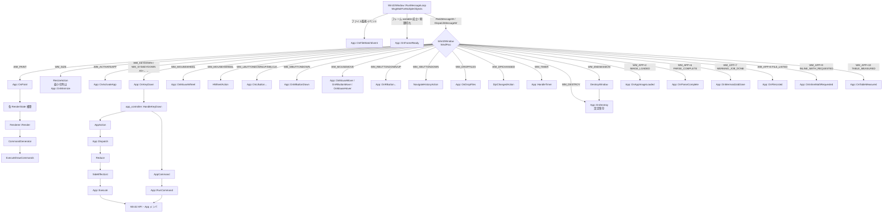

`WM_MOUSEMOVE` は `MK_LBUTTON` なら `OnMouseMove`（左ドラッグ）、`MK_RBUTTON` なら `OnRButtonMove`（ジェスチャ）、どちらでもなければ `OnMouseHover` に振り分ける。`WM_MOUSEWHEEL` は Ctrl 併用ならズーム、Shift 併用なら向きを反転して `HWheelAction`（横スクロール）にする。状態を変えるだけのメッセージ（`WM_SIZE`・`WM_ACTIVATE`・`WM_ENTERSIZEMOVE` / `WM_EXITSIZEMOVE`・`WM_CAPTURECHANGED`・`WM_MOUSELEAVE`・`WM_MOUSEHWHEEL`・`WM_XBUTTONDOWN`・検索欄の入力と選択と IME）は、`Win32Window` がアクションにして `App::Dispatch` に直接渡す。前フレームの表示待ちの間、メッセージループは `WM_PAINT` を取り出さずに入力・ポスト・送信メッセージだけを配る（3.1.1 参照）。`WM_ENDSESSION` ではログオフ・シャットダウン時に `WM_DESTROY` が来ないままプロセスが終わるため、`DestroyWindow` で終了処理（設定保存）を通す。モーダルループ中かは `WM_ENTERMENULOOP` / `WM_EXITMENULOOP`（システムメニューはアイコンのクリック・Alt+Space・キャプションの右クリックのどれでも、自前のポップアップは `PopupWindow::RunModal` が送る）から `App::OnModalLoop` が 1 つのフラグで持ち、その間は描画後のホバーの引き直し・右クリックのジェスチャー・`WM_CONTEXTMENU` の独自メニューを止める。

#### 3.2.5 キーボードショートカット

`app_controller::HandleKeyDown()` がキー入力を `AppAction` か `AppCommand`（状態を変えず App がその場で行う操作。3.4.2）に変換する。

| キー | アクション / コマンド | 備考 |
|:-----|:-----------|:-----|
| `F1` | `ShowHelpAction` | 内蔵ヘルプ表示 |
| `F3` | `SearchStepAction{ forward = true }` | 次の検索結果 |
| `Shift+F3` | `SearchStepAction{ forward = false }` | 前の検索結果 |
| `F5` | `AppCommand::Reload` | 再読み込み |
| `Esc` | `ClearSelectionAction` | 選択解除（検索バー表示中は検索バーを閉じる） |
| `Ctrl+O` | `AppCommand::OpenFile` | ファイルを開くダイアログ |
| `Ctrl+N` | `AppCommand::NewWindow` | 表示中のファイル（無ければファイルペインのフォルダ）を新しいウィンドウで開く。キーリピートは無視 |
| `Ctrl+A` | `SelectAllAction` | 全選択（検索欄では `AppCommand::SearchSelectAll` で入力欄の中を全選択） |
| `Ctrl+C` | `AppCommand::Copy` | プレーンテキストコピー |
| `Ctrl+Shift+C` | `AppCommand::CopyFormatted` | 書式付きコピー (HTML) |
| `Ctrl+F` | `OpenSearchBarAction` | 検索バー表示（表示中は閉じる） |
| `Ctrl+G` | `SearchStepAction{ forward = true }` | 次の検索結果 |
| `Ctrl+Shift+G` | `SearchStepAction{ forward = false }` | 前の検索結果 |
| `Ctrl+1` | `TogglePaneAction(File)` | ファイルペイン切替 |
| `Ctrl+2` | `TogglePaneAction(Toc)` | TOCペイン切替 |
| `Ctrl++` / `Ctrl+=` | `ZoomAction(In)` | ズームイン（テンキーの `+` も可） |
| `Ctrl+-` | `ZoomAction(Out)` | ズームアウト（テンキーの `-` も可） |
| `Ctrl+0` | `ZoomAction(Reset)` | ズーム100%（テンキーの `0` も可） |
| `Ctrl+ホイール` | `ZoomAction(In/Out)` | ポインタの下の領域（本文・ファイルペイン・目次ペイン）をホイール方向で増減（端数の扱いは 3.2.7） |
| `Alt+←` | `NavigateHistoryAction{ forward = false }` | 戻る（`WM_SYSKEYDOWN` で届く） |
| `Alt+→` | `NavigateHistoryAction{ forward = true }` | 進む（同上） |
| `↑` / `↓` | `KeyScrollAction(LineUp/Down)` | 1行スクロール |
| `Home` / `End` | `KeyScrollAction(Home/End)` | 先頭/末尾 |
| `PageUp` / `PageDown` | `KeyScrollAction(PageUp/Down)` | 1ページ |

#### 3.2.6 マウスジェスチャ

| 操作 | 動作 | 実装 |
|:-----|:-----|:-----|
| 右ドラッグ左 | ナビゲーション戻る | `MouseGesture`（30px以上の水平移動） |
| 右ドラッグ右 | ナビゲーション進む | 同上 |
| 右クリック（移動なし） | コンテキストメニュー | `ContextMenu` |
| Xボタン戻る/進む | ナビゲーション戻る/進む | `WM_XBUTTONDOWN` |
| ダブルクリック | 単語選択 (本文の上だけ。ボタン・スクロールバー・スプリッタは 1 回目と同じ) | `OnLButtonDown`（`is_double_click`） |
| タッチパッド水平スワイプ | ナビゲーション戻る/進む | `SwipeDetector`（`WM_MOUSEHWHEEL`） |

#### 3.2.7 app_controller — イベント→アクション変換

`app_controller` はステートレスなマッパー（namespace + 自由関数）である。宣言は `app_controller.h`、実装は `app_controller.cpp` に置く（受け渡すイベントとアクションの型は `app_events.h`）。必要な状態は呼び出し側が持って渡す。Win32 / D2D 依存なし、完全にテスト可能。

```cpp
struct KeyDownEvent {
    int  key;
    bool ctrl  = false;
    bool shift = false;
    bool alt   = false;
    bool repeat = false;   // 押し続けたときの自動リピート
};

// キーやボタンに割り当てたもの。状態を変えるものはアクションで reducer へ、それ以外はコマンドで App が行う。
using AppBinding = std::variant<AppAction, AppCommand>;

namespace app_controller {
    // 割り当ての無いキーは nullopt。
    std::optional<AppBinding> HandleKeyDown(const KeyDownEvent& event);
}
```

`KeyDownEvent` は `app_events.h` で定義されるプラットフォーム非依存の入力イベント。Win32 の `GetKeyState` 確認結果と、`lParam` の直前のキー状態から求めたリピートは、呼び出し側でバンドルしてから渡す。縦ホイールは状態 (Ctrl+ホイールの端数) を使うので、`App::OnMouseWheel` がポインタの下の領域を添えて `MouseWheelAction` にし、reducer が扱う（3.4.2）。

---

### 3.3 AppState — アプリケーション状態の集約

#### 3.3.1 概要

`AppState` はアプリケーションの **すべての状態** を保持する単一構造体。サブグループ別にネストされる。

```cpp
struct DocumentState {
    Document    doc;
    LayoutCache layout_cache;
};

// 進行中の左ボタンドラッグ。種類ごとに、そのドラッグで使う値だけを持つ。
namespace left_drag {
struct None {};
struct TextSelect {                  // 選択の起点と、押した位置 (px。小さいクリックの判定に使う)
    int      node    = -1;
    uint32_t pos     = 0;
    int      click_x = 0;
    int      click_y = 0;

    constexpr TextSelection SelectionTo(int to_node, uint32_t to_pos) const noexcept;
};
struct Splitter      { PaneTarget pane = PaneTarget::File; };                            // pane の右端
struct PaneScrollbar { PaneTarget pane = PaneTarget::File; float grip_offset = 0.0f; };  // grip_offset はつまみを掴んだ位置 (つまみ上端から)
struct MdScrollbar   { float grip_offset = 0.0f; };
struct BlockHScroll  { int node = -1; float start_x = 0.0f; float start_scroll = 0.0f; };  // 対象ノードと開始時の x・横スクロール量
struct SearchInput   { int anchor = 0; };                                                // 入力欄の選択の起点 (キャレット位置)
} // namespace left_drag

using LeftDragState = std::variant<left_drag::None, left_drag::TextSelect, left_drag::Splitter, left_drag::PaneScrollbar,
                                   left_drag::MdScrollbar, left_drag::BlockHScroll, left_drag::SearchInput>;

struct ViewState {
    ViewportManager viewport;
    PaneController  panes;
    // 次に開き終えた文書でスクロールする先。復元する位置か、飛ぶ見出し (UTF-8。別の文書へのリンクの # 以降と --anchor)
    std::variant<std::monostate, ScrollTarget, std::string> pending_scroll;
    NavHistory      nav_history;

    // ブロック単位の横スクロール。キーは BlockHScrollGeometry::scroll_key (ノードインデックス。
    // 区切ったコードブロックは並びの先頭)。
    // 永続化しない (ファイルロード/リロードでクリア)。スクロールバー本体は
    // 「ホバー中とドラッグ中のブロック」だけ描画するので、map のサイズは
    // ユーザー操作実績分に限定される。
    std::unordered_map<int, float> block_scroll_x;
    HoverHighlights hover;             // マウス位置でのホバー強調の全体。描画はここから読む
    int             active_toc_index = -1;     // SyncActiveTocIndex が描画のたびに決め直す
    bool            loading_shown = false;     // 読み込みのスピナーを本文ペインの代わりに出している (本文側にポインタを当てない)
    bool            keep_toc_pane_once = false; // 目次クリック直後の同期 1 回だけ、目次ペインを追従スクロールさせない
    LeftDragState   drag;

    bool  HasPendingScroll() const noexcept;  // pending_scroll が monostate でない
    bool  IsDragging() const noexcept;        // drag が left_drag::None でない
    bool  IsSelectingText() const noexcept;   // drag が left_drag::TextSelect
    int   HDragNode() const noexcept;         // 横スクロールをドラッグ中のブロック。無ければ -1
    float GetBlockScrollX(const BlockHScrollGeometry& geom) const noexcept;  // geom.scroll_key のスクロール量
};

// ViewState::hover の型 (app_events.h)。既定値はどこにもホバーしていない状態。
struct HoverHighlights {
    TitleBarHitZone  titlebar   = TitleBarHitZone::None;
    SearchBarHitZone search_bar = SearchBarHitZone::None;
    NavDirection     nav        = NavDirection::None;
    OverlayButtonHit overlay_button{};             // コピー / 保存ボタン
    int              diagram = -1;                 // ポインタが図の画像の上にあるノード。図の保存/コピーはこの間だけ描く
    int              h_block = -1;                 // 横スクロールバーを出すブロック
    std::array<int, 2>              side_index{ -1, -1 };  // PaneTarget 順 (File, Toc)
    std::array<PaneHeaderButton, 2> side_button{};
    LinkHover        link;                         // 指しているリンク (ノード・添字・行き先 (表示の文言と押せるか)・行き先の表示を寄せる側。3.25)
};

struct InteractionState {
    MouseGesture   gesture;
    SwipeDetector  swipe_detector;
    TooltipTarget  tooltip;   // 表示中か表示待ちの対象 (zone と key だけ)。文言とウィンドウ (Tooltip) は App が持つ
    int            zoom_wheel_accum = 0;   // Ctrl+ホイールの delta の端数。変えるのは reducer (MouseWheelAction) だけ
};

struct SearchGroup {
    SearchState  search_state;
    int          caret_pos = -1;
    int          selection_start = -1;
    std::wstring ime_composition;
    std::wstring query_wide;
    bool         scroll_after_search = false;
};

// 移動・サイズ変更のモーダルループ (WM_ENTERSIZEMOVE から WM_EXITSIZEMOVE まで)。
enum class SizeMove : uint8_t {
    None,
    Moving,    // 移動だけ。終了時のレイアウト処理 (SettleViewport) を省く
    Resized,   // 大きさか DPI が変わった。終了時に描画面とレイアウトを合わせ直す
};

struct WindowState {
    TitleBar       titlebar;
    SizeMove       size_move = SizeMove::None;
    bool           window_active = true;
    float          cached_dpi_scale = 1.0f;
    // 直近の WM_SIZE のクライアント領域 (物理 px)。ペイン配置の元になり、同じ大きさの WM_SIZE を無視するのにも使う。
    uint32_t       client_width  = 0;
    uint32_t       client_height = 0;
    // client_width / client_height を処理したときの DPI スケール。DPI が変わると同じピクセル寸法でも DIP 寸法が変わる。
    float          client_dpi_scale = 0.0f;

    constexpr bool  IsSizing() const noexcept;   // size_move != SizeMove::None
    constexpr float WidthDip() const noexcept;
    constexpr float HeightDip() const noexcept;
};

struct AppState {
    DocumentState    document;     // ドキュメント + LayoutCache
    ViewState        view;         // ViewportManager + PaneController + 開き終えた文書でスクロールする先 + NavHistory + ホバー + 左ドラッグ + 横スクロール
    InteractionState interaction;  // MouseGesture + SwipeDetector + TooltipTarget + Ctrl+ホイールの端数
    SearchGroup      search;       // SearchState + 入力欄の表示状態 (3.21.2)
    WindowState      window;       // TitleBar + サイズ変更ループ + DPI

    // ThemeService 所有 Theme への非所有参照。App の構築時に設定し、null にはならない。
    // ダークモードとズームの切り替えは同じ Theme を書き換えるのでポインタは安定。
    // reducer が spacing_above 等を参照するのに使う。
    const Theme*     theme = nullptr;

    FileExplorer     file_explorer;
};

// AppState 関連のフリー関数
// マウスキャプチャを持つ条件 (左ドラッグ中か、右ボタンのジェスチャー中)。Reduce が前後を比べて取得と解放を積む (inline)
bool         CaptureRequired(const AppState& state) noexcept;
// ViewportManager::CurrentTarget の薄いラッパ (inline)
ScrollTarget SnapshotVisibleTarget(const AppState& state) noexcept;
// 今の文書と表示位置を履歴の項目にする (inline)
NavEntry     CurrentNavEntry(const AppState& state);
// window の寸法・ペイン・テーマから組む。数十回の浮動小数演算なので持たずに毎回求める (定義は reducer.cpp)。
// 大きさが決まる (最初の WM_SIZE) までは空の配置
PaneLayout ComputePaneLayout(const AppState& state) noexcept;
float      MdMaxScroll(const AppState& state) noexcept;
```

履歴の積み込み（`PushCurrentNavEntry`）は reducer だけが使うので、`reducer.cpp` の無名名前空間に置く。`PushCurrentNavEntry` は `load_path` が現在と別のファイルなら、ロード失敗（`LoadFailedAction`）で取り消す仮の履歴にする。今の表示位置を履歴の項目にする `CurrentNavEntry` は、App も差し替える前の文書の位置（`DocumentOpenedAction::left`）を詰めるのに使うので `app_state.h` に置く。

左ボタンのドラッグ（テキスト選択・スプリッタ・各スクロールバー・ブロック横スクロール・検索入力）は種類を問わず `ViewState::drag`（種類ごとの struct の `std::variant`）1 つで表す。ドラッグ中かどうかは `IsDragging()`（`left_drag::None` 以外か）だけで決まる。キャプチャは個々の処理では指示せず、`Reduce` が処理の前後で `CaptureRequired` を比べて `SetCapture` / `ReleaseCapture` を積む。ホバー状態も `ViewState::hover` 1 つにまとまっており、App が `app_controller::ResolvePointerHover` で求めた `PointerHoverAction`（`HoverHighlights` にツールチップの対象 `TooltipHover` を足したもの）を渡すと Reducer がまとめて反映する。

#### 3.3.2 サブグループ詳細

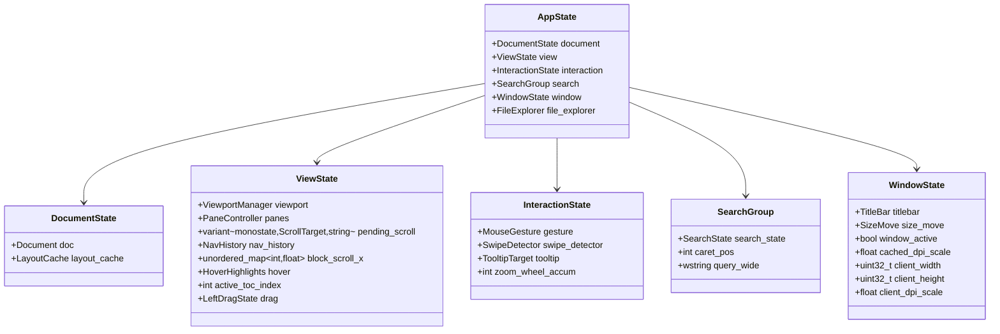

---

### 3.4 Reducer / SideEffect — 状態更新と副作用

#### 3.4.1 Reducer

```cpp
// reducer が App に計測を頼む窓口。計測 (DirectWrite) は App が持つ。
class NodeLayoutAccess {
public:
    // node_index のノードを計測済みにする (検索マッチの行の位置を引けるようにする)。見ている位置は保つ。
    virtual void EnsureNodeLayout(int node_index) = 0;
};

// Reducer: UI イベント由来の状態遷移ハブ。
// 現在の状態を in-place で変更し、実行すべき副作用のリストを返す。一覧の領域は resource から取る。
SideEffectList Reduce(AppState& state, const AppAction& action, NodeLayoutAccess& layout,
                      std::pmr::memory_resource* resource);
```

`AppState` はデータだけを持ち、reducer が App の機能を使うのは `NodeLayoutAccess` の計測だけである（検索マッチへスクロールする前に、そのノードの行の位置を引けるようにする）。窓口は `Reduce` の引数で渡すので、渡し忘れはコンパイルで分かる。本番は App 自身（ResourceManager の窓口と同じく private 継承した受け口）が `LayoutService::EnsureNodeLayout` へ渡し、テストは計測を頼まれても何もしない `Reduce(state, action)`（`reducer_harness.h`）か、計測の結果を差し込むものを渡す。

`Reducer` は `AppState` を **in-place で変更** し、実行すべき副作用の `SideEffectList` を返す。テーマ定数は `AppState::theme`（`ThemeService` 所有 `Theme` への安定ポインタ）経由で参照する。ペイン配置は持たず、`ComputePaneLayout(state)`（宣言は `app_state.h`、定義は `reducer.cpp`）がウィンドウの寸法・ペイン・テーマから呼ぶたびに求める（数十回の浮動小数演算で済むため、キャッシュと無効化の漏れを抱えない）。最初の `WM_SIZE` までは空の配置を返す。

> **Note**: 関数型「純粋関数」スタイル（新 state を返す）ではなく in-place 更新スタイルを採用するのは、`AppState` 内部のノード配列（`Document` の `ReservedArray<Node>`）や履歴（`NavHistory` の `std::deque<NavEntry>`）などの大型コンテナを毎回コピーすると性能上のオーバーヘッドが大きいためである。`SideEffectList` のみが新規 vector として生成される（領域は `Reduce` に渡した `memory_resource` から取る。3.4.3）。

#### 3.4.2 AppAction

`AppAction` は `std::variant` で 51 種類のアクションを保持する（コマンド系、マウス・ドラッグ系、システム、タイマー、検索の 5 グループ）。状態を変えない操作（ファイルを開くダイアログ・再読み込み・新しいウィンドウ・テーマの切り替え・コピー・検索欄の全選択）はアクションにせず、`AppCommand`（`app_events.h` の enum）にして `App::RunCommand` がその場で行う。reducer に渡しても副作用 1 つに置き換えて返すだけになるためである。キーとタイトルバーのボタンの割り当て（`app_controller`）は、どちらかを `AppBinding` で返す。ファイル変更通知・画像読み込み完了・パース完了は Reducer を通さず、`App` が直接処理する。文書の読み込みと差し替えは `App` が持ち、差し替えた後のビュー状態の後始末（番号に結び付いた一時状態・検索・ペインのスクロール・ファイル一覧・スクロールの復元）は `DocumentOpenedAction` / `DocumentReloadedAction` / `ReloadSettledAction` で reducer に任せる。

```cpp
using AppAction = std::variant<
    // コマンド系
    KeyScrollAction, MouseWheelAction,
    SelectAllAction, SelectWordAction, ClearSelectionAction,
    TogglePaneAction, ZoomAction,
    NavigateHistoryAction,              // forward で戻る / 進む
    ShowHelpAction,
    OpenSearchBarAction, CloseSearchBarAction,
    SearchStepAction,                   // forward で次 / 前のマッチ
    SearchSelectWordAction,             // 検索の入力欄のダブルクリック
    // マウス・ドラッグ系
    PointerHoverAction, MouseLeaveAction,
    LoadingShownAction,                 // 読み込みのスピナーを本文ペインの代わりに出す / 消す
    SplitterDragStartedAction, LeftDragMovedAction, LeftDragEndedAction,
    SearchInputDragStartedAction,
    MdScrollbarDragStartedAction,
    PaneScrollbarDragStartedAction,
    TextSelectionStartedAction,
    RightClickGestureStartedAction, RightClickGestureMovedAction, RightClickGestureCompletedAction,
    FilePaneDirectoryClickedAction,
    OpenDirectoryAction,                // ドロップしたフォルダへファイル一覧を移す
    FilePaneRevealCurrentFileAction,
    TocItemClickedAction, NavigateAnchorAction,
    DocumentOpenedAction, DocumentReloadedAction, ReloadSettledAction, LoadFailedAction, HWheelAction,
    BlockHScrollDragStartedAction,
    OpenPathAction,
    // システム
    ResizeAction, DpiChangedAction, ActivateAction,
    EnterSizeMoveAction, ExitSizeMoveAction, CaptureChangedAction,
    // タイマー
    SwipeOverlayTimeoutAction,
    // 検索
    SearchTextChangedAction, SearchContinueAction, ToggleCaseSensitiveAction, ToggleHighlightAction,
    SearchSelectionAction, ImeCompositionAction>;
```

左ドラッグの移動は種類を問わず `LeftDragMovedAction` 1 つで、マウスの `dip_x` / `dip_y` と、検索の入力欄ならキャレット位置（`search_caret`）、テキスト選択なら文字の位置（`node_index` / `text_pos`）を App が詰めて運ぶ。どのドラッグか・どのペインのスプリッタ・スクロールバーをドラッグ中かは `ViewState::drag`（どの `left_drag::` の型か、その `pane`）、ウィンドウ幅は `WindowState::WidthDip` から Reducer が読み、`drag` の型で処理を分ける（`std::visit`）。ドラッグの開始は開始のアクション（`SplitterDragStartedAction` など）の処理が `drag` にその種類の値を入れるだけで、`SetCapture` は `Reduce` が前後の `CaptureRequired` を比べて積む。

`OpenPathAction` は D&D・ファイルペインのクリック・ファイルダイアログ・リンクに共通で、履歴を積んでからファイルを開く（`anchor` があれば開き終えた文書でその見出しへスクロールする）。縦ホイールは `MouseWheelAction`（生の delta・Ctrl・ポインタの下の領域・`tick`・OS の 1 回にスクロールする行数 `scroll_lines`）1 つで、Ctrl ならその領域（スプリッタの上は本文）をズームし、そうでなければスクロールする。Ctrl+ホイールは高分解能ホイールやピンチが `WHEEL_DELTA` 未満の delta を連発しても `InteractionState::zoom_wheel_accum` に 1 ノッチ分たまるまでズームせず、向きが反転したら端数を捨てる（たまった段数は `ZoomAction::steps` で 1 回にまとめる）。スクロールは同時に `tick` で `SwipeDetector` の軸ロックを更新する（表示中のスワイプオーバーレイは消す）。`SearchContinueAction` は時間で区切った検索を、メッセージループの空き時間に 1 回分進める。

ドラッグの終了も種類を問わず `LeftDragEndedAction` 1 つである。Reducer が `drag` を `left_drag::None` に戻し、それまでの型を見て後処理（スプリッタと Markdown スクロールバーなら `SettleViewport`、ブロック横スクロールなら再描画、テキスト選択なら `node_index` / `text_pos` の終点で選択を確定）を分ける。キャプチャの解放は `Reduce` が積む。

#### 3.4.3 SideEffect — 単一variant

`SideEffect` は全 effect 型を 1 段の variant に束ねる。論理グループ（Ui / Window / Navigation / Layout / Timer）はコメント区切りで表現し、実行側（`App::Execute`）も同じ並びの単一 visitor で処理する。Effect 型は `namespace effect`（`side_effect.h`）に集約されている。

```cpp
using SideEffect = std::variant<
    // Ui
    effect::InvalidateWindow,
    effect::SetCapture, effect::ReleaseCapture,
    effect::SetTooltip,
    effect::ShowContextMenu, effect::Beep,
    // Window
    effect::SearchFocus, effect::SearchUnfocus,
    effect::ApplyZoom,
    effect::SettleViewport,
    effect::RendererResize, effect::ApplyDpi,   // ApplyDpi は { dpi, suggested }
    // Navigation
    effect::LoadFile, effect::CancelOtherFileLoad,
    // Layout
    effect::ResourceManage,
    // Timer
    effect::SetTimer, effect::KillTimer>;

using SideEffectList = std::pmr::vector<SideEffect>;
```

再描画要求は `effect::InvalidateWindow`（ウィンドウ全体の `InvalidateRect(hwnd, nullptr, FALSE)`）に一本化されている。タイトルバーや Markdown ペインだけを部分無効化する effect は持たない。`OnPaint` は `rcPaint` を見ずに毎回全面を描き、`FLIP_DISCARD` のスワップチェーンでは部分描画もできないため、無効化矩形を絞っても描画量は減らないからである。

`PushEffect<T>(effects, e)` は effect を `SideEffectList` に追加するヘルパーで、最初の 1 件で 4 件分を予約する。一覧の領域は `Reduce` の最後の引数の `memory_resource` から取る（テストの `Reduce(state, action)` は既定のリソースを使う）。`App::Dispatch` は呼び出しごとにスタックの 1KiB を `monotonic_buffer_resource` にして渡す。マウスの移動・ホイール・ドラッグは 1 イベントごとに副作用を積み、一覧の確保と解放が `Reduce` の 3〜4 割（1 イベント約 25ns）を占めていたため。effect が持つ文字列は `std::variant` が allocator を受け継がないので既定のリソースのままで、領域より長生きしない。描き直しは各処理が印（`ReduceContext::invalidated`）を立てるだけで、`Reduce` の終わりに `InvalidateWindow` を 1 件だけ副作用の先頭へ積む。キャプチャの取得・解放（前後の `CaptureRequired` の比較）も先頭へ積み、メニューのようなモーダルの副作用より先に済ませる（描き直しを後ろに積むと、メニューを閉じるまで右ドラッグの軌跡が残った）。テストで使う `FindEffect<T>(effects)` と `HasEffect<T>(effects)` は `std::get_if` の薄いラッパである（`tests/reducer_harness.h`）。

#### 3.4.4 App::Execute — 副作用の実行

`App::Dispatch` は `Reduce` が返した `SideEffectList` をそのまま `App::Execute` に渡す。`App::Execute(const SideEffect&)`（`app.cpp`）は `overloaded` の単一 `std::visit` で 1 件ずつ処理し、Win32 API もアプリ内ロジックも App のメンバから直接呼ぶ。間に抽象インターフェースは挟まない。Reducer は Win32 に依存しないので、テストは `Reduce` が返す `SideEffectList` の中身を検証する。

```cpp
void App::Dispatch(const AppAction& action)
{
    // 副作用の一覧は呼び出しごとのスタックの領域から取る (入れ子の Dispatch も自分の領域を持つ)
    alignas(std::max_align_t) std::array<std::byte, 1024> buffer;
    std::pmr::monotonic_buffer_resource arena(buffer.data(), buffer.size());
    auto effects = Reduce(state_, action, *this, &arena);   // 計測は App (NodeLayoutAccess) に頼む
    Execute(effects);   // 各要素を Execute(const SideEffect&) へ
}
```

| グループ | effect | 実行内容 |
|:--|:--|:--|
| Ui | `InvalidateWindow` / `SetCapture` / `ReleaseCapture` | `InvalidateRect(hwnd_, nullptr, FALSE)` / `::SetCapture(hwnd_)` / `::ReleaseCapture()`（キャプチャを持つのがこのウィンドウのときだけ。設定ダイアログなどのポップアップのキャプチャは外さない） |
| | `SetTooltip` | `tooltip_.Arm` で出ているものを隠して文言を差し替え、文言があれば `TOOLTIP` タイマーを張る / 空ならタイマーを止める |
| | `ShowContextMenu` | `App::OnContextMenu` |
| | `Beep` | `MessageBeep(MB_OK)`（検索の折り返し） |
| Window | `SearchFocus` / `SearchUnfocus` | `Win32Window::FocusSearchEdit` / `UnfocusSearch` をその場で呼ぶ（`Win32Window` が検索ボックスを操作する） |
| | `ApplyZoom` | `App::ApplyZoom` |
| | `SettleViewport` | `ViewportManager::EnsureScrollTarget` で見ている位置を決めてから `App::FinishLayout(LayoutChange::Remeasure, LayoutCaller::Message)`（ライブリサイズ中は積まず、`ResizeAction` の reducer がスクロールを収めて再描画を積む） |
| | `RendererResize` | `Renderer::Resize(width, height, live)` |
| | `ApplyDpi` | `Renderer::SetDpi(dpi)` と、WM_DPICHANGED が勧める矩形 `suggested` への `SetWindowPos` |
| Navigation | `LoadFile` / `CancelOtherFileLoad` | `App::LoadMarkdownFile` / `CancelOtherFileLoad` |
| Layout | `ResourceManage` | 先読みの範囲を空き時間で確かめさせ（`LayoutCache::SetHasDirtyNodes`）、`ResourceManager::ScheduleResourceManage` を呼ぶ。スクロールの間は見えている図をビットマップで描かせ（`Renderer::SetScrollingDiagrams(true)`）、`SCROLL_SETTLE` タイマー（500ms）でベクタに戻す |
| Timer | `SetTimer` / `KillTimer` | `::SetTimer` / `::KillTimer`（ID は `app_timer::Id`） |

キーとタイトルバーのボタンの `AppCommand` は `App::RunBinding` が `App::RunCommand` へ渡し、reducer を通さずにその場で行う。コンテキストメニューのコピーとテーマの切り替えも `RunCommand` を通す（新しいウィンドウは項目のパスを渡すので `App::OpenInNewWindow` を直接呼ぶ）。

| コマンド | 実行内容 |
|:--|:--|
| `OpenFile` | `App::OpenFileDialog`（選んだファイルは `OpenPathAction` で開く） |
| `Reload` | ファイルのある文書なら `ReloadScheduler::OnReloadRequested` の指示を `RunReloadCommand` で実行 |
| `NewWindow` | `App::OpenInNewWindow` が `LaunchSelfInNewWindow`（`win32_util.h`。元のウィンドウのタイトルバーが隠れないだけずらして、自分の exe を起動する）を呼ぶ。引数は `app_controller::NewWindowArgs`（開く先が空なら表示中の文書、ファイルが無ければファイル一覧のフォルダ。見出しは `--anchor` で渡す） |
| `ToggleDarkMode` | `App::ToggleDarkMode` |
| `Copy` / `CopyFormatted` | 選択があれば `ClipboardManager::CopySelection` が `WriteClipboardHtml`（`clipboard_util.h`。HTML が空なら CF_UNICODETEXT だけを書く。UTF-16 変換もここで行う）を呼ぶ |
| `SearchSelectAll` | `Win32Window::FocusSearchEdit(0, -1)`（入力欄の中の全選択） |

---

### 3.5 レンダーステート構築

各レンダーステート（`SidePaneState`, `TitleBarRenderState`, `SearchBarRenderState`, `GestureRenderState`）は `src/render/render_params.h` に定義される値型で、`App::OnPaint`（`src/app/app.cpp`）が毎フレーム組み立て、`RenderParams` にまとめて `Renderer::Render` に渡す。`SidePaneState` / `TitleBarRenderState` は `App::BuildSidePaneState` / `App::BuildTitleBarRenderState`、`GestureRenderState` は `ResolveGestureOverlay`（`app_state.h`）、`SearchBarRenderState` は `BuildSearchBarRenderState`（`reducer.h`）が作る。トーストの文言は `RenderParams::toast_message` にそのまま入れる。リンクの行き先は `hover.link.StatusText()`（`LinkHover::destination` の文言）と `hover.link.dock` を `RenderParams::link_status` / `link_status_dock` に入れる。ホバー強調はどれも `ViewState::hover` から詰める。本文ペインの入力（ノード・レイアウト・選択・ペインの矩形・スクロール位置・ホバー・ブロックの横スクロール・検索マッチと現在のマッチ）は `MdPaneParams` にまとめて `RenderParams::md` に入れ、`Renderer` はそれをそのまま `CommandGenerator::GenerateMdPane` に渡す。`App` が持つインラインの数式の描画命令と画像のビットマップ（`InlineDrawings`）は `RenderParams::inline_drawings` で渡し、`ExecuteDrawCommands` が描くときに引く。ロード中は `RenderParams::loading_angle` にスピナーの角度を入れ、`Renderer::Render` が Markdown ペインの代わりにスピナーを描く。

Markdown ペインの描画コマンドは `Renderer`（具象、`renderer.cpp`）が `CommandGenerator` を直接呼んで作り（テーマ・本文の文字列の書式 `MdPaneFormats`・`TextLayoutCache` は `Init` で 1 回だけ渡し、`Renderer` が持つものを参照させる。1 回の `GenerateMdPane` の間に使う値は `MdPaneEmitter`（`command_generator.cpp`）のメンバに置く）、自由関数 `ExecuteDrawCommands`（宣言は `draw_command.h`、実装は `command_executor.cpp`）で描く。1 フレームのコマンドは `Renderer` の 1 本の列（`frame_cmds_`）に、タイトルバーとサイドペイン（`Renderer::PrepareChrome`）→ 本文（`GenerateMdPane` が列の後ろに積む）→ 本文に重ねるもの（`GenOverlays`）の順に積み、`BeginDraw` の後に 1 回だけ実行する。タイトルバーとサイドペインの組み立て自体は `command_generator.h` の自由関数 `chrome::EmitTitleBar` / `chrome::EmitSidePanes` が行い（重ね描きの `overlay::` と同じく HWND やデバイスなしでテストできる）、`Renderer` は書式とキャッシュを渡すだけである。

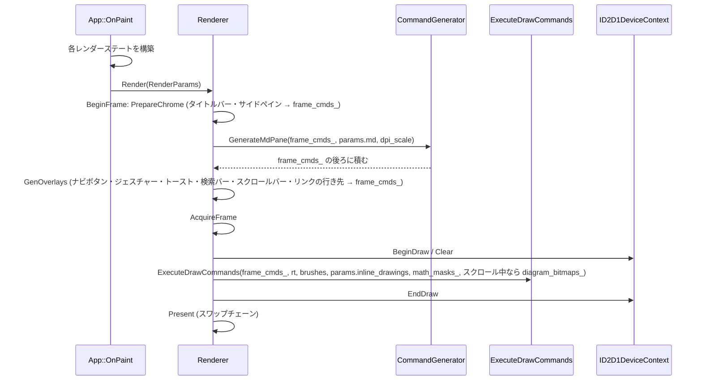

---

### 3.6 Parser — Markdownパーサ

#### 3.6.1 パイプライン

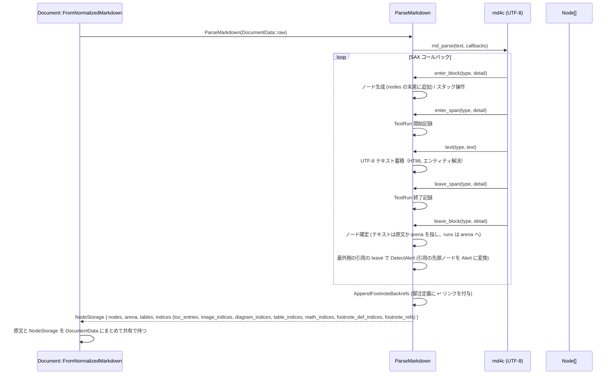

```cpp
// パース中に作る特殊ノードの索引。
struct NodeIndices {
    std::vector<TocEntry> toc_entries;    // 見出し (文書順)。そのまま目次になる
    std::vector<size_t> image_indices;    // 画像を持つノード (表はどれかのセル)
    std::vector<size_t> diagram_indices;
    std::vector<size_t> table_indices;
    std::vector<size_t> math_indices;     // インライン数式の run を持つノード (表はどれかのセル)
    std::vector<int32_t>     footnote_def_indices; // [id - 1] が脚注 id の定義ノード
    std::vector<FootnoteRef> footnote_refs;        // 脚注参照の位置 (文書順)
};

// パーサーの出力。ノードと、ノードが指すもの (テキスト・runs・リンク URL を置いた arena とテーブル) と索引。
// ノードは arena を指すので、nodes だけを取り出すときは arena ごと持ち続ける。
struct NodeStorage {
    ReservedArray<Node> nodes;   // 予約したアドレス空間に置き、使う分だけコミットして伸ばす (text_arena.h)
    TextArena arena;
    std::vector<std::unique_ptr<NodeTableData>> tables;
    NodeIndices indices;
};

// 確保に失敗したら (md4c の中でも) std::bad_alloc を投げる。
NodeStorage ParseMarkdown(std::string_view markdown_text, std::stop_token stop_token = {});
// ノードは入力テキストを参照するため、一時文字列 (std::string の右辺値) を渡す版は delete。
```

md4c は **UTF-8 モード** (`MD_CHAR=char`) で起動するため、入力は UTF-8 byte 列。ワーカーの `LoadFile` が UTF-8 のまま読み込んで `Document::FromNormalizedMarkdown(text, path, stop_token)` に渡す経路と、埋め込みリソース（ヘルプ）から 2 引数版 `Document::FromMarkdown(utf8, path)` で直接渡す経路がある。ノードのテキストは原文と一致すれば原文（`DocumentData::raw`）をそのまま指し、装飾や文字参照で一致しないものだけ `TextArena` にコピーする。リンクの `href`・画像の `src`・コードブロックの言語指定は md4c が属性として渡すので、`AttributeText` が文字参照（`&amp;` 等）を解いてから使う。

パース中の作業用の領域（文字参照を解いた属性・リンク URL の索引・リスト番号スタックなど）はパーサ専用の arena / pool を持たず、通常の `std::string` / `std::vector` / `std::unordered_map` として既定のアロケータで確保する。ノード配列と、ノードのテキストを組む `current_text`・表の本文を組む `table_text` は `ReservedArray`（`text_arena.h`）に置き、`ReserveForInput` が入力サイズからアドレス空間だけを予約する。ノード数の上限は `kInputBytesPerNode = 2`（ノードは少なくとも 2 byte の入力から作られる）で見積もり、テキストの置き場は入力の長さまで予約する。使う分だけコミットして伸ばすので要素を写さず、予約を超えたときだけ倍を予約し直して写す。パース後は `shrink_to_fit` がノード配列のコミットを足したときの余り（最大 1/4）を、写さずに外す。`TextArena` はチャンクを積み足すので予約しない。

#### 3.6.2 対応する Markdown 要素

##### ブロック要素

- **見出し** (`# H1` 〜 `###### H6`) — 6段階、アンカーID自動生成
- **段落** — 通常テキスト
- **コードブロック** — フェンス記法 (```), 言語指定対応
- **図** — ` ```mermaid ` のコードブロックは `NodeType::Diagram` として図で表示。` ```math ` と `$$...$$` だけの段落は段落の中に中央揃えの数式として表示
- **引用** (`>`) — ネスト対応、GitHub Alerts記法対応
- **水平線** (`---`, `***`, `___`)
- **順序付きリスト** (`1.`, `2.`, ...)
- **順序なしリスト** (`-`, `*`, `+`)
- **タスクリスト** (`- [ ]`, `- [x]`)
- **テーブル** — GFM拡張、列アライメント対応
- **脚注定義** (`[^label]: 本文`) — 文書末尾に参照順の番号付きリストとして表示

##### インライン要素

- **太字** (`**bold**`)
- **斜体** (`*italic*`)
- **取り消し線** (`~~strike~~`)
- **インラインコード** (`` `code` ``)
- **リンク** (`[text](url)`)
- **画像** (``) — 非同期読み込み
- **太字+斜体** (`***both***`)
- **脚注参照** (`[^label]`) — `[1]` 形式で脚注定義へのリンク
- **インライン数式**（ドル記号 1 つで囲む。段落の中のドル記号 2 つで囲む数式も同じ）— KaTeX で描き、本文の行の中にインラインオブジェクトとして置く（3.12・付録 C.11）

#### 3.6.3 アンカーID生成（GitHub互換）

```cpp
// 1. 大文字 → 小文字 (GitHub の toLowerCase に合わせた表。全角英字は全角のまま小文字にする)
// 2. スペース・タブ → ハイフン (1 文字ずつ。連続しても詰めない)
// 3. ASCII は英数字・アンダースコア・ハイフン以外を除去
// 4. ASCII 以外は記号・句読点のブロック (一般句読点・CJK の記号と句読点・全角の記号など) を除去し、文字は残す
// 5. 先頭・末尾のハイフンも残す
//
// 例:
// "Hello World"     → "hello-world"
// "C++ コード例"    → "c-コード例"
// "第1章: 概要"     → "第1章-概要"
```

スラグは `GenerateAnchorId(text)`（`core/anchor.h`）が値で返す。アンカーはリンクを辿るときにしか作らないので、作業バッファを使い回す仕組みは持たない。

#### 3.6.4 GitHub Alerts記法

引用ブロック先頭の `[!NOTE]` `[!TIP]` `[!IMPORTANT]` `[!WARNING]` `[!CAUTION]` を検出し、マーカーをアイコンとラベルに置き換え、`alert_type` を設定したうえで `set_has_alert_label` でラベルを持つ印を立てる。ラベル部分の長さ（描画エフェクト適用範囲に使う）はノードに持たず、`AlertType` から `AlertLabelLength`（`document_types.h` の `kAlertLabels` の "アイコン ラベル" の長さ）で求める。同じ引用グループの後続ノードには `alert_type` だけを伝播する（ラベル長は 0）。最外側の引用を閉じるとき（`MD_BLOCK_QUOTE` の leave）に、`parser.cpp` 内部の `DetectAlert` が引用の先頭ノード（`quote_first_node`）だけを見て処理する。引用の中の段落に専用の種別は無く、`NodeType::Paragraph` で `quote_depth > 0` のノードになる。書き換えたテキストと runs は `TextArena` に置く。

#### 3.6.5 脚注

md4c の `MD_FLAG_FOOTNOTES`（v0.6.0 で `MD_DIALECT_GITHUB` に追加）を有効にし、GitHub と同じ見た目に組み立てる[^spec-admonitions]。

| md4c のコールバック | mendo での扱い |
|:--|:--|
| `MD_SPAN_FOOTNOTE_REF` | 脚注番号を `[1]` のテキストとして補い、`#user-content-fn-1` へのリンクにする |
| `MD_BLOCK_FOOTNOTE_DEF_SECTION` | 水平線ノードを置き、続く定義をリストの深さ 1 に入れる |
| `MD_BLOCK_FOOTNOTE_DEF` | 番号付きの `ListItem` ノードにする（番号 = 脚注番号） |

- 参照ごとの番号 (`ref_id`) は md4c の値を使わず自前で数える[^spec-refcount]。
- 定義の末尾には参照へ戻る `↩` リンク（2 回目以降の参照は `↩2` …）を付ける。後の定義の中の参照は前の定義を閉じた後に届くため、`AppendFootnoteBackrefs` がパース後にまとめて付ける。
- 定義ノードは文書末尾に並ぶが原文では途中にあるので、ソース位置を記録せず、前のノードの位置を受け継ぐ。ソース位置の単調非減少は `FindNodeBySourceOffset` の二分探索の前提。
- 参照されない定義は表示せず、定義の無い `[^x]` はテキストのまま残す。

#### 3.6.6 長いテキストの区切り

段落・引用・コードブロック（図と数式のコードブロックを除く）のテキストは、`kTextChunkTarget`（16KB、`parser.h`）前後で区切って同じ種別のノードの並びにする。DirectWrite は 1 段落の行分割が長さに対して二乗に近く遅くなり（空行の無い 4MB のテキストで 28 秒）、1 ノードのままだと並列に計測できず、見えている間は解放もできないため。区切りはパース中に、テキストを足しながら決める（装飾の範囲が区切りをまたがず、続きのノードのソース位置も原文と正確に対応する）。

- 改行（ソフト改行・`<br>`・コードの行末）が目安の `kTextChunkWindow`（2KB）手前を過ぎたら、そこで区切る。区切るのは後に本文が続くときだけで、末尾に空のノードは作らない。
- 1 行が長ければ目安の前後 2KB にある空白の直後で、空白も無ければ和文の句読点（、。，．！？）の直後で、どちらも無ければ目安の長さ（UTF-8 の文字の境目）で区切る。区切ったノードは別のレイアウトなので、行の途中で区切るとそこで改行して見える。
- コードブロックは折り返さないので、足す行がノード 1 つに収まる限り、その行の前の改行で区切る（行の頭の字下げは続きのノードへ移す）。収まらない長い行だけを行の途中で区切る。
- ソフト改行の代わりの空白は前のノードの末尾に残す。`\n` は取り除き、続きのノードに `kNewlineBeforeChunk` を立てる。
- 見出し・リスト項目・図・数式のコードブロック・表は区切らない（記号や下線が増え、図と数式は 1 つのコードから描く）。

並びは見た目もコピーも 1 つのブロックとして扱う。

| 使う側 | 扱い |
|:--|:--|
| 間隔 | `GetSpacingAbove` / `GetSpacingBelow` は継ぎ目で 0 を返す |
| コードブロックの背景 | `NodeBoxPadTop` / `NodeBoxPadBottom` は継ぎ目ではみ出さず、`GenCodeBlockBg` は継ぎ目の側の角を丸めない |
| コピーボタン | 先頭のノードにだけ置き、`ClipboardManager::CopyCodeBlock` が並び全体をコピーする |
| 横スクロール | `GetBlockHScrollGeometry` が並びの先頭を `scroll_key` として返し、幅は並びのうち計測済みの部分の最大にする |
| 構文の色分け | パーサが並びを前から字句解析し（`AnnotateCodeChunkLeads`）、続きのノードの先頭を占める前からのトークンの長さと種類を `Node::code_lead_length` / `code_lead_type` に残す。`TokenizeCodeNode` はそれを先頭に置き、その後ろからトークン化する（ブロックコメントや文字列が何ノードにまたがっても色が崩れない）。このときトークンは作らず（`TokensCrossing`）、コメントや文字列が始まりうる文字まで語を飛ばす。数ノードずつの窓で順に解析し、窓の端で切れたトークンはその先頭から解析し直す |
| 検索 | 改行を挟まない継ぎ目をまたぐマッチは前のノードに置き、続きのノードへはみ出す長さを `SearchMatch::next_length_w` に持つ。ハイライトは両方のノードに描く |
| 語の選択 | `FindNodeWordBoundaries` が、改行を挟まない継ぎ目で切れた語を並びの続く限り隣のノードへ伸ばす |
| コピー | `ExtractSelectedText` は継ぎ目に元の改行だけを戻し、`ExtractSelectedTextAsHtml` は並びを 1 つの `<p>` / `<pre>` にまとめる |

[^spec-admonitions]: 同じく追加された `MD_FLAG_ADMONITIONS` は使わない。ネストした引用でも Alert として扱うなど、`DetectAlert`（GitHub 準拠）と挙動が違うため。
[^spec-refcount]: md4c はテーブル行の判定でもインラインを解析するため、表の中の参照が二重に数えられ、`ref_id` / `ref_count` が実際の参照数とずれる。

---

### 3.7 LayoutEngine / LayoutService — テキスト計測

#### 3.7.1 概要

`LayoutEngine` は `ITextMeasurer` インターフェース経由で各ノードを計測し、`LayoutCache` に格納する。`LayoutService` が `LayoutEngine` と `ViewportManager` を結合し、スクロール target 管理付きのレイアウト操作を提供する。

```cpp
// 計測とライフサイクルを 1 つのインターフェースにまとめる (src/layout/layout.h)。
// 計測は const で、複数の worker から同じインスタンスを呼んでよい。
// lifecycle 系 (RecreateFormats / SetTheme / SetScheduler) は UI スレッドからのみ呼ぶ。
class ITextMeasurer {
public:
    virtual ~ITextMeasurer() = default;

    virtual bool RecreateFormats() = 0;
    // 計測に使うテーマ。ズームや色の切り替えは同じ Theme を書き換えるので、渡すのは 1 回でよい。
    void SetTheme(const Theme& theme) noexcept;
    const Theme& GetTheme() const noexcept;
    // 並列計測 (ノード単位 / 巨大テーブルのセル単位) に使う scheduler。nullptr なら直列。
    // scheduler の Shutdown より前に nullptr へ戻す契約。
    void SetScheduler(TaskScheduler* scheduler) noexcept;
    TaskScheduler* Scheduler() const noexcept;

    // 測った高さを返す。測れなければ nullopt。高さと dirty の確定は MeasureEntry に任せる。
    // 並列計測では worker ごとに別ノード・別 entry を渡す。
    // 図のノード (NodeType::Diagram) は渡さない。
    virtual std::optional<float> MeasureNode(const Node& node, NodeLayoutEntry& entry, float max_width) const = 0;
    // dirty でないテーブルの、viewport (エントリ上端からのローカル座標) 内の evict 行だけセルを再生成する。
    virtual TableRestoreResult RestoreEvictedTableRows(const Node& node, NodeLayoutEntry& entry,
                                                       YRange viewport) const;
    // 表の幾何を entry に触れずに初めから組む (巨大な表をワーカーで組む TableMeasureJobs が使う)。
    virtual BuiltTable BuildTable(const Node& node, float max_width, std::stop_token stop) const;
};

// 計測結果を entry に確定させる。図のノードは DiagramNodeHeight で高さを決める (テーマは measurer のもの)。
void MeasureEntry(const ITextMeasurer& measurer, const Node& node, NodeLayoutEntry& entry,
                  float node_width, const DiagramEntry* diagram);

class LayoutEngine {
public:
    static constexpr float kWidthChangeThreshold = 2.0f;

    // theme は measurer に渡し、以後は measurer が持つものを使う。scheduler と書式の作り直しは measurer に直接頼む。
    bool Init(ITextMeasurer* measurer, const Theme& theme);
    // 巨大な表の最初の計測をワーカーに回す。無ければ UI スレッドで測る (テストとベンチ)。
    void SetTableJobs(TableMeasureJobs* jobs) noexcept;

    // 本文幅かズームが推定時から変わって全ノードを dirty にしたら true。
    bool Reestimate(std::span<const Node> nodes, LayoutCache& cache, float viewport_width);
    bool EnsureVisibleLayout(std::span<const Node> nodes, LayoutCache& cache, float viewport_width,
                             float viewport_top, float viewport_bottom);
    // updated: 高さ・位置・テーブル行のいずれかが変わった。remaining: 期限で計測しきれなかった。
    struct PassResult { bool updated = false; bool remaining = false; };
    PassResult ProcessDirtyBatch(std::span<const Node> nodes, LayoutCache& cache,
                                 float viewport_width, LayoutDeadline deadline, YRange range);
};

class LayoutService {
public:
    LayoutService(LayoutEngine& engine, ViewportManager& viewport) noexcept;

    void ViewportLayout(const Document& doc, LayoutCache& cache, float width, float height);
    // 可視範囲の上下 height * buffer_screens まで。height が 0 でも全域にはしない。
    LayoutEngine::PassResult ProcessDirtyBatch(const Document& doc, LayoutCache& cache, float width,
                                               LayoutDeadline deadline, float height, float buffer_screens);
    bool EnsureVisibleLayout(const Document& doc, LayoutCache& cache, float width, float height);
    // 画面外の node も計測する。
    bool EnsureNodeLayout(const Document& doc, LayoutCache& cache, float width, int node);
    void RecomputeAfterDiagram(const Document& doc, LayoutCache& cache, IndexRange changed) noexcept;
    // ワーカーで組み終えた表 (TableMeasureJobs::TakeResults) を置き、見ている位置を保って Y を組み直す。
    PlacedTables PlaceMeasuredTables(const Document& doc, LayoutCache& cache, float width,
                                     std::vector<TableMeasureJobs::Result> results);
};
```

本番実装は `DWriteTextMeasurer`（DirectWrite を使用）。書式は `SetFactory` の後に `RecreateFormats` で作る。計測に使うテーマと scheduler は `ITextMeasurer` が 1 か所で持ち、`LayoutEngine`・`MeasureEntry`・`MeasureIndicesParallel` はそれを読む（別の引数では受けない。テーマは `LayoutEngine::Init`、scheduler は `ITextMeasurer::SetScheduler` で渡す）。テーマは `ThemeService` が持つ今のテーマで、ズームと色の切り替えは同じ場所を書き換えるので渡し直さない。テスト時はモックに差し替えられる。`RecreateFormats` を呼んだスレッド（UI スレッド）は共有ファクトリで、それ以外の計測ワーカーはスレッドごとの ISOLATED ファクトリと書式（`thread_local`、`RecreateFormats` の世代番号が変わったら作り直す）で測る。共有ファクトリを全スレッドで使うと、ファクトリ内部の競合で 4 本を超えると遅くなるため（`test.md` x8 の全計測で、共有は 8 本 705ms・16 本 1480ms、分けると 410ms・260ms）。`RecomputeYPositions` / `EstimateNodeHeight` / `EstimateNodeHeights` / `MakeEstimatedLayoutCache` などのフリー関数（`layout_computer.h` の `layout` 名前空間）で Y 座標再計算と高さ推定（DirectWrite 計測前の暫定値）を提供する。リロードでは `CarryOverUnchanged` が、先頭・末尾から中身の一致する範囲（`FindUnchangedEnds` の結果。非同期リロードでは worker が数えて渡す）の計測結果を、旧キャッシュから区間ごとに引き継ぐ（`LayoutCache::TakeEntries`）。グローバル名前空間への `using` エイリアスは置かず、使う側の .cpp が必要な名前だけを `using layout::X;` で取り込む。

計測用の scheduler は Mermaid 等の共有 scheduler とは別に立て、ワーカー数は `LayoutWorkerCount`（コア数 − 1 を 2〜8 本に収める。16 本はさらに速いがファクトリの分だけ commit が約 11% 増える）で決める。ワーカーのファクトリと書式は、そのワーカーが最初に計測するときに作る。起動時に先に作らないのは、最初の計測が D3D デバイスの作成の裏で終わるので速くならず、作成と競合して最初のフレームを遅らせるからである。

幅が変わったときに既存の text_layout を作り直さずに済む経路は 2 つある。改行でしか折れておらず最も長い行が新しい幅に収まるノードは、組み直しても行が同じなので幅を付け替えない（`SetMaxWidth` の後の `GetMetrics` は作り直しとほぼ同じだけかかる。リサイズ時の計測し直しが `test.md` で 174ms → 143ms、README で 6.0ms → 3.1ms）。それ以外は `SetMaxWidth` で組み直す（作り直しより 1〜16% 速いだけだが、装飾の付け直しが要らない）。

計測後の確定処理は `MeasureEntry` 1 か所にまとめている。実測した幅を `cached_width` に残す（同じ幅の高さは `text_layout` の `GetMetrics` が返す）。例外で測れなかったときも、書式やレイアウトを作れず測れなかった（`MeasureNode` が nullopt）ときも、再試行せずに dirty を外す（`CreateTextLayout` や確保の失敗はすぐには回復せず、描画のたびに同じノードを測り直して失敗し続けない）。そのノードは次の幅変更かズームまで描かれない。図のノード（`NodeType::Diagram`）は `ITextMeasurer` に渡さず、`layout::DiagramNodeHeight` が `DiagramEntry` の寸法から表示高さを決める（寸法が届くまでは現在値、それも無ければプレースホルダーの高さ）。

推定に使った本文幅とズームは `LayoutCache::EstimateBasis` に残る。本文幅が `kWidthChangeThreshold`（2 DIP）を超えて変わるかズームが変わると、`Reestimate` が全ノードを dirty にして推定値で Y を組み直す（DirectWrite は呼ばない）。ズームでは `LayoutCache::InvalidateAllLayouts` が全レイアウトを捨てて `EstimateBasis` を空に戻すので、次の `Reestimate` が必ず推定し直す。ワーカーが表示と同じ幅で推定したキャッシュは UI スレッドで推定し直さない（幅を知らない起動時の先読みだけ推定し直す）。`LayoutService::ViewportLayout` は `Reestimate` の後に `ViewportManager::ApplyScrollTarget` で見ていた位置を当て直してから可視範囲を計測する。ズームや幅変更で推定し直すと Y がずれるため、古い `scroll_y` のまま計測すると見えない範囲を 1 画面分ムダに計測してしまう。幅かズームが変わったときは、残っている表の行（上下 8 画面分）が全部組み直しになるので、計測の前に画面外の行を捨て（`EvictInvisibleTableRows`）、見えたときに作らせる（2 万行 6 列の表の中で幅を変えたときの可視範囲のレイアウトが 3.7ms → 0.55ms）。

ダーティノードの計測は `LayoutEngine::MeasurePass`（private）に一本化されている。`MeasurePass` は範囲内の dirty を集めて `layout::MeasureIndicesParallel`（`layout.cpp`）で期限（`LayoutDeadline`）まで計測し、幅不変のまま行単位で evict されたテーブルは `RestoreEvictedTableRows` で戻し、高さが変わった区間だけ `RecomputeYPositions` で組み直す。セル数が `TableMeasureJobs::kMinCells`（1 万）を超え、幾何をまだ持たない表は、1 ノードなので期限では区切れず UI スレッドを止めるため、計測ワーカーで組ませ（`TableMeasureJobs`）、組み終えるまで dirty のまま飛ばす（推定の高さのまま中身を描かない）。組み終えた表は `LayoutService::PlaceMeasuredTables` が見ている位置を保って置く。`ProcessDirtyBatch` は `YRange`（可視範囲 ± `buffer_screens` 画面、`layout::BufferedRange`）内の dirty を期限まで計測する 1 回の `MeasurePass` である。期限は各ワーカーが次のノードを取る前に見て、過ぎていたら手を付けずに dirty のまま残す。ただし 1 ノード目は期限を過ぎていても計測するので、呼び出しごとに必ず進む。`EnsureVisibleLayout` は計測で高さが変わると範囲に入るノードも変わるため、範囲内の dirty が無くなるまで `MeasurePass` を繰り返す（1 回の手間の上限として最大 8 回）。`MeasureIndicesParallel` は `ParallelFor` に 1 ノード単位で配り、1 画面分（数十ノード）の dirty でも全 worker に行き渡らせる。scheduler が null なら同じ関数が呼び出しスレッドで直列に計測する。例外はノード単位で捕まえ、測れなかったノードは再試行せず dirty を下ろす。CodeBlock のトークン化と、リンク色・アラートラベル色の描画効果（`BrushEffect`）・インラインコード背景の付与は worker が担当ノードの `NodeLayoutEntry` へ直接書き込み、UI スレッドでの集約は行わない（`Tokenize` 完了後に代入するので、例外時に途中のトークンが残らない）。Y の範囲は文書座標・エントリのローカル座標とも `YRange`（`layout_cache.h`）で表し、「全部」（`YRange::All()`）と「空」（`YRange::None()`）を名前で書き分けて既定値は持たせない。`ProcessDirtyBatch` の `range` に `YRange::All()` を渡すと可視範囲で絞らず全 dirty を対象にする。可視範囲の上下に何画面か足した範囲は、計測・evict・図の要求とも `layout::BufferedRange` で作る。

計測待ちの dirty が残っているかは `LayoutCache::HasDirtyNodes` が持ち、キャッシュと一緒に動く。`Reestimate` / `EnsureVisibleLayout` / `ProcessDirtyBatch` が更新し、`EnsureVisibleLayout` は走査しない範囲外に dirty が残っていると保守的に仮定する。

遅延レイアウト（`App::OnDeferredLayout`）はメッセージループの空き時間（`App::RunIdleWork`）に、4ms の期限で `ProcessDirtyBatch` を 1 回呼んで進める。件数で細かく区切ると、区切るたびに走査・Y の組み直し・ワーカーの待ち合わせが挟まるためである（`test.md` x4 の全計測で、32 件ずつだと一度に測る 165ms が 290ms になった）。`ResourceManager::DEFERRED_LAYOUT_BUFFER_SCREENS`（2 画面）を `buffer_screens` に渡すため、画面外の計測は前後 2 画面までに限られる。範囲外へジャンプした場合は `EnsureVisibleLayout` が同期計測で拾う。

#### 3.7.2 レイアウト計算フロー

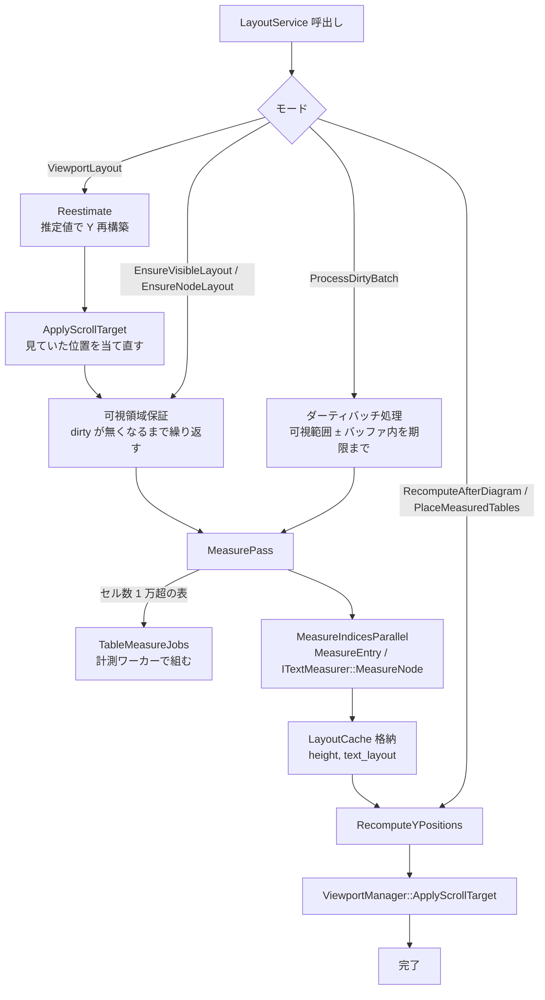

#### 3.7.3 テキストフォーマット

| 用途 | フォントファミリ | 既定サイズ (DIP) |
|:-----|:----------------|:-----------------|
| H1 | Segoe UI | 32 |
| H2 | Segoe UI | 26 |
| H3 | Segoe UI | 22 |
| H4 | Segoe UI | 18 |
| H5 | Segoe UI | 16 |
| H6 | Segoe UI | 14 |
| 本文 | Segoe UI | 16 |
| コード | Cascadia Mono → Consolas → Courier New | 14 |
| アイコン | Segoe Fluent Icons → Segoe MDL2 Assets | 用途ごとに異なる |

コードとアイコンのフォントは `theme_palette.h` の候補リスト（`kMonospaceFontCandidates` / `kIconFontCandidates`）で決まる。起動時に `ThemeService::Init` が先頭から実在するものを選び（テーマ間で共通なので 1 回だけ。ダークモードとズームの切り替えでは引き継ぐ）、どれも無ければ末尾を使う。HTML コピーのコードブロックの `font-family` も同じリストからコンパイル時に組み立てる。

本文は GitHub (Windows) と同じく英数字を Segoe UI で組み、Segoe UI に無い漢字・かな・全角記号は DirectWrite のシステムフォールバックに任せる。フォールバック先は書式のロケール `i18n::TextLocale()` で決まり、OS の表示言語が中国語・韓国語でなければ `ja-jp`（Yu Gothic UI）、簡体字なら `zh-cn`（Microsoft YaHei UI）、繁体字なら `zh-tw` / `zh-hk`（Microsoft JhengHei UI）、韓国語なら `ko-kr`（Malgun Gothic）になる。描画先は不透明なので `D2D1_ALPHA_MODE_IGNORE` で作り、文字は ClearType で描く。

> **Note**: 本文側のフォントサイズと余白はズーム倍率 (`Theme::zoom`) で乗算される。サイドペイン（ファイル一覧・目次）の項目はペインごとの倍率で別に拡大する（3.9.3）。窓枠（タイトルバー）・サイドペインのヘッダー・検索バーは固定サイズである。

---

### 3.8 Renderer — Direct2D 描画

#### 3.8.1 Command パターン

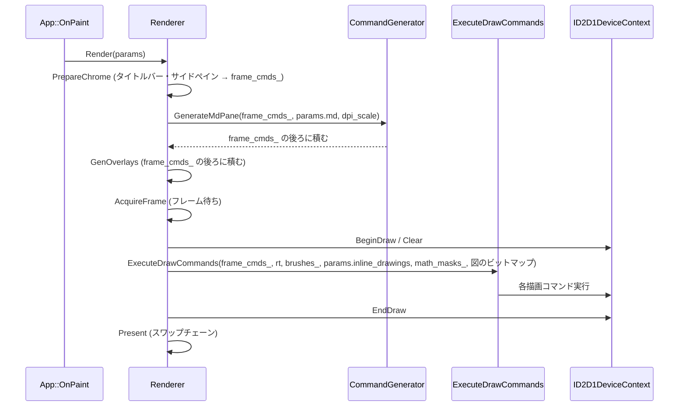

#### 3.8.2 DrawCommand 型

```cpp
using DrawCommand = std::variant<
    FillRectCmd,
    FillRoundedRectCmd,   // opacity あり。円 (箇条書きの記号・スピナーの点) も半径 = 半辺で描く
    DrawRoundedRectCmd,   // 枠線 (検索欄のフォーカス枠・白抜きの箇条書きの記号)
    DrawLineCmd,
    DrawTextLayoutCmd,    // opacity あり
    DrawBitmapCmd,
    DrawDiagramCmd,       // 図のコマンドリスト (記録した CSS px を dest に合わせて縮める)
    DrawGeometryCmd,      // 一筆描きの線 (ジェスチャーの軌跡)、opacity あり
    PushClipCmd,
    PopClipCmd,
    SetTransformCmd
>;

using DrawCommandList = std::vector<DrawCommand>;

using FixedBrushArray = std::array<Microsoft::WRL::ComPtr<ID2D1SolidColorBrush>, BRUSH_COUNT>;

// 該当ブラシが未作成のコマンドは描かない。rt は null にしない (実装は command_executor.cpp)。
// math_masks があればインライン数式の SVG の形をマスクで塗る。diagram_bitmaps があれば図をビットマップで描く (スクロールの間)。
void ExecuteDrawCommands(const DrawCommandList& cmds, ID2D1RenderTarget* rt, const FixedBrushArray& brushes,
                         const InlineDrawings& inline_drawings, MathMaskCache* math_masks = nullptr,
                         DiagramBitmapCache* diagram_bitmaps = nullptr);
```

`DrawCommandList` は `DrawCommand` variant の単一 `std::vector` である。毎フレーム構築して 1 回読むだけのリストなので、型別ベクタや発行順テーブルは持たない。`Renderer` は毎フレーム `frame_cmds_` を clear して容量を使い回し（`CommandGenerator::GenerateMdPane` は渡された列の後ろに積む。検索のハイライトで 4096 個を超えて膨らんだ容量は、4 分の 1 も使わなくなったら返す）、自由関数 `ExecuteDrawCommands` は先頭から `std::visit` で順に実行する。第 4 引数の本文中のインラインオブジェクトを描くもの（`App` が持つ `InlineDrawings`。インライン数式の描画命令と画像のビットマップ）は、`Renderer::Render` が `RenderParams::inline_drawings` をそのまま渡す。第 5・第 6 引数は `Renderer` が持つ数式の形のマスク（`MathMaskCache`）と、スクロールの間だけ渡す図のビットマップ（`DiagramBitmapCache`。見えている図を装置の画素のビットマップに描いて写し、止まったら捨ててベクタに戻す。`Renderer::SetScrollingDiagrams`）である。

各コマンドは値型で、`IDWriteTextLayout*` や `ID2D1Bitmap*` などのポインタは **非所有**（ライフタイムは `LayoutCache` / `TextLayoutCache` / `Renderer` が管理）。色はすべて `BrushId`（`brush_id.h`）で固定ブラシを指し、`Renderer` が保持する `FixedBrushArray` を `ExecuteDrawCommands` が配列ルックアップで引く。半透明は `opacity` で掛ける。アラートの背景も固定ブラシ（`AlertNoteBg` 〜 `AlertCautionBg`）、オーバーレイボタンはテーマが白（ダーク）か黒（ライト）に決めた固定ブラシ（`BrushId::Overlay`）に不透明度を掛けて描くので、コマンドが任意の色を持つことはない。ブラシが未作成のコマンドは描かない。

`DrawTextLayoutCmd` はすべて `ID2D1RenderTarget::DrawTextLayout` ではなく、自前の `IDWriteTextRenderer`（`VisibleRunRenderer`）を渡した `IDWriteTextLayout::Draw` で描く。テキストレイアウトに付く描画効果は計測ワーカーが `SetDrawingEffect` で付けた `BrushEffect`（リンク色・アラートラベル色）で、デバイスに依存しない印なので、デバイスを作り直しても付け直さずに済む。描画時に `BrushEffect::IdOf` で固定ブラシへ置き換える。色のフォント（絵文字）のランは、GitHub と図のラベルに合わせてフォントの色で描く（`DrawColorGlyphRun`）。

本文のテキストレイアウトには、`CommandGenerator` がコマンドに可視の縦範囲（`cull_top` / `cull_bottom`、クリップ範囲と同じ）を載せ、`VisibleRunRenderer` は範囲外のグリフラン・下線・取り消し線を飛ばす（D2D の `DrawTextLayout` は画面外も含め全ランを処理し、1 万行のコードブロックで 1 フレーム約 20ms かかる）。画面より低いレイアウトでも、画面の端に掛かるものの画面の外の行は描かない（端に掛かる 30 行のコードブロックが並ぶ文書の 1 フレームが 511 → 419µs）。本文以外の文字列は範囲を既定の無限のままにする。

コードブロックの構文色も描画時に付ける。`DrawTextLayoutCmd::syntax_tokens`（同じ `NodeLayoutEntry` が持つ UTF-16 位置のトークン、非所有）があれば、`VisibleRunRenderer` はグリフランを `clusterMap` でトークン境界に分け、種別ごとの固定ブラシ（`SyntaxKeyword` 〜 `SyntaxDeleted`）で描く（同じ色のグリフを 1 つのランに集めて色ごとに 1 回で描く。トークンの細かい JSON 60 行の 1 フレームが、トークンごとに描くと 1.5ms、まとめると 0.35ms）。右から左のランも分割し、境界がクラスタ（合字等）の途中にあればそのクラスタは後ろのトークンの色になる。`SetDrawingEffect` は 1 回ごとに既存の範囲数に比例して重くなり、巨大なコードブロックで O(n²) になるため構文色には使わない。トークンは計測ワーカーが text_layout と一緒に作り、トークン間の空白だけの隙間は直前のトークンに含めて同種をまとめ、グリフランの分割を減らしておく。

インラインオブジェクトは `DrawInlineObject` に届く。見えない行のものは、見分ける前に寸法（`GetMetrics`）で飛ばす。インライン数式（`MakeInlineMathObject` で作ったもの。`InlineMathObjectOf` が QueryInterface で見分け、key と倍率を返す）は `InlineDrawings` の描画命令を `DrawMath` で本文の色で描き（幅に収まらないブロック数式は倍率で縮める）、画像（`InlineImageObjectOf` が見分ける）は `InlineDrawings` のビットマップを箱いっぱいに描き（読めない画像はアイコンと alt を描く）、それ以外は書式の省略記号なのでオブジェクト自身に描かせる。省略記号は `TextFormatSpec::ellipsis` で書式に付け、今はタイトルバーの文書名（`titlebar_text`）・描けなかった図の文言（`placeholder_text`）・リンクの行き先（`link_status`。`ellipsis_keep_after` で最後の `\` から後ろを残し、手前を省く。3.25）が使う。図の文言の枠の高さは文言の長さによらない（推定か本文 3 行ぶんの高さ。3.26）ので、収まらない行を省いて最後に見える行の末尾を省略記号にし、前後のブロックに重ならないようにする。

#### 3.8.3 Renderer のデバイスとスワップチェーン

D3D11 デバイス + DXGI フリップモデルのスワップチェーン上の `ID2D1DeviceContext`、D2D / DirectWrite / WIC ファクトリ、DPI は `Renderer` が直接持つ（抽象インターフェースや別のクラスは挟まない）。ブラシとテキストフォーマットも `Renderer` が管理する。デバイスとスワップチェーンを扱うメンバ関数は `renderer_device.cpp` で定義する。`renderer.h` は D3D11 / DXGI / WIC の型を前方宣言だけで持ち、`d3d11.h` / DXGI のヘッダを `renderer.h` から `app.h` を読む翻訳単位（`app*.cpp`・`window.cpp`）へ広げない。DXGI を読むのは `renderer_device.cpp` と、ポップアップと図の拡大表示を本体のデバイスで描くスワップチェーン（`WindowSwapTarget`）を定義する `d2d_util.cpp` だけである。

```cpp
// デバイスとスワップチェーンを扱うメンバ関数は renderer_device.cpp で定義する。
class Renderer {
public:
    // デバイスとスワップチェーンは作らない (CreateDevice で作る)。
    bool Init(HWND hwnd, const Theme& theme);
    // 既存のデバイスがあれば捨てて作り直す。
    bool CreateDevice();
    void Resize(UINT width, UINT height, bool live) noexcept;
    void SetDpi(float dpi) noexcept;
    D2D1_SIZE_F GetSize() const noexcept;
    void TrimForMinimize() noexcept;

    static constexpr DWORD kFrameWaitTimeoutMs = 1000;
    HANDLE FrameWaitHandle() const noexcept;   // 取れている間とロスト中は nullptr
    void MarkFrameAcquired() noexcept;

    ID2D1Factory* GetD2DFactory() const noexcept;
    ID2D1RenderTarget* GetRenderTarget() const noexcept;
    IDWriteFactory* GetDWriteFactory() const noexcept;
    IWICImagingFactory* GetWICFactory() const noexcept;

private:
    void AcquireFrame() noexcept;
    void Present() noexcept;
    RenderDeviceState device_;   // NoDevice / Ready{frame_acquired} / Lost
};
```

- **デバイス作成**: D3D デバイスの作成（数十 ms）は `PrefetchD3DDevice` で wWinMain の冒頭から起動処理と重ね、`Renderer::CreateDevice` で受け取る。作り直しに失敗している間はロスト扱いのままにする。
- **デバイスとフレームの段階**: `RenderDeviceState` が `NoDevice`（作る前）/ `Ready`（描ける。`frame_acquired` を持つ）/ `Lost`（作り直す）の variant で持ち、`EndDraw` と `Present` の HRESULT から遷移を決める（`OnEndDraw` / `OnPresent`）。D3D に触らないので、デバイスのロストを起こさずに遷移をテストする（`test_render_device_state.cpp`）。
- **フレーム待ち**: Frame Latency Waitable Object のシグナルで次のフレームを描いてよいかを判断する。メッセージループが `FrameWaitHandle` を待って `MarkFrameAcquired` で記録し、取れていなければ `Renderer::Render` がコマンドを組み立てた後、`BeginDraw` の前の `AcquireFrame` で最大 `kFrameWaitTimeoutMs`（1 秒）待つ。取れたら Present するまで取れた扱いのままにし、表示されなかったフレームの後で待ち直さない。
- **リサイズ**: ライブリサイズ中（`live`）は `ResizeBuffers` をせず、モニタ全体の大きさのバッファを使い回して表示範囲（source size）だけを変える。
- **デバイスロスト**: `EndDraw` が `D2DERR_RECREATE_TARGET` を返したときと、`Present` が `DXGI_ERROR_DEVICE_REMOVED` / `RESET` / `HUNG` / `DRIVER_INTERNAL_ERROR` を返したとき、`Resize` でバッファを取り直せなかったときに `Lost` になり、次フレーム冒頭の `Render` が `CreateDevice` で作り直す。作り直しの経路はここ 1 か所だけ。
- **最小化**: `Renderer::TrimForMinimize` が D2D の内部キャッシュとドライバ側の一時確保を手放す。
- **別のアプリへの切り替え**: `WM_ACTIVATEAPP` で `App::OnActivateApp` が使っていない QuickJS のランタイムと、作り置いた短い文字列のレイアウト（`Renderer::TrimForInactive`）を捨て、`TRIM_WORKING_SET_DELAY_MS`（1 秒）後に `EmptyWorkingSet` でワーキングセットを空にする（読み込み中は終わるまで待つ）。空の文書のプライベートワーキングセット 20MB のうち約 15MB は、D3D11CreateDevice でドライバが一度触ったきりのページ（AMD）。非アクティブの間は 0.1MB 前後になり、戻ってスクロールしても数 MB しか戻らない。commit は変わらず、外したページはメモリに余裕があれば変更リストに残る。自分のポップアップや図の拡大表示への切り替えは同じ UI スレッドなので `WM_ACTIVATEAPP` が来ない。

#### 3.8.4 Renderer ファイル構成

| ファイル | 担当 |
|:---------|:-----|
| `renderer.cpp` | 1 フレームの描画（`Render`。ロスト中なら `CreateDevice` で作り直す）、Markdown ペイン描画統括、タイトルバーとサイドペインのコマンド（`PrepareChrome` が `chrome::` を呼ぶ）、本文に重ねるコマンドの組み立て（`GenOverlays`、ジェスチャーの軌跡）、固定ブラシ（`OnThemeColorsChanged`）・ペイン用フォーマット管理、アプリアイコン |
| `renderer_device.cpp` | D3D デバイスの先行作成（`PrefetchD3DDevice`）、ファクトリ・デバイス・スワップチェーンの作成、リサイズ、フレーム待ち（`AcquireFrame`）、`Present` とデバイスロストの検知、`TrimForMinimize` / `TrimForInactive`、図のビットマップの切り替え（`SetScrollingDiagrams`）（`Renderer` のうち `d3d11.h` / DXGI を読む唯一の翻訳単位） |

#### 3.8.5 描画順（`Renderer::Render`）

1. 背景クリア
2. カスタムタイトルバー・ファイルペイン / TOCペイン・スプリッタ（`PrepareChrome` が `frame_cmds_` の先頭に積む。以下も同じ列に積み、`BeginDraw` の後に `ExecuteDrawCommands` で 1 回だけ実行する）
3. Markdownコンテンツ（`GenerateMdPane` が続けて積む）
   - 引用ブロックのバー・背景（`GenBlockQuoteGroupDecorations`、グループ単位でノードより先に描く）
   - 以下、ノードごとに文書順（`GenerateNode`）
   - コードブロック背景 → テキスト（構文色は描画時に付ける）→ コピーボタン
   - テーブル（行背景・グリッド線・セル）
   - 水平線 / 見出し下線 / リスト記号 / タスクチェックボックス
   - Mermaidダイアグラムのコマンドリスト（`DrawDiagramCmd`。無ければプレースホルダー）→ 保存 / コピー / 拡大表示ボタン（画像は本文のインラインオブジェクトとしてテキストと一緒に描く）
   - テキストを持つノードはインラインコード背景 → 検索ハイライト → テキスト選択ハイライト → テキストの順
   - テーブル・コードブロックの横スクロールバー（ホバー中・ドラッグ中のブロックのみ）
4. 以下は `GenOverlays` が本文の後ろに積む
5. ナビゲーションボタン（戻る/進むオーバーレイ、`overlay::EmitNavButtons`）
6. マウスジェスチャトレイル（`GenGestureTrail`、`DrawGeometryCmd`）
7. スワイプオーバーレイ（`overlay::EmitGestureOverlay`）
8. トースト通知（`overlay::EmitToast`）
9. 検索バー（下部ドッキング、`overlay::EmitSearchBar`）
10. Markdownペインのスクロールバーのつまみ（`VScrollThumb`。サイドペインのつまみも同じ関数で作る）
11. 指しているリンクの行き先（`overlay::EmitLinkStatus`。3.25）

オーバーレイボタンのうち、コードブロックのコピーは常に描き、図の保存 / コピー / 拡大表示はマウスが図の画像領域にある間（`MdPaneParams::hovered_diagram`）だけ描く。どれもボタンにホバー中だけ濃くする。矩形は `layout::ForEachOverlayButton` が列挙し、描画とヒットテストで同じ矩形を使う。

読み込み中（`RenderParams::loading_angle` がある）は 3 の代わりに 5 のスピナー（`overlay::EmitLoadingSpinner`）を積み、7・8（ジェスチャオーバーレイ・トースト）だけを重ねる。コンテキストメニューはこのシーケンスとは別経路で描画される。

`Renderer` はすべてをコマンドにして `ExecuteDrawCommands` で描き、レンダーターゲットへ直接描くのは `BeginDraw` / `Clear` / `EndDraw` だけである。半透明は各コマンドの `opacity`、未作成のブラシは executor がまとめて扱う。スピナー・ナビボタン・ジェスチャー・トースト・検索バー・リンクの行き先の組み立ては `command_generator.h` の `overlay` 名前空間の関数に、スクロールバーのつまみは `VScrollThumb` にあり、デバイス無しでテストできる。検索バーの配置は `Renderer::GenOverlays` が 1 フレームに 1 回だけ `ComputeSearchBarLayout` で組み（`SearchBarLayout`。バー全体の矩形 `bar_rect` も持つ）、入力欄の幅を測るのにも `overlay::EmitSearchBar` にもそれを渡す。検索欄の文字列は `MeasureSearchInput`（`command_generator.h`。DirectWrite のファクトリと書式だけを使い、デバイスに依存しない）がレイアウトを `TextLayoutCache` から引いて選択範囲とキャレットの位置を測り、その結果（`SearchInputMetrics`）を `overlay::EmitSearchBar` に渡す。入力欄のクリックとドラッグの文字位置は `HitTestSearchInput` が同じレイアウトから求める。ジェスチャーの軌跡は D2D のジオメトリを作るので `Renderer` に残る。タイトルバーとサイドペインはデバイスに依存しないコマンド列なので、デバイスの作成前に `PrepareChrome` を呼んで最初のフレームの文字レイアウトを先に作れる（`App::CreateRenderDevice`）。

描画コストを抑えるためのキャッシュ:

- **サイドペインの項目テキスト**: 可視項目は数十個なのでオフスクリーンに溜めず毎フレームコマンドに積む。目次の項目は UTF-16 の文字列を持たず、描く項目だけ毎フレーム変換する（40 行で約 4µs）。左寄せ NO_WRAP の項目名・見出しはレイアウト幅を固定して `TextLayoutCache` に載せ、はみ出しはクリップで切るため、スプリッタのドラッグ中もレイアウトを作り直さない。
- **短い文字列**: `DrawText` は呼び出しごとに内部でテキストレイアウトを作るため使わない。アイコン・リスト番号・プレースホルダ・タイトル・ナビボタン・ジェスチャー・トースト・検索バーのラベルや件数は、(書式, フォントの対応, 文字列, 箱の大きさ, 下線) ごとに `TextLayoutCache`（`command_generator.h`。`text_layouts_`、`CommandGenerator` と共有）に作り置き、文字列と書式が同じ間は使い回す。中央に置くものは中央揃え書式のレイアウトを幅/高さ 0 で作って矩形中心に置き（`CmdWriter::Centered`）、固定サイズの箱が必要なものは箱サイズで作って左上に置く（`CmdWriter::Text`）。`Renderer`、`CommandGenerator`、`overlay` / `chrome` の関数がこれで積む。項目数が `kMaxEntries`（512）を超えたら `BeginFrame` で直前のフレームに使わなかったものを捨てる。言語の切り替えで書式を全部作り直す `RecreateAllTextFormats` はまとめて破棄し、別のアプリへ切り替わったとき（`Renderer::TrimForInactive`）も全部捨てる。ズームでは大きさがズームに従う書式（本文の記号・番号・プレースホルダ）だけを作り直し、作り直した書式のレイアウトだけを `TextLayoutCache::Forget` で捨てる（キーが書式を参照で持つので古い書式のレイアウトを引くことはないが、上限まで残ると 1 個 commit 約 20KB）。タイトルバーやサイドペインのレイアウトを作り直さずに済む（80 個ほどで約 2.7ms）。
- **検索入力欄**: 文字列と幅が同じ間は `TextLayoutCache` のレイアウトを使い回す。ドラッグ選択中のヒットテストも同じレイアウトを引く。IME の合成中は下線の範囲もキーに含めて同じキャッシュに置く。
- **スクロール中の図**: 図は毎フレームベクタで描くと 1 個 0.25ms（重い図は 1ms 超）かかるので、スクロールの間だけ、見えている図を装置の画素のビットマップに描いておき、次のフレームからはそれを写す（数十 µs。`DiagramBitmapCache`、`draw_command.h` / `command_executor.cpp`）。ビットマップは見えている部分の上下に 1/4 画面ずつ足した帯だけを持ち、帯から出たか倍率が変わったら描き直す。持つのは描いたフレームで見えていた図の分だけで（描かなかった図の分は `EndFrame` が捨てる）、合計は画面の約 1.5 倍まで。帯は本体の context が描いている最中に描くので、別の device context で描く。描いたときから動いた分は画素単位でずらして写す（半画素未満のずれはスクロールの間だけ）。拡大と平行移動だけの変換でないときと、帯が GPU のビットマップの最大辺を超えるときはベクタで描く。スクロールのたびに App の `effect::ResourceManage` のハンドラが `Renderer::SetScrollingDiagrams(true)` を呼んで `SCROLL_SETTLE` タイマー（500ms）を掛け直し、`Renderer::Render` はその間だけ `ExecuteDrawCommands` にビットマップを渡す。タイマーが満了したら `SetScrollingDiagrams(false)` が `Clear` で捨て、捨てたものがあれば描き直してくっきりしたベクタに戻す（静止中は持たない）。最小化（`TrimForMinimize`）でも捨て、デバイスの作り直しでは `Reset` で新しいデバイスに付け替える。全部の図をビットマップで持つ案は GPU +161MB / private +125MB で見送り、見えている分だけをスクロールの間だけ持つ形をユーザーが選んだ（2026-11-13）。帯の大きさが変わるたびにビットマップを作り直す。帯の最大（図の高さか 1.5 画面）で確保して使い回すと、作り直しが 96 → 27 回、1 フレームが 7〜10% 速くなるが、図を積んだ文書で同時に持つ最大が 8.4 → 10.0MB（+19%）になって上の合計が崩れるので、今のままをユーザーが選んだ（2026-11-14）。

---

### 3.9 Theme — テーマシステム

#### 3.9.1 テーマ構造

```cpp
struct Theme {
    // 固定ブラシ (BrushId) ごとの色。半透明の重ね色や固定色も含め、テーマを作るときに全部決める。
    std::array<D2D1_COLOR_F, BRUSH_COUNT> colors{};
    // テーマを作るときに決める (背景の明るさからは推さない)。
    bool dark = false;
    constexpr const D2D1_COLOR_F& Color(BrushId id) const noexcept;

    // フォント
    std::wstring font_family;     // "Segoe UI"
    const wchar_t* text_locale;   // 本文の書式に渡すロケール (i18n::TextLocale)
    std::wstring monospace_font;  // kMonospaceFontCandidates から解決した名前
    std::wstring icon_font;       // kIconFontCandidates から解決した名前

    // フォントサイズ (DIP)
    float font_size_body;
    float font_size_h[6];
    float font_size_code;

    // スペーシング
    float margin_left, margin_right, margin_top, margin_bottom;
    float paragraph_spacing, list_item_spacing;
    float heading_spacing_above;
    float heading_spacing_below;       // h3〜h6 の下マージン
    float heading_spacing_below_h1h2;  // h1/h2 の下マージン (下線+次行余白を確保)
    float code_block_spacing_above, code_block_padding;
    float indent_width, blockquote_bar_width;
    float list_bullet_offset, list_bullet_radius, hr_thickness, h2_underline_thickness;

    // ペインレイアウト（本文のズームの対象外。一覧の項目はペインごとの倍率を掛けて使う）
    float pane_item_height;
    float pane_header_height;
    float splitter_width;
    float pane_font_size;

    // ズーム (1.0 = 100%)
    float zoom = 1.0f;

    constexpr float ContentWidth(float viewport_width) const noexcept;
    float GetHeadingSize(int level) const noexcept;
    constexpr float GetHeadingUnderlineThickness(int level) const noexcept;
    // 倍率 1 のテーマにだけ掛ける (倍率を変えるたびにベーステーマから作り直す)。
    void ApplyZoom(float new_zoom) noexcept;
};
```

色は描画の固定ブラシと同じ添字の `colors` 1 つに持つ。`BuildTheme(dark)`（`theme.cpp` 内部）が `dark` を決め、テーマごとに違う色はライトとダークを 1 行に並べた 1 つの表（`kThemeColors`）から写す。背景（`BrushId::Background`、`Clear` に使う）・本文・見出し・コード・アラート（`AlertBrushIdFromIndex` / `AlertBgBrushIdFromIndex` の連番）・シンタックス（`SyntaxTokenType` の Keyword 以降と同じ順に並べ、`SyntaxBrushId` が差で引く）・タイトルバー・ペイン・検索・ジェスチャーとトーストの背景（`OverlayGestureBg`）の色に加えて、両テーマ共通の固定色（選択・閉じるボタンの赤・オーバーレイの白 `OverlayWhite`・ジェスチャーの軌跡）と、`dark` で決まる重ね色（表のストライプ・スクロールバーのつまみ・ボタンのオーバーレイ `Overlay`（ダークは白、ライトは黒））もここで入れる。`Renderer::OnThemeColorsChanged` は `colors` を添字順に 1 回なめてブラシに写すだけ。ポップアップ（コンテキストメニュー・設定ダイアログ）も `Color(BrushId::Text)` などから自前のブラシを作る。

Reducer は `AppState::theme`（`ThemeService` 所有 `Theme` への非所有ポインタ）経由で寸法を直接参照する。

#### 3.9.2 ThemeService — テーマ管理サービス

```cpp
class ThemeService {
public:
    constexpr bool IsDarkMode() const noexcept;
    // 今のテーマ。描画・計測・ポップアップ・reducer はこれを参照で持つ (アドレスは変わらない)。
    constexpr const Theme& GetTheme() const noexcept;
    // 起動時の先読みの推定用。今のライト/ダークのベーステーマに zoom を掛ける。フォントは候補の先頭のまま。
    Theme CreateTheme(ZoomLevel zoom) const;
    // 今のテーマを作り、フォントを実在する候補に決める。
    void Init(bool dark, ZoomLevel zoom);
    bool ToggleDarkMode();          // 色だけが変わる (ライトとダークの違いは色だけ)
    void ApplyZoom(ZoomLevel zoom); // 寸法だけが変わる
};
```

今のテーマは `ThemeService` が 1 つだけ持ち、`Renderer`（`const Theme*`）・`DWriteTextMeasurer` / `LayoutEngine`・`AppState::theme`・ポップアップ（`PopupEnv::theme`）はそれを参照する。切り替えは同じ場所を書き換え、ベーステーマから作り直すので倍率の累積誤差は溜まらない。起動時は `App::Init` が `session::LoadDarkMode` / `session::LoadZoomLevel` の値で `ThemeService::Init` を呼び、テーマを作ってフォントを決めてから `Renderer::Init(hwnd, theme)` に渡す。書式とブラシは 1 回の生成で済み、ライトテーマで作ってから作り直す二重生成を避ける。フォントの解決は DirectWrite の共有ファクトリだけを使い、D3D デバイスを待つより前に済む。

ライト/ダークの切替はフォントと寸法が共通なので色だけの変更として扱う。`ThemeService::ToggleDarkMode` の後の `Renderer::OnThemeColorsChanged` は書式やテキストレイアウトを作り直さず、固定ブラシを作り直すだけである（ズーム変更は `ThemeService::ApplyZoom` の後に計測側の `RecreateFormats` と `Renderer::OnThemeMetricsChanged` で書式を作り直す。描画側が作り直すのは本文の記号・番号・プレースホルダの書式だけ）。テキストレイアウトに付けた描画効果はブラシ ID の印（`BrushEffect`）なので付け直しも要らない。`App::ToggleDarkMode` もテキストレイアウトと描画エフェクトを維持し、テーマ色を焼き込んだ図だけは、後始末（`App::FinishLayout`）の図の要求がテーマの変化を見て描き直させる（`ResourceManager::InvalidateDiagramsForRequestChange`。テーマの切り替えは reducer を通さず、`App::RunCommand` が `App::ToggleDarkMode` を直接呼ぶ）。

#### 3.9.3 ズームシステム

17段階の離散的なズームレベル（`ui_types.h::ZOOM_STEPS`）。段は `ZoomLevel` が持ち、本文（`ViewportManager`）・ファイルペイン・目次ペイン（`PaneController`）がそれぞれ 1 つずつ持つ。

| インデックス | 倍率 | インデックス | 倍率 |
|:------------|:------|:------------|:------|
| 0 | 0.25x | 9 | 1.25x |
| 1 | 0.33x | 10 | 1.50x |
| 2 | 0.50x | 11 | 1.75x |
| 3 | 0.67x | 12 | 2.00x |
| 4 | 0.75x | 13 | 2.50x |
| 5 | 0.80x | 14 | 3.00x |
| 6 | 0.90x | 15 | 4.00x |
| 7 | **1.00x** (default) | 16 | 5.00x |
| 8 | 1.10x | | |

`ZOOM_DEFAULT_INDEX = 7`、`ZOOM_STEP_COUNT = 17`。

ズーム変更では reducer の `ZoomAction` の処理が可視先頭のノードとノード内オフセット（段を変える前後の倍率の比でスケール）を scroll target に置き、`App::ApplyZoom` が表を組むワーカーを止めて待ち（`TableMeasureJobs::CancelAll`。ワーカーはテーマと書式を読む）、全ノードのレイアウトを無効化して（`LayoutCache::InvalidateAllLayouts`。reducer は文書に書かない）、`ThemeService::ApplyZoom` が zoom=1.0 の基準テーマから倍率を掛けて今のテーマを作り直し（累積適用による誤差を避ける）、計測と描画の書式を作り直す。続く `App::FinishLayout`（`LayoutChange::Remeasure`）の `LayoutService::ViewportLayout` が推定し直した Y で見ていた位置を当て直してから可視範囲を計測する（3.7.1）。

本文のズームは Markdown 本文だけに掛かる。`Theme::ApplyZoom` は本文のフォントサイズと余白のみを倍し、サイドペインの `pane_item_height` / `pane_header_height` / `splitter_width` / `pane_font_size` は据え置く。ペイン幅もズーム倍率でスケールしないので、本文のズームでペイン配置（`ComputePaneLayout`）は変わらない。保存するペイン幅はズームを含まない DIP 値である。

サイドペインはペインごとの倍率で一覧の項目（行の高さ `SidePaneItemHeight`・文字・アイコン・目次の字下げ）だけを拡大する。ヘッダーとペイン幅は変えない。`ZoomAction::pane` があれば `ReduceSidePaneZoom` がそのペインの段を動かし、先頭に見えていた項目が残るようスクロール位置を倍率の比で動かす。本文は組み直さない。Renderer はペインごとの一覧の書式（`pane_list_fmt_`）を描画時の倍率で作り直す。`TextLayoutCache` はキーで書式を参照して持つので、書式を作り直してもキャッシュを捨てる必要はない（解放したアドレスが新しい書式に使い回されない）。図の保存・コピー・拡大表示のボタンは、ポインタが画像の矩形の上にあるとき（`hit_test::DiagramImageHitTest`）だけ出す。Ctrl+ホイールはポインタの下の領域を、右クリックメニューの「ズーム」の行（ブラウザのメニューと同じ − / 倍率 / + / 元に戻す）は右クリックした領域をズームする。ズームの行のボタンはメニューを閉じず、`ContextMenuParams::on_zoom` で `ZoomAction` を流す。メニューと設定ダイアログのモーダルループは本体のメッセージループ（`ModalLoop`、`Win32Window` が実装）で回すので、開いている間も本体の描画・タイマー・通知・ファイル監視・空き時間の仕事が進む（保存すれば裏で読み直される）。倍率の表示と押せるかは開いている間に変わるので、`ZoomLevel` から都度求める。

---

### 3.10 Syntax — シンタックスハイライト

#### 3.10.1 対応言語

```mermaid
graph LR
    subgraph 対応言語
        CPP[C / C++]
        PY[Python]
        JS[JavaScript]
        TS[TypeScript]
        GO[Go]
        RS[Rust]
        BASH[Bash]
        PS[PowerShell]
        CMD[Cmd]
        JSON[JSON / JSONC / JSON5]
        JVM[Java / Kotlin]
        CS[C#]
        SW[Swift]
        PHP[PHP]
        RB[Ruby]
        SQL[SQL]
        CONF[YAML / TOML / INI]
        WEB[HTML / XML / CSS / SCSS]
        DIFF[diff]
        BUILD[Dockerfile / Makefile]
        ZIG[Zig]
        HS[Haskell]
        LISP[Clojure / Emacs Lisp / Common Lisp / Scheme・Racket]
        LUA[Lua]
        VIM[Vim script / Vim9 script]
        MER[Mermaid]
    end

    subgraph トークンタイプ
        KW[Keyword]
        TY[Type]
        ST[String]
        NU[Number]
        CM[Comment]
        PP[Preprocessor]
        FN[Function]
        IN[Inserted]
        DE[Deleted]
    end

    CPP --> KW & TY & ST & NU & CM & PP & FN
    PY --> KW & TY & ST & NU & CM
    JS --> KW & TY & ST & NU & CM & FN
    TS --> KW & TY & ST & NU & CM & FN
    GO --> KW & TY & ST & NU & CM & FN
    RS --> KW & TY & ST & NU & CM & FN
    BASH --> KW & ST & NU & CM
    PS --> KW & TY & ST & NU & CM
    CMD --> KW & ST & CM
    JSON --> KW & ST & NU
    JVM --> KW & TY & ST & NU & CM & FN
    CS --> KW & TY & ST & NU & CM & PP & FN
    SW --> KW & TY & ST & NU & CM & PP & FN
    PHP --> KW & TY & ST & NU & CM & FN
    RB --> KW & TY & ST & NU & CM & FN
    SQL --> KW & TY & ST & NU & CM & FN
    CONF --> KW & TY & ST & NU & CM & PP
    WEB --> KW & TY & ST & NU & CM & PP & FN
    DIFF --> KW & TY & CM & IN & DE
    BUILD --> KW & TY & ST & NU & CM & FN
    ZIG --> KW & TY & ST & NU & CM & FN
    HS --> KW & TY & ST & NU & CM & PP & FN
    LISP --> KW & TY & ST & NU & CM & PP & FN
    LUA --> KW & TY & ST & NU & CM & FN
    VIM --> KW & TY & ST & NU & CM & PP & FN
```

`SyntaxTokenType` には `Plain` も定義されているが、トークナイザは `Plain` トークンを出力しない。描画も HTML 化もトークン間の隙間を既定色のテキストとして扱うため、出力しても同じ結果になるうえトークン数の大半を占めるだけだからである。トークンは計測で text_layout を作るときに一緒に作り、UTF-16 位置に直し、空白だけの隙間を直前のトークンに含めて隣り合う同種をまとめてから `NodeLayoutEntry` に置き、画面外で layout を捨てるときに一緒に捨てる。描画は `VisibleRunRenderer`（`command_executor.cpp`）がグリフランをトークン境界で分けて種別の色で描く（3.8.2）。書式付きコピーは表示の有無に関係なくその場でトークン化する。

C++ の生文字列 `R"delim(...)delim"` は、`R"` の直後から規格どおり最大 16 文字・空白/括弧/`\` を含まない区切りの範囲だけ `(` を探す。上限なしに探すと `(` の無い `R"` が続く文書で末尾までの走査を繰り返し、O(n²) になるためである。

JSON 系は ` ```json ` / ` ```jsonc ` / ` ```json5 ` の言語タグで認識される。`true` / `false` / `null` をキーワードとしてハイライトする。

Java / C# / Kotlin / Swift / PHP / Ruby / SQL は C++ 等と同じ汎用 lexer (`TokenizeRange<LexerConfig>`) に設定フラグを足して扱う。C# の逐語的文字列 `@"..."`、SQL の `--` コメント、PHP 8 の属性 `#[...]` と `$` 付きの変数名（`$class` をキーワードにしない）、Ruby の `=begin` / `=end` がそのためのフラグである。トリプルクォート文字列は `TripleQuote` で、`\` をエスケープにする形（Python / Java / Swift）、しない形（Kotlin の raw string）、開きと同じ数以上の `"` で閉じる形（C# 11 の raw string literal）を読み分ける。数値リテラルは `'` に加えて `_` も桁区切りとして受け付ける。

YAML / TOML / INI / HTML / XML / CSS / SCSS / diff / Dockerfile / Makefile は、キーと値・タグと属性・セレクタと宣言・行頭の記号といった行や宣言の構造で色が決まるため専用 lexer を持つ。設定ファイル系の値はスカラー全体で数値・定数を判定し、`1.2.3` や `node:18-alpine` の一部だけを数値として色付けしない。埋め込み言語は汎用 lexer を範囲指定で呼んで色付けする（HTML の `<script>` / `<style>` を JS / CSS、Dockerfile の命令引数と Makefile のレシピ行をシェル）。diff の追加行・削除行には専用のトークン種別 `Inserted` / `Deleted` を使う。ハンク内では `-- ` を消した行も `--- ` で始まるので、`--- ` `+++ ` `@@` の 3 行が並ぶときだけ次のファイルのヘッダとみなす。YAML のブロックスカラー（`|` / `>`）の本文は、行内で最後に現れた `-` かキーの桁より深い行とする。TOML の `'''` は `\` をエスケープにしない。

Zig は汎用 lexer に `\\` の行文字列と `@import` 等の組み込み関数のフラグを足して扱う。Haskell は専用 lexer で、`'` を識別子の一部 (`foldl'`)・文字リテラル・型レベルの昇格 (`'True`) に読み分け、記号と隣り合う `--` は演算子として扱う。大文字始まりの識別子を型・コンストラクタ、行頭の小文字始まりを定義名とする。Lisp 系 4 方言は 1 つの lexer を方言ごとのキーワード表と字句フラグ（大文字小文字の区別、`?a` / `\a` の文字リテラル、`cond` の節）で使い分ける。`-` や `?` を含むシンボルを 1 語として読み、リスト先頭の呼び出し位置を Function、特殊形式を Keyword にする。定義名（`defun foo` の `foo`）は Function とし、引数リストと `let` の束縛リストは呼び出しと見ない。

Lua は汎用 lexer に長括弧（`[[ ]]` / `[==[ ]==]` の文字列と `--[[ ]]` のコメント）のフラグを足して扱う。Vim script は専用 lexer で、行頭と `|` の後をコマンド位置として読み、コマンド名（省略形を含む）を Keyword、`g:` / `s:` / `a:` 等のスコープ付き変数と `&option` / `$ENV` / `@r` を Type、`<CR>` 等のキー表記を Preprocessor にする。`"` は行頭ならコメント、式の中では同じ行に閉じの `"` があれば文字列、無ければ行末コメントとみなす。マッピングコマンドの引数はキー列なのでキー表記だけを色付けし、`lua << EOF` の本文は Lua として、`let x =<< END` の本文は文字列として色付けする。`<<` はコマンド（`let` は代入の `=`）の直後に来たときだけ本文の始まりとみなし、行の途中のシフト演算子や文字列中の `<<` では始めない。先頭のコマンドが `vim9script` の文書（と ` ```vim9 `）は Vim9 script として `#` をコメント、`"` を文字列とする。

キーワードリストは `syntax_keywords.h` に集約され、語の長さと先頭・中央・末尾の文字から番地を求める開番地法の表（`WordTable<N>`。受け渡しは型消去した `KeywordTable`）で持つ。判定は番地から順に空きまでを見る。なお `SyntaxLanguage` には図形言語の `Mermaid` と、` ```math ` の `LatexMath`（トークン化対象外）もある。`Mermaid` のブロックはパーサが `NodeType::Diagram` のノードにする。` ```math ` はパーサが中身を `$$` で囲んだ段落にし、`$$...$$` だけの段落と同じく段落いっぱいの `kMathDoubleDollar` の run（`IsBlockMath`）としてインライン数式の仕組みで描く。

---

### 3.11 ファイルI/O — LoadFile / FileWatcher / AsyncLoadCoordinator

#### 3.11.1 ファイル読み込み

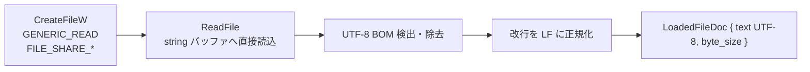

```cpp
enum class FileLoadError : uint8_t {
    NotFound,    // ファイルが見つからない、またはアクセス拒否 (Locked 以外の CreateFileW の失敗)
    Locked,      // 他のプロセスが共有を許さずに開いている (エディタの保存中など)。時間をおけば読める
    TooLarge,    // ファイルサイズが上限 (async_load_coordinator.cpp の MAX_FILE_SIZE、~2GB-1) を超過したか、
                 // 読み込み・パースでメモリを確保できなかった
    ReadFailed,  // サイズの取得や読み込み中の I/O エラー
};

struct LoadedFileDoc {
    std::string text;           // UTF-8 (BOM 除去・LF 正規化済み)
    size_t      byte_size = 0;  // BOM 込みのファイルバイト数
};

// ワーカーだけが呼ぶ自由関数 (async_load_coordinator.h)。stop_token は差し替え口の型に合わせて受けるだけ。
std::expected<LoadedFileDoc, FileLoadError>
    LoadFile(const std::wstring& path, const std::stop_token& stop_token);
```

- 共有モード: `FILE_SHARE_READ | FILE_SHARE_WRITE | FILE_SHARE_DELETE`
- 他プロセスが編集中でも読み取り可能。共有を許さずに開かれている間（`ERROR_SHARING_VIOLATION` / `ERROR_LOCK_VIOLATION`）は `Locked` を返す
- `ReadFile` で `std::string` バッファへ直接読み込み、**UTF-8 のまま** 返す（md4c も UTF-8 モードで動く）
- 改行を LF に、NUL を U+FFFD に正規化して返す（`NormalizeSource`）。`Document` とリロード差分はこの出力が LF のみであることを前提にする
- 上限は ~2GB-1（`INT_MAX`）で、超えたら `TooLarge` として弾く。md4c の長さ（`MD_SIZE`）とノードの位置は 32 bit なので 4GB 未満であればよいが、`INT_MAX` は文書全体を UTF-16 に変換していた頃の値で、それより大きい文書を開ける必要は無いので残している
- ファイル選択ダイアログは `file_dialog::OpenMarkdownFile` / `SavePngFile`（`src/util/file_io.h`。`<commdlg.h>` は `file_io.cpp` だけが読む）に分離されている

#### 3.11.2 FileWatcher — ファイル変更監視

`ReadDirectoryChangesW` による非同期ディレクトリ監視。対象ファイルの親ディレクトリを監視し、ファイル名一致（大小無視。通知が 8.3 短縮名で来る場合に備えて短縮名とも照合）で変更を検出する。

```cpp
// 監視の対象。ReadDirectoryChangesW は最初に呼んだ後の変更を貯めるので、読み込みの worker がファイルを読む前に作り
// (OpenWatchTarget)、UI スレッドの StartWatching に渡す。読んでから監視を始めるまでの保存も通知で届く。
// 短縮名の問い合わせと親フォルダを開くことは、ネットワーク上のファイルでは往復が入るので、これも worker で済ませる。
struct FileWatchTarget {
    std::wstring filename;
    std::wstring short_filename;                // 長い名前と一致しない場合のみ
    std::unique_ptr<DirectoryChangeRead> read;  // 親フォルダと発行した読み取り。開けなければ null で、監視しない
};
FileWatchTarget OpenWatchTarget(const std::wstring& file_path);

class FileWatcher {
public:
    // disposer があれば、やめた監視の読み取りをその worker で取り消して閉じる
    // (UI スレッドですると切断されたネットワークドライブで固まる)。
    explicit FileWatcher(TaskScheduler* disposer = nullptr) noexcept;

    // 変更のたびに呼ぶ。読み直しの最中かどうかは呼ばれた側 (ReloadScheduler) が見る。
    using ChangeCallback = std::move_only_function<void()>;

    void StartWatching(FileWatchTarget target, ChangeCallback callback);
    void StopWatching() noexcept;
    void CheckForChanges();
    HANDLE GetEventHandle() const noexcept;  // 読み取りを発行している間だけ非nullptr
};
```

`MsgWaitForMultipleObjects` で `EventHandle`（本文中の画像のフォルダの監視 `ImageFolderWatcher` のイベントと一緒に `App::GetFileWatchEvents` が集める）を監視し、変化時は `App::OnFileWatchEvent` が `FileWatcher::CheckForChanges` と `ResourceManager::OnImageFolderEvent` を直接呼ぶ（Reducer は通さない）。変更を検出したコールバックは `ReloadScheduler::OnFileChanged` に知らせ、`FILE_RELOAD` タイマー（`FILE_RELOAD_DEBOUNCE_MS`）の満了でリロードする。続けて保存されてもタイマーは延ばさず、最初の通知から数える。

読み直しの進み方は `ReloadScheduler`（`async_load_coordinator.h`）の状態（`Idle` / `Waiting` / `Reloading` / `LoadingOther`）で表し、変更の通知・`FILE_RELOAD` タイマー・読み込みの開始と結果ごとに、App が行うこと（`ReloadCommand`。タイマーの掛け直し・読み直しの開始・結果の適用など）を返す。読み直しの間に届いた変更は `Reloading::changed` に溜め、読み終えたら最初の通知として待ち直す。別ファイルのロード中に届いた変更と、別ファイルを開き始めて取り消した読み直しは `LoadingOther::changed` に残し、そのロードが文書を差し替えずに終わったとき（取り消し・失敗）に読み直させる。書き込みの途中（読み終えた後もファイルが伸びている `StillGrowing`、truncate→rewrite の前半の `DeferPrefixShrink`）を読んだら `FILE_RELOAD_RETRY_MS` で読み直す（prefix shrink の defer は `kMaxPrefixShrinkDefers` = 10 回まで）。共有を許さずに開かれていて読めない（`Locked`）間も読み直し、`kLockedRetriesBeforeNotice` = 50 回（約 3 秒）続いたら一度知らせ、以後は `FILE_RELOAD_LOCKED_RETRY_MS` の間隔にする。

| 定数 | 値 | 用途 |
|:-----|:---|:-----|
| `FILE_RELOAD_DEBOUNCE_MS` | 200ms | ファイル変更通知のデバウンス（文書と本文中の画像） |
| `FILE_RELOAD_RETRY_MS` | 50ms | truncate→rewrite 検出後の短縮リトライ |
| `FILE_RELOAD_LOCKED_RETRY_MS` | 1000ms | 共有なしで開かれたまま長引いているファイルの読み直し間隔 |

テキスト選択のドラッグ中はリロードを始めず、`ReloadScheduler::OnTimer` が同じ `FILE_RELOAD_RETRY_MS` の再試行で待つ（読み始めた後にドラッグが始まったら、結果を適用せずに同じく待って読み直す）。ドラッグが終わると次の再試行で読み直す。

ReadDirectoryChangesW の通知バッファは 64KB（ネットワーク越しで許される上限）。溢れると貯まった通知が捨てられて 0 バイトで返るので、変更として扱う（大きく取るのは、無関係な変更の多いフォルダで読み直しを増やさないため）。

本文中の画像のファイルは `ImageFolderWatcher`（`file_watcher.h`。`ResourceManager` が持つ）が監視する。画像のあるフォルダごとに読み取りを 1 つ発行し、通知の名前を登録した画像と照らす（更新時刻を定期的に見る形は、画像の枚数ぶんの問い合わせがネットワーク上で往復になるので採らなかった）。文書のフォルダは `FileWatcher` も監視しているが、対象を差し替える時期が違うので読み取りは共用しない。

- **登録**: `ResourceManager::ResolveImagePath` が初めて解決した画像を `Watch` で足す。初めてのフォルダは画像を読む worker（`ImageLoader::scheduler`）で開き、開き終えるまで（`IsOpening`）そのフォルダの画像は読まない（読んでから監視を始めるまでの更新を取りこぼさない）。まだ無いファイルも、置かれたら知らせる。
- **UI スレッドではファイルに触れない**: フォルダを開く・短縮名を長い名前に直す・読み取りを取り消して閉じる、はどれも worker で行う（切断されたネットワークドライブの画像を参照する文書で、フォルダごとに数秒〜数十秒ウィンドウが固まるため）。worker は結果を受け箱に置き、受け箱のイベントもフォルダの読み取りと一緒にメッセージループが待つ（`EventHandles`）。
- **通知の照合**: 通知の名前を登録した画像のファイル名と大小無視で比べる。当たらなかった名前のうち 8.3 短縮名の形（12 文字以内で `~` の直後が数字）のものだけを worker で長い名前に直し、次の `CheckForChanges` で照らす（`~` だけで問い合わせると、エディタの一時ファイルの通知のたびに走る）。通知が溢れたフォルダは、登録した画像を全部更新されたとみなす。読み取りが失敗したフォルダ（消えたなど）は監視をやめる。
- **読み直し**: `ResourceManager::OnImageFolderEvent` が更新された画像を控え、最初の通知から `IMAGE_RELOAD` タイマー（`FILE_RELOAD_DEBOUNCE_MS`）を掛ける。待つ間の通知ではタイマーを延ばさない（延ばすと、短い間隔で書き出され続ける画像がいつまでも出ない）。満了した `OnImageReloadTimer` は控えた画像を `ImageLoader::Invalidate` し（3.23）、先読み範囲の画像の読み直しを頼む（範囲の外の画像は、入ったときの走査が頼む）。フォルダを開き終えた知らせなら、待たせていた画像を読ませる（`LoadImages`）。
- **監視の枠と文書の切り替え**: 監視するフォルダは `kMaxFolders`（8）まで（待つハンドルは `MsgWaitForMultipleObjects` に足すので増やしすぎない。イベントは受け箱の分を足して `kMaxEvents` = 9 まで）。別の文書を開いたら `ResourceManager::ForgetInlineImages` が `ForgetPaths` で登録した画像を外し、フォルダの読み取りは次の文書のために残す（開けなかったフォルダは次の文書で開き直す）。枠が埋まったら、今の文書の画像が無いフォルダから前に使った順にやめる（`Watch` は使ったフォルダを後ろへ寄せる）。今の文書の画像だけで枠を超えた分のフォルダの画像は、保持範囲を出て戻るまで更新が出ない。フォルダが変わったときだけ外していた頃は、同じフォルダの文書を渡り歩くと前の文書の画像のフォルダが枠を占め続け、使い切った後の文書では更新が出なかった。2026-11-11 からは開くたびにフォルダの監視ごと捨てていたが、同じフォルダの文書を渡り歩くたびに開き直すので、2026-11-13 に今の形にした（ユーザーの判断）。

#### 3.11.3 AsyncLoadCoordinator — 非同期ロード制御

```cpp
// 表示中のファイルを読み直すとき (開き直しを含む) に worker に渡す旧文書 (同じヘッダの ReloadBaseFor が作る)。
// 原文はパース前の差分判定に、ノードはパース後に変わらなかったノードを数えるのに使う。空ならリロードとして扱わない。
struct ReloadBase {
    std::shared_ptr<const DocumentData> data;   // Document::ShareData
    bool accept_prefix_shrink = false;          // prefix shrink も defer せずにパースする (defer の上限後)
};

// 同一ファイルのリロードで、worker がパース前に差分判定まで済ませた結果。
// NoChange / DeferPrefixShrink / StillGrowing / Locked はパースせずに返す (doc は空)。ただし StillGrowing はパースの間に伸びたときも付ける。
struct ReloadCheck {
    ReloadDecision decision{ ReloadOp::NoChange, std::string_view::npos };
    // 判定に使った旧文書。UI 側の文書がこれと同一のときだけ decision と ends を信用できる。
    // 弱参照なので、判定後に UI が文書を差し替えれば旧文書はその時点で解放される。
    std::weak_ptr<const DocumentData> base;
    // 旧文書のノードと比べて変わらなかった先頭と末尾のノード数 (Replace のとき)。worker で数える。
    UnchangedEnds ends;
};

// ワーカースレッドでのパース結果。cache は doc 向けに EstimateNodeHeights 済み。
struct AsyncLoadResult {
    Document    doc;
    LayoutCache cache;
    std::optional<ReloadCheck> reload;
    FileWatchTarget watch;   // 開いた文書の変更の監視に使う。リロードは今の監視を続けるので作らない
};

// 非同期ロード 1 回分の結果。成功時は AsyncLoadResult、失敗時はその理由。
using AsyncLoadOutcome = std::expected<AsyncLoadResult, FileLoadError>;

// App が直接持つ (load_coordinator_)。全 public API は UI スレッドから呼ぶ。
class AsyncLoadCoordinator {
public:
    // load_file はテストが worker を読み込み中で止め、Cancel / 再 Start との競合を再現するための差し替え口。
    explicit AsyncLoadCoordinator(TaskScheduler& scheduler, LoadFileFn load_file = &LoadFile) noexcept;
    bool IsActive() const noexcept;

    // 進行中の読み込み (preload を含む) の stop_source に request_stop してから新しく始める。
    // 結果は Attach で渡した通知先へ送る。Attach の前なら送らない。
    void Start(std::wstring path, Theme theme,
               float content_width = 0.0f, ReloadBase reload_base = {});

    // 通知先を渡す。以後の Start の結果もここへ送る。読み込み中なら true で、結果が出ていればこの場で通知を送る。
    bool Attach(HWND hwnd, UINT msg_id);

    std::optional<AsyncLoadOutcome> Take() noexcept;
    void Cancel() noexcept;

private:
    // Cancel と直列化するため、lock 内で stop を確かめてから outcome_ に書く。
    void Publish(const std::stop_token& stop_token, AsyncLoadOutcome outcome);
};
```

ファイルの読み込みとパースは大きさによらず（埋め込みのヘルプとライセンスを除いて）ワーカーで行い、UI スレッドはファイルに触れない（ネットワーク上のファイルで止まらない）。スピナーの状態（`spinner_`。`SpinnerOff` / `SpinnerDelayed` / `SpinnerSpinning` の variant）は `App` が持つ。スピナーは、読み込みが `LOADING_SPINNER_DELAY_MS`（150ms）より長引いたときだけ出す（`App::ScheduleLoadingAnimation` が `LOADING_ANIM` タイマーを遅延付きで張り、最初の発火でスピナーを始める）。すぐ終わる読み込みでちらつかせないためである。読み込みのタスクは `TaskScheduler::PostFront` で、画像のデコードや図の読み込みの待ちより先に実行させる（リロードは旧文書の表示を続けるので、それらの待ちを捨てられない）。

非同期ロードはワーカースレッドで Document を構築し、推定高さまで埋めた `LayoutCache` を返す。同一ファイルのリロードでは、worker が旧文書（`ReloadBase::data`）の原文とパース前に差分を判定し、判定後は弱参照（`ReloadCheck::base`）だけを残してパース中に旧文書を延命しない。パース後は旧文書のノードと比べ、変わらなかった先頭と末尾のノード数（`UnchangedEnds`）も worker で数える（100MB で約 20ms を UI スレッドから外す）。パース中に UI が旧文書を手放していれば数えないが、そのときは UI の文書が `base` と別物なので、`PlanParseComplete` が結果を使わずに読み直させる（`Retry`）。ワーカーは自分の `stop_token` の確認と mutex 保護の `outcome_` への書き込みだけを行う。`Start` と `Cancel` は必ず旧 `stop_source` に `request_stop` するので、停止を要求された token を持つ worker が古い worker であり、`Publish` は lock 内で stop を確かめてから書く。成功と失敗は `AsyncLoadOutcome`（`std::expected`）1 つで運ぶので、結果とエラーが両方入っている状態や、片方だけ取り残される状態は起きない。UI スレッドは `App::OnParseComplete` で `Take` を 1 回呼んで受け取る。

起動時の読み込みは、ウィンドウを作る前に `App::StartPreloadAsync` が通知先なしで `Start` する。ウィンドウ作成後の `App::LoadInitialDocument` が `Attach` で通知先を渡す。結果がもう出ていれば `Attach` がその場で `PARSE_COMPLETE` を送り（通知先が無い間の `Publish` は送っていないので二重には届かない）、まだなら完了時に `Publish` が送る。どちらも `Win32Window::Create` が最初のフレームより前に取り込む（D3D デバイスの先行作成を待つ間に届けば `AwaitInitialParseBeforeDevice`、作成の後なら `PeekMessageW` で）ので、初回フレームは空にならない。`Attach` が false（読み込んでいない）ならヘルプを表示する。

#### 3.11.4 対応ファイル形式

| フィルタ名 | 拡張子 |
|:----------|:-------|
| Markdown Files | `*.md`, `*.markdown`, `*.mkd`, `*.txt` |
| All Files | `*.*` |

---

### 3.12 MermaidRenderer / DiagramCache

#### 3.12.1 アーキテクチャ

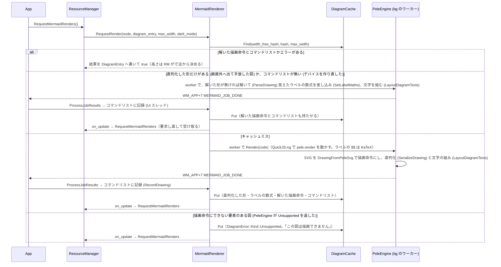

#### 3.12.2 IMermaidRenderer インターフェース

```cpp
class IMermaidRenderer {
public:
    virtual ~IMermaidRenderer() = default;

    // 結果 (描画命令かエラー) が出ていれば diagram_entry に書いて true。まだなら描画を始めて false
    // (始めていれば何もしない)。結果が出たら初期化時に渡した通知で知らせ、呼び出し側が要求し直す。
    // 要求と結果はコードのハッシュで引くので、ノードや diagram_entry を持ち続けない。
    virtual bool RequestRender(const Node& node, DiagramEntry& diagram_entry,
                               float max_width, bool dark_mode) = 0;
    // 前に描いた図の縮めない大きさ (CSS px)。文書を開くときと読み直すときに、描く前に図の高さを決めるのに使う。
    // 実装し忘れると開くたびに図の高さが跳ねるので、既定の実装を置かない。
    virtual std::optional<mermaid_util::DiagramSize> KnownSize(const Node& node, float max_width, bool dark_mode) const = 0;
    // 描画待ちと、投入済みでまだ始まっていない表示用の要求 (キャッシュの直列化した形の読み込みを含む) を捨て、
    // 描いている途中の表示用の描画も止める (インライン数式の要求は維持)。捨てた図は再要求される。
    virtual void DropQueued() {}
    // 見えている図から順に RequestRender し直す回の始まり。待ちを、この回に頼まれた順へ並べ直す。
    virtual void BeginRequestPass() {}
    // どの図も拡大表示も持たなくなった描画命令とコマンドリストを、覚えている結果からも外す (図から外しただけでは
    // メモリが返らない)。寸法と直列化した形は残し、次の RequestRender でそこから読み直す。要求の回の終わりに呼ぶ。
    // 実装し忘れると画面外の図のメモリが返らないまま気付けないので、既定の実装を置かない。
    virtual void ReleaseIdleDrawings() = 0;
    // 図の保存・コピーに使う画像を描く (本文の幅に収まらない図はその幅まで縮める)。描けなければ null。
    virtual ComPtr<IWICBitmap> DiagramBitmap(const mermaid_util::DiagramDrawing& drawing, float max_width);
};
```

`ResourceManager` は `FlushPendingResources`・結果の通知（`on_update` から `RequestMermaidRenders`）から、再レイアウトしない `RequestVisibleDiagrams` で可視範囲 → 下 → 上の順に図を走査し、1 図ずつ `RequestDiagramRender` で要求する（拡大表示の図は本文の範囲に依らず先に頼む）。その場で結果が出た図は呼び出しごとの `changed` に積み、`RequestMermaidRenders` が再レイアウトを 1 回にまとめる（`RecomputeLayout`。Y の再計算は変わった範囲に限る）。大きく移動したとき・幅やテーマが変わったとき・文書を切り替えたときは `DropQueued` で不要になった描画待ちを捨てる。保持範囲の外へ出た図は `EvictOffscreenResources` がコマンドリストと描画命令を捨て（`DiagramEntry::ReleaseImage`。寸法は残すので組み直さない。仮表示中の絵も、見えない所では代わりが要らないので捨てる）、続く要求の回の終わりに `RequestMermaidRenders` が `ReleaseIdleDrawings` で覚えている結果からも外させる。戻ってきたら `RequestRender` が直列化した形を worker で解き直して記録する（JS は動かさない）。

要求と結果のキーは、ノードのテキストだけで決まる `DiagramCodeHash`（rapidhash）に量子化幅とテーマを混ぜた `DiagramRequestHash`。pele は幅の上限（要求に含めて渡す）より狭く描けた図（`IsWidthFree`）をどの幅でも同じに描く（mermaid の文書の例と本書の図、計 559 図で確かめた）。その結果は幅を混ぜない `DiagramWidthFreeHash` で持って先に引き、いまの幅の上限より狭いときだけ使う。幅の上限より広いフローチャートも、別の幅で描き直した描画命令（直列化した形のハッシュ）が `last_drawn_` に覚えた前の幅のものと同じなら、どの幅でも使える結果（`any_width`）として幅なしのキーに置き、前の幅の結果は捨てる。ウィンドウやペインの幅を変えても、描き直すのは幅に縛られる図（gantt など）とエラーだけになる。同じコードは同じ結果になるので、失敗も成功と同じく覚えて描き直さない。待ち・読み込み中・描画中の要求は `inflight_`（ハッシュの集合）で重複を弾く。要求はコードを UTF-8 のまま持つ。

図はブラウザを使わずに描く。`PeleEngine` が bg の `TaskScheduler` のワーカーで pele を QuickJS-ng で動かし、文字の幅は pele の `measurer` オプションを `DiagramTextMeasurer`（DirectWrite）につないで測る。出てきた SVG は `DrawingFromPeleSvg` がブラウザの `getComputedStyle` の代わりに CSS 変数・`color-mix()`・継承・変換・`text-anchor` を自分で解いて、描画命令（`DiagramDrawing`）にする。結果は `Job` 経路で UI に戻り、直列化した形（`SerializeDrawing`）と一緒に図の結果のキャッシュ（`DiagramCache`。3.12.3）に置く。`<foreignObject>` のように描画命令にできない要素を含む図は描かず、`DiagramError::Kind::Unsupported`（「この図は描画できません」）にする。今の pele は数式を描けたラベルを `<svg class="pele-math">`、描けなかったラベルを TeX の文字で書き、画像は `images: false` で出させないので、mermaid の文書の例と本書の図（575 図）でこのエラーになる図は無い。

数式もブラウザを使わずに描く。`PeleEngine` の同じランタイムで KaTeX（`katex.min.js`）を動かして HTML 出力（`output: 'html'`、`displayMode`）を作り、`LayoutKatexHtml` が katex.css の使う範囲の CSS（vlist の表・inline-block・相対位置・絶対位置の SVG・`.katex-sizing` の大きさ）を解いて描画命令（`MathDrawing`。字形の並び・枠の矩形・SVG の path）にする。KaTeX は縦の位置と高さを自分で決めて em で書くので、解くのは横の並びと字幅だけでよい。書体は KaTeX の 20 書体（woff2、260KB）を EXE に埋め込み、使う書体だけを初めて使うときに DirectWrite で展開して読む（`KatexAssets`。展開したものを DirectWrite に写させない）。KaTeX の書体は GSUB・GPOS・kern の表を持たないので、字幅は送り幅の和で Chrome と一致する。KaTeX の書体に無い文字（`\text{}` の日本語など）は、本文と同じくシステムのフォールバックに尋ねる。描き方は Chrome に合わせ、罫線（分数の線など）の太さは CSS px に切り捨てて 1px 未満は 1px、SVG の箱とベースラインは装置の画素に合わせる。KaTeX の対応一覧と本書の 927 式を Edge で描いた KaTeX と比べると、幅の差は中央値 0.008px、1 画素のずれを許した画素の差は中央値 0% だった。大きさは KaTeX の CSS と同じ本文の 1.21 倍、`align` などの自動の式番号は数式ごとに (1) から振って式の右に置く。数式は `\color` などで指定した色だけを持ち、指定の無い部分は描くときに周りの文字の色で描く（指定した色はダークモードでも変えず、`\colorbox` の背景も指定どおり描く。GitHub と同じ。#412）。

KaTeX は 1 式 平均 0.2ms（最大 3ms ほど）、配置は 15µs ほどなので、インライン数式は文書の順に重複を除いて、最初は 16 個（開いた直後の画面の数式を早く出す）、後は 64 個ずつ区切った組（`InlineMathPlan`）ごとに bg のワーカーで描き（`MermaidRenderer::RequestMathBatch`）、図の結果のキャッシュには置かない。図のラベルの `$$...$$` は pele の `math` オプションで描く。KaTeX は JS のスタックを深く使い、pele の配置の奥で動かすと pele の使う分だけ描ける入れ子の段数が減るので、pele と同じ正規表現でコードから TeX を拾って最上位で HTML にしておき、配置の途中では `LayoutKatexHtml`（C++ だけ）を呼ぶ（pele が切り出した TeX が拾ったものと違ったときだけ、もう一度配置する）。描画命令の層にはラベルの数式（`DrawingMath`）を置く。直列化した形には TeX だけを書き、数式の描画命令は別に覚えて、解き直したときに差し込む（3.12.3）。起動から最初に見える数式がそろうまでは、数式の見本の文書で 553 → 86ms、KaTeX の対応一覧で 563 → 95ms、mendo + WebView2 のメモリは 202 → 62MB と 211 → 59MB になった（WebView2 で描いていた頃との比較。キャッシュなし、3 回交互の中央値）。

拡大表示（窓 1 枚を `ZoomViewer` が持ち、`ZoomWindow` が描く。`ui/zoom_viewer.*`）とクリップボードの SVG も本文と同じ描画命令から作る。描画命令は本文の幅で組んだ縮めない大きさ（幅の上限より広いことがある）で、本文は描くときに幅まで縮めるが、拡大表示と SVG は縮めずに描く。拡大表示は本文と同じ幅・テーマで要求して本文と同じ結果（`cache_`）を使う（`ResourceManager` が本文の図と同じ回の中で `ResourceManagerHost::RequestViewerDrawing` を呼び、`ZoomViewer::RequestDiagram` が `MermaidRenderer::RequestViewerDrawing` で引く。本文が描いた図は pele で描き直さず、本文と同じ折り返しになる）。拡大表示は本体の描画デバイスで窓のスワップチェーンを作り（`WindowSwapTarget`）、描画命令をコマンドリストに記録して、倍率と位置の変換を掛けて描く（別のデバイスの `HwndRenderTarget` で描いていた頃は、開くたびに最初の描画まで 34〜40ms かかり、ドライバのデバイスの分の commit 約 30MB が閉じた後も残った）。操作は右上のボタン・ホイールでスクロール・ドラッグ・`+` `-` `0` `Esc`・全体表示のまま窓に追従・保存とテーマの切り替えで倍率と位置を保つ。描けない図は窓を閉じて「図を開けませんでした」を出す（書き換えで描けなくなったときは、出ている図を残す）。クリップボードの SVG は描画命令をそのまま 1 枚の SVG にする（`DrawingToSvg`。図形は層の SVG の中身、文字は 1 行ずつの `<text>`、CSS は使わない）。数式のラベルは Office や Inkscape で読めるよう、ラベルに書いたとおりの `$$TeX$$` の文字で書く。保存・コピーの画像は本体の窓の DPR でその場で描く（`DiagramBitmap`。本文の幅に収まらない図はその幅まで縮め、大きな図は画素数の上限まで縮める）。コピーは描いた画像をそのまま CF_DIB にし、SVG もその場で作って一緒に置く。保存は保存先を選んでから描いて PNG にする。

本文の画像も同じ窓で拡大表示する（issue #468）。リンクの外の画像をクリックすると開き（GitHub と同じ。リンクの中の画像はリンクを開く）、開ける画像の上ではポインタを手の形にする。どちらも、ヒットテストが当たった layout の inline object が描いている画像か（`HitResult::on_image`）で決める。本文のビットマップは本文の幅に縮めたもので見えている範囲の分しか持たないので、`ZoomViewer` が開いたときに worker で原寸に読み直し（`ImageLoader::DecodeFullSize`。画素数は 32Mi px、辺は GPU の最大までに縮める）、本体の描画先で GPU に載せて窓に渡し、閉じたら捨てる。読み終えたことは `app_msg::VIEWER_IMAGE_DECODED` で知らせ、中身を替える・閉じるたびに進める世代で古い結果を捨てる。画像のファイルが更新されたら（`ResourceManager::OnImageReloadTimer` が返すパス）位置と倍率を保って読み直し、載せる前に古い絵を外す。デバイスを作り直したら読み直す（描画先が無い間に読み終えた画像は持たない）。100% は本文と同じく画像の 1 px を物理 1 px で描き、左上を物理 px の境目に置く。縮小表示では今の倍率の画素数へ高品質に縮めた版を持ち、描くたびに縮め直さない（窓の大きさを変えている間は作らない）。

`PeleEngine` は同時に動く数だけ QuickJS のランタイムを作って使い回す（pele を読んだもので約 2.9MB、KaTeX を読んだもので約 2.6MB）。pele と KaTeX はビルドの時に QuickJS のバイトコードにして exe に埋め込み（`js_compile`。実行時にコンパイルすると最初の図で約 65ms、最初の数式で約 20ms かかっていた）、各ランタイムは使うときにそれを読む（pele 約 5ms、KaTeX 約 3ms）。スレッドのスタックは 8MB（`CMakeLists.txt` の `/STACK`）にし、JS のスタックの上限は 4MB にする（512KB では分数 3 段・行列 2 段までしか描けなかった）。同時に描く数は bg のワーカーの数より 1 つ少なくし（`PumpRenders`）、配置の重い図が画像のデコードやキャッシュの直列化した形の読み込みを待たせないようにする。描き終えて待ちが空になったら、同時に描いた分のランタイムを 1 個まで減らし（`ProcessJobResults`）、残りの 1 個は最後に描き終えてから `PELE_TRIM_MS`（10 秒）か、別のアプリへ切り替わった時点で捨てる（`app_timer::Id::PELE_TRIM` / `App::OnActivateApp` → `TrimIdleRuntimes`。図 4 個の文書で mendo の private bytes が 63 → 52MB）。捨てる処理は全オブジェクトをたどる（1 個約 3.5ms）ので bg のワーカーで行う（`PeleEngine::Trim`）。切り替えた時点で捨てるのは、ランタイムを捨てると全オブジェクトをたどり、ヒープも遅れて decommit するので、ワーキングセットを空にした後だと外したページを触り直させるため。起動から図がそろうまでは図 4 個の文書で 473 → 149ms、mendo + WebView2 のメモリは 194 → 61MB になった（WebView2 で描いていた頃との比較。3 回交互の中央値）。インタプリタなので配置の重い図は遅く、本書の図のうち subgraph のある LR の 1 つは約 0.8 秒かかる（V8 の JIT では 0.07 秒）。

`PeleEngine` は KaTeX の出力を覚えておき、同じ入力では JS を走らせない。pele の出力（SVG）は覚えず、テーマを切り替えたときも JS で描き直す（テーマの切り替えのためだけに最大 4MB を持つのをやめた、ユーザーの判断。描き直す間は旧テーマの絵を仮に出す）。KaTeX の HTML は TeX のハッシュをキーに持つ（KaTeX が描けなかった TeX は null を覚え、取り消しで止めた式は覚えない）。KaTeX に渡すのは TeX だけで、文字の大きさは配置（`LayoutKatexHtml`）にしか使わないので、ズームや見出しと本文の同じ式では、配置だけをやり直す（根号や行列の多い 707 式で 650 → 32ms。`BM_MathRender`）。合計は `kMaxHtmlBytes`（4MB。1 件ごとに表の分の 128 バイトを足して数える）までで、超えたら古い順を持たずに全部捨てる（上限は文書 1 つの数式が収まる大きさなので、超えるのは文書を渡り歩いた後）。KaTeX の HTML は 1 式 0.5〜2.2KB で、上限いっぱいだと commit 約 9%・private WS 約 17% 増える。private WS の 1 割に収まる 2MB では根号や行列の多い式が約 840 個で溢れ、溢れると全部捨ててズームに効かなくなるので、4MB（同じ式で約 1700 個、軽い式で約 6000 個）をユーザーが選んだ。

`MermaidRenderer` は `mendo_core` に入る。埋め込みリソース（pele・KaTeX・書体）から `PeleEngine` を作るのは `Init` に渡す `PeleFactory` で、本番は `CreateBundledPele` を、テストはビルドで作ったバイトコードから作る（テストの exe はリソースを持たない）。`ResourceManager` と `ClipboardManager` は `IMermaidRenderer` 越しに使い、テストでは mock を渡す。

描画とキャッシュの直列化した形の読み込みは UI スレッドで行わない。どちらも `Job` 経路に流し、バックグラウンド `TaskScheduler` で描画命令を作るか、直列化した形を解く。`Job` は仕事の種類（`JobWork`: pele で描く `Render`・キャッシュにある描画命令の文字を組む `Load`。解いた形が無ければ先に直列化した形を解き、デバイスを作り直してコマンドリストだけ外した図は文字だけを組む）と、結果（`JobOutcome` の variant: 返しただけの `JobDropped`・描画命令の `JobDrawing`・描けなかった `JobFailed`・解けなかった `JobUnreadable`・インライン数式の `JobMaths`）を持つ。同時に描く数の枠を使うのは `Render` だけ。`JobDrawing` には worker で組んだ図の文字の並び（`DiagramTextLayouts`）も入れ、UI スレッドの記録では描くだけにする（記録の 8 割は文字を組む手間）。完了は `app_msg::MERMAID_JOB_DONE` で通知され、UI スレッドの `ProcessJobResults` が描画命令をコマンドリストに記録して図の結果のキャッシュに置き、結果が出たものがあれば `on_update_` をまとめて 1 回呼ぶ。記録した後の文字の並びは worker で捨てる。1 回の転送は `kImportSliceBudget`（4ms）までで、残した分は `HasLeftoverJobResults` が真になり、メッセージループの空き時間（`App::RunIdleWork`）で続ける。直列化した形を解けなかった図（同じプロセスで書いたものなので、直列化と解析が食い違ったときの保険。描画命令は大きさ（`IsStorableSize`）も置き方（`IsStorable`）も読み戻せるものだけを作る）はその項目を捨てて描き直し、描いた直後の図が記録できなければエラーとして確定させる。投入済みでまだ始まっていない表示用の要求（描画も読み込みも）は `DropQueued` / `Shutdown` で世代（`drop_gen_`）を進めて取り消す（ImageLoader の `drop_gen_` と同じ）。worker は世代が変わっていれば描かず・読まずに `JobDropped` で返し、UI は要求中の印だけを外す。描いている途中の表示用の図も、pele が世代の変化を見て止める（`PeleEngine::Render` の `StaleWhen`。`Shutdown` は `PeleEngine::Cancel` で止める）。インライン数式は取り消すと頼み直す契機が無いので、世代が変わっても描く。

#### 3.12.3 DiagramCache — 図の結果のキャッシュ

```cpp
// mermaid.h。UI スレッドから使う。キーは DiagramRequestHash か DiagramWidthFreeHash。
class DiagramCache {
public:
    static constexpr size_t MAX_BYTES = 4u * 1024 * 1024;  // 直列化した形・ラベルの数式・エラーの文言・項目の器を数える上限
    static constexpr size_t ITEM_BYTES = 256;              // 上限に数える、項目の器の見込み
    static constexpr size_t LABEL_MATH_BYTES = 1024;       // 上限に数える、ラベルの数式 1 つの見込み

    struct Item {
        DiagramResult result;                      // 寸法・any_width・エラー。表示している間は解いた描画命令とコマンドリストも
        std::shared_ptr<const std::string> bytes;  // 直列化した描画命令。エラーと、上限より大きい図は持たない
        std::vector<std::shared_ptr<const MathDrawing>> maths;  // ラベルの数式の描画命令 (層と数式の順)
    };
    struct Hit {
        uint64_t key = 0;  // 当たったキー (幅なしか幅つきか)
        Item* item = nullptr;
    };

    // 幅に縛られない結果 (max_width より狭いか、どの幅でも使えるときだけ) を先に、無ければ幅つきで引き、使ったことにする。
    Hit Find(uint64_t width_free_key, uint64_t sized_key, float max_width);
    // 寸法を見るだけなので捨てる順を変えない (KnownSize)。
    const Item* Peek(uint64_t width_free_key, uint64_t sized_key, float max_width) const;
    const Item* Peek(uint64_t key) const;  // テスト用
    // 同じキーは置き換える (置くものが無ければ残す)。上限を超えても置くときには捨てない。
    void Put(uint64_t key, Item item);
    void Erase(uint64_t key);
    // 持ち主のいなくなった解いた形とコマンドリストを外し、上限を超えた分を使っていない順に捨てる。
    void ReleaseIdleDrawings();
    // 描画デバイスが変わった。コマンドリストと、旧デバイスで確定したかもしれないエラーを捨てる。
    void ResetDevice();
};
```

図の結果は、ディスクに置かず RAM の `DiagramCache` 1 つに持つ（設定ファイルのほかにファイルを書かない。起動し直すと空から始まる。ユーザーが選んだ）。描けた図は直列化した描画命令（`SerializeDrawing` の UTF-8。図 1 個 平均 4KB、同じ図の PNG の約 1/20）とラベルの数式の描画命令を持ち、表示している間だけ解いた描画命令（`DiagramDrawing`）とコマンドリストも持つ。直列化した形は数式を TeX だけで持つので、解いた後に覚えた数式の描画命令を同じ順で差し込み（`SetLabelMaths`）、読み直しで KaTeX も pele も動かさない。DPR に依らないので、キーに DPR を混ぜない。

解いた形は直列化した形より大きいので、表示中の図の分だけにする（ユーザーが選んだ）。表示中かどうかは持ち主の数で決め、どの図（`DiagramEntry`）も拡大表示も worker の仕事も持たなくなった解いた形（`use_count` が 1）を `ReleaseIdleDrawings` で外す。持ち主を増やすのは UI スレッドだけなので、1 と読めたら持ち主はこの表だけである。呼ぶのは要求の回（`ResourceManager::RequestMermaidRenders`）の終わりの 1 か所で、画面外の図を捨てた後（`EvictOffscreenResources` の後には要求の回が続く）・結果の通知・文書を開いたときの回がここを通る。図が受け取った後なので、この回で置き換わった結果・前の文書の図・閉じた拡大表示の分・届く前に画面外へ出た図の結果もここで外れ、新しい文書に同じ図があれば手放す前に受け取る。結果を取り込む `ProcessJobResults` では手放さない。表示が終わる経路ごとに知らせてはもらわない。同じコードの図が 2 つあれば解いた形を共有し、片方が画面外へ出ても外さない。

上限 `MAX_BYTES`（4MB。ユーザーが選んだ）は直列化した形・ラベルの数式（1 つ `LABEL_MATH_BYTES` と見込む）・エラーの文言・項目の器（`ITEM_BYTES`）を数え、表示中の解いた形とコマンドリストは数えない。超えたら `ReleaseIdleDrawings` の最後に、解いた形を持たない項目を使っていない順に捨てる（捨てるのは上限を超えたときだけなので、順序の構造は持たず、捨てるときに候補を 1 回だけ集めて `last_used` の古い順にヒープで取り出す。手放した時を使った時とし、画面を離れたばかりの図を後まで残す）。表示中の項目は捨てず、それだけで上限を超えるなら超えたままにする。置くとき（`Put`）には捨てない。表示中の図だけで上限を超えていると、置いたばかりのエラーを図が受け取る前に捨て、同じ図を JS で描き直し続けるためである。ほかを全部捨てても入らない図は直列化した形を持たず、表示している間だけ置く（手放したら JS で描き直す）。エラーの件数には上限を設けない（書きかけの図を保存するたびに増えても、ほかの項目と同じく古い順に捨てる）。前の幅の記録（`last_drawn_`）は描画命令のハッシュで覚えるので、前の幅の結果がこの表から捨てられても、上限より大きくて直列化した形を持たなくても比べられる。描くたびに引くので `FlatHashMap`（3.28.1）で持ち、この表の上限には数えない（どちらも速さをユーザーが選んだ）。件数は表に入りうる件数（`MAX_BYTES / ITEM_BYTES` = 16384 件。ユーザーが選んだ）までで、達したら全部捨てる（`TryEmplaceBounded`）。

描画デバイスが変わったら（`ResetDevice`）コマンドリストと、旧デバイスで確定したかもしれないエラーを捨てる。表示中の図は、解いた形が残っていればそこから、無ければ直列化した形から worker で解いて文字を組み、記録し直す。前の版が設定フォルダに残した図のディスクキャッシュ（`MermaidCache`）と WebView2 のデータ（`WebView2Data`）は、起動時に有れば優先度を下げた専用のスレッドで黙って消す（`RemoveLegacyFolders`。ユーザーが選んだ）。共有の bg のワーカーを塞がず、終了も待たせない（途中で終われば次の起動で続きを消す）。ほかの mendo の窓（`SameClassWindows`。前の版も窓のクラスは同じ）があれば、使っている最中かもしれないので次の起動に回す。

#### 3.12.4 初期化

`PeleEngine` は起動時には作らず、最初に図か数式を描くとき（`StartRender`）に `EnsurePele` が作る（キャッシュの直列化した形を解くだけなら作らない）。pele・KaTeX・KaTeX の書体は RCDATA（`IDR_PELE_JS`・`IDR_KATEX_JS`・`IDR_KATEX_FONT_FIRST` から 20 個）から無圧縮のまま渡す。ランタイムが作れない・pele を読み込めないときは、図のせいにせず、その図は汎用の失敗（`DiagramError::Kind::Render` で文言が空。「図の描画に失敗しました」）になる。

---

### 3.13 NavHistory / リンク解決 — ナビゲーション

#### 3.13.1 NavHistory — 履歴スタック

ブラウザスタイルの戻る/進む履歴。純粋ロジック・Win32 依存なし。

```cpp
struct NavEntry {
    std::wstring file_path;
    int   node   = -1;     // ノードインデックス（位置の安定基準）
    float offset = 0.0f;   // ノード先頭からのピクセルオフセット
};

class NavHistory {
public:
    static constexpr size_t MAX_HISTORY = 1024;

    // 表示中の文書の中の移動。別の文書の読み込み中は、読み込みより前の移動として積む (取り消しても残る)。
    void Push(NavEntry current);
    // 別ファイルを開く前の仮の Push。ロード結果で確定 (CommitOpened) か取り消し (RollbackPending / FailPending) をする。
    void PushPending(NavEntry current);
    void CommitOpened(NavEntry left);  // 別の文書を開き終えた。表示していた文書は差し替えた時点の位置 left で入る
    void CommitPending();              // 文書を差し替えずに確定する (表示中の文書の中への戻る/進む)
    void RollbackPending() noexcept;
    void FailPending() noexcept;       // 取り消したうえで、戻る/進むの移動先だったファイルを履歴から外す
    bool GoBack(NavEntry current, NavEntry& out);     // 仮の操作として積む
    bool GoForward(NavEntry current, NavEntry& out);  // 同上

    // 確定待ちの操作を確定したときの数。
    bool   CanGoBack() const noexcept;
    bool   CanGoForward() const noexcept;
    size_t BackSize() const noexcept;
    size_t ForwardSize() const noexcept;

private:
    std::deque<NavEntry> back_stack_;      // 確定した履歴
    std::deque<NavEntry> forward_stack_;
    struct Settled {};
    struct PendingOpen { NavEntry left; };                     // 別のファイルを開いている (PushPending)
    struct PendingTraverse { int steps = 0; NavEntry left; };  // 戻る/進むで移動している。steps は確定した履歴の上の移動数 (負は戻る)
    std::variant<Settled, PendingOpen, PendingTraverse> pending_;
};
```

戻る/進むスタックは `NavEntry` をそのまま `std::deque` に積み、各エントリがファイルパスを持つ（履歴は最大 1024 件程度なので、パスのインターン化は行わない）。容量を超えたら最古のエントリを捨てる。位置はノード単位で表現するため、ファイルが編集されて絶対 y 座標が変わっても同一ノードに戻れる。

別ファイルへの移動（`PushPending` と、別ファイルへの `GoBack` / `GoForward`）は確定待ち（`pending_` の `PendingOpen` / `PendingTraverse`）にし、確定するまで両スタックを変えない。ロードが終わったら `DocumentOpenedAction` で `CommitOpened` し、表示していた文書は差し替えた時点の位置（`DocumentOpenedAction::left`。読み込みの間にスクロールや見出しへの移動をした分を含む）で履歴に入る。取り消し（次のロードの開始など）なら `RollbackPending` で確定待ちを捨てるだけでよい。失敗（`LoadFailedAction`）なら `FailPending` で、戻る/進むの移動先だったファイルも履歴から外す（残すと押すたびに同じファイルで失敗し、その先の履歴へ移れない）。開けなかったファイルの分だけ履歴が重複したり、戻る/進むの位置がずれたりしないためである。ロード中に次の操作が来たら、ロード中の文書はまだ表示されていないので、`PushPending` は前の仮の操作を置き換え、戻る/進むの連続はロード中の移動先を起点に続ける（確定した履歴の上の移動数 `PendingTraverse::steps` を足していき、続けた操作は `RollbackPending` でまとめて取り消す）。表示中のファイル内への戻る/進む（続けて押して表示中の文書へ戻ったときを含む）はロードを伴わないので、その場で確定する（`CommitPending`）。`Push` は確定待ちを確定させず、別の文書の読み込み中なら読み込みより前の移動として積む（取り消しても残る）。同じファイルの開き直しはリロードとして終わり確定が来ないので、`PushPending` ではなく `Push` で積む。

#### 3.13.2 リンク解決

リンククリックは `document_utils.h` のフリー関数 `ClassifyLinkClick(url, doc_path)` で解析し、結果に応じて `App::HandleLinkClick` がアンカーへのスクロール（`NavigateAnchorAction`）、外部 URL を `ShellExecuteExW` で開く処理（`App::ShellOpenAsync`。UI スレッドを待たせないよう専用スレッドで開く）、ローカルの Markdown ファイルと埋め込みの文書を開く処理（`OpenPathAction`）を分岐する。`#` で始まる URL がアンカー、`mendo://help`・`mendo://licenses` が埋め込みの文書（`Embedded`）、`http://` / `https://` / `mailto:` で始まる URL（`IsSafeUrlScheme`）が外部 URL で、それ以外は文書のフォルダからの相対パスなどとして解決し（`ResolveLocalPath`）、Markdown ファイル（`.md`・`.markdown`・`.mkd`）なら `LocalFile` として開く（`#` より後ろは開いた文書で飛ぶ見出し。表示中の文書を指していれば見出しへ飛ぶだけ）。Markdown 以外のファイルや `file://` などは何もしない（ShellExecute に渡すと実行ファイルも起動できてしまう）。外部 URL は関連付けのコマンドに差し込まれるので、`"` と空白・制御文字を `%XX` にしてから渡す。Ctrl+クリックと中クリックは、ローカルの Markdown と（ファイルを開いている文書の）見出しへのリンクを新しいウィンドウで開く（`App::OpenInNewWindow`）。別ファイルへの遷移（リンク、履歴の戻る/進む、ファイルペイン・ダイアログ・D&D で開く操作）は Markdown ファイルパスを `LoadFile` 副作用として発行する。

```cpp
struct LinkClickResult {
    enum class Type : uint8_t { None, Anchor, ExternalUrl, Embedded, LocalFile };
    Type         type = Type::None;
    std::string  target;  // Anchor・LocalFile: 飛ぶ見出し (UTF-8、'#' より後ろをパーセントデコード済み。LocalFile で無ければ空)
                          // ExternalUrl: URL (UTF-8)。App::ShellOpenAsync に渡す直前で wstring 化する。
    std::wstring path;    // Embedded: 仮想パス。LocalFile: 絶対パス。OpenPathAction で開く。
};

// doc_path はリンクのある文書のパス。相対パスはその文書のフォルダから引く。
LinkClickResult ClassifyLinkClick(std::string_view url, std::wstring_view doc_path);
// 指したリンクの行き先の表示 (3.25)。押したら開くもの (ローカルの Markdown は絶対パス、文書の中の見出しは "#見出し") と、
// 押して何か起きるか (navigable。手の形のカーソルにするか)。押しても何も起きないリンクは書いたままの URL
LinkDestination DescribeLinkDestination(std::string_view url, std::wstring_view doc_path);
bool            IsSafeUrlScheme(std::string_view url) noexcept;
// md4c は URL をエンコードされたまま渡すので、ファイルパスやアンカーとして引く前に通す。
std::string     PercentDecode(std::string_view s);
```

リンク切れのアンカーでは履歴を積まない（進む履歴が消えて、戻っても同じ位置になるため）。

脚注のリンク (`#user-content-fn-N` / `#user-content-fnref-N[-M]`) も Anchor として扱う。`Document::FindAnchorIndex` が見出しの索引より先に `FindFootnoteAnchor` で照合する[^spec-anchor-format]。

[^spec-anchor-format]: アンカーは GitHub が出力する HTML の id と同じ形式。N は脚注番号、M は同じ脚注への何回目の参照か（1 回目は省略）。

#### 3.13.3 ナビゲーションフロー

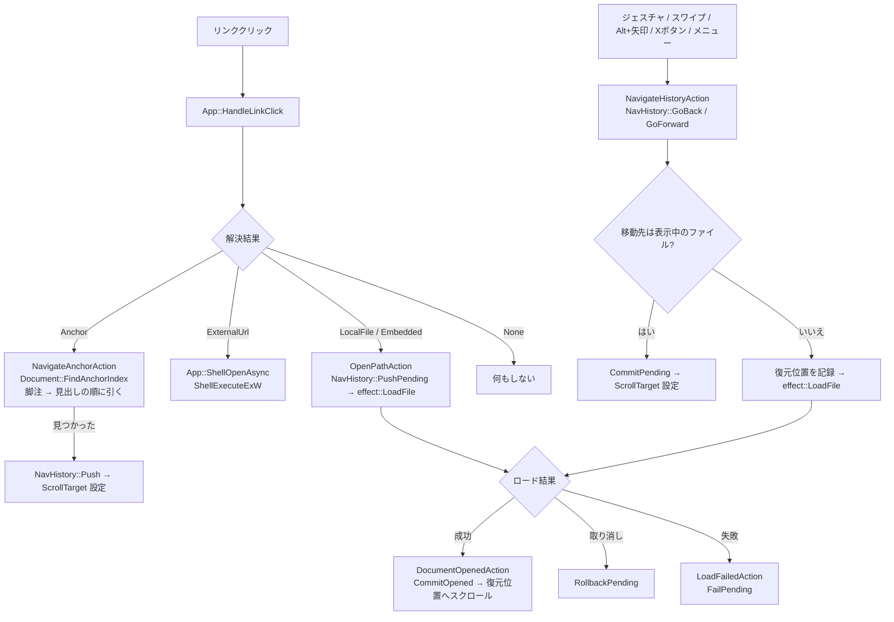

---

### 3.14 MouseGesture — マウスジェスチャ

#### 3.14.1 状態遷移

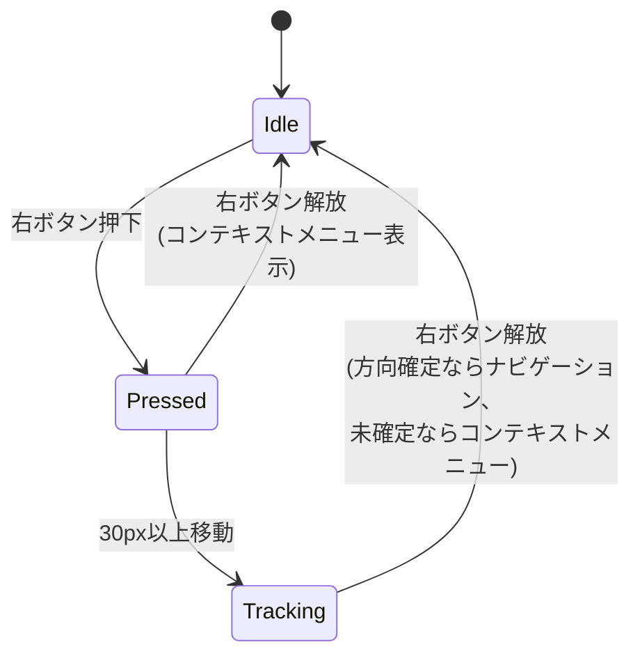

#### 3.14.2 パラメータ

| パラメータ | 値 | 説明 |
|:----------|:---|:-----|
| `GESTURE_THRESHOLD` | 30.0f (DIP) | ジェスチャ開始の移動距離閾値 |
| `MIN_POINT_DISTANCE` | 2.0f | トレイル軌跡のサンプリング最小距離 |
| `TRAIL_MAX_POINTS` | 512 | トレイル軌跡の最大ポイント数 |

左へのドラッグは `NavDirection::Back`、右へのドラッグは `NavDirection::Forward` になる。ジェスチャ・スワイプ・オーバーレイ描画は向きを同じ `NavDirection` で受け渡し、符号付き整数や別の列挙との変換は挟まない。

---

### 3.15 SwipeDetector — タッチパッドスワイプ検出

`WM_MOUSEHWHEEL` の累積デルタに基づくスワイプ検出。

```cpp
// util/ui_types.h。MouseGesture::GetDirection・GestureRenderState::direction・ナビボタンのホバーも同じ型を使う。
enum class NavDirection : uint8_t { None, Back, Forward };

class SwipeDetector {
public:
    constexpr void OnHWheel(int delta, uint64_t now_ms) noexcept;
    constexpr NavDirection Commit() noexcept;
    constexpr void NotifyVScroll(uint64_t now_ms) noexcept;
    constexpr bool IsOverlayVisible() const noexcept;
    // 右スワイプで戻る、左スワイプで進む。
    constexpr NavDirection GetOverlayDirection() const noexcept;

    static constexpr int      TRIGGER_THRESHOLD = 400;
    static constexpr uint64_t AXIS_LOCK_MS      = 200;
    static constexpr uint64_t RESET_TIMEOUT_MS  = 500;
    static constexpr uint64_t COMMIT_TIMEOUT_MS = 150;
};
```

| パラメータ | 値 | 説明 |
|:----------|:---|:-----|
| `TRIGGER_THRESHOLD` | 400 | 発火の累積デルタ閾値（WHEEL_DELTA単位） |
| `AXIS_LOCK_MS` | 200ms | 縦スクロール後の軸ロック期間 |
| `RESET_TIMEOUT_MS` | 500ms | 入力なしで蓄積をリセットするタイムアウト |
| `COMMIT_TIMEOUT_MS` | 150ms | 指を離してから発火までの待機 |

---

### 3.16 ViewportManager — ビューポート管理

スクロール・選択・ズームの純粋な状態管理。Win32依存なし。

```cpp
struct ScrollTarget {
    int   node   = -1;       // -1 = 無効
    float offset = 0.0f;     // ノード先頭からのピクセル距離
    constexpr bool IsValid() const noexcept;
};

class ViewportManager {
public:
    // スクロール
    // スクロール上限は持たず、AppState から求めた max_scroll を呼び出し側が渡す (MdMaxScroll)。
    constexpr float GetScrollY() const noexcept;
    constexpr void  ScrollTo(float position, float max_scroll) noexcept;      // scroll_target を無効化
    constexpr void  DirectScrollBy(float delta, float max_scroll) noexcept;   // 同上 (ユーザー発のピクセルスクロール)
    constexpr void  ClampScroll(float max_scroll) noexcept;                  // target は残す
    constexpr int   FindFirstVisibleNode(const LayoutCache& cache) const noexcept;
    // 可視先頭ノード基準の現在位置。ノードが無ければ node=-1, offset=scroll_y
    constexpr ScrollTarget CurrentTarget(const LayoutCache& cache) const noexcept;
    constexpr void  SetScrollY(float y) noexcept;            // クランプしない。target は無効化

    // ScrollTarget — ノード相対位置によるスクロール復元
    constexpr void SetScrollTarget(int node, float offset) noexcept;
    constexpr const ScrollTarget& GetScrollTarget() const noexcept;   // 有無は IsValid() で見る
    constexpr void ApplyScrollTarget(const LayoutCache& cache) noexcept;
    constexpr void EnsureScrollTarget(const LayoutCache& cache) noexcept;

    // 選択
    constexpr const TextSelection& GetSelection() const noexcept;
    constexpr void SetSelection(const TextSelection& sel) noexcept;
    constexpr void SelectAll(std::span<const Node> nodes) noexcept;
    constexpr void ClearSelection() noexcept;

    // ズーム — 段 (SetIndex は [0, ZOOM_STEP_COUNT) に必ず clamp、Step / CanStep / Percent) は ZoomLevel が持つ
    // (deducing this で const/非 const を1本に集約)
    constexpr auto& Zoom(this auto& self) noexcept;
};
```

`ScrollTarget` は **「ノード i の先頭から offset ピクセル下」** という相対位置を保持する。ファイル再読み込み・ズーム・DPI 変更でレイアウトが変わっても、同じノードに戻ることで「見ている位置を保つ」を実現する。ノード数は `LayoutCache` のエントリ数で数える。文書のノードとキャッシュのエントリは常に同数で（文書を差し替える `ReplaceDocument` が assert で確かめる）、ノード数を別の引数で渡して突き合わせることはしない。`ZoomLevel::SetIndex` は外部入力経路から不正値が来ても out-of-bounds にならないよう setter 側で必ず clamp する。テキスト選択のドラッグ中かどうかはここでは持たず、`ViewState::drag`（`left_drag::TextSelect`、3.3）で表す。見出しへ飛ぶときは、見出しを上端に貼り付けず上の余白（`heading_spacing_above`）ごと見せる `ScrollTarget` を Reducer の `HeadingTarget` が作る。

---

### 3.17 PaneController — ペイン管理

3ペイン（File / TOC / Markdown）の表示状態・幅・スクロールと、サイドペインの倍率を管理する。Win32依存なし。ペインの配置とゾーン判定と一緒に `src/util/pane_layout.h / .cpp` に置く。File / TOC の個別メソッドは持たず、`PaneTarget` 引数で共通化する。ホバーは `ViewState::hover`（`HoverHighlights` の `side_index` / `side_button`）、スプリッタやスクロールバーのドラッグは `ViewState::drag`（`LeftDragState`）が持つ（3.3）。

```cpp
class PaneController {
public:
    // 表示切替
    constexpr bool IsSidePaneVisible(PaneTarget t) const noexcept;
    constexpr void SetSidePaneVisible(PaneTarget t, bool v) noexcept;
    constexpr void ToggleSidePane(PaneTarget t) noexcept;

    // 幅
    constexpr float GetSidePaneWidth(PaneTarget t) const noexcept;
    constexpr void  SetSidePaneWidth(PaneTarget t, float w) noexcept;  // SIDE_PANE_MIN_WIDTH を下回らせない

    // スクロール (deducing this で const / 非 const を 1 つにまとめる)
    constexpr auto& SidePaneScroll(this auto& self, PaneTarget t) noexcept;
    // 一覧の項目 (文字・行の高さ) だけに掛かる倍率。ヘッダーとペイン幅は変えない
    constexpr auto& SidePaneZoom(this auto& self, PaneTarget t) noexcept;
    constexpr void ResetScrollStates() noexcept;
    bool ScrollSidePaneBy(PaneTarget t, float delta, float max_scroll) noexcept;  // 変化した場合 true

    // スプリッタ — edge のペインの右端にあるスプリッタを dip_x へ動かす
    void DragSplitterTo(PaneTarget edge, float dip_x, float total_width,
                        float splitter_w) noexcept;

    // レイアウト（幅はズーム倍率を含まない DIP 値）。表示状態も PaneLayout に写す。top_offset はタイトルバーの高さ
    PaneLayout ComputeLayout(float total_w, float total_h, float splitter_w,
                             float top_offset) const noexcept;
};

struct PaneLayout {
    PaneRect file_rect, toc_rect, md_rect;
    bool show_file = false;   // 隠したペインの矩形は空なので、ゾーン判定は表示中かをこちらで見る
    bool show_toc  = false;
};

PaneZone DetectPaneZone(float dip_x, const PaneLayout& layout, float splitter_width) noexcept;
```

スプリッタのドラッグでは、reducer が `left_drag::Splitter` の対象ペイン（`pane`）をそのまま `DragSplitterTo` に渡す。座標からのゾーン判定はメンバではなくフリー関数 `DetectPaneZone` が `PaneLayout` だけから行う（ホバー・ホイール・クリックで共有）。幅の既定値 `SIDE_PANE_DEFAULT_WIDTH = 220.0f` と下限 `SIDE_PANE_MIN_WIDTH = 100.0f` は `ui_types.h`、Markdown ペインの最小幅 `MD_PANE_MIN_WIDTH = 200.0f` は `src/util/pane_layout.h` の inline 定数として定義される。「MD ペインに `MD_PANE_MIN_WIDTH` を残し、表示中のペインのスプリッタを除いた幅をサイドペインで分ける」規則は、保存幅がウィンドウより広いときの表示幅の縮小（`ComputeLayout`）とスプリッタのドラッグの上限（`DragSplitterTo`）が同じ関数で共有する。

#### 3.17.1 ペイン構成

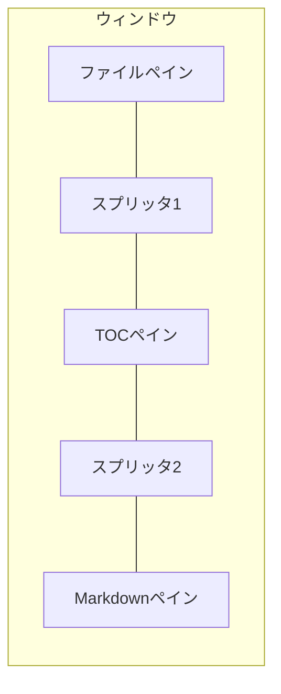

| ペイン | 既定幅 | 最小幅 | 内容 |
|:-------|:-------|:-------|:-----|
| ファイルペイン | 220px | 100px | ディレクトリ内のファイル一覧 |
| TOCペイン | 220px | 100px | 見出しベースの目次 |
| Markdownペイン | 残り全幅 | 200px | Markdownコンテンツ |
| スプリッタ | テーマ依存（`Theme::splitter_width`） | — | ペイン間の境界線 |

ファイルペインの一覧は `FileExplorer`（`AppState::file_explorer`）が持つ。`SetDirectory` / `Refresh` は一覧を古いと印すだけで、列挙は次の `EnsureListed` まで遅らせる。`EnsureListed` を呼ぶのは表示中のファイルペインの描画（`App::BuildSidePaneState`）・起動時・「現在のファイルを表示」だけなので、非表示の間は列挙しない（起動時やファイルを開くたびの I/O を省く）。列挙は `SetAsyncLister` で渡した専用スレッドで行い、`FILE_LISTED` で受けた結果を `ApplyListing` で差し替える（届くまで一覧は前のまま）。`GetEntries` は副作用の無い accessor。列挙し直すたびに世代 (`GetGeneration`) が進み、ツールチップは項目 index と世代の組で対象を識別する。

---

### 3.18 hit_test — ヒットテスト

```cpp
struct MdPaneHitContext {
    std::span<const Node>    nodes;
    const LayoutCache&       cache;
    const Theme&             theme;
    float    scroll_y;
    // 当てる点。X は本文ペインの左端から、Y は文書の先頭から (DIP)。
    DipPoint point;
    // ボタン位置とブロック横スクロールの clamp に使う
    float content_width = 0.0f;
    // ブロック単位の横スクロール量。null は全ノード 0 として扱う。
    const std::unordered_map<int, float>* block_scroll_x = nullptr;
};

// MD ペインのヒットテスト。状態を持たない純粋関数群 (src/input/hit_test_service.h)。
namespace hit_test {

struct HitResult {
    static constexpr uint32_t kNoChar = std::numeric_limits<uint32_t>::max();

    int      node_index = -1;
    // キャレット位置 (選択の端)。文字の右半分を指すとその文字の後ろになる。
    uint32_t text_pos   = 0;
    // 点の下にある文字の位置 (リンクの判定)。文字の上でなければ kNoChar。
    uint32_t char_pos   = kNoChar;
};

HitResult HitTest(const MdPaneHitContext& ctx) noexcept;
// HitTest と同じノードを返す。文字位置は求めない。
int HitNode(const MdPaneHitContext& ctx) noexcept;
HitResult HitTestTable(const Node& node, const NodeLayoutEntry& entry,
                       float entry_text_top, int node_index, const Theme& theme,
                       float dip_x, float dip_y, float h_scroll_x) noexcept;

NavDirection NavButtonHitTest(float dip_x, float dip_y, const PaneRect& md_rect) noexcept;

// 可視ノードのオーバーレイボタン (コードのコピー / 図の保存・コピー・拡大表示) のうちマウス位置にあるもの。
OverlayButtonHit OverlayButtonHitTest(const MdPaneHitContext& ctx) noexcept;
// マウスが node_index の図の画像の上にあり、その図に保存・コピー・拡大表示のボタンを出せるか。
bool DiagramImageHitTest(const MdPaneHitContext& ctx, int node_index) noexcept;
bool BlockHScrollbarHitTest(const MdPaneHitContext& ctx, int node_index, float visible_width) noexcept;

} // namespace hit_test

// src/util/ui_types.h — コードブロック・図の右上に重ねるボタン
enum class OverlayButton : uint8_t { None, CodeCopy, DiagramSave, DiagramCopy, DiagramView };

// マウス座標は 1 点なので同時に当たるのは 1 つだけ。
struct OverlayButtonHit {
    int           node = -1;
    OverlayButton kind = OverlayButton::None;
    constexpr bool Any() const noexcept;   // kind != None
    bool operator==(const OverlayButtonHit&) const = default;
};
```

オーバーレイボタンの矩形は `layout::ForEachOverlayButton`（`layout/layout_computer.h`）が `fn(rect, kind)` で列挙し、描画（`CommandGenerator::GenOverlayButtons`）と `OverlayButtonHitTest` が同じ矩形を使う。コードブロックはコピー 1 つ、描けていて保存・コピーの元がある図（`NodeType::Diagram` で `layout::HasDiagramButtons`）は保存・コピー・拡大表示の 3 つを並べる。

テーブルの行・列の判定（`FindTableRow` / `FindTableCol`）は `TableLayoutData` の累積配列（`row_cum_y` / `col_cum_x`）だけを二分探索する。幾何が揃っていない（未計測）ときはヒットなしとして扱い、行高さを推定し直して線形に探す経路は持たない。セル本文の原点は描画と同じ `TableCellTextOrigin` で求める。

本文はペイン基準の座標（ペイン原点 `md_rect.x/y` は描画変換に乗る）で描くので、マウス座標は `app_controller::MakeMdPaneHitContext` が一度だけ「ペイン左端基準の X とドキュメント Y」（`MdPaneHitContext::point`）に変換し、ノードやボタン、ブロック横スクロールバーの矩形はドキュメント座標のまま比べる。可視範囲はどこでも `[scroll_y, scroll_y + md_rect.height]` で一致する。

`hit_test` は状態を持たず、ヒット結果のキャッシュもしない。呼ばれるたびに判定する（`HitTestPoint` は 1 万行のコードブロックでも数〜十数 µs で済むため）。ホバー中のナビボタンは、ジェスチャやスワイプが示す履歴移動の向きと同じ `NavDirection`（`util/ui_types.h`、`{ None, Back, Forward }`）で表す。

ホバーとクリックは同じ `app_controller::ResolveMdPaneHit`（`AppState` とペイン配置だけから求める純粋関数）で「点が MD ペインのどの領域を指すか」を決める。優先順位は 検索バー → ナビボタン → オーバーレイボタン（コピー / ダイアグラムコピー / 保存 / 拡大表示）→ スクロールバー → 本文 で、縮小表示でボタンがスクロールバーのヒット余白に掛かってもボタンが勝つ。結果は `app_controller::MdPaneHit`（`kind` と、検索バーのゾーン・ナビボタン・`OverlayButtonHit`）で返す。ホバー表示（カーソルとツールチップ）とクリックの結果は常に一致する。ホバーでは `app_controller::ResolvePointerHover` が判定結果を `PointerHoverResult` の `PointerHoverAction` に書き、App がそれを reducer に渡し、reducer が `ViewState::hover` に反映する。

当てるのは描いているものだけにする。読み込み中（`ViewState::loading_shown`。スピナーを出している間）は本文・ナビボタン・検索バー・スクロールバーを描かない（3.8.5）ので、`ResolveMdPaneHit` は何にも当てず `MdPaneHit::Kind::None` を返す（カーソルは矢印のまま、クリックは何もしない。`IsOverMdScrollbar` も偽）。ナビボタンは戻るか進むの履歴があるときだけ描くので、当てるのも `NavHistory::CanGoBack` / `CanGoForward` のどちらかが真のときだけにする（無ければボタンの位置もオーバーレイボタン・本文の判定に回す）。

リンクは `FindLinkHitAtPosition`（`core/document_utils.h`）で URL とその添字（`node.view_link_urls()` の位置）を一度に求める。ツールチップと左下の行き先の表示（`HoverHighlights::link`。3.25）はこの添字で対象を識別し、URL 文字列から添字を探し直さない。

---

### 3.19 ConfigService / session:: — 設定永続化

#### 3.19.1 保存先・形式

```
%LOCALAPPDATA%\mendo\settings.ini
```

`ini::Parse` / `ini::Serialize`（3.28.4）で読み書きし、セクション+キーの2階層でアクセスする。書き込みは `*.tmp` → `MoveFileExW(MOVEFILE_REPLACE_EXISTING)` の原子的差し替え。書き出しはアプリ終了時 (WM_DESTROY) に集約し、読み込み後に値が変わっていなければ書かない。ログオフ・シャットダウンでは WM_DESTROY が来ないため、WM_ENDSESSION で `DestroyWindow` を呼んで同じ終了処理を通す。

#### 3.19.2 保存項目

| セクション | キー | 型 | 既定値 | 説明 |
|:-----------|:-----|:---|:------|:-----|
| `General` | `Language` | `wstring` | （OS自動判定） | UI言語 (`ja` / `en` / `zh` / `zh-hant` / `ko`) |
| `View` | `DarkMode` | `bool` | `false` | ダークモード |
| `View` | `ZoomLevel` | `int` | `7` (1.00x) | ズームインデックス |
| `Window` | `X` / `Y` | `int` | `0` | 通常表示時のウィンドウ位置 |
| `Window` | `Width` / `Height` | `int` | `0`（未保存） | 通常表示時のウィンドウサイズ。未保存なら OS 既定の位置に既定サイズ（1600×900）で開く |
| `Window` | `Maximized` | `bool` | `false` | 最大化状態（最小化中に閉じたときは最小化前の状態） |
| `Pane` | `ShowFile` | `bool` | `true` | ファイルペイン表示 |
| `Pane` | `ShowToc` | `bool` | `true` | TOCペイン表示 |
| `Pane` | `FileWidth` | `int` | `220` (DIP、ズーム非適用) | ファイルペイン幅 |
| `Pane` | `TocWidth` | `int` | `220` (DIP、ズーム非適用) | TOCペイン幅 |
| `Pane` | `FileZoomLevel` | `int` | `7` (1.00x) | ファイルペインのズームインデックス |
| `Pane` | `TocZoomLevel` | `int` | `7` (1.00x) | TOCペインのズームインデックス |
| `Session` | `LastFile` | `wstring` | 空文字列 | 最後に開いたファイルパス |
| `Session` | `ScrollNode` | `int` | `-1` | スクロール位置（ノードインデックス） |
| `Session` | `ScrollOffset` | `int` | `0` | スクロール位置（ノード内オフセット） |

#### 3.19.3 ConfigService — 設定永続化

設定 (settings.ini) のメモリ上マップとディスク永続化を保持する。インスタンスごとに独立した状態を持つので、テストでは新しいインスタンスを使うだけで分離できる。

```cpp
class ConfigService {
public:
    ConfigService();     // 設定ディレクトリを DefaultConfigDir() で決める

    // 設定ディレクトリ
    void SetConfigDir(const std::filesystem::path& dir);
    // filename は固定の名前だけを渡す (検証しない)。
    std::filesystem::path GetConfigPath(std::wstring_view filename) const;

    // ディスク永続化
    void Load();
    void Flush();        // 変更があれば、書く直前に読み直してこのインスタンスで変えた値だけを重ねて書く（WM_DESTROY 時に呼ぶ）

    // 型付きアクセサ
    void SaveBool(std::string_view section, std::string_view key, bool value);
    bool LoadBool(std::string_view section, std::string_view key, bool default_value) const;

    void SaveInt(std::string_view section, std::string_view key, int value);
    int  LoadInt(std::string_view section, std::string_view key, int def, int min_v, int max_v) const;
    // 無い・不正・範囲外なら等倍
    ZoomLevel LoadZoomLevel(std::string_view section, std::string_view key) const;
    void      SaveZoomLevel(std::string_view section, std::string_view key, ZoomLevel zoom);

    void         SaveWString(std::string_view section, std::string_view key, std::wstring_view value);
    std::wstring LoadWString(std::string_view section, std::string_view key) const;
};
```

LocalAppData は環境変数 `LOCALAPPDATA` を優先し（`SHGetKnownFolderPath` は初回に `windows.storage.dll` のロード等で ms 単位かかるため）、取れない・絶対パスでない場合だけ `SHGetKnownFolderPath` にフォールバックする。それも取れなければ一時フォルダ（`GetTempPathW`、絶対パスでなければ Windows フォルダ）の下にし、相対パスでカレントディレクトリの下を読み書きしないよう必ず絶対パスにする。解決は `config_service.cpp` の無名名前空間の関数 `DefaultConfigDir()` がコンストラクタで一度だけ行い、`config_dir_` に持つ（テストは `SetConfigDir` で差し替える）。

`Save*` は既存値と同じなら何もせず、値が変わったときだけそのキーを `changed_` に記録する。`Flush` は `changed_` が空なら書き込まず、書き込みに成功したら `changed_` を空にする。終了のたびに同期書き込み（`FlushFileBuffers` + `MOVEFILE_WRITE_THROUGH`）が走るのを、設定を変えたセッションだけに限るためである。書くときは直前に settings.ini を読み直し、このインスタンスで変えた値だけを重ねる（他のウィンドウが先に閉じて書いた値を、起動時に読んだ古い値で戻さない）。組で意味を持つ `Session` / `Window` は 1 つでも変えていればセクションごと重ねる（キーごとだと別のプロセスの値と混ざる）。読み込みと書き込みはプロセス間のロック（`InterProcessFileLock`）で囲む。

#### 3.19.4 session::

セッション状態（最後に開いたファイル、ペイン構成、スクロール位置、言語、ダークモード、ズーム、ウィンドウの配置）の永続化を担当する自由関数群（`config_service.h`）。`ConfigService` のセクション "Session" / "Pane" / "General" / "View" / "Window" を排他的に扱う。状態を持たないのでクラスにしない。

```cpp
namespace session {
void         SaveLastFilePath(ConfigService& config, std::wstring_view path);
// UNC・デバイスパスと実在しないパスは空。ネットワークドライブは切断時に止まらないよう存在を確かめない。
std::wstring LoadLastFilePath(const ConfigService& config);

// 表示・幅・倍率を PaneController と直接やり取りする。幅はズーム倍率を含まない DIP 値 (SIDE_PANE_MIN_WIDTH 以上)。
void SavePanes(ConfigService& config, const PaneController& panes);
void LoadPanes(const ConfigService& config, PaneController& panes);

struct ScrollPosition {
    int node   = -1;
    int offset = 0;
};
void           SaveScrollPosition(ConfigService& config, int node, float offset);
ScrollPosition LoadScrollPosition(const ConfigService& config);

void         SaveLanguage(ConfigService& config, std::wstring_view lang_key);   // 空は OS に合わせる
std::wstring LoadLanguage(const ConfigService& config);

void SaveDarkMode(ConfigService& config, bool dark);
bool LoadDarkMode(const ConfigService& config);
void      SaveZoomLevel(ConfigService& config, ZoomLevel zoom);
ZoomLevel LoadZoomLevel(const ConfigService& config);

struct WindowPlacement {
    int  x = 0, y = 0, width = 0, height = 0;
    bool maximized = false;
};
void            SaveWindowPlacement(ConfigService& config, const WindowPlacement& placement);
WindowPlacement LoadWindowPlacement(const ConfigService& config);   // 未保存なら width と height が 0
}
```

`session::SaveScrollPosition` はノード内オフセット（`SnapshotVisibleTarget` の `offset`）を整数に丸めて永続化する（`Session.ScrollOffset` セクションキー）。

---

### 3.20 TitleBar — カスタムタイトルバー

#### 3.20.1 概要

Win32 標準タイトルバーを `WM_NCCALCSIZE` で非表示にし、Direct2D で自前描画したカスタムタイトルバーに置き換える。ファイルを開く・検索・テーマ切替・設定・ヘルプ・ファイル/目次ペイン切替・最小化/最大化/閉じるボタンを含む。

```cpp
// OpenFile..Close はボタン。連続した値であることを TitleBarButtonIndex が前提にする。
enum class TitleBarHitZone : uint8_t {
    None, Caption, Icon,
    OpenFile, Settings, Help, ThemeToggle, Search,
    FileToggle, TocToggle,
    Minimize, Maximize, Close,
};

constexpr bool IsTitleBarButton(TitleBarHitZone zone) noexcept;   // OpenFile..Close か
inline constexpr size_t kTitleBarButtonCount = /* OpenFile..Close の個数 */;
constexpr size_t TitleBarButtonIndex(TitleBarHitZone zone) noexcept;  // zone - OpenFile

class TitleBar {
public:
    static constexpr float BASE_HEIGHT       = 32.0f;
    static constexpr float BUTTON_WIDTH      = 32.0f;
    static constexpr float ICON_LEFT_MARGIN  = 8.0f;
    static constexpr float ICON_SIZE         = 24.0f;
    static constexpr float ICON_RIGHT_GAP    = 4.0f;
    // キャプションボタン（最小化/最大化/閉じる）はタイトルバーの全高を使う
    static constexpr float CAPTION_BTN_WIDTH = 46.0f;
    // アイコンの位置は幅に依存しない。
    static constexpr DipRect ICON_RECT{ ICON_LEFT_MARGIN, (BASE_HEIGHT - ICON_SIZE) / 2.0f, ICON_LEFT_MARGIN + ICON_SIZE,
                                        (BASE_HEIGHT + ICON_SIZE) / 2.0f };

    void UpdateLayout(float window_width_dip) noexcept;
    TitleBarHitZone HitTest(float dip_x, float dip_y) const noexcept;

    constexpr const DipRect& GetButton(TitleBarHitZone zone) const noexcept;
    constexpr const DipRect& GetTitleTextRect() const noexcept;

private:
    std::array<DipRect, kTitleBarButtonCount> buttons_{};   // TitleBarButtonIndex の順
};
```

ボタン矩形はボタンごとのメンバではなく配列 `buttons_` 1 つで持ち、`TitleBarHitZone` から `TitleBarButtonIndex` で直接引く（`GetButton`）。ヒットテストと描画（`TitleBarRenderState::bar` の `GetButton(zone)`）は同じ配列を使い、`WM_NCHITTEST` は `IsTitleBarButton` でボタンかどうかを判定する。狭幅でボタン同士が重なったときは、`HitTest` がキャプションボタン（閉じる・最大化・最小化）を優先する。

`TitleBar` はホバー状態を持たない。ホバー中のゾーンは `ViewState::hover.titlebar` が持ち、`TitleBarRenderState::hovered_zone` で描画に渡す。

#### 3.20.2 ボタン配置

```
┌───────────────────────────────────────────────────────────────────────────────────┐
│ [Icon] [Open] [Search] [Theme] [Settings] [Help] ←タイトル→ [File] [TOC] [─][□][×]│
│  左側グループ                                                      右側グループ   │
└───────────────────────────────────────────────────────────────────────────────────┘
```

- **左側**（アイコンの右から）: OpenFile → Search → ThemeToggle → Settings → Help
- **右側**（右端から）: Close ← Maximize ← Minimize ← TocToggle ← FileToggle
- **タイトルテキスト**: 左側グループの右端から FileToggle の左端まで

---

### 3.21 SearchState / 検索バー — 検索

#### 3.21.1 SearchState（ドメインロジック）

```cpp
// start_w / length_w はノード (表ならセル) 内の UTF-16 code unit 位置で、HitTestTextRange にそのまま渡せる。
struct SearchMatch {
    int      node_index;
    int      table_row = -1; // テーブルセル用（-1 なら通常ノード）
    int      table_col = -1;
    uint32_t start_w  = 0;
    uint32_t length_w = 0;
    // 区切ったノードの継ぎ目をまたぐマッチ (前のノードに置く) の、続きのノードの先頭からの長さ
    uint32_t next_length_w = 0;
};

class SearchState {
public:
    constexpr bool IsVisible() const noexcept;
    constexpr void Show() noexcept;
    void Hide() noexcept;       // visible_ = false。検索を止め、結果も確保ごと捨てる

    constexpr const std::vector<SearchMatch>& GetMatches() const noexcept;
    constexpr int GetCurrentMatchIndex() const noexcept;
    constexpr int GetMatchCount() const noexcept;
    constexpr bool HasResult() const noexcept;   // 初めての検索を調べ終えるまで false

    constexpr bool IsCaseSensitive() const noexcept;
    constexpr void ToggleCaseSensitive() noexcept;
    constexpr bool IsHighlightEnabled() const noexcept;
    constexpr void ToggleHighlightEnabled() noexcept;

    // BeginSearch で始め、ContinueSearch で deadline まで (少なくとも 1 ノード) 進める。終わったら true
    void BeginSearch(std::string_view query);   // UTF-8
    bool ContinueSearch(std::span<const Node> nodes, std::chrono::steady_clock::time_point deadline);
    constexpr bool IsSearching() const noexcept;
    // リロードで中身の変わらなかったノードのマッチだけを新しいノード番号で残す
    void KeepMatchesOfUnchangedNodes(const UnchangedEnds& ends) noexcept;
    bool NextMatch() noexcept;  // ラップ時 true
    bool PrevMatch() noexcept;  // ラップ時 true
    void SetCurrentMatchNear(float scroll_y, const LayoutCache& cache) noexcept;
};
```

一致件数の上限は private 定数 `MAX_MATCHES = 10000`。

マッチ列の世代カウンタは持たない。描画側はハイライトの矩形をキャッシュせず、毎フレーム見えている行にかかるマッチだけを `HitTestTextRange` で引き直す（`CommandGenerator` の `GenSearchHighlights` / `GenCellSearchHighlights`）。

大文字小文字を無視する検索でも文書の小文字コピーは持たない。クエリだけを ASCII 小文字にし、`ascii_util::Find`（`fold` = true）が走査しながら文書側を畳み込む（畳み込むのは ASCII 英字だけ）。クエリに ASCII 英字が無ければ通常一致と結果が同じなので、畳み込みを省く（`fold` = false）。テーブルは `concat_text` を 1 回だけ走査し、セル区切りをまたぐヒットを除いてセル単位のマッチに振り分ける。UTF-16 位置（`start_w` / `length_w`）は `Utf16OffsetCursor` が最初のヒットから前方へ数えて求め、ノード全文を UTF-16 に変換しない。パーサが改行を挟まずに区切った継ぎ目では、前のノードの末尾とクエリ長 − 1 バイトの続きだけをつないで探し、またぐマッチを前のノードに置く（3.6.6）。

前回の検索を調べ切っていて（上限で打ち切っていない）、比べ方（`fold`）が同じまま、クエリを後ろへ伸ばしただけなら、`BeginSearch` は前回マッチのあったノードだけを候補（`candidate_nodes_`）にして調べる（新しいクエリが現れるノードには前回のクエリも現れる）。継ぎ目をまたいだマッチの続きのノードは、またいだ分を飛ばして探したので、マッチが無くても候補に入れる。リロードの `KeepMatchesOfUnchangedNodes` の後は変わった範囲のマッチが抜けているので、次の検索では絞り込まない。`Hide` は候補の確保も返す。

#### 3.21.2 検索バー（UI制御）

検索バーの UI 状態（キャレット、選択範囲、IME 組成文字列、入力欄の UTF-16 クエリ）は `SearchGroup`（`app_state.h`）がデータとして持ち、変えるのは reducer だけ（`reducer.cpp` の検索バーの関数群）。再描画・フォーカス・ビープは `effect::InvalidateWindow` / `SearchFocus` / `SearchUnfocus` / `Beep` として積み、`App::Execute` に任せる。表示中は常に入力欄がフォーカスを持つ。ホバーは `ViewState::hover.search_bar`（`BuildSearchBarRenderState` が `SearchBarRenderState::hovered` に詰める）、入力欄のドラッグ選択は `ViewState::drag`（`left_drag::SearchInput`、起点は `anchor`）が持つ（3.3）。

マッチへスクロールするときの MD ペイン高さとスクロール上限は `AppState` から求める（`MdScrollInfo(state)` の `content_height` と `max_scroll`）。App に頼むのはマッチのノードの計測だけで、`Reduce` の引数 `NodeLayoutAccess&` で頼む（3.4.1）。タイマーは持たない。キャレットは点滅させず、フォーカス中かつウィンドウがアクティブな間は常時表示する（点滅タイマーが約 530ms ごとに全画面再描画を起こしていたため廃止した）。`SearchBarRenderState::caret_visible` は `BuildSearchBarRenderState` が `WindowState::window_active` から詰める。

```cpp
struct SearchGroup {
    SearchState search_state;
    int caret_pos = -1;          // EDIT の選択 [selection_start, caret_pos)。-1 はテキスト末尾
    int selection_start = -1;
    std::wstring ime_composition;
    std::wstring query_wide;   // クエリの持ち主。検索を始めるときに UTF-8 にして BeginSearch へ渡す
    bool scroll_after_search = false;
};

// reducer.h。開閉・次/前・入力・選択・IME・大文字小文字・ハイライト・検索の続き・文書の差し替えはアクションで Reduce に通す。
SearchBarRenderState BuildSearchBarRenderState(const AppState& state);   // hovered と caret_visible も state から詰める
```

テストは `tests/test_search_bar.cpp` がアクションを `Reduce` に通して確かめる。

`SearchTextChangedAction` は入力が前回と同じなら何もしない（文書の切替で入力欄を空にしたときの `EN_CHANGE` など）。空になったらその場でマッチを消す。それ以外は入力のたびにすぐ検索を始める。検索は `kSearchSliceBudget`（8ms）ずつ区切って進み、残りは `App::HasIdleWork` が `SearchState::IsSearching` を見て、メッセージループの空き時間に `SearchContinueAction` で続けるので、大きな文書でも入力や描画を待たせない（デバウンスは持たない）。

途中のマッチは見せない。調べている間は前回の結果（件数・ハイライト。0 件なら赤背景も）を見せ続け、調べ終えたときにまとめて差し替える。初めての検索を調べ終えるまでは `SearchState::HasResult` が偽で、`SearchBarRenderState::total_matches` を -1 にして赤背景も件数も出さない。リロードでは `App::ReloadDocument` が読み込みの worker の `FindUnchangedEnds` が求めた先頭・末尾の一致範囲（`UnchangedEnds`）を `DocumentReloadedAction` で（変更箇所が見えるスクロール位置と一緒に）渡し、reducer が `SearchState::KeepMatchesOfUnchangedNodes` で変わらなかったノードのマッチだけを新しい番号で残す。スクロール位置と見えている範囲のレイアウトが決まったら（`ReloadSettledAction`）調べ直す。保存のたびに件数が 0 に戻ってハイライトが消えるちらつきを出さず、同期の再検索で UI を止めることもないためである。

別文書（ヘルプを含む）へ切り替えると、`DocumentOpenedAction` を受けた reducer が検索バーを常に閉じ、クエリとマッチも空にしてから入力欄を空にさせる（`effect::SearchUnfocus{ clear_text = true }`。そのときの `EN_CHANGE` はクエリが既に空なので何もせず終わる）。旧文書のマッチ位置を新しいノードに使わないためである。

ホバー領域は `SearchBarHitZone`（`chrome_layout.h`）で定義され、None / Up / Down / CaseSensitive / Highlight / Close / Input の 7 値。Input はホバー強調が無いので None と同じに扱う。

#### 3.21.3 検索バーUI

下部にドッキングされ、以下のコントロールを含む。

- テキスト入力（IME対応）
- 前へ / 次へボタン
- 大文字小文字区別トグル
- ハイライト切替トグル
- 閉じるボタン
- 一致件数表示（`X / Y`）

| 対象 | 色 | アルファ |
|:-----|:---|:--------|
| 現在の一致 | オレンジ系 (`BrushId::SearchHighlightCurrent`) | 60%（ダーク 55%） |
| その他の一致 | 黄色系 (`BrushId::SearchHighlight`) | 40%（ダーク 35%） |
| 一致なし入力背景 | 薄赤、ダークは暗い赤 (`BrushId::SearchNoMatchBg`) | — |

---

### 3.22 ContextMenu — カスタムコンテキストメニュー

`ContextMenu` は Win32 のシステムメニューの代わりに、Direct2D で自前描画するカスタムコンテキストメニュー。実装は `context_menu.cpp`（mendo_core 入り）にまとまっている。ウィンドウ・モーダルループ・背景や縁の描画は設定ダイアログと共用の土台 `PopupWindow<Derived>`（`popup_window.h`）が持ち、`ContextMenu` は項目とレイアウト・描画・ヒットテストだけを書く。描画先は本体の描画デバイス（`PopupEnv` の `d3d` / `device`）があればそのスワップチェーンの DeviceContext、無ければ SOFTWARE の `HwndRenderTarget`。

```cpp
// ui_types.h。ポップアップ (右クリックメニュー・設定ダイアログ) に渡す本体の資源。App::MakePopupEnv が作る
struct PopupEnv {
    ID2D1Factory*   d2d_factory = nullptr;
    ID3D11Device*   d3d = nullptr;      // 本体の描画デバイス。無ければ SOFTWARE の描画先で描く
    ID2D1Device*    device = nullptr;
    IDWriteFactory* dwrite_factory = nullptr;
    const Theme*    theme = nullptr;
    float           dpi_scale = 1.0f;
    ModalLoop*      modal_loop = nullptr;
};

struct ContextMenuParams {
    PopupEnv env;
    int   screen_x = 0;
    int   screen_y = 0;
    bool  can_go_back = false;
    bool  can_go_forward = false;
    bool  can_edit_file = false;    // Markdown か .txt のファイル (ヘルプは開けない)
    bool  has_selection = false;
    bool  dark_mode_checked = false;
    bool  file_pane_checked = false;
    bool  toc_pane_checked = false;
    bool  show_file_items = false;  // MdPaneの場合のみtrue
    bool  on_file_entry = false;    // ファイル一覧の項目の上。「新しいウィンドウ」をその項目を開く文言に替える
    const ZoomLevel* zoom = nullptr;  // 右クリックした領域 (本文・ファイル一覧・目次) の倍率。必ず渡す
    std::function<void(ZoomDirection)> on_zoom;  // ズームの行のボタンで呼ぶ。メニューは閉じない
};

// 開くたびに作る (項目・レイアウト・HitTest / NavHitTest / ZoomHitTest)。
struct ContextMenu : PopupWindow<ContextMenu> {
    static int Show(HWND owner_hwnd, const ContextMenuParams& params);  // 選んだ項目の ID。選ばずに閉じたら 0
};
```

#### 3.22.1 メニュー構成

```
┌──────────────────────────────────┐
│ ← [戻る]  [進む] →               │  NavRow（横並び）
├──────────────────────────────────┤
│ 新しいウィンドウ                 │  ※ ファイル一覧の項目の上では「新しいウィンドウで開く」
├──────────────────────────────────┤
│ エディタで開く                    │  ※ MdPaneのみ。Markdown / .txt のファイルのときのみ有効
│ コピー                           │  ※ MdPaneのみ。選択あり時のみ有効
│ 書式付きコピー                    │  ※ MdPaneのみ。HTML形式、選択あり時のみ有効
├──────────────────────────────────┤  ※ MdPaneのみ
│ ズーム      [−] 100% [+]  [↺]    │  ZoomRow。右クリックした領域の倍率。押してもメニューは閉じない
├──────────────────────────────────┤
│ ☑ ダークモード                    │
├──────────────────────────────────┤
│ ☑ ファイルペイン                  │
│ ☑ 目次ペイン                     │
└──────────────────────────────────┘
```

---

### 3.23 ImageLoader — 非同期画像読み込み

WIC を使用した非同期画像読み込み。ワーカースレッドでデコードし、UIスレッドで `ID2D1Bitmap` に変換する。

```cpp
// ProcessCompletedDecodes で GPU に載せたビットマップ。TakeDelivered で受け取った側が描く側へ渡す。
class DeliveredImages {
public:
    ID2D1Bitmap* Find(const std::wstring& abs_path) const noexcept;
};

class ImageLoader {
public:
    ~ImageLoader();

    // デコード結果が届いたら hwnd へ msg_id を投げる (hwnd が null なら投げない)。
    void Init(IWICImagingFactory* wic, HWND hwnd, UINT msg_id, TaskScheduler& scheduler);
    // UI スレッドからのみ。デバイスロストでの差し替えでは、旧 rt のビットマップを捨てる。
    // デコードは WIC ビットマップを作るので rt に依らず、待ちのものも受け箱の結果も新しい rt に載せる。
    void SetRenderTarget(ID2D1RenderTarget* rt);
    // 画像を読む worker。画像のフォルダの監視 (ImageFolderWatcher) も、ここでフォルダを開く。
    TaskScheduler* scheduler() const noexcept;

    // 読み込んだ画像の寸法。ビットマップはここに残さず、描く側 (InlineDrawings) が保持範囲の画像の分だけ持つ。
    struct ImageInfo {
        // 縮小前の原寸 (物理 px)。表示の DIP は DPI で変わるので DipSize で求める。
        float pixel_width  = 0.0f;
        float pixel_height = 0.0f;
        // 最後に読んだビットマップは、この幅 (物理 px) までは縮小によるぼけ無しで描ける。原寸なら上限なし。
        // 寸法だけを読んだ (RequestSizeAsync) なら 0。
        UINT sharp_width_px = UINT_MAX;
        // 読んだ後にファイルが更新された (Invalidate)。寸法は読み直すまで前のものを使わせる。
        bool stale = false;
    };
    // 次に寸法の表を変える (ProcessCompletedDecodes) まで有効。
    const ImageInfo* FindImageInfo(const std::wstring& abs_path) const noexcept;
    size_t ImageInfoCount() const noexcept;
    static constexpr size_t kMaxImageInfos = 4096;   // 超えたら空にして数え直す
    // 受け取ったビットマップを渡し、ImageLoader には残さない。
    DeliveredImages TakeDelivered() noexcept;
    // 今の DPI での表示寸法 (画像の 1 px を物理 1 px で描く)。
    D2D1_SIZE_F DipSize(const ImageInfo& image) const noexcept;
    // max_width_dip: 表示幅。これを量子化した物理 px まで縮小してデコードする。0 は原寸。
    void RequestLoadAsync(const std::wstring& abs_path, float max_width_dip);
    // 寸法だけを読む (ピクセルはデコードせず、ビットマップも作らない)。
    void RequestSizeAsync(const std::wstring& abs_path);
    // kMaxImageRetries 回失敗し、もう読まない (ResetFailedPaths まで)。
    bool HasGivenUp(const std::wstring& abs_path) const noexcept;
    // 表示幅が広がり、最後に読んだ解像度では足りなくなったか。
    bool NeedsSharperDecode(const ImageInfo& image, float max_width_dip) const noexcept;
    // deadline を過ぎた分は残し、HasLeftoverUploads が真になる。
    // 戻り値: 見えている画像を要求し直すべきか。結果を 1 件以上取り込んだ (失敗も含む) か、捨てた要求が待ちの間に要求し直されていた。
    bool ProcessCompletedDecodes(std::chrono::steady_clock::time_point deadline = std::chrono::steady_clock::now() + kImportSliceBudget);
    // 前に呼んでから RequestLoadAsync で頼み直されなかったビットマップの要求 (範囲を出た画像) を取り消す。
    void CancelStaleBitmapRequests() noexcept;
    bool HasLeftoverUploads() const noexcept;   // UI スレッド専用
    // 始まっていないデコードを worker に空振りさせる。始まったものの結果は寸法の表に入れる。
    // どちらも結果が届くまで要求中のまま残す。
    void DropQueued();
    // DropQueued に加え、届いている結果と失敗の記録も捨てる。
    void CancelPending();

    void ResetFailedPaths();
    // ファイルが更新された。寸法に stale を立て、失敗の記録を消して読み直せるようにする。
    void Invalidate(const std::wstring& abs_path);
    void Shutdown();

    // 読み込んだ結果として寸法 (と bitmap があれば受け取ったビットマップ) を入れる。テスト専用。
    void InsertImageForTest(const std::wstring& path, float pixel_width, float pixel_height, ID2D1Bitmap* bitmap = nullptr);
};
```

ビットマップのキャッシュは持たない。`ImageLoader` が持つのはパスのハッシュ（rapidhash）→ `ImageInfo`（寸法）の表だけで、`kMaxImageInfos`（4096）件を超えたら空にして数え直す。`ProcessCompletedDecodes` が GPU に載せたビットマップは `DeliveredImages` に置き、`ResourceManager::LoadImages` が `TakeDelivered` で受け取って描く側（`InlineDrawings`）へ渡す。描く側は保持範囲の画像の分だけを持ち（`EvictOffscreenResources`）、外れた画像は戻ったときにファイルから読み直す（ビットマップを 128 件・128MB まで残すキャッシュがあった頃は、スクリーンショット 40 枚の文書を最後まで見ると private 130MB・GPU 110MB、残さないと 52MB・30MB）。保持範囲の外の画像は `RequestSizeAsync` で寸法だけを読み（ファイルの先頭 64KB から。足りなければ全体）、ビットマップを持たずに組めるようにする。`RequestLoadAsync` / `RequestSizeAsync` は同じパスが要求中なら何もせず（`pending_paths_`。要求し直されたことだけ記録する）、`kMaxImageRetries`（3）回失敗したパスは要求しない（`HasGivenUp`）。ワーカーは `TaskScheduler` 上でファイル（上限 256MB、`MAX_IMAGE_FILE_SIZE`）を読んで WIC デコードし、結果を `completed_`（`PostedInbox`。自前の mutex で守る）に積んでウィンドウへ `msg_id`（`app_msg::IMAGE_LOADED`）を投げる。UI スレッドの `ProcessCompletedDecodes` が `ID2D1Bitmap` に変換して寸法の表と `DeliveredImages` に入れ、要求中・失敗の記録（どちらも UI スレッド専用でロックは要らない）を更新し、見えている画像を要求し直すべきかを返す。描画先が無い間（起動でデバイスを待つ間・デバイスの作り直しの再試行中）は結果を受け箱（`completed_`）に残す。呼び出し側（`ResourceManager::OnImagesDecoded` / `FlushPendingResources`）がそれを見て画像の適用と再レイアウトを 1 回だけ行う。1 回の転送は `kImportSliceBudget`（4ms）までで、残した分は `HasLeftoverUploads` が真になり、メッセージループの空き時間（`App::RunIdleWork`）で続ける。新しい結果は投函で知らせるので、空き時間の判定でキューを覗くためにロックは取らない。画像の読み込みはこの非同期経路だけで、UI スレッドで原寸デコードする同期 API は持たない。

待ちの捨て方は 3 通りある。`CancelStaleBitmapRequests` は、前に呼んでから `RequestLoadAsync` で頼み直されなかったビットマップの要求（範囲を出た画像）を取り消す。`ResourceManager::LoadImages` が取り込みのたびに、まだ要るビットマップを頼み直させてから呼ぶ。取り消した要求は worker が始める前なら読まずに返し、デコードの後なら GPU に載せず寸法だけを入れる（速いスクロールで溜まった要求を読み続けると、止まった位置の画像が後回しになる）。`DropQueued` は世代 `drop_gen_`（atomic。Mermaid の `drop_gen_` と同じ）を進め、デコードを始めていない要求を worker に空振りさせる（`Skipped` の結果を返す）。始めたものの結果は寸法の表に入れる。どちらも結果が届くまで要求中のまま残すので、キーがパスなので文書をまたいでも結果を使え、結果が届く前に同じパスを要求し直しても二重に読まない。空振りした結果は待ちの間に要求し直されたものだけ読み直させ、文書を切り替えて捨てた要求の結果で旧文書の画像を読み直さない。文書の切替と大きなジャンプ（3.26）で使う（`ResourceManager::DropQueues`）。`CancelPending` はそれに加えて届いている結果と失敗の記録を捨てる。終了時に使う。デバイスロストでは `SetRenderTarget` が旧 render target のビットマップ（`DeliveredImages` の分）と失敗の記録を捨て、寸法の表は残す。デコードの結果は WIC ビットマップで render target に依らないので、デバイスロストの後も新しい render target に載せる。リロードでは寸法の表を捨てず、`ResetFailedPaths` で失敗記録だけを消す。画像のフォルダの監視が更新を知らせると、`Invalidate` が寸法に `stale` を立てて失敗の記録を消し、読み直すまで前の寸法とビットマップを使わせる（組んだ本文を動かさない）。

ワーカーは表示幅（物理 px を 256 px 単位に切り上げたもの）と GPU ビットマップの最大辺に収まるよう縮小デコードする（`wic_util::ComputeDecodeSize` / `DecodeToWicBitmap`）。幅で縮めた画像は `sharp_width_px` にその幅を記録し、表示幅が広がると `NeedsSharperDecode` で読み直しを判定する。アルファを持たないフレーム（JPEG などの 24bpp BGR / 8bpp Gray）は PBGRA への形式変換より先に縮小し、JPEG デコーダの縮小デコード（`IWICBitmapSourceTransform`）を効かせる。アルファ付き形式は straight alpha のまま補間すると縁がにじむため、変換後に縮小する。使わないメタデータを先読みしないよう、デコーダは `WICDecodeMetadataCacheOnDemand` で作る。

形式は拡張子ではなく先頭バイトで判定し（`wic_util::SniffImageContainer`）、その形式のデコーダだけを使う。WIC の内容判定に任せると、HEIF・RAW や他社製コーデックなどインストール済みのどのデコーダもプロセス内で動かせてしまうため、ブラウザが表示する形式に限る。どれにも当たらなければ失敗扱いにする。

| 形式 | 先頭バイト |
|:-----|:------|
| PNG | `89 'PNG' 0D 0A 1A 0A` |
| JPEG | `FF D8 FF` |
| GIF | `'GIF8'` |
| BMP | `'BM'` |
| WebP | `'RIFF'` + 8 バイト目から `'WEBP'` |
| ICO | `00 00 01 00` |

---

### 3.24 トースト通知

一定時間だけ表示する通知。文言は `App::toast_message_`（空なら非表示）が持ち、reducer は通さない。`App::ShowToast` が文言を入れると同時に `app_timer::Id::TOAST` を `TOAST_DURATION_MS`（1300ms）で仕掛け、`App::HandleTimer` がタイマーを止めて文言を空にし、描き直させる。フェードは毎フレームの全画面再描画を伴うのでせず、描き直すのは表示と消去の 2 回だけ。描画は `RenderParams::toast_message` を `overlay::EmitToast` が積む。

---

### 3.25 Tooltip — ツールチップ

Win32 の `TOOLTIPS_CLASS` を `TTF_TRACK` モードでラップし、マウスホバー時のツールチップを表示する。

```cpp
struct TooltipTarget {
    enum class Zone : uint8_t {
        None, TitleBarButton, SearchBarButton,
        FilePaneItem, FilePaneButton,
        TocPaneItem,  TocPaneButton,
        MdLink, MdImage,
        OverlayButton,   // key は OverlayButton
        NavButton,
    };

    Zone     zone = Zone::None;
    uint64_t key  = 0;   // zone 内の対象識別子 (項目 index・ボタン種別など)

    constexpr bool operator==(const TooltipTarget&) const noexcept = default;
    constexpr bool IsEmpty() const noexcept;     // zone == Zone::None
};

// ポインタの下で求めたツールチップ (PointerHoverAction::tooltip)。text は対象が変わった時だけ作る
struct TooltipHover {
    TooltipTarget target;
    std::wstring  text;
};

// current と同じ対象なら fill / text を使わず、表示文字列を作らない
TooltipHover MakeTooltip(const TooltipTarget& current, TooltipTarget::Zone zone, uint64_t key, Fill&& fill);
TooltipHover MakeTooltip(const TooltipTarget& current, TooltipTarget::Zone zone, uint64_t key, std::wstring_view text);

class Tooltip {
public:
    Tooltip() = default;
    ~Tooltip();
    Tooltip(const Tooltip&) = delete;
    Tooltip& operator=(const Tooltip&) = delete;

    // 待ちには parent の timer_id のタイマーを使う
    void Init(HWND parent_hwnd, UINT_PTR timer_id);
    void Arm(std::wstring_view text);   // 出ていれば隠し、text を TOOLTIP_DELAY_MS 後に出す。空なら隠すだけ
    void Dismiss();                     // Arm({})。次に Arm されるまで出さない
    void OnTimer();                     // parent が timer_id の WM_TIMER を受けたら呼ぶ
    void ApplyDarkMode(bool dark);

private:
    enum class Phase : uint8_t { Hidden, Armed, Shown };   // Armed: タイマーを掛けて出すのを待っている

    void Show();           // 表示時点のカーソル位置に出す
    void Hide();
    bool EnsureWindow();   // 最初の表示までウィンドウを作らない

    HWND         hwnd_     = nullptr;
    HWND         parent_   = nullptr;
    UINT_PTR     timer_id_ = 0;
    std::wstring text_;    // Armed と Shown の間の文言
    Phase        phase_    = Phase::Hidden;
    bool         dark_     = false;
};
```

`Tooltip`（ウィンドウと表示する文言）は `App::tooltip_` が持ち、`AppState` は表示中か表示待ちの対象（`InteractionState::tooltip`、`TooltipTarget` の `zone` と `key`）だけを持つ。Win32 の `TOOLTIPS_CLASS` を `TTF_TRACK` モードでラップし、最大幅 600px、カーソルから 20px 下にオフセット、DPI スケーリング対応。メインウィンドウや図の拡大表示の窓と共用の `ApplyDarkModeToWindow` は `win32_util.h` に置き、`<dwmapi.h>` / `<uxtheme.h>` をヘッダに漏らさないよう実装は `win32_util.cpp` に置く。

`TooltipTarget` の同一判定は `zone` と `key` だけで行う。`key` は表示文字列の内容ではなく対象の番号で、リンクは「ノード番号とリンクの添字」、画像は「ノード番号と画像のテキスト上の位置」、ファイルペインの項目は「`FileExplorer` の世代と項目 index」、目次の項目は index、各ボタンはボタン種別から作る。ホバー処理（`app_controller.cpp` の `BuildMdContentTooltip` / `BuildSidePaneTooltip` など）は現在の対象と異なるときだけ `text` を組み立てる（確保と UTF-8→UTF-16 変換をマウス移動のたびに行わない）。番号は文書が変わると別の対象を指すので、文書を差し替えると `DocumentOpenedAction` / `DocumentReloadedAction` の reducer（`ResetPerNodeTransientState`）が現在の対象を捨ててツールチップを隠させる。

ホバーの結果が別の対象なら reducer が `InteractionState::tooltip` を書き換えて `effect::SetTooltip{ text }` を出す。消すとき（スクロール・ウィンドウ外へ出た・非アクティブ化・文書の差し替え）は空の `SetTooltip` で、対象が無ければ隠れているので出さない。`App::Execute` は `tooltip_.Arm` に渡し、`Arm` が出ているものを隠して文言を差し替え、文言があれば `app_timer::Id::TOOLTIP`（`TOOLTIP_DELAY_MS` = 500ms）を仕掛けて `Phase::Armed` にする。`App::HandleTimer` は `tooltip_.OnTimer()` を呼び、`Tooltip` がタイマーを止めて、待っていれば（`Armed`）表示する（reducer を通さない）。`Show` は保存した座標ではなく表示時点の `GetCursorPos` を使うので、待つ間に同じ対象の中でカーソルが動いても最新の位置に出る。

#### リンクの行き先の表示

本文のリンクを指している間は、ツールチップ（書いたままの URL）と別に、本文ペインの左下へ押したら開くものを待たずに出す（Chrome の左下の表示と同じ。issue #433 でユーザーが両方出すことを選んだ）。文言は `DescribeLinkDestination`（3.13.2）が `ClassifyLinkClick` の結果から作る。ローカルの Markdown は解決した絶対パス（見出しの指定があれば `#見出し` を後ろに付ける）、文書の中の見出しは `#見出し`、外部の URL と押しても何も起きないリンクは書いたままの URL。押しても何も起きないリンクは手の形のカーソルにしない（`LinkDestination::navigable`）。

- **状態**: 指しているリンクは `HoverHighlights::link`（`LinkHover`。ノード・添字・行き先 `destination`・寄せる側 `dock`）に持つ。行き先は文言と `navigable` の組（`LinkDestination`）を `shared_ptr` で持つ。`app_controller` の `HoverLink` は、指すリンクが前と同じ（`LinkHover::SameLink`）なら前の `destination` を共有して文言を作らない（パスの解決をマウス移動のたびに行わない）。reducer はホバー全体と一緒に差し替え（`ApplyHoverHighlights`）、文書を差し替えたときは `ResetPerNodeTransientState` が消す。行き先はポインタで比べるので、描き直すのは指すリンクか寄せる側が変わったときだけ。
- **置き場所**: `LinkStatusBand`（`chrome_layout.h`）が本文ペインの下端（検索バーを出していればその上）に高さ `LINK_STATUS_HEIGHT` の帯を取り、右端はナビボタンの手前までにする。ポインタが帯の高さにあれば、`LinkStatusDockAt` がポインタと反対の半分（`LinkStatusDock::LeftHalf` / `RightHalf`）に寄せ、指しているリンクを隠さない。半分の境は描く側と同じ帯の中央。
- **描画**: `overlay::EmitLinkStatus` が文言の幅に合わせて置く。下端（左に寄せたときは左端も）はペインの縁に付け、縁に付けた側の角はクリップで切り落とす。書式（`link_status`）は省略記号付きで、`ellipsis_keep_after = '\'` により長いパスはファイル名を残して途中を省く。フェードはしない（3.24 と同じく、毎フレームの全画面再描画を伴うため）。

---

### 3.26 ResourceManager — 画像・Mermaidリソース管理

App から画像読み込み、Mermaid の描画要求、画面外のレイアウト・図・画像を捨てる責務を分離する。

App への依頼は抽象インターフェース `ResourceManagerHost`（`resource_manager.h`）越しに行い、App がこれを private 継承して受ける。メンバ関数の本体は `resource_manager.cpp` に置き、ヘッダは依存先を前方宣言だけで持つ（`app.h` を読む翻訳単位に `mermaid_util.h`・`string_convert.h` などを広げないため）。

```cpp
// ResourceManager が App に頼むこと。通知は取り込み (FlushPendingResources・LoadImages) の中から届くので、
// 組み直しと描き直しだけをさせ、取り込みに入り直させない。
class ResourceManagerHost {
public:
    virtual void SetTimer(app_timer::Id id, UINT ms) = 0;
    virtual void KillTimer(app_timer::Id id) = 0;
    // 図の高さが changed の範囲で変わった。見ている位置を保って Y を組み直し、再描画させる。
    virtual void RecomputeLayout(IndexRange changed) = 0;
    // 本文中の画像の寸法かビットマップが変わった。寸法を待って仮に組んだノードか、寸法が変わった画像を持つノードを組み直させる。
    // どちらでもなければ描き直させる。
    virtual void OnInlineImagesUpdated(bool pending_resolved, bool sizes_changed) = 0;
    // 別の文書を読み込んでいる。この間は表示中の文書の画像と図を新たに頼まない (届いた画像は取り込む)。
    virtual bool IsLoadingOtherDocument() const = 0;

protected:
    ~ResourceManagerHost() = default;
};

class ResourceManager {
public:
    // 遅延レイアウトで計測する範囲。範囲外へのスクロールは EnsureVisibleLayout が同期計測で拾う。
    static constexpr float DEFERRED_LAYOUT_BUFFER_SCREENS = 2.0f;
    // 画像を読む範囲。
    static constexpr float PREFETCH_BUFFER_SCREENS = 2.0f;
    static_assert(PREFETCH_BUFFER_SCREENS <= DEFERRED_LAYOUT_BUFFER_SCREENS);
    // 画像のビットマップと図のコマンドリストを残す範囲。読む範囲より狭いと、evict 直後の flush で範囲外を毎回読み直す。
    static constexpr float EVICT_BUFFER_SCREENS = 2.5f;
    static_assert(PREFETCH_BUFFER_SCREENS < EVICT_BUFFER_SCREENS);
    // text_layout と表のセルを残す範囲。
    static constexpr float LAYOUT_EVICT_BUFFER_SCREENS = 8.0f;
    static_assert(EVICT_BUFFER_SCREENS < LAYOUT_EVICT_BUFFER_SCREENS);

    // 文書・レイアウト・スクロール位置・ペインの寸法・テーマは AppState から読む。渡すものはどれも ResourceManager より長生きする。
    // inline_images と inline_drawings.images は本文中の画像の寸法とビットマップで、ResourceManager が読み込みの結果を書く。
    ResourceManager(AppState& state, ImageLoader& image_loader, IMermaidRenderer& mermaid, InlineImageTable& inline_images,
                    InlineDrawings& inline_drawings, ResourceManagerHost& host) noexcept;

    // 画像
    bool ApplyCachedImageSizes(IndexRange range);   // range の画像に読んだことのある寸法を入れる。読み込みは起動しない。入れたら true
    // 開くときとリロードのスクロール位置計算用に、range の図の推定高さを前に描いた寸法 (IMermaidRenderer::KnownSize) で上書きし、画像の寸法も入れる。
    bool ApplyCachedHeights(IndexRange range);
    void LoadImages();   // 先読み範囲。描くビットマップの無い画像は読み込みを起動
    // 届いたデコード結果を取り込み、あれば適用して再レイアウトを 1 回行う (IMAGE_LOADED・空き時間・デバイス作成直後)。
    void OnImagesDecoded(std::chrono::steady_clock::time_point deadline = std::chrono::steady_clock::now() + kImportSliceBudget);
    // 別の文書を開いたら、画像の寸法とビットマップ、解決したパスと監視する画像を捨てる。
    void ForgetInlineImages();
    // 画像のフォルダの監視が更新を知らせた。更新された画像を控え、IMAGE_RELOAD タイマーで読み直させる。
    void OnImageFolderEvent();
    void OnImageReloadTimer();

    // Mermaid
    // 先読み範囲の図を要求し、高さが変わったら再レイアウトを 1 回だけ行う。
    // 図の結果が出た通知 (MermaidRenderer の初期化時に渡すラムダ) からも呼び、待っていた図を要求し直す。
    void RequestMermaidRenders();

    // 画面外の整理
    void EvictOffscreenResources();
    // 届いたデコード結果を取り込んで先読み範囲の画像に入れ、図の描画を頼む。
    void FlushPendingResources();
    void ScheduleResourceManage();
    void OnResourceManageTimer();
    // 図の描画待ちと画像のデコード待ちを捨てる (描画中の分は残る)。
    void DropQueues();
    // 旧デバイスのビットマップと図のコマンドリストを捨て、新しい RT で読み直す。
    void OnRenderDeviceRecreated();

private:
    // 再レイアウトはしない。寸法が変わった画像は update に、高さが変わった図のノードは changed に積む。
    void ApplyCachedImagesIn(std::span<const std::span<const size_t>> slices, const DeliveredImages* delivered, InlineImageUpdate& update);
    void RequestVisibleDiagrams(IndexRange& changed);
    // indices の先読み範囲を、可視部分 → 下側 → 上側の 3 区間に分ける。
    std::array<std::span<const size_t>, 3> PrioritizedSlices(std::span<const size_t> indices);
    // 前回の要求位置から EVICT_BUFFER_SCREENS 画面を越えて移動していたら、図と画像の待ちを捨てる。
    void DropQueuesIfJumped();
    // 前回の要求から量子化幅かテーマが変わっていれば、描き直す図を stale にして旧条件の描画待ちを捨てる。
    void InvalidateDiagramsForRequestChange(float content_width, bool dark_mode);
    // 解決結果は src 単位で覚える。開かない src も空文字列で覚える。
    const std::wstring* ResolveImagePath(std::string_view src, const std::wstring& doc_dir);
};
```

本文中の画像はノードのテキストの中のインラインオブジェクトとして組む（画像のノードは無い。4.1）。画像の実寸は `InlineImageTable`（`InlineImageKey(src)` をキーにした寸法の表。計測ワーカーが引く）に、描くビットマップは `InlineDrawings::images` に置き、文書モデルの `Node` には書き込まない。画像の適用（`ApplyCachedImagesIn`。`LoadImages` / `FlushPendingResources` から呼ぶ）は `ImageLoader` が覚えている寸法を今の DPI で DIP にして表に入れ（DPI が変われば同じ画像でも寸法を当て直す。読めない画像は `Unavailable`）、寸法が変わったら `ResourceManagerHost::OnInlineImagesUpdated` で画像を持つノードを組み直させる。デコードする幅は `layout::NodeContentWidth(node, theme, content_width)` で、レイアウト計算と同じ字下げを使う（表のセルの画像は置かれる列の幅）。表は 1 ノードなので、先読み範囲に掛かる行のセルの画像だけビットマップを読み、ほかの行の画像は寸法だけを読む。Mermaid の描画要求も `const Node&` と `DiagramEntry&` を渡すだけで、`Document` を書き換える経路は無い。

画像パスの解決結果は src をキーに覚え、別の文書を開いたとき（`ForgetInlineImages`）と文書フォルダが変わったときに捨てる（リロードでは解決し直さない）。リモート（`://` を含む）・ローカル以外・解決に失敗した src も空文字列で覚える。src はパーセントデコードしてから UTF-16 に変換し、相対パスは `\\?\` を外した文書フォルダ（`path_util::ToWin32Path`）と結合する（`ResolveLocalPath`）。初めて解決した画像はフォルダの監視（`ImageFolderWatcher`）に足し、ファイルが更新されたら `IMAGE_RELOAD` タイマー（200ms）の後に読み直す。

画像と図は `PrioritizedSlices` で、先読み範囲（可視範囲 ± `PREFETCH_BUFFER_SCREENS` 画面）を見えている分 → 下側 → 上側の順に要求する。要求キューは FIFO なので、スクロール位置の復元やジャンプの直後に画面より上の分が先に処理されないようにするためである。前回の要求位置から `EVICT_BUFFER_SCREENS` 画面を越えて移動していたら（TOC ジャンプや Ctrl+End）、`DropQueuesIfJumped` が図の描画待ち（`IMermaidRenderer::DropQueued`）と画像のデコード待ち（`ImageLoader::DropQueued`）を捨てる。

図は `IMermaidRenderer::RequestRender` で要求する。結果（描画命令を記録したコマンドリストかエラー）が出ていればその場で `DiagramEntry` に書かれ、`DiagramNodeHeight` が高さを決める。描けなかった図の枠は、文言を省略記号で切るので、推定（コードの行数）が 1 行ぶんの短い図でも数行見せるよう、本文 3 行ぶん（`ErrorPlaceholderHeight`）以上にする。まだなら描画が始まり、結果が出ると `MermaidRenderer` が初期化時に渡された通知で `RequestMermaidRenders` を呼び、待っていた図を要求し直させる。要求と結果はコードのハッシュで引くので、リロード・幅・テーマの変更でも出来上がった結果を使い回す（3.12）。`RequestVisibleDiagrams` 自体は再レイアウトせず、高さの変化を呼び出しごとの `changed` に積む。`RequestMermaidRenders` はその後に見ている位置を保つ再レイアウト（`ResourceManagerHost::RecomputeLayout`）を 1 回だけ行う。量子化した本文幅かテーマが前回の要求から変わると、`InvalidateDiagramsForRequestChange` が描き直す図を stale にし（幅だけが変わったときは新旧どちらの幅にも収まる図を除く）、旧条件の描画待ちを捨てる。

可視範囲外の画像のビットマップと図のコマンドリストは解放する（前後 `EVICT_BUFFER_SCREENS` = 2.5 画面分は保持、`PREFETCH_BUFFER_SCREENS` = 2 画面分は先読み）。保持範囲は先読み範囲より広くする（狭いと evict 直後の flush で範囲外の画像を毎回読み直し、同じだと境目の画像を小刻みなスクロールのたびに捨てて読み直す）。表の画像は保持範囲に掛かる行の分だけを残す。図はコマンドリストだけを捨て、寸法と描画命令は残すので組み直さず、先読み範囲に戻ったら描画命令から記録し直す。遅延レイアウトの計測範囲は `DEFERRED_LAYOUT_BUFFER_SCREENS`（2 画面）で、範囲外へのスクロールは `EnsureVisibleLayout` が同期計測で拾う。text_layout と表のセルは、文書の大きさによらず前後 `LAYOUT_EVICT_BUFFER_SCREENS`（8 画面）の外で捨てる。2 画面と比べてメモリに差が出ず、少し戻るだけで作り直しになるのを避けられる。小さい文書で全部残すと、1MB の文書を読み終えたときに物理メモリが約 4 割増えたため、全部残す扱いは持たない。`ScheduleResourceManage` は前回の flush から 50ms 以上経っていれば、スクロールの停止を待たずに evict と flush を行い、`RESOURCE_MANAGE` タイマー（150ms）を仕掛け直す。スクロール停止後の `OnResourceManageTimer` は evict → flush を行い、flush でリソースを適用してレイアウトが変わったときだけ再描画を要求する（evict 対象は可視範囲外なので見た目は変わらない）。App の後始末（`App::FinishLayout`）は計測の直後に `FlushPendingResources` で画像と図を要求するので、続く `ScheduleResourceManage` はスロットルに当たり、evict は最大 150ms 後のタイマーで行う。タイマー ID は `app_constants.h` の `app_timer::Id` enum で集約管理される。

別文書への切替では、`ResourceManager::DropQueues` が図・画像の `DropQueued` を呼び、始まっていない要求だけを捨てる。別のファイルを読み始めた時点（`App::LoadMarkdownFile`）で捨て、読み込みの間は表示中の文書の画像と図を新たに頼まない（`ResourceManagerHost::IsLoadingOtherDocument`）。文書を差し替えずに終わったら（失敗・取り消し・開いている文書への戻り・読み直しの見送り）`ReloadCommand::resume_resources` を受けて `ScheduleResourceManage` が表示を続ける文書のぶんを要求し直す（冪等でスロットル付きなので、捨てたかどうかは覚えない）。開いている文書を開き直したときは捨てない。別の文書を開き終えたら、前の文書の画像の寸法・ビットマップ・解決したパスも捨てる（`ForgetInlineImages`）。リロードでは描画・デコードの待ちも結果も捨てない（図はコードのハッシュ、画像はパスがキーなので、そのまま使える）。編集で画像が置かれた可能性があるので、画像の失敗記録（`ResetFailedPaths`）だけを消す。

---

### 3.27 補助コンポーネント

#### 3.27.1 pending_scroll — 開き終えた文書のスクロール先

```cpp
// ViewState (app_state.h)。次に開き終えた文書でスクロールする先。復元する位置か、飛ぶ見出し (UTF-8)。
std::variant<std::monostate, ScrollTarget, std::string> pending_scroll;
```

セッション復元（`App::RestoreScrollPosition` が保存したノードとオフセットを入れる）と、別ファイルへの戻る/進む（reducer の `ApplyNavResult` が移動先の位置を入れる）で、開き終えたときに戻す位置を持つ。位置には専用の型を持たず `ScrollTarget`（3.16）をそのまま使う。別の文書へのリンクの `#` 以降と起動時の `--anchor`（`App::SetInitialAnchor`）では、見出しの位置は開き終えるまで分からないので見出しの名前のまま持つ。開き終えると `DocumentOpenedAction` の reducer（`RestoreScrollAfterLoad`）が取り出して（見出しは `FindAnchorIndex` で引いて）スクロール target にし、無ければ先頭へスクロールする。ロードの取り消し・失敗（`DiscardPendingLoad`）や表示中の文書への戻る/進むでは捨て、次に開く別ファイルへ持ち越さない。

#### 3.27.2 SystemCursors — カーソルハンドルキャッシュ

```cpp
struct SystemCursors {
    std::array<HCURSOR, 4> cursors{};  // PointerCursor の順

    void Load() noexcept;
    HCURSOR Get(app_controller::PointerCursor cursor) const noexcept;
};
```

`LoadCursorW` の呼び出しを初期化時に一度だけ行う（`src/app/app.h`、`App::cursors_`）。

#### 3.27.3 ホバーの引き直し

ホバーは `WM_MOUSEMOVE`（`App::OnMouseHover`）のたびと、描画の後（`App::OnPaint` の末尾の `RefreshHoverAtCursor`。ロード中は除く）にカーソル位置で引き直す。スクロール・リフロー・ズーム・ペインの開閉などで止まったカーソルの下の内容が変わっても、経路ごとに引き直しを要求させずに済む。結果が前と同じなら reducer は何も積まないので、同じ座標の `WM_MOUSEMOVE` を捨てる前段のフィルタや、距離・時間による間引き、ヒットテスト結果のキャッシュは持たない（`HitTestPoint` は 1 万行のコードブロックでも数〜十数 µs で、間引きはカーソル形状やリンク状態の更新を遅らせるだけだったため）。ボタンを押している間・モーダルループ中・カーソルが別のウィンドウや非クライアント領域にあるときは、`RefreshHoverAtCursor` は引き直さない。

---

### 3.28 ユーティリティ

#### 3.28.1 FlatHashMap — ハッシュ値をキーにする表

`utility.h` の開番地法（線形探索）の表。キーはハッシュ値（`uint64_t`）で、要素を 1 本の配列に並べ、`unordered_map` のように要素ごとに確保しない。負荷率が 1/2 を超えると配列を 2 倍にする。要素は配列の中で動くので、`Find` や `TryEmplace` のポインタは次に表を変えるまでしか使えない。非スレッド安全。`TryEmplaceBounded` は、無いキーを足すときに上限に達していれば先に全部捨てる（失っても作り直せる手掛かりの表を増え続けさせない。画像の寸法の表 `ImageLoader::infos_` と、幅の上限より広いフローチャートの前の幅の記録 `MermaidRenderer::last_drawn_`）。

```cpp
template <class V>
class FlatHashMap {
public:
    size_t size() const noexcept;
    const V* Find(uint64_t key) const noexcept;  // 無ければ nullptr
    std::pair<V*, bool> TryEmplace(uint64_t key);  // 無ければ既定値で足す。second は足したとき true
    std::pair<V*, bool> TryEmplaceBounded(uint64_t key, size_t max_size);
    void Clear() noexcept;  // 配列は残す
};
```

#### 3.28.2 UniqueResource — RAII ハンドルラッパー

無効値と解放関数をテンプレート引数で受ける汎用 RAII リソースラッパー。

```cpp
template <typename T, T (*Invalid)() noexcept, auto Close>
class UniqueResource {
public:
    explicit UniqueResource(T h) noexcept;
    explicit operator bool() const noexcept;
    T get() const noexcept;
    T release() noexcept;
    T* put() noexcept;   // 出力引数で受け取る API 用 (持っていたものは解放する)
    void reset(T h = Invalid()) noexcept;
};

// 定義済み (win_handle.h)
using UniqueHandle       = UniqueResource<HANDLE, InvalidHandleValue, CloseHandle>;
using UniqueNullHandle   = UniqueResource<HANDLE, NullHandle<HANDLE>, CloseHandle>;   // イベントなど無効値が nullptr のもの
using UniqueFindHandle   = UniqueResource<HANDLE, InvalidHandleValue, FindClose>;
using UniqueCoTaskMemStr = UniqueResource<wchar_t*, NullHandle<wchar_t*>, CoTaskMemFree>;
using UniqueGlobalMem    = UniqueResource<HGLOBAL, NullHandle<HGLOBAL>, GlobalFree>;

// clipboard_util.h。GMEM_MOVEABLE で確保し、ロック中の領域へ fill(void* dst) -> bool で書かせる。失敗したら空
template <class Fill>
UniqueGlobalMem AllocGlobalFilled(size_t size, Fill&& fill);
```

クリップボード関連のユーティリティは `src/util/clipboard_util.h` に分離されている。どの書き込みも、バッファを全部確保してからクリップボードを開く（確保に失敗しても既存の内容を壊さない）:

- `ClipboardSession`: RAII で `OpenClipboard` + `EmptyClipboard` / `CloseClipboard` を扱う
- `BuildGlobalZeroTerminated<CharT>(text)`: 末尾 NUL 付きの `UniqueGlobalMem` を作る
- `BuildGlobalWideFromUtf8(utf8)`: UTF-8 を GlobalAlloc 先へ直接 UTF-16 変換する（巨大な全選択コピーで中間 wstring を持たない）
- `BuildGlobalCfHtml(fragment_utf8)`: CF_HTML 形式のペイロードを GlobalAlloc 先に直接組み立てる
- `CommitClipboardGlobal(format, mem)`: `SetClipboardData` に成功したら所有権を手放す
- `WriteClipboardHtml(hwnd, fragment_utf8, plain_text_utf8)`: CF_HTML + CF_UNICODETEXT を同時書き込み（`fragment_utf8` が空なら CF_UNICODETEXT だけ）
- `WriteClipboardDiagram(hwnd, dib, svg_utf8)`: `image/svg+xml` + `CF_DIB` + `CF_UNICODETEXT` を同時書き込み（Office や Inkscape がベクタ画像として認識）。`DibTotalBytes` / `WriteDibHeader` で 32bpp トップダウンの DIB を組む

#### 3.28.3 TaskScheduler — ワーカースレッドプール

```cpp
// Mermaid / 画像デコード等で共有する scheduler のワーカー数。コア数の半分を 2〜4 に収める。
constexpr int SharedWorkerCount(unsigned int cores) noexcept;
// レイアウト計測用 scheduler のワーカー数。コア数 - 1 を 2〜8 に収める (コア数 0 は 2)。
constexpr int LayoutWorkerCount(unsigned int cores) noexcept;

class TaskScheduler {
public:
    // スレッド数を記録するだけで、ワーカーはまだ起動しない。Shutdown した後は使い直せない。
    explicit TaskScheduler(int thread_count) noexcept;
    // スレッドセーフ。Shutdown 後だけ false。キューに上限を置かない
    // (数式の結果などタスクごとに 1 回返す約束があり、捨てると待つ側が固まる)。
    // 初回の Post でワーカーを起動する。
    bool Post(std::move_only_function<void()> task);
    // 待っているタスクより先に実行させる。
    void PostFront(std::move_only_function<void()> task);
    // 起動前でも指定した数を返す (ParallelFor の分割数に使うため)。Shutdown 後は 0。
    size_t WorkerCount() const noexcept;
    void Shutdown();
    // ワーカー上ならそのスレッドを一度だけ MTA に入れる。WIC など COM を使う処理の直前で呼ぶ。
    static void EnsureWorkerCom() noexcept;
};
```

`App` のメンバの初期化で `std::thread::hardware_concurrency()` を上の 2 関数に渡して、レイアウト用（`layout_scheduler_`）とバックグラウンド用（`scheduler_`）のワーカー数を決める。ワーカー数の規則は `task_scheduler.h` の 2 関数だけにあり、呼び出し側では計算しない。レイアウト用の上限 8 は、ワーカーごとの ISOLATED ファクトリで本数なりに速くなる（3.7.1）が、ファクトリ 1 つで約 0.4MB 増え、16 本では `test.md` 表示時の commit が約 11% 増えるため。ふだんの計測は可視範囲の数十ノードで、8 本でも余る。起動時の読み込み（`App::StartPreloadAsync`）は `App::Init` より前に呼ばれるが、本数は構築時に決まっているのでそのまま使える。

ワーカーは初回 `Post` で指定数をまとめて起動する。レイアウト用は最初の並列計測まで、バックグラウンド用は起動時の読み込みや画像・Mermaid の要求が来るまで起動しない。ワーカーは COM を初期化せずに起動し、COM を使うタスクが `EnsureWorkerCom` でそのスレッドを一度だけ MTA に入れる（起動時に全ワーカーで初期化すると、プロセス初回の COM 初期化を COM を使わない起動時の読み込みのパースまで待たせるため）。バックグラウンド用は Mermaid の描画と直列化した形の読み込み、画像のデコード、`AsyncLoadCoordinator` のバックグラウンドロードなどに使用される。

#### 3.28.4 ini:: — INIファイルパーサ

軽量パーサ。型と宣言は `config_service.h`、本体は `config_service.cpp` に置く（使うのは `ConfigService` とテストだけ）。`[Section]` と `Key=Value` 形式をサポートし、`;` / `#` コメントを無視する。

```cpp
namespace ini {
    using IniData = std::map<std::string,
                             std::map<std::string, std::string, std::less<>>,
                             std::less<>>;

    IniData     Parse(std::string_view text);
    std::string Serialize(const IniData& data);
}
```

#### 3.28.5 i18n — 国際化

UI文字列のローカライズ。日本語 (`ja`) / 英語 (`en`) / 簡体字中国語 (`zh`) / 繁体字中国語 (`zh-hant`) / 韓国語 (`ko`) の5言語をサポート。

```cpp
namespace i18n {
    struct Strings { /* 文字列フィールド多数 */ };

    void Init(std::wstring_view config_lang) noexcept;
    bool SetLanguage(const Strings* chosen) noexcept;  // nullptr は OS の表示言語に合わせる。表示が変われば true
    const Strings* ChosenLanguage() noexcept;          // 設定で選んだ言語。OS に合わせるときは nullptr
    const Strings& S() noexcept;
    std::wstring_view ConfigLangKey() noexcept;        // 設定ファイルに保存する値。OS に合わせるときは空
    const wchar_t* TextLocale() noexcept;              // 本文の書式に渡すロケール
}
```

言語は `Strings` 定義済みインスタンス（`kAllStrings` = `kJa` / `kEn` / `kZh` / `kZhHant` / `kKo`。設定ダイアログの一覧の並び）へのポインタで選択し、表示中の文言と設定で選んだ言語をそれぞれ `std::atomic<const Strings*>` で保持する。`config_lang` がいずれかの `Strings::lang_key`（`"ja"` / `"en"` / `"zh"` / `"zh-hant"` / `"ko"`）なら直接選択、空または未知の場合は `GetUserDefaultUILanguage()` から自動判定する（`StringsForUiLanguage`。日本語 → `kJa`、韓国語 → `kKo`、台湾・香港・マカオと地域なしの zh-Hant → `kZhHant`、残りの中国語 → `kZh`、それ以外 → `kEn`）。設定ダイアログで言語を変えると `SetLanguage` が表示中の文言をすぐ切り替える（文言は使うたびに `S()` から引く）。

`TextLocale()` は UI の言語設定とは別に OS の表示言語から決める。`Theme::text_locale` がこれを持ち、文書から来る文字の書式（本文・見出し・コード・ペインの一覧・タイトル・検索語）に渡す。メニュー・ペインの見出し・トースト・設定ダイアログなど UI の決まった文言は、選んだ言語の `Strings::lang_locale` で組む。

#### 3.28.6 StringConvert — 文字列変換ユーティリティ

UTF-8 ↔ ワイド文字変換のヘッダオンリーユーティリティ。

```cpp
namespace string_convert {
    std::wstring Utf8ToWide(std::string_view utf8);
    std::string WideToUtf8(std::wstring_view wide);
}
```

#### 3.28.7 Profiler — パフォーマンス計測

Tracy プロファイラベースの計測マクロ（`src/util/profiler.h`）。`MENDO_PROFILE(label)` は `ZoneNamedN(...)` に展開される。ほかにフレーム境界の `MENDO_FRAME_MARK()`、数値プロットの `MENDO_PLOT`、Tracy 有効時だけ展開する `MENDO_IF_TRACY(...)`、ログの `MENDO_TRACE` / `MENDO_TRACEF` を持つ。CMake オプション `-DMENDO_USE_TRACY=ON` で有効化され、既定 OFF では全マクロが no-op（`((void)0)` か空）に展開される。

---

### 3.29 UIConstants / DipRect

#### 3.29.1 UIConstants

`ui_constants.h` には文書のレイアウトと DPI の換算に要る定数とヘルパー関数を置く（`layout_cache.h` と `theme.h` を通じて大半の TU が読むため）。ペインの配置は `pane_layout.h`、本文ペインに重ねる部品（検索バー・ナビボタン・リンク先の表示など）の幾何は `chrome_layout.h` に分けてある。描画とヒットテストで同じ矩形を使うものは、これらのヘッダに式を置く。

| 定数グループ | 内容 |
|:------------|:-----|
| Spinner | ローディングスピナーの半径・ドット数（`chrome_layout.h` の `spinner::`） |
| DPI | `DpiScaleFrom` / `DipToPixel` / `DipToPixelCeil` / `PixelToDip` |
| Table | セルパディング・ボーダー幅・行高さ係数 |
| NodeWidth | `MIN_NODE_CONTENT_WIDTH` と `ShrinkKeepingMinContent`（深いネストでも本文幅を残す） |
| NavButton | 戻る/進むボタンのサイズ・マージン・間隔と `NavBackButtonRect` / `NavForwardButtonRect`（`chrome_layout.h`） |
| CopyButton | コピー/保存/拡大表示ボタンのサイズ・マージン・間隔と `OverlayButtonRect`（図のボタンは右から保存・コピー・拡大表示） |
| Diagram | `MIN_DIAGRAM_PLACEHOLDER_HEIGHT` と `FitBitmapSize` / `DiagramRect`（縮小 + 中央寄せ） |
| Scrollbar | ブロック横スクロールバーの位置・つまみ幅・ヒット矩形（縦スクロールバーの位置とヒット範囲は `pane_layout.h`、幅は `ui_types.h`） |
| ScrollSnap | ピクセルスナップ関数（`SnapToPhysicalPixel`） |
| PaneButton | ペイン閉じる/更新/現在のファイルの場所へ移動ボタンと見出しの矩形計算（`pane_layout.h`） |
| SearchBar | 検索バーの寸法と `ComputeSearchBarLayout` / `HitTestSearchBar`（`SearchBarHitZone`）（`chrome_layout.h`） |
| MouseScroll | `MOUSE_WHEEL_SCROLL_MULTIPLIER` などのホイール量（`pane_layout.h`。横ホイールの `HSCROLL_DIP_PER_NOTCH` は `reducer.cpp`） |

#### 3.29.2 DipRect

```cpp
// メンバに既定値が無いので、宣言では {} で 0 にする
using DipRect = D2D1_RECT_F;

// D2D に合わせ右辺・下辺は含まない
constexpr bool PointInRect(float x, float y, const DipRect& r) noexcept;
// 右辺・下辺を含む版
constexpr bool PointInRectInclusive(float x, float y, const DipRect& r) noexcept;
```

タイトルバーボタンやコンテキストメニューなど、DIP 単位の矩形を扱う箇所で使用する（`src/util/ui_types.h`）。`<d2d1.h>` は PCH で全 TU に入るので、別の型にせず `D2D1_RECT_F` をそのまま使う。

---

## 4. データ構造

### 4.1 Node

ドメイン中核となるパース出力。レイアウト情報は `LayoutCache` に分離されている。md4c が UTF-8 モードで動作するため、テキストは UTF-8（`GetText()` は `std::string_view`）で保持される。

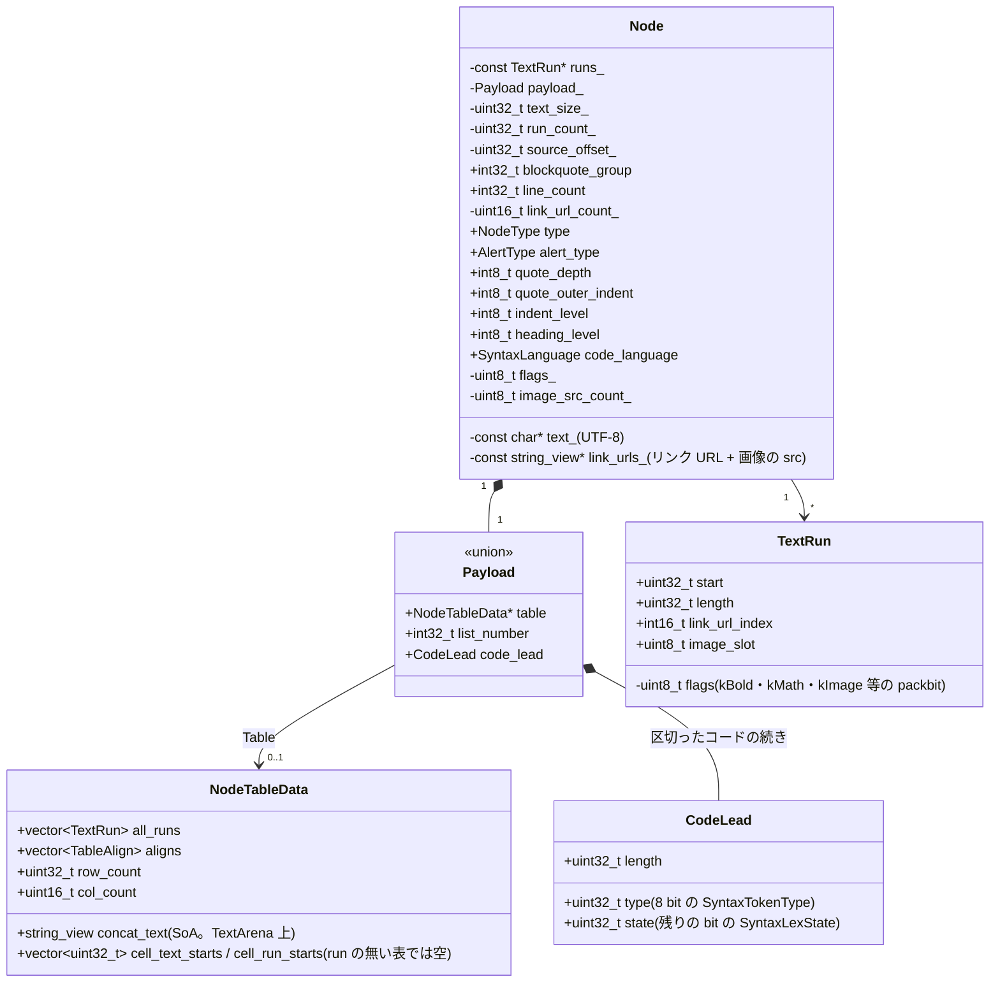

画像はノードのテキスト（表はセル）の中の `kImage` の run（範囲は alt）で、ノードが持つのは Markdown に書かれた `src` だけである（`Node::image_src(run)` / `image_srcs()`。src はリンク URL の配列の後ろに続けて置き、run の `image_slot` で引く。1 ノード `kMaxImageSlots` = 255 個まで）。読み込んだ画像の幅・高さはパース結果ではないので `Node` には置かず、`InlineImageTable` が持つ（3.26）。

`Node` は自分では何も所有しない trivially copyable なビューで、`static_assert(sizeof(Node) == 64)` と `static_assert(std::is_trivially_copyable_v<Node>)` で退行を検出する。ノード種別ごとのデータは 8B の union `payload_` に 1 つだけ置き、どれを読むかは `type` で決まる（`list_number` は `flags_` の `kListOrdered`、`code_lead` は `kHasCodeLead` で判定する）。Table は `Document` が `unique_ptr` で所有する `NodeTableData` を指し、区切ったコードブロックの続きは前のノードから続くトークンの長さと種類、その後ろから字句解析を始める状態（`code_lead`）を持つ。Alert のラベル長は payload に持たず、`kHasAlertLabel` が立っていれば `AlertType` から `AlertLabelLength` で求める（3.6.4）。`heading_level` / `code_language` / `flags_` / `image_src_count_` は末尾の 1 バイト領域に置く。`heading_level` と `code_language` は不変条件を持たない素のフィールドで、設定するのは見出し (`heading_level`) と CodeBlock・Diagram (`code_language`) だけなので、ほかのノードでは既定値の 0 / `SyntaxLanguage::None` のまま。`flags_` は `kListOrdered`・`kTaskChecked`・`kHasChildBlocks`（loose list の LI が中身を子ブロックに持つ）・`kHasAlertLabel` と、長いテキストを区切ったノードの並びを表す `kContinuesPrev`・`kContinuesNext`・`kNewlineBeforeChunk`（3.6.6）、`code_lead` を持つかの `kHasCodeLead` を持つ。

> **Why**: ノード配列（`ReservedArray`。予約したアドレス空間をコミットして写さずに伸ばす）を予約し直すときの写しを memcpy で済ませるため、ノードには所有するメンバを置かない。`TextArena` のチャンク化と合わせて、100MB の文書でパース後のコミットが 162MB → 82MB に減った。

テキスト・`runs`・リンク URL はノード自身では持たず、「先頭ポインタ + 長さ / 件数」で外部の領域を指す（長さと件数は 4B / 2B 領域にまとめて 64B に収める）。原文をそのまま表示できるノードは `DocumentData::raw` を、加工が要るノード（SOFTBR の空白化、HTML entity、Alert など）のテキストと全ノードの `runs`・URL 配列（画像の src を含む）は `DocumentData::parsed`（`NodeStorage`）の `TextArena` を指す。Table ノードのテキストは `NodeTableData::concat_text` 全体を指すので、表の本文も `GetText()` で取れる。`TextArena` はチャンクを積み足すだけのバンプアロケータで、個別には解放しない。チャンクは 4KB から倍々に広げて 1MB で頭打ちにし、256KB を超える要求は専用に確保する（小さな文書で大きく確保せず、使い残しを末尾のチャンク 1 個分程度に抑えるため）。URL 配列の要素と画像の `src` は `string_view` で、md4c の href / src が原文を指していればそのまま、参照定義の展開や脚注 URL のように原文の外にあるものだけ arena へコピーする。パース中はテキスト・`runs`・URL を `ParseContext` のスクラッチに貯め、ノード確定時に arena へ 1 回だけコピーするので、ノードごとの確保・解放がほぼ無く、旧文書の破棄も arena の塊を返すだけで済む。ソース位置は `uint32_t source_offset_` に明示的に持ち、`SourceOffset()` で取り出す。`TextRun` の装飾は個別 bool ではなく `uint8_t flags` に packbit され、`bold()` / `italic()` / `code()` / `strikethrough()` / `math()` / `image()` アクセサで判定する。

アクセサは `payload_` と `flags_` への薄いラッパーとして提供される:

```cpp
NodeTableData* table_data() noexcept;            // Table 以外は nullptr。Table は必ず表を持つ (const 版は const を返す)
bool has_table() const noexcept;
std::string_view image_src(const TextRun& run) const noexcept;   // kImage の run の画像の記述どおりのパス
std::span<const std::string_view> image_srcs() const noexcept;  // 画像の src を image_slot の順に重複なく (表はセル全体の分)
bool has_images() const noexcept;
int8_t heading_level = 0;                        // 素のフィールド。Heading 以外は 0
SyntaxLanguage code_language = SyntaxLanguage::None;   // 素のフィールド。未設定は None
int32_t list_number() const noexcept;            // 順序なしリストは 0
bool list_ordered() const noexcept;
bool task_checked() const noexcept;
bool has_child_blocks() const noexcept;
uint32_t alert_label_length() const noexcept;    // AlertLabelLength(alert_type)。ラベルを持たない (Alert の伝播先) ノードは 0
bool continues_prev() const noexcept;            // 区切ったテキストの続き (前のノードと同じブロック)
bool continues_next() const noexcept;            // 次のノードが続き
bool newline_before_chunk() const noexcept;      // 前のノードとの間の改行を、区切るときに取り除いた
uint32_t code_lead_length() const noexcept;      // 区切ったコードの続きで、前から続くトークンが先頭から占める長さ (無ければ 0)
SyntaxTokenType code_lead_type() const noexcept; // その種類 (kHasCodeLead が立っていなければ Plain)
SyntaxLexState code_lex_state() const noexcept;  // 続くトークンの後ろから字句解析を始めるときの状態 (CSS・HTML・YAML など)
// payload に書いて kHasCodeLead を立てる。Plain なら長さを 0 にし、長さも状態も 0 なら立てない
void set_code_lead(uint32_t length, SyntaxTokenType type, SyntaxLexState state) noexcept;
void set_list_number(int32_t number) noexcept;   // payload に書いて kListOrdered を立てる
// 先頭 link_count 個がリンク URL、残りが画像の src (image_slot の順)
void SetLinkUrlsAndImageSrcs(std::span<const std::string_view> urls, size_t link_count) noexcept;
void set_has_alert_label() noexcept;             // kHasAlertLabel を立てる。alert_type を先に決める
```

リロードで中身が同じノードの計測結果を引き継ぐときの照合（`FindUnchangedEnds`、`document_utils.h`。比較本体は `document_utils.cpp` 内部の `NodeContentEquals`）は、ノードが指す先の内容（テキスト・`runs`・URL・画像の `src`・表）と `flags_`、区切ったコードの続きの先頭のトークン（`code_lead_*`）と字句解析を始める状態（`code_lex_state`）を比べる。表は `NodeTableData` の既定の `operator==` で比べる。

### 4.2 LayoutCache

レイアウト情報を Node から分離して管理する。

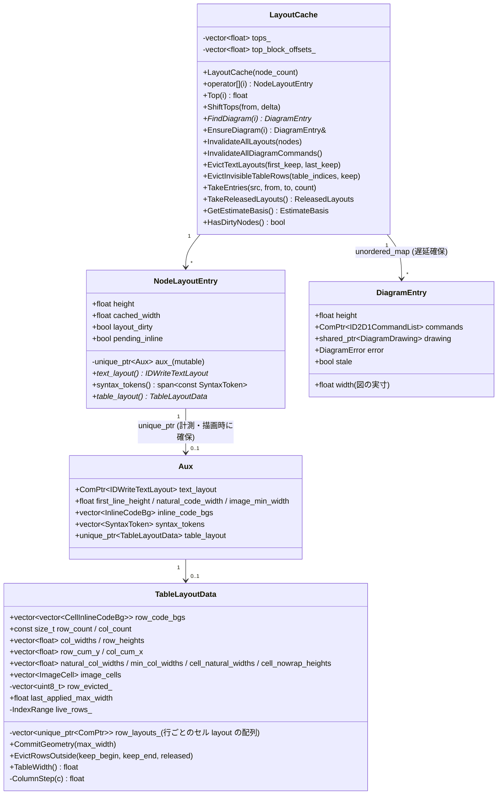

`NodeLayoutEntry` は全ノード分並ぶので、全ノードで要る高さ・実測キャッシュ・dirty フラグ・寸法を待って仮に組んだ印（`pending_inline`）だけを直に持ち (24B)、テキストレイアウトやエフェクト状態など計測・描画したノードでしか使わないものは `Aux` に置いて必要になったときに確保する。既定値を書く setter（`set_first_line_height(0.0f)` など）は `Aux` を確保しない。evict では `Aux` ごと解放し (行単位 evict するテーブルは列幅・行高さを残す)、ズームの全無効化ではテーブル幾何も含めて捨てる (旧倍率の幾何は計測で全部作り直すので使い道がない)。`IDWriteTextLayout` の解放は 1 個 2〜3µs かかり、ズームや巨大な表の evict では数千〜数十万個になるので、捨てたレイアウトは `ReleasedLayouts` に溜め、`App::RunIdleWork` が多ければワーカーへ渡して解放する。文書を差し替えたときの旧 `LayoutCache` も、D2D のコマンドリストを持つ図だけ UI スレッドで捨て（`ReleaseDiagrams`）、残りはワーカーで捨てる。ノードの Y 位置は `entries_` とは別の連続配列 `tops_` に持つ（SoA）ので、高さが変わったときの後続ノードの一括シフト（`ShiftTops`）がエントリ全体をなめない。さらに Top は 4096 件ごとのブロック内の値とブロックのオフセット（`top_block_offsets_`）に分けて持ち、ずらしを同じブロックの残りとブロック数ぶんの書き換えで済ませる。CodeBlock の構文トークン（`syntax_tokens`、UTF-16 位置）は計測ワーカーが `text_layout` と一緒に作り、描画時のグリフランの色分けに使う。

遅延レイアウトで計測する dirty が残っているかは `LayoutCache` 自身が `HasDirtyNodes()` として持ち、`LayoutEngine` が計測のたびに決め直す。キャッシュと一緒に動くので、推定直後（true）のキャッシュを文書ごと差し替えても遅延レイアウトが拾う。

`TableLayoutData` は `unique_ptr` でテーブルノードのみ確保される。セルレイアウトは行ごとの配列（`row_layouts_`。初めてセルを置くときに作り、layout を持たない行は null）で持ち、セルは `CellIndex`（`row * col_count + col`）で引く（セルごとに持つと、巨大な表で可視 ±数画面の行のほかは null の `ComPtr` が並び、20 万行 20 列の表を組むと commit 64.3MB、行ごとにして 34.9MB）。`natural_col_widths` / `cell_natural_widths` などをまとめて管理する。セルのレイアウトは自然幅を測るために無限幅で作り（列の揃えは作るときに付ける）、左揃えで列幅に収まるセルはそのまま使う（`ApplyCellWidth`。折り返さないので行組みは同じで、列幅を付けると組み直しになる）。幅が変わったかはレイアウト自身の `GetMaxWidth` で判定し、変わらなければ `GetMetrics` が計測済みの高さを返すだけなので、セルごとの高さや適用幅は持たない。エントリは中身の同じノードの間でしか移らないので、行数と列数は確保したときに決まり、セル単位・行単位の配列もそのときに表の大きさで確保する。`MeasureTable` は `BuildTable` でローカルに組み、全セルを測って幾何を確定（`FinalizeTableLayout` の `CommitGeometry`）してから `NodeLayoutEntry::set_table_layout` で置くので（1 万セルを超える表の最初の計測は、`TableMeasureJobs` が計測ワーカーで `BuildTable` を呼んで組み、組み終えるまで表は推定の高さのまま中身を描かない）、`table_layout()` があれば描画とヒットテストに要る幾何（`col_widths` / `row_heights` / `col_cum_x` / `row_cum_y`）は揃っている。幅も合っているかは `GeometryValidAt` で分かる。幅が変わっても組み直すまでは前の幅の幾何のまま残り（見えている表は描く前に組み直す）、推定が `entry.height` だけを伸ばしても、同じ幅の早道は幾何の高さ（`TotalHeight`）で確定し直す。`table_layout()` の無いテーブルは描かず、ヒットテストもしない（推定の行高さで描く線形のフォールバックは持たない）。表の総幅は `TableWidth`（`col_cum_x` の末尾）、列の刻み幅は `ColumnStep`、セル本文の原点は `TableCellTextOrigin` で求め、描画とヒットテストが同じ式を使う。インラインコードの背景は行ごとの配列 `row_code_bgs`（各行は列の昇順）で持ち、インラインコードを含むテーブルだけ `row_count` 分確保して行の計測で作り直す。描画は行の背景を列の昇順に読み進め、セルごとに行の全件を見ない。行単位 evict（`EvictInvisibleTableRows` が呼ぶ `TableLayoutData::EvictRowsOutside`）はセルレイアウトが生存しうる行範囲 `live_rows_`（`IndexRange`。ノードの `text_layout` の `live_nodes_` も同じ型）のうち keep 範囲外の差分だけを捨て、背景は幅が変わらない限り有効なので残す。evict 済みの行の印（`row_evicted_`）・その数・生存範囲は互いに揃っている必要があるので private にし、`TableLayoutData` のメンバ（`EvictRowsOutside` / `MarkRowRestored` / `MarkAllRowsEvicted`）だけが書き換える。初回の計測（`MeasureTableCells`）は列幅を決めるために全セルを測るが、`kMaxKeptTableCells`（1024）を超える表はセルの自然幅と折り返さない高さ（`cell_nowrap_heights`）だけを残してレイアウトを捨て、全行を evict 済みにする（セルのレイアウトは 1 個 7KB ほどあり、5 万行 6 列の表で 2GB になる）。このとき列ごとに中身（テキストと装飾）が同じセルは最初の 1 つだけを測り、残りはその値を使う（`FindRepresentativeCells`。状態や種別のような同じ値が並ぶ表では計測が 4 割ほど縮む）。見出し行は書式が違うので対象にしない。evict 中の行の高さは、列幅に収まるセルは折り返さない高さそのもの、収まらないセルは折り返しの行数を見積もった値で、行が可視になって `RestoreEvictedTableRows` が作り直したときに実測へ揃える。

`DiagramEntry` の `width` / `height` は描画した図の実寸で、再計測（幅変更・ズーム）でも表示高さの計算に使う。デバイスロスト時の `InvalidateAllDiagramCommands()` はコマンドリストと描画命令を捨てても寸法は残す。図はビットマップを持たず、`commands`（描画命令を記録したコマンドリスト）を描き（スクロールの間だけ、見えている図を `DiagramBitmapCache` がビットマップに描いて写す）、`drawing`（描画命令）をクリップボードコピー・保存に使う。画面外へ出た図は `commands` と `drawing` を捨て（`ReleaseImage`。仮表示中の絵も）、寸法は残す（戻ったら図の結果のキャッシュの直列化した形から読み直す。3.12.3）。`error`（`DiagramError`。失敗の種類と、pele が返した文言）は描画失敗の理由で、空でなければ再要求しない（コードの書き換え・幅変更・テーマ変更・デバイスロストで消えて再試行の契機になる）。言語で変わる文言は持たずに描くときに引くので、言語を切り替えても前の言語の文言は残らない。`stale` は幅・テーマ・コードの変更で描き直す間、前の結果を仮に表示している印（`MarkStale`）で、プレースホルダへ戻って高さが 2 回変わるのを避ける。`DiagramEntry` は図のノードでしか使わないため、`diagrams_` は全ノード分の枠を持たず、ノード番号をキーにした `std::unordered_map<size_t, DiagramEntry>` として持つ。Mermaid の処理待ちは `DiagramEntry` を指さず、結果は `MermaidRenderer` のキャッシュに置かれ、要求し直したときに `RequestRender` が書き込む。確保は結果を書き込む `EnsureDiagram(i)` だけが行い、読み取り・描画・破棄は未確保なら `nullptr` を返す `FindDiagram(i)` を使うので、表示していない図ノードには確保しない。検索・選択のハイライトの矩形はキャッシュせず、可視範囲の前後の行にかかる分を毎フレーム引く（全選択のまま画面いっぱいの 15KB の和文を描いて 1 フレーム 34〜43µs）。

### 4.3 Document

```cpp
// 原文と、それをパースした結果。ノードのテキストは raw か parsed.arena を指すので、1 つの共有で寿命をそろえる。
// パース後は書き換えない。
struct DocumentData {
    std::string raw;      // パース入力 (NormalizeSource 済み。改行は LF、NUL は U+FFFD)。relocate しないので、原文をそのまま表示するノードが指し続けられる
    NodeStorage parsed;   // ノードと、加工したテキスト・全ノードの runs・URL・画像の src を置く arena、テーブル本体、索引
};

class Document {
public:
    constexpr Document() noexcept = default;
    Document(Document&&) noexcept = default;   // move-only
    Document& operator=(Document&&) noexcept = default;

    // text は NormalizeSource 済みの UTF-8 (LoadFile の出力)
    static Document FromNormalizedMarkdown(std::string text, std::wstring_view path,
                                           std::stop_token stop_token = {});
    // NormalizeSource を通してから読む版 (埋め込みの文書 / テスト用)
    static Document FromMarkdown(std::string utf8, std::wstring_view path);

    std::span<const Node>         GetNodes() const noexcept;  // 書き換え用のアクセサは持たない
    constexpr const std::wstring& GetFilePath() const noexcept;
    bool                          HasBackingFile() const noexcept;    // 空パスと埋め込みの仮想パス (ヘルプ・ライセンス) は false
    const std::vector<TocEntry>&  GetToc() const noexcept;    // 文書順の見出し
    bool                          IsEmpty() const noexcept;
    std::string_view              GetRawText() const noexcept;        // リロード差分比較用 (UTF-8)
    // worker (非同期リロードの旧文書との比較・巨大な表の組み) に渡す共有参照。同一性で「同じ文書か」を判定できる
    const std::shared_ptr<const DocumentData>& ShareData() const noexcept;
    constexpr const std::wstring& GetDirectory() const noexcept;      // キャッシュ済み参照

    // アンカー (ToLowerAnchorCopy の規則で大文字小文字は無視) を付けた見出し、または脚注の定義 / 参照のノード番号。見つからなければ -1。
    int FindAnchorIndex(std::string_view anchor);
    const std::vector<size_t>& GetImageNodeIndices() const noexcept;     // 画像を含むノード
    const std::vector<size_t>& GetDiagramNodeIndices() const noexcept;
    const std::vector<size_t>& GetTableNodeIndices() const noexcept;
    const std::vector<size_t>& GetMathNodeIndices() const noexcept;

private:
    std::shared_ptr<const DocumentData> data_;   // 設定するのは FromNormalizedMarkdown だけ
    std::wstring file_path_;
    std::wstring cached_directory_;
    std::unique_ptr<HeadingAnchorIndex> anchor_index_;   // リンクを辿るときに見つかるまでだけ延ばす
};
```

`Document` は `FromMarkdown` で作ったら中身を変えない。別の内容を表示するときは新しい `Document` を作り、`App::ReplaceDocument` が推定高さ入りの `LayoutCache` と一緒に丸ごと差し替える。このときノード数とキャッシュのエントリ数が等しいことを assert で確かめ、以降の描画・ヒットテスト・スクロール計算はこの一致を前提にする。`Document` は move-only で、ノードは `DocumentData` の `raw` と `parsed` の arena・テーブルを直接指すが、`DocumentData` を共有で持つので move で位置が変わらず、ポインタの付け替えは要らない。原文とパース結果を 1 つの共有にまとめて持つのは、両者の寿命をそろえるためと、非同期リロードの worker が UI の文書の差し替えと無関係に旧文書の原文とノードを読めるようにするためである（3.11.3）。

アンカーは文書内リンクのクリック時にしか使わないため、パースでは作らない。`FindAnchorIndex` はクエリをスラグと同じ規則で小文字に畳み（`ToLowerAnchorCopy`）、`HeadingAnchorIndex`（アンカー → ノード番号のハッシュ索引）を引く。無ければ TOC の続きから見出しのスラグを作って github-slugger と同じ規則で連番を付け、見つかるまでだけ索引を延ばす。索引はリンクを辿った文書にだけ作られ、内容を差し替えると捨てる。115MB・見出し 14 万件の文書では、パースが約 65ms 短くなる代わりに、存在しないアンカーを初めて引いたときだけ約 50ms・+19MB かかる。

脚注のアンカー (`user-content-fn-N` / `user-content-fnref-N[-M]`) は、パース時に作った `footnote_def_indices`（脚注番号 → 定義ノード）と `footnote_refs`（参照の位置）を引く。見出しの索引より先に照合するので、脚注のアンカーと同じスラグの見出しがあっても脚注が優先される。

`DocumentData::raw` はパース入力の UTF-8 テキストを常時保持する。これはリロード時の差分比較（`AnalyzeReloadDiff`、差分位置からのスクロール量は `layout_computer.h` の `layout::CalcScrollYForDiff`）用で、ノードレベルでは検出できない編集（空行追加・末尾空白等）も UTF-8 byte オフセット精度で差分位置を求めるため。非同期リロードのワーカーは `ShareData()` で旧文書を受け取り（`ReloadBase`）、パースの前に差分を判定する。`raw` は常に正規化済み（`LoadFile` か `FromMarkdown` が `NormalizeSource` を通し、改行を LF に、NUL を U+FFFD にする）なので、リロード diff の新テキストも `LoadFile` で同じ正規化を通してから比較する。これによりファイル全体の改行コードを変換して保存するエディタ（issue #273）でも差分位置が編集行を正しく指し、改行コード変換のみの保存は NoChange としてスクロール位置が維持される。

### 4.4 NodeType / AlertType

```cpp
enum class NodeType : uint8_t {
    Heading, Paragraph, CodeBlock, HorizontalRule,
    ListItem, Table, TaskListItem,
    Diagram  // Mermaid の図。テキストではなく描画命令 (pele の SVG から作る) で描くコードブロック
};

enum class AlertType : uint8_t {
    None = 0, Note = 1, Tip = 2, Important = 3, Warning = 4, Caution = 5
};
inline constexpr size_t ALERT_TYPE_COUNT = 5;

// Alert の先頭に置く "アイコン ラベル" の UTF-8 byte 数。t は None でないこと
constexpr uint32_t AlertLabelLength(AlertType t) noexcept;
```

### 4.5 TextSelection

```cpp
// text_types.h。位置は (ノード番号, ノードのテキストでの UTF-8 byte オフセット) の組
struct TextSelection {
    int      start_node = -1;
    uint32_t start_pos  = 0;
    int      end_node   = -1;
    uint32_t end_pos    = 0;

    // 空でない範囲を選んでいる (始点と終点が違う)
    constexpr bool active() const noexcept;

    struct NodeRange { uint32_t start; uint32_t end; };
    // node_index に対応する選択範囲 [start, end)。end は text_size でクランプ済み
    constexpr NodeRange ClampedRange(int node_index, size_t text_size) const noexcept;
    // ClampedRange に加え、非アクティブや範囲外のノードでは空範囲を返す
    constexpr NodeRange RangeIn(int node_index, size_t text_size) const noexcept;

    constexpr void Clear() noexcept;
    static constexpr TextSelection MakeOrdered(
        int node_a, uint32_t pos_a,
        int node_b, uint32_t pos_b) noexcept;
};
```

---

## 5. 処理フロー

### 5.1 アプリケーション起動

```mermaid
flowchart TD
    START[wWinMain] --> DLL[SetDefaultDllDirectories<br>System32 限定 + d2d1 / dwrite を先に読む]
    DLL --> D3D[PrefetchD3DDevice<br>D3D11 デバイスを別スレッドで先行作成]
    D3D --> CFGLOAD[ConfigService::Load<br>settings.ini読み込み]
    CFGLOAD --> I18NINIT[i18n::Init<br>session::LoadLanguage General/Language]
    I18NINIT --> PLAN[PlanStartup → DecideStartupPlan<br>引数 __wargv / 前回ファイル / cwd]
    PLAN --> WIN[Win32Window window&#40;config&#41;]
    WIN --> PCHK{document_path<br>あり？}
    PCHK -->|Yes| PRELOAD[StartPreloadAsync<br>共有 scheduler で読み込み + パース + 推定]
    PCHK -->|No| PREP
    PRELOAD --> PREP[scroll が Restore か、RestoreIfSameFile で同一ファイルなら RestoreScrollPosition<br>Anchor なら SetInitialAnchor<br>ペインのフォルダがあれば SetInitialDirectory]
    PREP --> COM[CoInitializeEx<br>COINIT_APARTMENTTHREADED + COINIT_DISABLE_OLE1DDE]
    COM --> CREATE[Win32Window::Create]

    CREATE --> REG[RegisterClassExW]
    REG --> WND[CreateWindowExW<br>WS_EX_ACCEPTFILES + WS_EX_NOREDIRECTIONBITMAP]
    WND --> INIT[App::Init]
    INIT --> CFG[session::LoadDarkMode + LoadZoomLevel<br>の値で ThemeService::Init、テーマを作りフォントを決める]
    CFG --> D2D[Renderer::Init&#40;hwnd, theme&#41;<br>D2D / DWrite / WIC ファクトリ + Formats<br>+ LayoutEngine::Init で計測の書式]
    D2D --> LSCHED[measurer の SetScheduler<br>ワーカーは初回 Post で起動]
    LSCHED --> LEGACY[RemoveLegacyFolders<br>前の版の MermaidCache・WebView2Data が<br>有るときだけ専用のスレッドで消す<br>ほかの mendo の窓があれば次の起動へ]
    LEGACY --> MERM[MermaidRenderer::Init<br>PeleEngine は初回描画で作る]
    MERM --> PANES[session::LoadPanes<br>ペインの表示・幅・倍率]
    PANES --> SHOWW[DWMWA_CLOAK で隠したまま<br>RestoreWindowPlacement / ShowWindow]
    SHOWW --> ATTACH{LoadInitialDocument<br>Attach で通知先を渡す}

    ATTACH -->|読み込み中| AWAIT[AwaitInitialParseBeforeDevice<br>D3D デバイスの先行作成を待つ間に<br>PARSE_COMPLETE が届けば OnParseComplete<br>長引けばスピナー]
    ATTACH -->|読み込んでいない| HELP[ShowEmbeddedResource]

    AWAIT --> TAKE[TakeStartupMessages<br>FILE_LISTED / INLINE_MATH_REQUESTED を<br>デバイスを待つ前に取り込む]
    HELP --> TAKE
    TAKE --> DEV[App::CreateRenderDevice<br>画像のフォルダを開き終えるのを D3D の作成の裏で待ち<br>先行作成した D3D デバイスで D2D デバイス + Brushes<br>終わったデコードと図の結果を取り込む]
    DEV --> PEEK[PARSE_COMPLETE が届いていれば<br>OnParseComplete + TakeStartupMessages]
    PEEK --> SHOW[UpdateWindow → cloak 解除]
    SHOW --> LOOP[RunMessageLoop]
    LOOP --> DESTROY[Win32Window破棄<br>COMオブジェクト解放]
    DESTROY --> EXIT[CoUninitialize]
    EXIT --> END[終了]
```

`DecideStartupPlan` は、ファイル引数ならそのファイル、フォルダ引数・引数なしなら前回ファイルを `document_path` にし、実在しないパスの引数では前回ファイルを復元せずヘルプを出す。ファイルペインのフォルダは、ファイル引数ならその親、フォルダ引数ならそのフォルダ、それ以外は cwd（cwd がシステムフォルダや exe のフォルダなら前回ファイルのフォルダ）にする。開いた文書でのスクロールは `StartupPlan::scroll`（`None` / `Restore` / `RestoreIfSameFile` / `Anchor` の variant）で決める。ファイル引数に `--anchor` があればその見出しへ飛び（`Anchor`）、前回ファイルと同じ表記（大文字小文字は区別しない）ならスクロール位置を復元する（`Restore`）。表記が違ってもファイル名が同じ（か 8.3 短縮名の `~` を含む）なら同一ファイルかもしれないので `RestoreIfSameFile` にし、2 ファイルを開く `std::filesystem::equivalent` での確認はプリロードを始めた後に `wWinMain` が行う。描画デバイスの作成（`CreateRenderDevice`）は起動時の読み込みの取り込みより後に置き、デバイスを待つ間に終わった読み込みや画像デコードは最初のフレームに入れる。ファイルペインの列挙完了とインライン数式の描画の依頼もデバイスに依存しないので、デバイスの作成を待つ前に取り込む（`Win32Window::TakeStartupMessages`）。

### 5.2 ファイル読み込みから描画まで

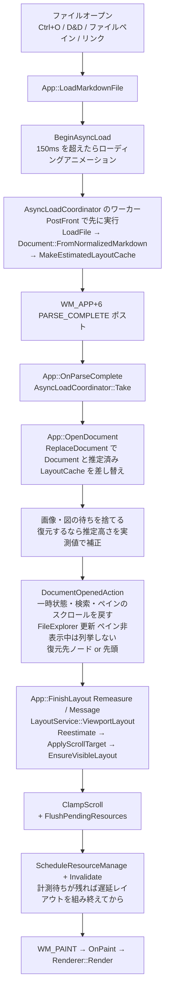

### 5.3 描画フロー

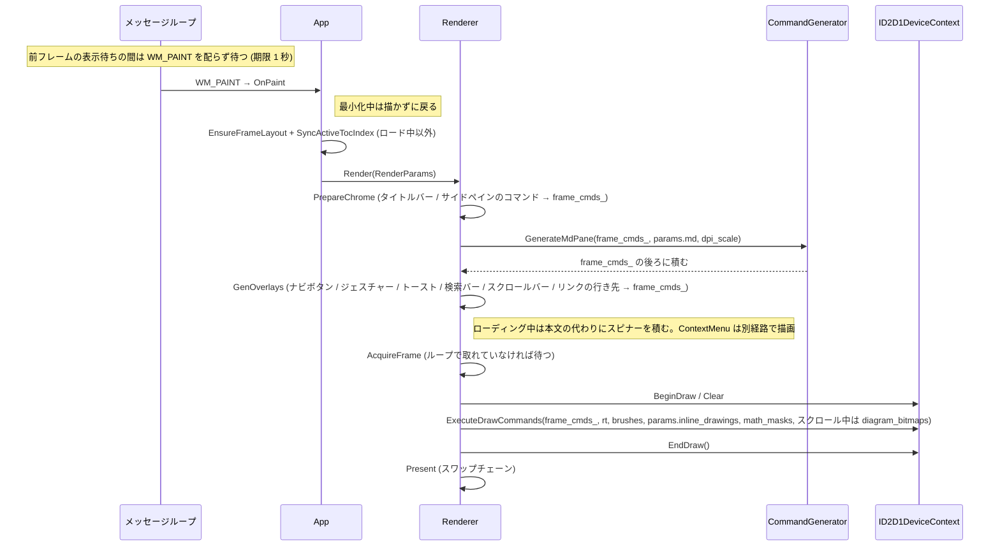

スワップチェーンは `SetMaximumFrameLatency(1)` で、Frame Latency Waitable Object がシグナルするまで次のフレームを描かない。メッセージループはこのハンドルも `MsgWaitForMultipleObjects` で待ち、待つ間は `QS_PAINT` を外して `WM_PAINT` を取り出さず、入力などを先に配る（待つ間の入力を反映して描ける）。期限は `Renderer::kFrameWaitTimeoutMs`（1000ms）で、GPU が止まっても抜けられる。モーダルループや `UpdateWindow` からの描画のようにループが待っていない経路では、`Renderer::Render` がコマンドを組み立てた後の `AcquireFrame` で同じ期限まで待つ（組み立ての時間は待ちに隠れる）。

---

## 6. ビルドシステム

### 6.1 CMake 構成

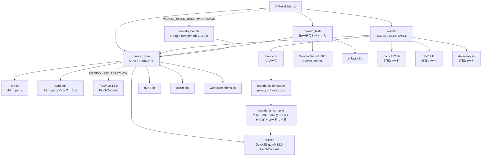

### 6.2 ビルドコマンド

**通常ビルド:**

```bash
cmake -B build
cmake --build build --config Release
```

**テストなしビルド:**

```bash
cmake -B build -DMENDO_BUILD_TESTS=OFF
cmake --build build --config Release
```

**Tracy プロファイラ有効化（既定 OFF）:**

```bash
cmake -B build -DMENDO_USE_TRACY=ON   # Tracy v0.15.0 を FetchContent で取得
```

**テスト実行:**

```bash
build/tests/Release/mendo_tests.exe --gtest_brief=1
```

### 6.3 ビルドターゲット

| ターゲット | 種別 | 説明 |
|:-----------|:-----|:-----|
| `md4c` | 静的ライブラリ | サードパーティ Markdown パーサ |
| `quickjs` | 静的ライブラリ | QuickJS-ng（pele と KaTeX を動かす JS エンジン。FetchContent で v0.18.0 を SHA-256 で検証して取得し、ライブラリの 4 ファイルだけを組む） |
| `rapidhash` | INTERFACE ライブラリ | ハッシュ（ヘッダーのみ、`third_party/rapidhash`） |
| `mendo_js_compile` | 実行ファイル（ビルド時に使う） | pele と KaTeX を QuickJS-ng のバイトコード（`pele.qbc` / `katex.qbc`）にする。`mendo_js_bytecode` が実行し、`res/mendo.rc` が埋め込む |
| `mendo_core` | 静的ライブラリ | テスト可能なコアロジック（WinMain・ウィンドウ・`App`・レンダラ実装を含まない） |
| `mendo` | 実行ファイル (WIN32) | メインアプリケーション |
| `mendo_tests` | テスト | 全テストを含む単一バイナリ |
| `mendo_bench` | ベンチマーク | Google Benchmark v1.10.0 のベンチ（`-DMENDO_BUILD_BENCHMARKS=ON` のときだけ） |

`mendo_core` には **DirectWrite / 図の描画の抽象化越し** のサービスが入る — `ITextMeasurer` / `IMermaidRenderer` を通して使い、`Renderer`（Direct2D）と `App` / `Win32Window` は `mendo` 実行ファイル側に置く。`MermaidRenderer` は `mendo_core` に入り、pele をテストから差し込む（`PeleFactory`）。`DWriteTextMeasurer` は `mendo_core` に含まれ、`dwrite.lib` への依存を持つ。

### 6.4 pele と KaTeX の埋め込み

図は [pele](https://pele.run/)（mermaid 記法を SVG に描くライブラリ。ESM の 1 ファイル版 `pele.mjs`）、数式は KaTeX（UMD の縮小版 `katex.min.js`）で描く。どちらも `scripts/update_js_libs.ps1` が npm の tarball を integrity で検証してから `third_party/pele` と `third_party/katex` に置き（KaTeX は描画に使う 20 書体の woff2 も `third_party/katex/fonts` に置く）、JS はビルド時に `mendo_js_compile` が QuickJS-ng のバイトコード（`pele.qbc` / `katex.qbc`）にして実行時のコンパイル（約 60ms と約 20ms）を省き、`res/mendo.rc` が数値 ID（`IDR_PELE_JS` / `IDR_KATEX_JS`、書体は `IDR_KATEX_FONT_FIRST` から `kKatexFontFiles` の順）の RCDATA として無圧縮のまま EXE に埋め込む。どちらも `PeleEngine` が QuickJS-ng で動かす。ビルド時の圧縮ステップや実行時の展開処理は持たず、`cabinet.lib` にも依存しない。配布は zip なので事前圧縮しても配布サイズはほぼ変わらず、展開の方が高くつくためである。

pele の見た目は mermaid.js と違う（文字を 16px に保って折り返すので、図全体を縮めて文字を読めなくすることはない）。ダークテーマの配色は `DrawingFromPeleSvg` が SVG のルートの style の先頭に CSS 変数として足す（`kDarkVars`）。

表示用の図は描画命令（`DiagramDrawing`）にして、UI スレッドが `DrawDiagram` で `ID2D1CommandList` に記録する（`MermaidRenderer::RecordDrawing`。描画中の Renderer とは別の DeviceContext を同じデバイスから作って使う）。図は止まっている間はビットマップを持たず、毎フレームそのコマンドリストを枠の幅に合わせて縮めて描く（`DrawDiagramCmd`）。図形は色・不透明度・変換を属性に確定させた SVG にして `ID2D1SvgDocument` で、文字は D2D の SVG が描かないので 1 行ずつの並びにして DirectWrite で描く。文字の位置は `text-anchor` と DirectWrite の字幅から求め、書体は pele の `measurer` と同じく本文と同じ Segoe UI にロケールで決まるフォールバック先を明示するので、pele の配置と一致する（明示しないと日本語のフォールバック先が分かれて最大 86px ずれる）。図形が前の文字に重なるときだけ層を分け、文書の順の重なりを保つ。D2D の SVG はグラデーションで塗るときの塗りの不透明度を無視するので、止まりの不透明度に掛けて書き出す。描画命令にできない要素のある図は描かず、描けないことを図の枠に出す。

ベクタのまま持つのは、ビットマップがメモリの大半を占めるためである。図 30 個を持つと、ビットマップ（DPR 1.5）では GPU +161MB・private +125MB、コマンドリストでは GPU +0.8MB・private +4.3MB だった。代わりに毎フレーム描く手間が 1 図 0.1〜1.7ms（多くは 0.15〜0.4ms、ビットマップは 0.01〜0.11ms）かかる。mendo と WebView2 の合計は、図 4 個の文書で 221 → 201MB、test.md の図 8〜11 で 277 → 222MB、200 ノードで 243 → 179MB になった（WebView2 で描いていた頃の計測）。どの倍率でもくっきり描け、ビットマップの大きさの上限も無くなる（1000 メッセージのシーケンス図も描ける）。毎フレーム描く手間を省くため、スクロールの間だけ、見えている図の上下に 1/4 画面ずつ足した帯を装置の画素のビットマップに描いて写し（`DiagramBitmapCache`）、止まって 0.5 秒（`SCROLL_SETTLE_MS`）でビットマップを捨ててベクタで描き直す。コマンドリストと描画命令は保持範囲（上下 2.5 画面）の外へ出たら捨て（寸法は残す）、先読みの範囲に戻ったら図の結果のキャッシュの直列化した形から解き直して記録する。デバイスロストではコマンドリストを捨てて、描画命令から記録し直す。直列化した形は描画命令の UTF-8 で、図 1 個 平均 4KB（同じ図の PNG の約 1/20）。保存・コピーの PNG は、そのときに `RasterizeDiagram` で CPU で描く。クリップボードの SVG は、Office や Inkscape が CSS 変数と `color-mix()` を読めないので、解決した値を属性だけで書く（`DrawingToSvg`）。

### 6.5 MSVC ビルド最適化

| オプション | 用途 |
|:----------|:-----|
| `/MP` | マルチプロセッサコンパイル |
| `/GL` | Whole Program Optimization (Release。quickjs は LTCG の下だと解釈実行が遅くなるので除く) |
| `/Gy` | Function-Level Linking (Release) |
| `/Gw` | グローバルデータの COMDAT 化。`/OPT:REF` で未使用分を除去させる (Release) |
| `/LTCG` | Link-Time Code Generation (Release) |
| `/OPT:REF` | 未参照関数/データの除去 (Release) |
| `/OPT:ICF` | 同一COMDATの統合 (Release) |
| `/MT` | CRT静的リンク（単一exe配布のため） |
| `/DELAYLOAD` | `comdlg32.dll`（ファイルダイアログでしか使わない）、`comctl32.dll`（検索の Edit とツールチップを初めて作るまで要らない）、`shell32.dll`（ドロップ・外部で開く・設定フォルダの取得の予備だけ）と、KnownDLLs に無い `d2d1` / `dwrite` / `d3d11` / `dwmapi` / `uxtheme` を遅延ロード。`/DEPENDENTLOADFLAG:0x800` と `SetDefaultDllDirectories` で System32 からだけ解決させる |

---

## 7. テスト仕様

### 7.1 テストフレームワーク

- **Google Test** v1.18.0（FetchContentで自動取得）
- 単一テストバイナリ `mendo_tests` に全テストをリンク（`tests/CMakeLists.txt` が `test_*.cpp` を `GLOB CONFIGURE_DEPENDS` で集める。CTest への個別ケース登録は行っていない）

### 7.2 テスト対象範囲

> **テスト対象外**: `main.cpp`, `window/window.cpp`, `app/app.cpp`（Win32/D2D ハンドラ実装・副作用の実行）, `render/renderer*.cpp`, `ui/context_menu.cpp`（D2D 描画部分） は Win32 / Direct2D 依存のためユニットテスト対象外。Mermaid 描画とテキスト計測はインターフェース（`IMermaidRenderer` / `ITextMeasurer`）越しに mendo_core 側でテストされ、描画コマンドは WIC ビットマップのレンダーターゲットで実行して確かめる。

### 7.3 テストソース一覧（抜粋）

| テストファイル | 対象モジュール |
|:--------------|:-------------|
| `test_parser.cpp` | Markdownパーサ |
| `test_layout.cpp` | レイアウトエンジン |
| `test_layout_cache.cpp` | LayoutCache |
| `test_layout_engine.cpp` | LayoutEngine（MockTextMeasurer 経由） |
| `test_syntax.cpp` | シンタックスハイライト |
| `test_theme.cpp` | テーマ定義・ThemeService |
| `test_document.cpp` | Document |
| `test_document_utils.cpp` | テキスト操作・リンクの判定 |
| `test_html_entity.cpp` | HTML 文字参照の解決 |
| `test_anchor.cpp` | アンカーID生成（`GenerateAnchorId`）・見出しアンカー索引・脚注アンカー |
| `test_toc.cpp` | 目次生成・`FindActiveTocIndex` |
| `test_types.cpp` | 型・データ構造 |
| `test_file_io.cpp` | ファイルI/O ユーティリティ |
| `test_file_explorer.cpp` | FileExplorer |
| `test_config_service.cpp` | ConfigService（設定永続化）・session::・INI の読み書き（`ini::Parse` / `Serialize`） |
| `test_locale.cpp` | i18n ロケール |
| `test_string_convert.cpp` | UTF-8 ↔ Wide 変換 |
| `test_pane_layout.cpp` | ペインレイアウト計算・PaneController |
| `test_viewport_manager.cpp` | ViewportManager |
| `test_hit_test_service.cpp` | hit_test |
| `test_mouse_gesture.cpp` | MouseGesture・SwipeDetector・ジェスチャ / スワイプのオーバーレイ状態 |
| `test_nav_history.cpp` | NavHistory |
| `test_titlebar.cpp` | TitleBar |
| `test_context_menu.cpp` | ContextMenu |
| `test_settings_dialog.cpp` | SettingsDialog |
| `test_search_state.cpp` | SearchState |
| `test_search_bar.cpp` | 検索バー (検索バーのアクションの Reduce) |
| `test_ui_constants.cpp` | UIConstants |
| `test_image.cpp` | ImageLoader |
| `test_help.cpp` | ヘルプドキュメント |
| `test_mermaid_util.cpp` | Mermaidユーティリティ |
| `test_render_device_state.cpp` | RenderDeviceState（描画デバイスとフレームの段階） |
| `test_mermaid_renderer.cpp` | MermaidRenderer（pele で描く・図の結果のキャッシュ (DiagramCache)・取り消し・同時に描く数の枠） |
| `test_app_controller.cpp` | app_controller・TooltipTarget |
| `test_reducer.cpp` | Reducer |
| `test_resource_manager.cpp` | ResourceManager |
| `test_command_executor.cpp` | CommandExecutor（`ExecuteDrawCommands`、構文色の画素一致） |
| `test_command_generator_frame.cpp` | CommandGenerator フレーム描画 |
| `test_command_generator_content.cpp` | CommandGenerator コンテンツ描画 (モック経路) |
| `test_command_generator_highlight.cpp` | CommandGenerator ハイライト描画 |
| `test_task_scheduler.cpp` | TaskScheduler・ワーカー数（`SharedWorkerCount` / `LayoutWorkerCount`） |
| `test_utility.cpp` | ユーティリティ関数（`utility.h`、rapidhash のハッシュと FlatHashMap を含む） |
| `test_async_load_coordinator.cpp` | AsyncLoadCoordinator（起動時の先行読み込みと `Attach` を含む） |
| `test_parallel_measure.cpp` | 並列計測と `ProcessDirtyBatch` のダーティバッチ計測（期限・クリップ・計測に失敗したノードは 1 回で諦める） |
| `test_clipboard_manager.cpp` | ClipboardManager |
| `test_block_h_scroll.cpp` | ブロック横スクロール |
| `test_utf8_codec.cpp` | UTF-8 コーデック |

### 7.4 主要テストケース

#### Parser テスト

- [x] 見出し（H1〜H6）
- [x] 段落・太字・斜体・取り消し線・インラインコード
- [x] リンクとURL抽出
- [x] コードブロック（言語指定あり/なし）
- [x] 順序付き/なしリスト（ネスト）
- [x] タスクリスト
- [x] テーブル（アライメント）
- [x] 引用ブロック / GitHub Alerts
- [x] 水平線
- [x] Mermaid ブロックの検出（`NodeType::Diagram`）
- [x] リンク URL・画像 src の文字参照の解決
- [x] 装飾 run 数の上限（4096 個、表はセルごと）

#### Reducer / Effect テスト

- [x] 各 `AppAction` に対する状態遷移
- [x] Effect 発行の妥当性（`HasEffect<T>`, `FindEffect<T>`）
- [x] スクロール／ズーム／ナビゲーションの結合動作

#### NavHistory テスト

- [x] Push / GoBack / GoForward
- [x] 履歴上限（MAX_HISTORY = 1024、超過時は最古を破棄）
- [x] 参照モデルとのランダム操作比較
- [x] ロード中（保留中）に次の移動が重なる連続操作
- [x] ファイル切替時の履歴保持

#### DiagramCache テスト

- [x] 直列化した形・ラベルの数式・エラーの文言・項目の器を上限に数え、超えたら使っていない順に捨てる（置くときには捨てない）
- [x] 持ち主のいない解いた形だけを外し、表示中の項目は上限を超えても捨てない
- [x] 上限より大きい図は直列化した形を持たず、表示している間だけ置く
- [x] 幅に縛られない項目は幅の上限より狭いとき（か、どの幅でも使えるとき）だけ使い、無ければ幅つきの項目を引く

#### 検索テスト

- [x] 検索バーの表示/非表示
- [x] クエリによるテキスト検索と一致件数
- [x] 次/前の一致へのナビゲーション（ラップアラウンド）
- [x] 大文字小文字区別・ハイライト切替
- [x] テーブルセル内の検索
- [x] スクロール位置に基づく最近接一致の選択

#### ビューポートテスト

- [x] ScrollTarget による位置復元
- [x] ズームイン/アウト/リセット
- [x] 全選択/クリア
- [x] max_scroll による範囲の制限（内容が縮んだときの ClampScroll）

---

## 8. DPI対応仕様

### 8.1 DPI認識レベル

**Per-Monitor DPI Awareness V2** を採用（`res/mendo.manifest` の `dpiAwareness` で指定）。

```mermaid
flowchart LR
    START[アプリ起動] --> SET[マニフェスト<br>dpiAwareness = PerMonitorV2]
    SET --> INIT[初期DPIでリソース作成]
    INIT --> MOVE{モニタ間移動？}
    MOVE -->|Yes| WM[WM_DPICHANGED<br>DpiChangedAction]
    WM --> RECREATE[DPI 反映<br>ID2D1DeviceContext::SetDpi]
    RECREATE --> RESIZE[推奨矩形へ移動・リサイズ<br>SetWindowPos]
    RESIZE --> RELAYOUT[WM_SIZE<br>ペインレイアウト再計算]
    RELAYOUT --> REPAINT[再描画]
    REPAINT --> MOVE
    MOVE -->|No| WAIT[メッセージ待ち]
    WAIT --> MOVE
```

### 8.2 DIP変換

すべての座標・サイズはDIPで管理する。

```
物理ピクセル = DIP × (DPI / 96.0)
```

`IDWriteTextLayout` も DIP 単位のため、DPI 変更そのものではブラシ・テキストフォーマットの作り直しや再計測をせず、ハイライト系のキャッシュも捨てない（描画先の DPI を `SetDpi` で変えるだけ）。

---

## 9. タイマーIDとカスタムメッセージ

### 9.1 タイマーID（`src/util/app_constants.h`）

```cpp
namespace app_timer {

// Win32 API に渡す際は std::to_underlying でキャスト。1 始まりのギャップなし連番。
enum class Id : UINT_PTR {
    LOADING_ANIM = 1,
    SWIPE_OVERLAY,         // 2
    TOAST,                 // 3
    TOOLTIP,               // 4
    RESOURCE_MANAGE,       // 5
    FILE_RELOAD,           // 6 文書の変更通知のデバウンスと読み直しの再試行
    PELE_TRIM,             // 7 使っていない QuickJS のランタイムを捨てる
    DEVICE_RECREATE_RETRY, // 8
    INLINE_TABLES,         // 9 数式か画像を待つ表の組み直しを、前回から App::kInlineTableRelayoutInterval (1 秒) 空けて行う
    TRIM_WORKING_SET,      // 10 別のアプリへ切り替わった後にワーキングセットを空にする
    IMAGE_RELOAD,          // 11 本文中の画像ファイルの変更通知のデバウンス
    SCROLL_SETTLE,         // 12 スクロールが止まったら図をビットマップからベクタの描画に戻す
};

inline constexpr UINT FRAME_INTERVAL_MS         = 16;   // ~60fps アニメーション用
inline constexpr UINT LOADING_SPINNER_DELAY_MS  = 150;  // 読み込みがこれより長引いたらスピナーを出す
inline constexpr UINT FILE_RELOAD_DEBOUNCE_MS   = 200;  // ファイル変更通知のデバウンス (文書と本文中の画像)
inline constexpr UINT FILE_RELOAD_RETRY_MS      = 50;   // truncate→rewrite 検出後の短縮リトライ
inline constexpr UINT FILE_RELOAD_LOCKED_RETRY_MS = 1000; // 共有なしで開かれたまま長引いているファイルの読み直し間隔
inline constexpr UINT RESOURCE_MANAGE_DELAY_MS  = 150;  // 画面外の整理と範囲内の読み込み (OnResourceManageTimer) までの待ち
inline constexpr UINT TOAST_DURATION_MS         = 1300; // トースト表示時間
inline constexpr UINT TOOLTIP_DELAY_MS          = 500;  // ツールチップを出すまでの待ち
inline constexpr UINT DEVICE_RECREATE_RETRY_MS  = 500;  // 描画デバイスの作り直しに失敗した後の再試行間隔
inline constexpr UINT TRIM_WORKING_SET_DELAY_MS = 1000; // 非アクティブ直後の描き直しやすぐ戻る切り替えで、外したページを触り直させない
inline constexpr UINT SCROLL_SETTLE_MS          = 500;  // スクロールが止まったとみなし、図をベクタの描画に戻すまでの時間
}
```

遅延レイアウト・検索の続き・worker の結果の取り込み（画像の GPU への転送・図の描画命令の記録）のように時間で区切って進める仕事はタイマーを使わない。WM_TIMER は約 15.6ms 刻みでしか発火せず 4〜8ms の仕事の合間が空くので、メッセージループが入力と描画を配り終えた空き時間に `App::RunIdleWork` で進める。

### 9.2 カスタムメッセージ（`src/util/app_constants.h`）

```cpp
namespace app_msg {
inline constexpr UINT IMAGE_LOADED   = WM_APP + 2;  // +1, +3〜+5 は欠番
inline constexpr UINT PARSE_COMPLETE = WM_APP + 6;
inline constexpr UINT MERMAID_JOB_DONE = WM_APP + 7;  // Mermaid の bg の仕事 (描画・キャッシュの直列化した形の読み込み) の完了
inline constexpr UINT FILE_LISTED    = WM_APP + 8;  // ファイルペインの列挙完了
inline constexpr UINT INLINE_MATH_REQUESTED = WM_APP + 9;  // 計測ワーカーがインライン数式の描画を頼んだ
inline constexpr UINT TABLE_MEASURED = WM_APP + 10; // 巨大な表を計測ワーカーで組み終えた (TableMeasureJobs)
}
```

検索欄のフォーカスはメッセージにせず、`Win32Window` の関数でその場で行う（3.1.2）。ファイルの読み込みは常に非同期で、スピナーは読み込みが `LOADING_SPINNER_DELAY_MS`（150ms）より長引いたときだけ出す。

---

## 10. 非機能要件

### 10.1 パフォーマンス目標

| 項目 | 目標値 |
|:-----|:------|
| 小規模ファイル（< 100行）の初回表示 | < 50ms |
| 大規模ファイル（> 10,000行）の初回表示 | < 500ms |
| スクロール時のフレームレート | 60fps |
| メモリ使用量（1万行ファイル表示時） | < 100MB |
| ファイル変更検出の応答時間 | < 500ms |

### 10.2 対応環境

| 項目 | 要件 |
|:-----|:-----|
| OS | Windows 10 1809 以降 / Windows 11（WebP 画像のデコーダ WebP Image Extension が 1809 以降のため） |
| アーキテクチャ | x64 / arm64 |
| コンパイラ | MSVC (C++23) |
| ビルドツール | CMake 4.2+（Visual Studio 2026 ジェネレータ） |

---

## 11. 付録

### 付録A: ファイル一覧

```
src/
├── main.cpp                       # エントリポイント (wWinMain)
├── pch.h                          # プリコンパイル済みヘッダ
├── app/                           # アプリケーション層
│   ├── async_load_coordinator.h / .cpp # LoadFile・非同期ロード調停 (stop_token・起動時の先行読み込み)・AsyncLoadResult・リロード判定 (AnalyzeReloadDiff / prefix shrink の判定)・完了時の分岐 (PlanParseComplete)・ReloadScheduler
│   ├── app.h / app.cpp            # App 統括（Init / Dispatch / 副作用の実行 Execute / OnPaint / レイアウト / テーマ適用 / コンテキストメニュー・設定ダイアログ / ファイル読み込み / マウス入力 / インライン数式の描画の依頼）+ SystemCursors
│   ├── clipboard_manager.h / .cpp # ClipboardManager (コピー/PNG 保存/SVG コピー)
│   ├── app_state.h                # AppState (全状態集約) + reducer と App が導出するペイン/ブロック情報 (ComputePaneLayout 等) + ResolveGestureOverlay
│   ├── nav.h / nav.cpp            # NavHistory
│   ├── startup_plan.h / .cpp      # 起動時の初期表示の決定
│   ├── app_events.h               # AppAction variant と各アクション + KeyDownEvent + HoverHighlights / PointerHover
│   ├── theme_service.h / .cpp     # テーマ管理サービス
│   ├── app_controller.h / .cpp    # app_controller (キー→Action、ホバーとクリックの判定 Resolve*Hit / ResolvePointerHover)
│   ├── reducer.h / reducer.cpp    # Reducer (Action+State→Effects, in-place) + ドメイン別 Reduce*
│   ├── side_effect.h              # SideEffect 単一variant + PushEffect
│   └── resource_manager.h/.cpp    # ResourceManager + ResourceManagerHost
├── window/                        # ウィンドウ層
│   └── window.h / window.cpp      # Win32Window
├── render/                        # 描画層
│   ├── renderer.h / renderer.cpp  # Direct2D 描画統括 + ブラシ・フォーマット (タイトルバー・サイドペイン・オーバーレイのコマンドは command_generator の chrome:: / overlay::)
│   ├── renderer_device.cpp        # Renderer のデバイス部分 (D3D11 デバイス / スワップチェーン / フレーム待ち)
│   ├── render_params.h            # レンダリングパラメータ (MdPaneParams / RenderParams 等)
│   ├── draw_command.h             # DrawCommand variant + DrawCommandList (vector) + FixedBrushArray + インラインオブジェクト (数式・画像) の描画に使うもの (InlineDrawings) + スクロール中の図のビットマップ (DiagramBitmapCache) / ExecuteDrawCommands 宣言
│   ├── command_generator.h / .cpp # 描画コマンド生成 (テーブル / ハイライトを含む) + TextLayoutCache (繰り返し描く短い文字列のテキストレイアウト作り置き)
│   └── command_executor.cpp       # 描画コマンド実行 (固定ブラシ・可視グリフランの描画と構文色付け)
├── core/                          # コアドメイン
│   ├── document_types.h           # Node (64B), AlertType, NodeType, NodeTableData, TocEntry etc.
│   ├── text_types.h               # TextRun, TextSelection etc.
│   ├── text_arena.h               # TextArena (ノードのテキスト・TextRun・リンク URL を置くチャンク式バンプアロケータ) + ReservedArray (予約したアドレス空間で写さずに伸ばす配列。ノード配列など)
│   ├── parser.h / parser.cpp      # Markdown パース (md4c UTF-8) + GitHub Alerts 検出 + ResolveHtmlEntity 宣言
│   ├── anchor.h / anchor.cpp      # 見出しのスラグ生成 + 見出しアンカー索引 + 脚注アンカーの生成・解決
│   ├── html_entities.cpp          # HTML エンティティ解決
│   ├── html_entity_table.h        # HTML5 名前付き文字参照表 (生成コード)
│   ├── unicode_lower_table.h      # 非 ASCII の単純小文字化表 (生成コード)
│   ├── document.h / document.cpp  # Document (ノード一式とパース入力 UTF-8 の保持) + 埋め込み文書の仮想パス (HELP_PATH / LICENSES_PATH / IsEmbeddedPath)
│   ├── document_utils.h / .cpp    # テキスト操作 + 改行と NUL の正規化 (NormalizeSource) + リロードのノード照合 (FindUnchangedEnds / FindNodeBySourceOffset)
│   ├── selection_html.h / .cpp    # 選択範囲の HTML 生成
│   ├── syntax.h / syntax.cpp      # シンタックスハイライト
│   └── syntax_keywords.h          # 言語別キーワード辞書
├── layout/                        # レイアウト層
│   ├── layout.h / layout.cpp      # ITextMeasurer (本番/モック差し替え用) + MeasureEntry + LayoutEngine + LayoutService + ワーカー並列計測 (MeasureIndicesParallel) + 巨大な表の最初の計測をワーカーで行う TableMeasureJobs
│   ├── layout_cache.h / .cpp      # LayoutCache (レイアウトデータ)
│   ├── layout_computer.h / .cpp   # ノード Y 位置・高さ再計算ユーティリティ (layout) + 文書位置と Y 座標の突き合わせ (FindActiveTocIndex / CalcScrollYForDiff)
│   ├── viewport_manager.h         # ViewportManager + ScrollTarget
│   ├── block_h_scroll.h           # ブロック横スクロール幾何計算 + 描画コンテキスト
│   ├── doc_dwrite_bridge.h / .cpp # Document⇔DirectWrite 計測ブリッジ
│   ├── inline_math.h / .cpp       # インライン数式 ($...$) の寸法表 (InlineMathTable)・組 (InlineMathPlan)・インラインオブジェクト + 本文中の画像の寸法表 (InlineImageTable)
│   └── dwrite_measurer.h / .cpp   # DirectWrite 実装
├── theme/                         # テーマ層
│   ├── theme.h / theme.cpp        # Theme + theme_palette
│   ├── theme_palette.h            # 配色パレットとフォント候補の定義
│   └── brush_id.h                 # ブラシ ID 定義
├── input/                         # 入力処理層
│   ├── hit_test_service.h / .cpp  # hit_test 名前空間の関数群 + MdPaneHitContext
│   └── mouse_gesture.h            # MouseGesture + SwipeDetector (ヘッダオンリー)
├── io/                            # I/O層
│   ├── file_watcher.h / .cpp      # ReadDirectoryChangesW 監視
│   ├── file_explorer.h / .cpp     # ディレクトリブラウザ
│   ├── image_loader.h / .cpp      # 非同期画像読み込み
│   └── config_service.h / .cpp    # ConfigService + session:: + INI の読み書き (ini::Parse / Serialize)
├── mermaid/                       # Mermaid層
│   ├── mermaid.h / mermaid.cpp    # MermaidRenderer + DiagramCache (図の結果のキャッシュ)
│   ├── mermaid_renderer_interface.h # IMermaidRenderer
│   ├── mermaid_util.h / .cpp      # ヘルパー
│   ├── pele_engine.h / .cpp       # PeleEngine (pele と KaTeX を QuickJS-ng で動かす)
│   ├── diagram_raster.h / .cpp    # pele の SVG の解決 (DrawingFromPeleSvg)・図の記録と描画 (DrawDiagram / RasterizeDiagram)・KaTeX の HTML の配置
│   └── js_compile.cpp             # pele と KaTeX をビルド時にバイトコードにする (mendo_js_compile)
├── ui/                            # UI層 (Win32/D2D 依存ありの可視層)
│   ├── titlebar.h / titlebar.cpp  # TitleBar + ウィンドウのタイトル (BuildTitleString)
│   ├── context_menu.h / .cpp      # ContextMenu (D2D描画)
│   ├── settings_dialog.h / .cpp   # SettingsDialog (言語の選択、D2D描画)
│   ├── popup_window.h             # 自前描画のポップアップ (コンテキストメニュー・設定ダイアログ) の共通の土台 PopupWindow
│   ├── zoom_viewer.h / .cpp       # 図と画像の拡大表示 (窓 ZoomWindow と、中身を取り寄せる ZoomViewer)
│   ├── tooltip.h / tooltip.cpp    # Tooltip + TooltipTarget
│   └── search_state.h / .cpp      # SearchState
└── util/                          # ユーティリティ層 (Win32 依存最小、テスト容易)
    ├── app_constants.h            # タイマーID / WM_APP+N 定義
    ├── utility.h                  # 汎用ユーティリティ (ScopeGuard / rapidhash / ByteBuffer / overloaded)
    ├── win32_util.h / .cpp        # Win32 小物 (IsKeyDown / LoadRcData / BindWindowInstance / LogHrFailure / ApplyDarkModeToWindow / LaunchSelfInNewWindow)
    ├── string_convert.h           # UTF-8 ↔ Wide 変換 (ヘッダオンリー)
    ├── utf8_codec.h               # UTF-8 低レベルコーデック
    ├── file_io.h / .cpp           # ファイルI/Oヘルパー + ファイル選択ダイアログ (file_dialog::)
    ├── wic_util.h                 # WIC ヘルパー
    ├── d2d_util.h / .cpp          # Direct2D ヘルパー (TextFormatSpec・ほかの窓のスワップチェーン WindowSwapTarget)
    ├── ascii_util.h               # ASCII 操作 (ToLowerAsciiCopy を含む)
    ├── worker_latch.h             # ワーカー完了同期ラッチ
    ├── clipboard_util.h           # クリップボード補助
    ├── win_handle.h               # UniqueResource (RAII) + 定義済み traits
    ├── i18n.h                     # 国際化
    ├── resource.h                 # リソースID
    ├── ui_constants.h             # UI 定数 + DIP⇔ピクセル変換・ボタン矩形
    ├── chrome_layout.h            # 描画・ヒット判定・reducer だけが読む部品の寸法 (ナビボタン・SearchBarLayout・リンクの行き先・オーバーレイ)
    ├── ui_types.h                 # DipPoint / DipRect / PaneRect / FileEntry / OverlayButton / NavDirection / ZoomLevel / ModalLoop / PopupEnv
    ├── pane_layout.h / .cpp       # PaneZone / PaneLayout / PaneController / PaneScrollInfo
    ├── task_scheduler.h / .cpp    # TaskScheduler + ワーカー数 (SharedWorkerCount / LayoutWorkerCount) + scheduler 上の chunk 分割並列実行 (ParallelFor)
    └── profiler.h                 # パフォーマンス計測
```

### 付録B: 依存ライブラリ

| ライブラリ | バージョン | 用途 | ライセンス |
|:-----------|:----------|:-----|:----------|
| md4c | 0.6.0 | Markdown パース | MIT |
| Google Test | 1.18.0 | ユニットテスト | BSD-3-Clause |
| pele | 1.13.0 | ダイアグラム描画 | MIT |
| KaTeX | 0.19.1 | 数式描画（20 書体の woff2 を同梱） | MIT（書体は SIL OFL 1.1） |
| QuickJS-ng | 0.18.0 | pele と KaTeX を動かす JS エンジン | MIT |
| rapidhash | V3 | ハッシュ | MIT |
| Tracy | 0.15.0 | プロファイラ（`MENDO_USE_TRACY=ON` 時のみ） | BSD-3-Clause |
| Google Benchmark | 1.10.0 | ベンチマーク（`MENDO_BUILD_BENCHMARKS=ON` 時のみ） | Apache-2.0 |

### 付録C: Markdown表示サンプル

本節は mendo の表示テストを兼ねている。

---

#### C.1 見出しレベルテスト

# 見出しレベル1
## 見出しレベル2
### 見出しレベル3
#### 見出しレベル4
##### 見出しレベル5
###### 見出しレベル6

---

#### C.2 テキスト装飾テスト

これは **太字** のテストです。
これは *斜体* のテストです。
これは ***太字かつ斜体*** のテストです。
これは ~~取り消し線~~ のテストです。
これは `インラインコード` のテストです。
これは **太字の中に *斜体* を含む**テストです。

---

#### C.3 リンクテスト

- 外部リンク: [GitHub](https://github.com)
- 内部アンカー: [はじめに](#1-はじめに)
- URLそのまま: https://example.com

---

#### C.4 リストテスト

##### 順序なしリスト

- 項目 A
  - サブ項目 A-1
  - サブ項目 A-2
    - サブサブ項目 A-2-a
    - サブサブ項目 A-2-b
  - サブ項目 A-3
- 項目 B
- 項目 C

##### 順序付きリスト

1. 第一ステップ
2. 第二ステップ
   1. サブステップ 2-1
   2. サブステップ 2-2
3. 第三ステップ

##### タスクリスト

- [x] Markdownパーサ統合 (md4c, UTF-8)
- [x] Direct2D / DirectWrite レンダリング
- [x] サービスアーキテクチャへのリファクタリング
- [x] Reducer / SideEffect による副作用の分離
- [x] AppState による状態集約
- [x] レンダーステート構築の値型化（render_params.h）
- [x] ナビゲーション機能（NavHistory + ClassifyLinkClick 自由関数）
- [x] マウスジェスチャ
- [x] カスタムタイトルバー
- [x] トースト通知
- [x] タッチパッドスワイプ検出
- [x] カスタムコンテキストメニュー
- [x] 非同期画像読み込み（WIC + TaskScheduler）
- [x] ヘルプドキュメント
- [x] 検索機能（インクリメンタル + ASCII の大文字小文字畳み込み）
- [x] 国際化 (i18n: ja/en/zh/zh-hant/ko)
- [x] 図の結果のキャッシュ（RAM、4MB、幅の量子化）
- [x] ツールチップ
- [x] Mermaidダイアグラム保存ボタン + SVG クリップボードコピー
- [x] ファイル監視（ReadDirectoryChangesW + 短縮リトライ）
- [x] session:: によるセッション復元
- [x] 検索バー制御の分離 (SearchGroup のデータと reducer の関数)
- [x] RAIIハンドルラッパー（UniqueResource + ClipboardSession）
- [x] Node 拡張データの union 統合（メモリ削減）
- [x] LoadFile による UTF-8 のままの読み込み
- [x] ライブリロード差分検出（AnalyzeReloadDiff）
- [ ] パフォーマンス最適化
- [ ] ドキュメント整備

---

#### C.5 引用テスト

> これは引用ブロックです。
> 複数行にわたる引用を表示できます。

> **ネストされた引用:**
>
> > 内側の引用です。
> > Direct2D は高速な2Dグラフィックスを提供します。

---

#### C.6 コードブロックテスト

##### C++ コード

```cpp
#include <windows.h>
#include <d2d1.h>
#include <dwrite.h>
#include <string>
#include <vector>

// Direct2D レンダーターゲットの初期化
HRESULT InitializeD2D(HWND hwnd, ID2D1HwndRenderTarget** ppRT) {
    ID2D1Factory* pFactory = nullptr;
    HRESULT hr = D2D1CreateFactory(
        D2D1_FACTORY_TYPE_SINGLE_THREADED,
        &pFactory
    );

    if (SUCCEEDED(hr)) {
        RECT rc;
        GetClientRect(hwnd, &rc);

        D2D1_SIZE_U size = D2D1::SizeU(
            rc.right - rc.left,
            rc.bottom - rc.top
        );

        hr = pFactory->CreateHwndRenderTarget(
            D2D1::RenderTargetProperties(),
            D2D1::HwndRenderTargetProperties(hwnd, size),
            ppRT
        );
    }

    if (pFactory) pFactory->Release();
    return hr;
}

int main() {
    std::vector<std::string> items = {"alpha", "beta", "gamma"};
    for (const auto& item : items) {
        std::cout << item << std::endl;
    }
    return 0;
}
```

##### Python コード

```python
import hashlib
from pathlib import Path
from typing import Optional

class MarkdownParser:
    """Markdownファイルのパーサクラス"""

    def __init__(self, path: str):
        self.path = Path(path)
        self._cache: dict[str, str] = {}

    def parse(self) -> list[dict]:
        """ファイルを読み込みパースする"""
        content = self.path.read_text(encoding="utf-8")
        lines = content.splitlines()

        nodes = []
        for i, line in enumerate(lines):
            if line.startswith("# "):
                nodes.append({
                    "type": "heading",
                    "level": 1,
                    "text": line[2:],
                    "line": i + 1
                })
            elif line.startswith("```"):
                pass

        return nodes

    def get_hash(self) -> Optional[str]:
        """ファイルのSHA-256ハッシュを返す"""
        if not self.path.exists():
            return None
        data = self.path.read_bytes()
        return hashlib.sha256(data).hexdigest()


if __name__ == "__main__":
    parser = MarkdownParser("README.md")
    for node in parser.parse():
        print(f"[L{node['line']}] {node['type']}: {node['text']}")
```

##### JavaScript コード

```javascript
/**
 * Mermaidダイアグラムのレンダリング
 * ブラウザで描く例 (mendo は pele + QuickJS-ng で描く)
 */
async function renderMermaid(code, config) {
    const { mermaid } = await import('./mermaid.esm.min.mjs');

    mermaid.initialize({
        startOnLoad: false,
        theme: config.darkMode ? 'dark' : 'default',
        securityLevel: 'strict',
        fontFamily: '"Yu Gothic UI", sans-serif',
    });

    try {
        const { svg } = await mermaid.render('diagram', code);

        const canvas = document.createElement('canvas');
        const ctx = canvas.getContext('2d');
        const img = new Image();

        return new Promise((resolve, reject) => {
            img.onload = () => {
                canvas.width = img.naturalWidth * 2;
                canvas.height = img.naturalHeight * 2;
                ctx.scale(2, 2);
                ctx.drawImage(img, 0, 0);
                resolve(canvas.toDataURL('image/png'));
            };
            img.onerror = reject;
            img.src = `data:image/svg+xml;charset=utf-8,${encodeURIComponent(svg)}`;
        });
    } catch (error) {
        console.error('Mermaid render failed:', error.message);
        return null;
    }
}
```

##### TypeScript コード

```typescript
import { readFileSync } from 'fs';
import * as path from 'path';

interface MarkdownNode {
    type: 'heading' | 'paragraph' | 'code_block';
    level?: number;
    text: string;
    language?: string;
}

type ParseResult = {
    nodes: MarkdownNode[];
    metadata: Record<string, unknown>;
};

class MarkdownLoader {
    private cache = new Map<string, ParseResult>();

    constructor(private readonly basePath: string) {}

    async load(filename: string): Promise<ParseResult> {
        const fullPath = path.join(this.basePath, filename);
        const cached = this.cache.get(fullPath);
        if (cached !== undefined) {
            return cached;
        }

        const content: string = readFileSync(fullPath, 'utf-8');
        const nodes: MarkdownNode[] = this.parse(content);
        const result: ParseResult = { nodes, metadata: {} };
        this.cache.set(fullPath, result);
        return result;
    }

    private parse(content: string): MarkdownNode[] {
        const lines = content.split('\n');
        const nodes: MarkdownNode[] = [];
        for (const line of lines) {
            if (line.startsWith('# ')) {
                nodes.push({ type: 'heading', level: 1, text: line.slice(2) });
            } else if (line.trim().length > 0) {
                nodes.push({ type: 'paragraph', text: line });
            }
        }
        return nodes;
    }
}

const loader = new MarkdownLoader('./docs');
loader.load('README.md').then((result) => {
    console.log(`ノード数: ${result.nodes.length}`);
});
```

##### Go コード

```go
package main

import (
	"bufio"
	"fmt"
	"os"
	"strings"
)

type MarkdownNode struct {
	Type  string
	Level int
	Text  string
}

func ParseMarkdown(content string) []MarkdownNode {
	var nodes []MarkdownNode
	scanner := bufio.NewScanner(strings.NewReader(content))

	for scanner.Scan() {
		line := scanner.Text()
		switch {
		case strings.HasPrefix(line, "# "):
			nodes = append(nodes, MarkdownNode{
				Type:  "heading",
				Level: 1,
				Text:  line[2:],
			})
		case strings.HasPrefix(line, "```"):
			lang := strings.TrimPrefix(line, "```")
			nodes = append(nodes, MarkdownNode{
				Type: "code_fence",
				Text: lang,
			})
		default:
			if len(strings.TrimSpace(line)) > 0 {
				nodes = append(nodes, MarkdownNode{
					Type: "paragraph",
					Text: line,
				})
			}
		}
	}
	return nodes
}

func main() {
	data, err := os.ReadFile("README.md")
	if err != nil {
		fmt.Fprintf(os.Stderr, "読み込みエラー: %v\n", err)
		os.Exit(1)
	}

	nodes := ParseMarkdown(string(data))
	for i, node := range nodes {
		fmt.Printf("[%d] %s: %s\n", i, node.Type, node.Text)
	}
}
```

##### Rust コード

```rust
use std::fs;
use std::io::{self};
use std::path::Path;
use std::collections::HashMap;

#[derive(Debug, Clone)]
enum NodeType {
    Heading(u8),
    Paragraph,
    CodeBlock(String),
}

#[derive(Debug, Clone)]
struct MarkdownNode {
    node_type: NodeType,
    text: String,
}

struct Parser {
    cache: HashMap<String, Vec<MarkdownNode>>,
}

impl Parser {
    fn new() -> Self {
        Parser { cache: HashMap::new() }
    }

    fn parse_file(&mut self, path: &Path) -> io::Result<&Vec<MarkdownNode>> {
        let key = path.to_string_lossy().to_string();
        if !self.cache.contains_key(&key) {
            let content = fs::read_to_string(path)?;
            let nodes = self.parse(&content);
            self.cache.insert(key.clone(), nodes);
        }
        Ok(self.cache.get(&key).unwrap())
    }

    fn parse(&self, content: &str) -> Vec<MarkdownNode> {
        let mut nodes = Vec::new();
        for line in content.lines() {
            if let Some(text) = line.strip_prefix("# ") {
                nodes.push(MarkdownNode {
                    node_type: NodeType::Heading(1),
                    text: text.to_string(),
                });
            } else if !line.trim().is_empty() {
                nodes.push(MarkdownNode {
                    node_type: NodeType::Paragraph,
                    text: line.to_string(),
                });
            }
        }
        nodes
    }
}

fn main() -> io::Result<()> {
    let mut parser = Parser::new();
    let path = Path::new("README.md");
    let nodes = parser.parse_file(path)?;

    for (i, node) in nodes.iter().enumerate() {
        println!("[{}] {:?}: {}", i, node.node_type, node.text);
    }
    Ok(())
}
```

##### Bash コード

```bash
#!/bin/bash
# Markdownファイルの見出しを抽出するスクリプト

set -euo pipefail

readonly SCRIPT_DIR="$(cd "$(dirname "${BASH_SOURCE[0]}")" && pwd)"
readonly DEFAULT_EXT="*.md"

usage() {
    echo "Usage: $(basename "$0") [-d directory] [-l level] [-h]"
    echo "  -d  検索ディレクトリ"
    echo "  -l  見出しレベル (1-6)"
    echo "  -h  ヘルプ"
    exit 0
}

extract_headings() {
    local file="$1"
    local level="${2:-}"

    if [[ ! -f "$file" ]]; then
        echo "エラー: ファイルが見つかりません: $file" >&2
        return 1
    fi

    local pattern="^#{1,6} "
    if [[ -n "$level" ]]; then
        pattern="^#{${level}} "
    fi

    grep -nE "$pattern" "$file" | while IFS=: read -r lineno content; do
        local depth="${content%%[! #]*}"
        depth="${#depth}"
        printf "  L%-4d [H%d] %s\n" "$lineno" "$depth" "${content#*# }"
    done
}

main() {
    local dir="."
    local level=""

    while getopts "d:l:h" opt; do
        case "$opt" in
            d) dir="$OPTARG" ;;
            l) level="$OPTARG" ;;
            h) usage ;;
            *) usage ;;
        esac
    done

    echo "=== Markdown見出し一覧 ==="
    find "$dir" -name "$DEFAULT_EXT" -type f | sort | while read -r file; do
        echo ""
        echo "📄 $file"
        extract_headings "$file" "$level"
    done
}

main "$@"
```

##### PowerShell コード

```powershell
#Requires -Version 5.1
<#
.SYNOPSIS
    Markdownファイルの解析ユーティリティ
.DESCRIPTION
    指定ディレクトリ内のMarkdownファイルから見出しとリンクを抽出する
#>

[CmdletBinding()]
param(
    [Parameter(Position = 0)]
    [string]$Path = ".",

    [ValidateRange(1, 6)]
    [int]$HeadingLevel = 0,

    [switch]$IncludeLinks
)

class MarkdownInfo {
    [string]$File
    [System.Collections.Generic.List[hashtable]]$Headings
    [System.Collections.Generic.List[hashtable]]$Links

    MarkdownInfo([string]$file) {
        $this.File = $file
        $this.Headings = [System.Collections.Generic.List[hashtable]]::new()
        $this.Links = [System.Collections.Generic.List[hashtable]]::new()
    }
}

function Get-MarkdownHeadings {
    [CmdletBinding()]
    param(
        [Parameter(Mandatory, ValueFromPipeline)]
        [string]$FilePath,

        [int]$Level = 0
    )

    process {
        $info = [MarkdownInfo]::new($FilePath)
        $lineNum = 0

        foreach ($line in Get-Content -Path $FilePath -Encoding UTF8) {
            $lineNum++

            if ($line -match '^(#{1,6})\s+(.+)$') {
                $depth = $Matches[1].Length
                if ($Level -eq 0 -or $depth -eq $Level) {
                    $info.Headings.Add(@{
                        Line  = $lineNum
                        Level = $depth
                        Text  = $Matches[2]
                    })
                }
            }

            if ($line -match '\[([^\]]+)\]\(([^)]+)\)') {
                $info.Links.Add(@{
                    Line = $lineNum
                    Text = $Matches[1]
                    Url  = $Matches[2]
                })
            }
        }

        Write-Output $info
    }
}

$mdFiles = Get-ChildItem -Path $Path -Filter "*.md" -Recurse -File
Write-Host "=== Markdown解析結果 ===" -ForegroundColor Cyan

foreach ($file in $mdFiles) {
    $result = $file.FullName | Get-MarkdownHeadings -Level $HeadingLevel
    Write-Host "`n$($result.File)" -ForegroundColor Green

    foreach ($h in $result.Headings) {
        $indent = "  " * $h.Level
        Write-Host "${indent}[H$($h.Level)] L$($h.Line): $($h.Text)"
    }

    if ($IncludeLinks -and $result.Links.Count -gt 0) {
        Write-Host "  --- リンク ---" -ForegroundColor Yellow
        foreach ($link in $result.Links) {
            Write-Host "  L$($link.Line): [$($link.Text)]($($link.Url))"
        }
    }
}
```

##### Cmd (バッチ) コード

```cmd
@echo off
rem Markdownファイルの見出しを簡易抽出するバッチスクリプト
setlocal enabledelayedexpansion

set "TARGET_DIR=%~1"
if "%TARGET_DIR%"=="" set "TARGET_DIR=."

echo === Markdown 見出し抽出ツール ===
echo 対象ディレクトリ: %TARGET_DIR%
echo.

set "FILE_COUNT=0"
set "HEADING_COUNT=0"

for /r "%TARGET_DIR%" %%f in (*.md) do (
    set /a FILE_COUNT+=1
    echo ファイル: %%f
    set "LINE_NUM=0"

    for /f "usebackq delims=" %%l in ("%%f") do (
        set /a LINE_NUM+=1
        set "LINE=%%l"

        if "!LINE:~0,2!"=="# " (
            echo   L!LINE_NUM!: [H1] !LINE:~2!
            set /a HEADING_COUNT+=1
        )
        if "!LINE:~0,3!"=="## " (
            echo   L!LINE_NUM!: [H2] !LINE:~3!
            set /a HEADING_COUNT+=1
        )
        if "!LINE:~0,4!"=="### " (
            echo   L!LINE_NUM!: [H3] !LINE:~4!
            set /a HEADING_COUNT+=1
        )
    )
    echo.
)

echo === 結果 ===
echo ファイル数: %FILE_COUNT%
echo 見出し数:   %HEADING_COUNT%

endlocal
exit /b 0
```

##### JSON コード

```json
{
  "name": "mendo",
  "version": "0.5.0",
  "description": "Direct2D / DirectWrite による高速 Markdown ビュアー",
  "platform": {
    "os": "Windows",
    "minVersion": "10.0.17763",
    "architecture": ["x64"]
  },
  "build": {
    "language": "C++23",
    "compiler": "MSVC",
    "system": "CMake",
    "minCmakeVersion": "4.2"
  },
  "features": {
    "rendering": true,
    "syntaxHighlight": true,
    "mermaid": true,
    "search": true,
    "darkMode": true,
    "i18n": ["ja", "en", "zh", "zh-hant", "ko"],
    "experimental": null
  },
  "dependencies": [
    { "name": "md4c",        "version": "latest",       "license": "MIT" },
    { "name": "QuickJS-ng",  "version": "0.18.0",       "license": "MIT" },
    { "name": "pele",        "version": "1.13.0",       "license": "MIT" },
    { "name": "KaTeX",       "version": "0.19.1",       "license": "MIT" },
    { "name": "rapidhash",   "version": "3",            "license": "MIT" },
    { "name": "Google Test", "version": "1.18.0",       "license": "BSD-3-Clause" }
  ],
  "performance": {
    "smallFileMs": 50,
    "largeFileMs": 500,
    "targetFps": 60,
    "memoryBudgetMB": 100,
    "fileSizeLimitGB": 2
  },
  "zoomSteps": [
    0.25, 0.33, 0.50, 0.67, 0.75, 0.80, 0.90,
    1.00,
    1.10, 1.25, 1.50, 1.75, 2.00, 2.50, 3.00, 4.00, 5.00
  ]
}
```

##### JSONC コード（コメント・末尾カンマ対応）

```jsonc
{
  // タイマーIDの一覧（src/util/app_constants.h と一致）
  "timers": {
    "LOADING_ANIM":          1,
    "SWIPE_OVERLAY":         2,
    "TOAST":                 3,
    "TOOLTIP":               4,
    "RESOURCE_MANAGE":       5,
    "FILE_RELOAD":           6,
    "PELE_TRIM":             7,
    "DEVICE_RECREATE_RETRY": 8,
    "INLINE_TABLES":         9,
    "TRIM_WORKING_SET":      10,
    "IMAGE_RELOAD":          11,
    "SCROLL_SETTLE":         12,
  },
  /* カスタム Win32 メッセージ
     WM_APP+N の形式で識別子を採番している (+1, +3〜+5 は欠番) */
  "messages": {
    "IMAGE_LOADED":          "WM_APP+2",
    "PARSE_COMPLETE":        "WM_APP+6",
    "MERMAID_JOB_DONE":      "WM_APP+7",
    "FILE_LISTED":           "WM_APP+8",
    "INLINE_MATH_REQUESTED": "WM_APP+9",
    "TABLE_MEASURED":        "WM_APP+10",
  },
}
```

##### Java コード

```java
import java.util.List;

/** 行数を数える */
public final class LineCounter {
    private static final long LIMIT = 1_000_000L;

    @Override
    public String toString() {
        return """
            LineCounter(limit=%d)
            """.formatted(LIMIT);
    }

    public static int count(List<String> lines) {
        int n = 0;
        for (String line : lines) {
            if (!line.isBlank()) n++;
        }
        return n;
    }
}
```

##### C# コード

```csharp
#region Paths
namespace Mendo.Tools;

public record DocEntry(string Path, int Lines);

public static class DocScanner
{
    private const string Root = @"C:\Users\docs\";

    public static async Task<List<DocEntry>> ScanAsync(string pattern = "*.md")
    {
        var result = new List<DocEntry>();
        foreach (var file in Directory.EnumerateFiles(Root, pattern))
        {
            var lines = await File.ReadAllLinesAsync(file);
            result.Add(new DocEntry(file, lines.Length));
        }
        decimal ratio = 0.5m;
        Console.WriteLine($"found {result.Count} files ({ratio})");
        return result;
    }
}
#endregion
```

##### Kotlin コード

```kotlin
data class Heading(val level: Int, val text: String)

fun parseHeadings(lines: List<String>): List<Heading> =
    lines.filter { it.startsWith("#") }
        .map { line ->
            val level = line.takeWhile { it == '#' }.length
            Heading(level, line.drop(level).trim())
        }

val template = """
    # ${'$'}title
""".trimIndent()
```

##### Swift コード

```swift
import Foundation

struct Heading {
    let level: Int
    var text: String
}

#if DEBUG
let verbose = true
#endif

func parse(_ line: String) -> Heading? {
    guard line.hasPrefix("#") else { return nil }
    let level = line.prefix { $0 == "#" }.count
    return Heading(level: level, text: String(line.dropFirst(level)))
}
```

##### PHP コード

```php
<?php
declare(strict_types=1);

#[Route('/docs/{name}')]
function renderDoc(string $name): string
{
    // 拡張子を補う
    $path = __DIR__ . "/docs/{$name}.md"; # 相対パス
    if (!file_exists($path)) {
        throw new RuntimeException("not found: $name");
    }
    return htmlspecialchars(file_get_contents($path));
}
```

##### Ruby コード

```ruby
=begin
見出しを抽出するスクリプト
=end
require 'set'

class HeadingExtractor
  attr_reader :levels

  def initialize(levels = 1..3)
    @levels = levels
  end

  def extract(text)
    text.each_line.filter_map do |line|
      next unless line.start_with?('#') # 見出し行だけ
      level = line[/\A#+/].size
      [level, line.strip] if @levels.include?(level)
    end
  end
end

puts HeadingExtractor.new.extract(File.read("README.md")).inspect
```

##### SQL コード

```sql
-- 最近更新されたドキュメント
CREATE TABLE documents (
    id INTEGER PRIMARY KEY,
    path VARCHAR(260) NOT NULL UNIQUE,
    updated_at TIMESTAMP DEFAULT CURRENT_TIMESTAMP
);

/* 直近 10 件 */
SELECT d.path, COUNT(h.id) AS headings
FROM documents d
LEFT JOIN headings h ON h.doc_id = d.id
WHERE d.updated_at > '2026-01-01' AND `d`.`path` LIKE '%.md'
GROUP BY d.path
ORDER BY headings DESC
LIMIT 10;
```

##### YAML コード

```yaml
# GitHub Actions のワークフロー
name: build
on:
  push:
    branches: [main, "release/*"]
env:
  BUILD_TYPE: Release
  RETRY: 3
  VERBOSE: false
defaults: &defaults
  shell: pwsh
jobs:
  build:
    runs-on: windows-latest
    timeout-minutes: 30
    steps:
      - uses: actions/checkout@v4
      - name: Configure
        <<: *defaults
        run: |
          cmake -B build
          cmake --build build --config Release
      - name: Test
        run: build/tests/Release/mendo_tests.exe --gtest_brief=1 # 簡潔な出力
```

##### TOML コード

```toml
# Cargo.toml
[package]
name = "mendo-tools"
version = "0.1.0"
edition = "2021"
released = 2026-10-17T09:00:00+09:00
description = """
Markdown を扱う
補助ツール群
"""

[dependencies]
serde = { version = "1.0", features = ["derive"] }
regex = "1"

[[bin]]
name = 'mendo-scan'
path = 'src/main.rs'
test = false
```

##### INI コード

```ini
; 設定ファイルの例 (mendo の settings.ini の書式とは別)
[window]
width = 1280
height = 800
maximized = false

[font]
family = "Yu Gothic UI"
size: 14
```

##### HTML コード

```html
<!DOCTYPE html>
<html lang="ja">
<head>
  <meta charset="utf-8">
  <title>mendo &amp; Markdown</title>
  <style>
    body { margin: 0 auto; max-width: 960px; }
    .note:hover { color: #0969da !important; }
  </style>
</head>
<body>
  <!-- 本文 -->
  <p class="note" data-id=42>Hello&nbsp;world</p>
  <input type="checkbox" checked disabled>
  <script>
    const items = document.querySelectorAll(".note");
    for (const el of items) {
      el.addEventListener("click", () => console.log(el.dataset.id));
    }
  </script>
</body>
</html>
```

##### XML コード

```xml
<?xml version="1.0" encoding="utf-8"?>
<Project Sdk="Microsoft.NET.Sdk">
  <!-- ビルド設定 -->
  <PropertyGroup>
    <TargetFramework>net9.0</TargetFramework>
    <Nullable>enable</Nullable>
  </PropertyGroup>
  <ItemGroup>
    <None Include="docs\**\*.md" CopyToOutputDirectory="PreserveNewest" />
  </ItemGroup>
  <Description><![CDATA[a < b && c > d]]></Description>
</Project>
```

##### CSS コード

```css
/* ライトテーマ */
@import url("base.css");

:root {
  --accent: #0969da;
}

.markdown-body h1,
.markdown-body h2::after {
  border-bottom: 1px solid rgba(0, 0, 0, 0.1);
  margin: 1.5em 0 16px;
}

@media (max-width: 600px) {
  .markdown-body {
    padding: 0 8px;
    background: url(data/bg.png) no-repeat;
    font-family: "Segoe UI", sans-serif !important;
  }
}
```

##### SCSS コード

```scss
$accent: #0969da;
$radius: 6px;

// ボタン
.button {
  border-radius: $radius;
  color: $accent;

  &:hover {
    color: darken($accent, 10%);
  }

  &--primary {
    background: $accent;
  }
}
```

##### diff コード

```diff
diff --git a/src/core/syntax.cpp b/src/core/syntax.cpp
index 1a2b3c4..5d6e7f8 100644
--- a/src/core/syntax.cpp
+++ b/src/core/syntax.cpp
@@ -496,6 +496,8 @@ SyntaxLanguage DetectLanguage(std::string_view info_string) noexcept
         { "json", SyntaxLanguage::Json },
-        { "mermaid", SyntaxLanguage::Mermaid },
+        { "mermaid", SyntaxLanguage::Mermaid },
+        { "math", SyntaxLanguage::LatexMath },
     };
\ No newline at end of file
```

##### Dockerfile コード

```dockerfile
# syntax=docker/dockerfile:1
FROM node:20-alpine AS build
WORKDIR /app
COPY package*.json ./
RUN npm ci && \
    npm run build

FROM nginx:1.27
ARG PORT=8080
ENV NGINX_PORT=${PORT}
COPY --from=build /app/dist /usr/share/nginx/html
EXPOSE 8080
CMD ["nginx", "-g", "daemon off;"]
```

##### Makefile コード

```makefile
# ビルド設定
CXX      := cl
CXXFLAGS ?= /O2 /std:c++latest
SRCS     := $(wildcard src/*.cpp)
OBJS      = $(SRCS:.cpp=.obj)

.PHONY: all clean

all: mendo.exe

mendo.exe: $(OBJS)
	$(CXX) $(CXXFLAGS) /Fe$@ $^

%.obj: %.cpp
	@echo "compiling $<"
	$(CXX) $(CXXFLAGS) /c $< /Fo$@

ifeq ($(OS),Windows_NT)
RM = del /q
else
RM = rm -f
endif

clean:
	$(RM) $(OBJS) mendo.exe
```

##### Zig コード

```zig
const std = @import("std");

/// 見出しの深さを数える
pub fn headingLevel(line: []const u8) ?u8 {
    var level: u8 = 0;
    for (line) |c| {
        if (c != '#') break;
        level += 1;
    }
    return if (level == 0) null else level;
}

pub fn main() !void {
    const help =
        \\usage: mendo-scan <file>
        \\  "-v" で詳細表示
    ;
    const n: u32 = @intCast(help.len);
    std.debug.print("{d} bytes, max = 0x{X}\n", .{ n, 1_000 });
}
```

##### Haskell コード

```haskell
{-# LANGUAGE OverloadedStrings #-}
module Main where

import qualified Data.Map as M

-- | 見出しを数える
data Heading = Heading { level :: Int, title :: String }
  deriving (Show, Eq)

countHeadings :: [String] -> M.Map Int Int
countHeadings = foldl' step M.empty
  where
    step acc' line = M.insertWith (+) (depth line) 1 acc'
    depth = length . takeWhile (== '#')

{- 入れ子の {- コメント -} も
   ひとまとまり -}
main :: IO ()
main = do
  let xs = ["# a", "## b", "## c"]
  print (countHeadings xs)
  print ('\n', "done")
```

##### Clojure コード

```clojure
(ns mendo.toc
  (:require [clojure.string :as str]))

(defn heading-level
  "見出しの深さを返す。見出しでなければ nil。"
  [line]
  (let [n (count (take-while #(= % \#) line))]
    (when (pos? n) n)))

#_(println "debug")
(def headings (filter heading-level ["# a" "text" "## b"]))
(println (str/join \newline headings) #"\d+" {:count 2})
```

##### Emacs Lisp コード

```elisp
;;; mendo.el --- mendo で開く  -*- lexical-binding: t -*-

(defcustom mendo-executable "mendo.exe"
  "mendo の実行ファイル。"
  :type 'string)

(defun mendo-open-current-file (&optional arg)
  "現在のファイルを mendo で開く。"
  (interactive "P")
  (let ((file (buffer-file-name)))
    (when (and file (not arg))
      (start-process "mendo" nil mendo-executable file))))

(define-key global-map (kbd "C-c m") #'mendo-open-current-file)
(insert ?a ?\n)
```

##### Common Lisp コード

```lisp
(defpackage :mendo-toc
  (:use :cl))
(in-package :mendo-toc)

#| 見出しの一覧を作る
   #| 入れ子のコメント |# |#
(defun heading-level (line)
  "LINE が見出しなら深さを返す。"
  (let ((n (or (position #\# line :test-not #'char=) (length line))))
    (if (plusp n) n nil)))

(defun collect-headings (lines &key (max-level 3))
  (loop for line in lines
        for level = (heading-level line)
        when (and level (<= level max-level))
          collect (cons level line)))

(format t "~a~%" (collect-headings '("# a" "## b") :max-level #x2))
```

##### Scheme / Racket コード

```racket
#lang racket
;; 見出しの深さを数える
(define (heading-level line)
  (let loop ([i 0])
    (cond
      [(and (< i (string-length line))
            (char=? (string-ref line i) #\#))
       (loop (add1 i))]
      [else i])))

#;(displayln "無効化された式")
(define headings
  (filter (λ (l) (> (heading-level l) 0)) '("# a" "text" "## b")))
(displayln (list headings #t 1/2 #:sep ", "))
```

##### Lua コード

```lua
--[[ Neovim の設定例
     mendo で Markdown を開く ]]
local M = {}

local function open_in_mendo(path)
  local cmd = { "mendo.exe", path or vim.fn.expand("%:p") }
  vim.fn.jobstart(cmd, { detach = true })
end

function M.setup(opts)
  opts = opts or {}
  for key, value in pairs(opts) do
    print(key, value) -- 設定の確認
  end
  vim.keymap.set("n", "<leader>m", open_in_mendo, { desc = [[mendo で開く]] })
  return #opts == 0 and nil or 0x10
end

return M
```

##### Vim script コード

```vim
" mendo 連携
set nocompatible
set number          " 行番号を表示
let g:mendo_path = 'C:\Tools\mendo.exe'

function! s:OpenInMendo(...) abort
  let l:file = a:0 > 0 ? a:1 : expand('%:p')
  call job_start([g:mendo_path, l:file])
endfunction

command! -nargs=? Mendo call s:OpenInMendo(<f-args>)
nnoremap <silent> <leader>m :Mendo<CR>

augroup mendo
  autocmd!
  autocmd FileType markdown setlocal spell | echo "spell on"
augroup END

if has('nvim')
  lua << EOF
  require('mendo').setup({ auto_open = false })
EOF
endif
```

##### Vim9 script コード

```vim
vim9script
# mendo 連携 (Vim9)
var count: number = 0

def OpenInMendo(file: string = expand('%:p')): void
  count += 1
  job_start(['mendo.exe', file])  # バックグラウンドで起動
enddef

nnoremap <silent> <leader>m <ScriptCmd>OpenInMendo()<CR>
```

---

#### C.7 テーブルテスト

##### 基本テーブル

| 列1 | 列2 | 列3 |
|-----|-----|-----|
| A1 | B1 | C1 |
| A2 | B2 | C2 |
| A3 | B3 | C3 |

##### アライメント指定テーブル

| 左寄せ | 中央寄せ | 右寄せ |
|:-------|:-------:|-------:|
| apple | banana | cherry |
| 123 | 456 | 789 |
| short | medium length text | extraordinarily long text |

##### テーブル内リンク

| 名前 | リンク | 備考 |
|:-----|:-------|:-----|
| GitHub | [github.com](https://github.com) | 外部リンク |
| はじめに | [1. はじめに](#1-はじめに) | 内部アンカーリンク |
| **太字リンク** | [**Bold Link**](https://example.com) | 太字+リンク |
| 複合 | 前文 [リンク](https://example.com) 後文 | テキスト中のリンク |

##### コンポーネントマトリクス

| # | コンポーネント | 主要ファイル | 配置 | テスト |
|:--|:--------------|:------------|:-----|:------|
| 1 | Win32Window | window.h/cpp | mendo | なし |
| 2 | App | app.h/cpp | mendo | 部分 |
| 3 | AppState | app_state.h | mendo_core | あり (各サブgrp) |
| 4 | app_controller | app_controller.h/cpp | mendo_core | あり |
| 5 | Reducer | reducer.h/cpp | mendo_core | あり |
| 6 | SideEffect + App::Execute | side_effect.h + app.cpp | mendo_core (型) / mendo (実行) | Reducer 経由 |
| 7 | Renderer | renderer*.cpp | mendo | RenderDeviceState のみ |
| 8 | CommandGenerator | command_generator.h/cpp | mendo_core | あり |
| 9 | ExecuteDrawCommands | draw_command.h + command_executor.cpp | mendo_core | あり |
| 10 | Parser | parser.cpp + anchor.cpp | mendo_core | あり |
| 11 | LayoutEngine + LayoutService | layout.h/cpp | mendo_core | あり |
| 12 | DWriteTextMeasurer | dwrite_measurer.h/cpp | mendo_core | parity |
| 13 | Document | document.h/cpp | mendo_core | あり |
| 14 | Theme | theme.h/cpp | mendo_core | あり |
| 15 | ThemeService | theme_service.h/cpp | mendo_core | あり |
| 16 | Syntax | syntax.h/cpp | mendo_core | あり |
| 17 | LoadFile | async_load_coordinator.h/cpp | mendo_core | あり |
| 18 | FileWatcher | file_watcher.h/cpp | mendo_core | あり |
| 19 | AsyncLoadCoordinator | async_load_coordinator.h/cpp | mendo_core | あり |
| 20 | FileExplorer | file_explorer.h/cpp | mendo_core | あり |
| 21 | TOC + FindActiveTocIndex | document_types.h + layout_computer.h/cpp | mendo_core | あり |
| 22 | PaneController | pane_layout.h/cpp | mendo_core | あり |
| 23 | ViewportManager | viewport_manager.h | mendo_core | あり |
| 24 | NavHistory + ClassifyLinkClick | nav.h/cpp + document_utils.h/cpp | mendo_core | あり |
| 25 | MouseGesture | mouse_gesture.h | mendo_core | あり |
| 26 | SwipeDetector | mouse_gesture.h | mendo_core | あり |
| 27 | hit_test | hit_test_service.h/cpp | mendo_core | あり |
| 28 | ConfigService + session:: | config_service.h/cpp | mendo_core | あり |
| 29 | MermaidRenderer | mermaid.h/cpp | mendo_core | あり |
| 30 | DiagramCache | mermaid.h/cpp | mendo_core | あり |
| 31 | TitleBar | titlebar.h/cpp | mendo_core | あり |
| 32 | ContextMenu | context_menu.h/cpp | mendo_core | あり |
| 33 | トースト | app.h/cpp (App::ShowToast) | mendo | なし |
| 34 | Tooltip + TooltipTarget | tooltip.h/cpp | mendo_core | TooltipTarget のみ |
| 35 | SearchState | search_state.h/cpp | mendo_core | あり |
| 36 | 検索バー | app_state.h (SearchGroup) + reducer.h/cpp | mendo_core | あり |
| 37 | ImageLoader | image_loader.h/cpp | mendo_core | あり |
| 38 | ResourceManager | resource_manager.h/cpp + app.h/cpp (ResourceManagerHost の実装) | mendo_core / mendo (App) | あり |
| 39 | i18n | i18n.h | mendo_core | あり |
| 40 | ini::Parse / Serialize | config_service.h/cpp | mendo_core | あり |
| 41 | TaskScheduler | task_scheduler.h/cpp | mendo_core | あり |
| 42 | FlatHashMap | utility.h | mendo_core | あり |
| 43 | UniqueResource + Clipboard utils | win_handle.h + clipboard_util.h | mendo_core | Clipboard utils のみ |
| 44 | SettingsDialog + PopupWindow | settings_dialog.h/cpp + popup_window.h | mendo_core | あり |
| 45 | InlineMath | inline_math.h/cpp | mendo_core | あり |
| 46 | SystemCursors | app.h 内 | mendo | なし |
| 47 | UIConstants | ui_constants.h | mendo_core | あり |
| 48 | StringConvert | string_convert.h | mendo_core | あり |
| 49 | Profiler | profiler.h | mendo_core | なし |
| 50 | ZoomWindow + ZoomViewer | zoom_viewer.h/cpp | mendo_core | 倍率 (FitZoom / NextZoom) と ZoomViewer (窓は偽物) |
| 51 | PeleEngine | pele_engine.h/cpp | mendo_core | あり |
| 52 | DrawingFromPeleSvg + RasterizeDiagram | diagram_raster.h/cpp | mendo_core | あり |
| 53 | ClipboardManager | clipboard_manager.h/cpp | mendo_core | あり |
| 54 | StartupPlan + DecideStartupPlan | startup_plan.h/cpp | mendo_core | あり |
| 55 | TableMeasureJobs | layout.h/cpp | mendo_core | あり |
| 56 | ReloadScheduler | async_load_coordinator.h/cpp | mendo_core | あり |
| 57 | ImageFolderWatcher | file_watcher.h/cpp | mendo_core | あり |
| 58 | DiagramBitmapCache | draw_command.h + command_executor.cpp | mendo_core | あり |
| 59 | MathMaskCache | diagram_raster.h/cpp | mendo_core | あり |
| 60 | TextLayoutCache | command_generator.h | mendo_core | あり |

---

#### C.8 水平線テスト

上のテキスト

---

中間のテキスト

***

下のテキスト

___

最後のテキスト

---

#### C.9 Mermaid ダイアグラムテスト

pele で描ける図の種類を一通り並べる。

##### フローチャート

```mermaid
flowchart TD
    A[開始] --> B{条件分岐}
    B -->|Yes| C[処理A]
    B -->|No| D[処理B]
    C --> E[結果出力]
    D --> E
    E --> F[終了]
```

##### シーケンス図

```mermaid
sequenceDiagram
    actor User as ユーザー
    participant App as mendo
    participant FS as ファイルシステム

    User->>App: ファイルをドロップ
    App->>FS: ファイル読み込み
    FS-->>App: UTF-8テキスト
    App->>App: Markdownパース
    App->>App: レイアウト計算
    App->>App: Direct2D描画
    App-->>User: 画面表示
```

##### クラス図

```mermaid
classDiagram
    class Win32Window {
        -HWND hwnd_
        -unique_ptr~App~ app_
        +Create() bool
        +RunMessageLoop() int
    }

    class App {
        -AppState state_
        -Renderer renderer_
        +Init(hwnd) bool
        +OnPaint()
        +Dispatch(action)
        -Execute(effects)
    }

    class Reducer {
        <<function>>
        +Reduce(state, action, layout, resource) SideEffectList
    }

    class SideEffect {
        <<variant>>
        InvalidateWindow
        SetTimer
        LoadFile
    }

    Win32Window --> App
    App --> Reducer
    Reducer ..> SideEffect
    App ..> SideEffect : visit で実行
```

##### 状態遷移図

```mermaid
stateDiagram-v2
    [*] --> 初期状態
    初期状態 --> ファイル表示中 : ファイルを開く
    ファイル表示中 --> ファイル表示中 : スクロール / ズーム
    ファイル表示中 --> テキスト選択中 : マウスドラッグ
    テキスト選択中 --> ファイル表示中 : マウスリリース
    ファイル表示中 --> ジェスチャ中 : 右ドラッグ開始
    ジェスチャ中 --> ファイル表示中 : ナビゲーション実行 / 中止
    ファイル表示中 --> ファイル表示中 : ファイル変更検出 → 再読み込み
    ファイル表示中 --> 初期状態 : ファイルを閉じる
    初期状態 --> [*]
```

##### ガントチャート

```mermaid
gantt
    title mendo 開発タイムライン
    dateFormat  YYYY-MM-DD
    section 基盤
    プロジェクトセットアップ      :done, a1, 2025-01-01, 7d
    Win32ウィンドウ基盤           :done, a2, after a1, 14d
    Direct2D/DirectWrite初期化    :done, a3, after a2, 7d

    section コア機能
    Markdownパーサ統合            :done, b1, after a3, 14d
    テキストレイアウトエンジン    :done, b2, after b1, 14d
    レンダリングエンジン          :done, b3, after b2, 21d

    section 拡張機能
    シンタックスハイライト        :done, c1, after b3, 7d
    Mermaidダイアグラム           :done, c2, after c1, 14d
    3ペインレイアウト             :done, c3, after c2, 7d
    テーマ・ズーム                :done, c4, after c3, 7d

    section リファクタリング
    サービスアーキテクチャ        :done, e1, after c4, 14d
    Command パターン              :done, e2, after e1, 7d
    Reducer / SideEffect 抽象化   :done, e3, after e2, 14d
    AppState 状態集約             :done, e4, after e3, 7d
    IWin32Host 境界分離           :done, e5, after e4, 7d
    レンダーステート構築の整理    :done, e6, after e5, 5d

    section UI拡張
    カスタムタイトルバー          :done, f1, after e6, 7d
    トースト通知                  :done, f2, after f1, 3d
    タッチパッドスワイプ          :done, f3, after f2, 3d
    カスタムコンテキストメニュー  :done, f4, after f3, 5d
    非同期画像読み込み            :done, f5, after f4, 5d
    検索機能                      :done, f6, after f5, 7d
    Mermaid永続キャッシュ         :done, f7, after f6, 5d
    NavHistory パスインターン     :done, f8, after f7, 3d

    section 品質
    ユニットテスト整備            :done, d1, after f8, 14d
    パフォーマンス最適化          :active, d2, after d1, 14d
    ドキュメント整備              :active, d3, after d1, 7d
```

##### 円グラフ

```mermaid
pie title 文書の中身の内訳（例）
    "段落・見出し" : 52
    "コードブロック" : 21
    "表" : 12
    "図" : 9
    "数式" : 6
```

##### フローチャート（ELK レイアウト）

```mermaid
flowchart-elk TD
    A[ファイルを開く] --> B[読み込み]
    B --> C{リロード?}
    C -->|はい| D[差分を判定]
    C -->|いいえ| E[パース]
    D -->|変更あり| E
    D -->|変更なし| H[表示を続ける]
    E --> F[高さを推定]
    F --> G[見えている範囲を計測]
    G --> I[描画]
```

##### ER 図

```mermaid
erDiagram
    DOCUMENT ||--o{ NODE : "持つ"
    NODE ||--o| TABLE : "表なら持つ"
    NODE }o--o{ IMAGE : "参照する"
    TABLE ||--|{ CELL : "並べる"
    DOCUMENT {
        string path
        string raw
    }
    NODE {
        int type
        int source_offset
    }
    IMAGE {
        string src
        float width
        float height
    }
```

##### ユーザージャーニー

```mermaid
journey
    title Markdown を読む一日
    section 朝
      ファイルを開く: 5: 利用者
      目次から見出しへ飛ぶ: 4: 利用者
    section 昼
      エディタで書き直す: 3: 利用者, エディタ
      保存して表示を確かめる: 5: 利用者, mendo
    section 夜
      図を拡大して見る: 4: 利用者
```

##### Git グラフ

```mermaid
gitGraph
    commit id: "初版"
    branch feature
    checkout feature
    commit id: "図を追加"
    commit id: "数式を追加"
    checkout main
    commit id: "誤字を直す"
    merge feature tag: "v1.0"
    commit id: "表を整える"
```

##### マインドマップ

```mermaid
mindmap
  root((mendo))
    表示
      見出し
      表
      コードブロック
    図と数式
      pele
      KaTeX
    操作
      検索
      目次
      ジェスチャー
```

##### タイムライン

```mermaid
timeline
    title Markdown のあゆみ
    2004 : Markdown の公開
    2014 : CommonMark
    2017 : GitHub Flavored Markdown の仕様
    2022 : GitHub で Mermaid の図
    2023 : GitHub Alerts
```

##### 四象限チャート

```mermaid
quadrantChart
    title 改善案の評価 (例)
    x-axis 手間が小さい --> 手間が大きい
    y-axis 効果が小さい --> 効果が大きい
    quadrant-1 計画して進める
    quadrant-2 すぐやる
    quadrant-3 後回し
    quadrant-4 見送る
    キャッシュの追加: [0.3, 0.8]
    並列化: [0.7, 0.7]
    定数の調整: [0.2, 0.3]
    全面書き直し: [0.9, 0.4]
```

##### 要求図

```mermaid
requirementDiagram

    requirement fast_view {
    id: 1
    text: "大きな文書もすぐに表示する"
    risk: medium
    verifymethod: test
    }

    performanceRequirement low_memory {
    id: 2
    text: "待機時のメモリを抑える"
    risk: low
    verifymethod: analysis
    }

    element viewer {
    type: application
    }

    viewer - satisfies -> fast_view
    viewer - satisfies -> low_memory
```

##### C4 図

```mermaid
C4Context
    title mendo のシステムコンテキスト図
    Person(user, "利用者", "Markdown を読む人")
    System(mendo, "mendo", "Markdown ビュアー")
    System_Ext(editor, "エディタ", "Markdown を書く")
    System_Ext(fs, "ファイルシステム", "文書と画像を置く")
    Rel(user, mendo, "読む")
    Rel(user, editor, "書く")
    Rel(editor, fs, "保存する")
    Rel(mendo, fs, "読み込んで変更を監視する")
```

##### サンキー図

```mermaid
sankey

ファイル,読み込み,10
読み込み,パース,10
パース,ノード,7
パース,表,3
ノード,レイアウト,7
表,レイアウト,3
```

##### XY チャート

```mermaid
xychart
    title "1 フレームの描画時間 (例)"
    x-axis ["文字", "表", "図", "数式", "画像"]
    y-axis "時間 (ms)" 0 --> 5
    bar [1.2, 2.5, 0.8, 1.6, 0.4]
    line [1.2, 2.5, 0.8, 1.6, 0.4]
```

##### ブロック図

```mermaid
block
    columns 3
    md["Markdown"] space parse["パーサ"]
    space space space
    draw["描画"] space layout["レイアウト"]
    md --> parse
    parse --> layout
    layout --> draw
```

##### パケット図

```mermaid
packet
    title UTF-8 の 4 バイトの並び
    0-4: "11110"
    5-7: "上位 3 ビット"
    8-9: "10"
    10-15: "6 ビット"
    16-17: "10"
    18-23: "6 ビット"
    24-25: "10"
    26-31: "6 ビット"
```

##### カンバン

```mermaid
kanban
  todo[未着手]
    t1[ドキュメントを書く]
    t2[テストを足す]
  doing[作業中]
    t3[図の描画を速くする]
  done[完了]
    t4[検索を実装する]
    t5[目次を実装する]
```

##### アーキテクチャ図

```mermaid
architecture-beta
    group app(cloud)[mendo]

    service ui(server)[ウィンドウ] in app
    service parser(server)[パーサ] in app
    service renderer(server)[描画] in app
    service disk(disk)[ディスク]
    service cache(database)[図のキャッシュ]

    disk:R --> L:parser
    parser:R --> L:ui
    ui:B --> T:renderer
    renderer:R --> L:cache
```

##### レーダーチャート

```mermaid
radar-beta
  title ビュアーの比較 (例)
  axis speed["速さ"], memory["省メモリ"], feature["機能"]
  axis looks["見た目"], startup["起動"]
  curve a["ビュアー A"]{5, 5, 3, 4, 5}
  curve b["ビュアー B"]{3, 2, 5, 5, 2}
  max 5
  min 0
```

##### ツリーマップ

```mermaid
treemap-beta
"メモリの内訳 (例)"
    "描画"
        "D3D デバイス": 15
        "ビットマップ": 3
    "文書"
        "原文": 4
        "ノード": 3
        "レイアウト": 5
    "図と数式": 2
```

##### 情報（info）

```mermaid
info
```

##### エージェントフロー

```mermaid
agentflow-beta LR
  request["要求"]@{ shape: input }
  plan["計画を立てる"]@{ shape: task }
  search["search_docs"]@{ shape: tool }
  guide["手順書"]@{ shape: refdoc }
  answer["回答する"]@{ shape: action }

  request --> plan --> search --> answer
  plan -.- guide
```

##### スイムレーン

```mermaid
swimlane-beta LR
  subgraph user [利用者]
    edit[文書を保存する]
    view[表示を確かめる]
  end

  subgraph app [mendo]
    notice[変更の通知を受ける]
    reload[読み直して差し替える]
  end

  edit --> notice --> reload --> view
```

##### イベントモデリング

```mermaid
eventmodeling

timeframe 01 ui FileList
timeframe 02 command OpenFile
timeframe 03 event FileOpened
timeframe 04 processor FileWatcher
timeframe 05 command ReloadFile
timeframe 06 event DocumentReplaced
```

##### ツリービュー

```mermaid
treeView-beta
    mendo/
        src/
            app/
            core/
            layout/
            render/
        tests/
        example/
            test.md
        CMakeLists.txt
```

##### 鉄道図（railroad-beta・EBNF・ABNF・PEG）

```mermaid
railroad-beta
title 見出しの文法 (railroad-beta)

heading = sequence(
    oneOrMore(terminal("#")),
    terminal(" "),
    nonterminal("text")
) ;
```

```mermaid
railroad-ebnf-beta
title 見出しの文法 (EBNF)

heading = "#" , { "#" } , " " , text ;
text = character , { character } ;
```

```mermaid
railroad-abnf-beta
title 見出しの文法 (ABNF)

heading = 1*6"#" SP text ;
text = 1*VCHAR ;
```

```mermaid
railroad-peg-beta
title 見出しの文法 (PEG)

Heading <- "#"+ " " Text ;
Text <- Char+ ;
Char <- "a" / "b" / "c" ;
```

##### ベン図

```mermaid
venn-beta
  title "Markdown の方言"
  set CommonMark
  set GFM
  union CommonMark,GFM["共通の書式"]
```

##### ワードリーマップ

```mermaid
wardley-beta
title Markdown ビュアーのバリューチェーン

component User [0.95, 0.70]
component Viewer [0.80, 0.55]
component Parser [0.55, 0.80]
component Direct2D [0.40, 0.90]

User -> Viewer
Viewer -> Parser
Viewer -> Direct2D
```

##### Cynefin フレームワーク

```mermaid
cynefin-beta
  title 不具合の切り分け

  complex
    "再現しない表示の乱れ"

  complicated
    "メモリの増加を測る"

  clear
    "設定を戻す"

  chaotic
    "起動直後に落ちる"

  confusion
    "原因の分からない遅さ"
```

##### ユースケース図

```mermaid
usecase-beta
direction LR
actor User
systemBoundary mendo
  Open("文書を開く")
  Search("検索する")
  Copy("図をコピーする")
end
User --> Open
User --> Search
User --> Copy
```

##### 特性要因図（石川図）

```mermaid
ishikawa-beta
    表示が遅い
    文書
        巨大な表
        長い 1 行
    環境
        ネットワークドライブ
        フォントのフォールバック
    設定
        ズームが大きい
```

---

#### C.10 複合テスト

以下は複数の書式が混在する段落のテストです。

**Direct2D** は Microsoft が提供する *ハードウェアアクセラレーション対応* の2Dグラフィックス API であり、`ID2D1RenderTarget` インターフェースを通じて図形やテキストの描画を行う。詳しくは [Microsoft Docs](https://docs.microsoft.com) を参照。~~古いGDI+ベースの描画~~ は本アプリケーションでは使用しない。

> **注意**: mendo は `IDWriteTextLayout` の ***カスタムレンダラ*** を使用して、リンクの下線やコードの構文の色分けなどを実現している。通常の `DrawTextLayout` 呼び出しでは不十分なケースに対応するためである。

コードブロック内の `#include <d2d1.h>` のような記述と、本文中の `d2d1.h` というインラインコードの区別が正しく表示されることを確認する。

---

#### C.11 LaTeX 数式テスト

`$$...$$` のみで構成される段落、文中のインライン `$...$`、文中や blockquote 内の `$$...$$` を KaTeX で描画する。

##### 基本的な数式

アインシュタインの有名な式:

$$E = mc^2$$

ピタゴラスの定理:

$$a^2 + b^2 = c^2$$

二次方程式の解の公式:

$$x = \frac{-b \pm \sqrt{b^2 - 4ac}}{2a}$$

##### ギリシャ文字・分数・累乗

$$\alpha + \beta = \gamma$$

$$\frac{\partial f}{\partial x} = \lim_{h \to 0} \frac{f(x+h) - f(x)}{h}$$

##### 総和・積分

$$\sum_{n=1}^{\infty} \frac{1}{n^2} = \frac{\pi^2}{6}$$

$$\int_{-\infty}^{\infty} e^{-x^2} \, dx = \sqrt{\pi}$$

##### 行列

$$\begin{pmatrix} a & b \\ c & d \end{pmatrix} \begin{pmatrix} x \\ y \end{pmatrix} = \begin{pmatrix} ax + by \\ cx + dy \end{pmatrix}$$

##### 複数行の数式

$$
\begin{aligned}
(a + b)^2 &= a^2 + 2ab + b^2 \\
(a - b)^2 &= a^2 - 2ab + b^2
\end{aligned}
$$

`align` のようなディスプレイ専用の環境も描画される。`align`・`gather`・`equation` の自動番号は数式ごとに (1) から振り、式の右に置く (文書の通し番号にはしない)。`\tag` は環境の外でも行ごとでも、書いた番号を置く。

$$
\begin{align}
(a + b)^2 &= a^2 + 2ab + b^2 \\
(a - b)^2 &= a^2 - 2ab + b^2
\end{align}
$$

$$
E = mc^2 \tag{1}
$$

##### math コードブロック

GitHub / GitLab 互換の ` ```math ` コードブロックも `$$...$$` と同じく KaTeX で描画される。

```math
\begin{aligned}
\nabla \cdot \mathbf{E} &= \frac{\rho}{\varepsilon_0} \\
\nabla \times \mathbf{B} &= \mu_0 \mathbf{J} + \mu_0 \varepsilon_0 \frac{\partial \mathbf{E}}{\partial t}
\end{aligned}
```

##### 文中の $$...$$

段落内に数式以外の内容が混じるときは、`$$...$$` を本文の中に描画する。数式はすべてディスプレイ形式で描くので、文中の $$\sum_{i=1}^{n} i = \frac{n(n+1)}{2}$$ と、インラインの $\sum_{i=1}^{n} i = \frac{n(n+1)}{2}$ は同じ見た目になる。

##### インライン数式

インライン `$...$` は本文の中に、本文と同じ大きさと色で描画される。例: 変数 $x$ と $y$ の関係は $x = f(y)$ で表される。分数 $\frac{a}{b}$ や総和 $\sum_{i=1}^{n} i$ のように背の高い数式を含む行は高くなる。

- 見出しや表のセルの中でも描画される (見出しでは見出しの大きさになる)
- 選択してコピーすると `$` を除いた LaTeX の文字列になる。検索は元の `$...$` のテキストを対象にする。ダブルクリックで数式全体を選ぶ
- 描画が終わるまでの間は元のテキストを表示する
- KaTeX で描けない数式は元のテキストのまま表示する。例: $\frac{a}$
- 数式の中の `\color` は効かない (周りの文字の色で描く)。例: リンクの中の数式 [$e^{i\pi}$](https://example.com) はリンクの色になる

##### 誤検出しないこと

通常のドル記号（金額表記など）は数式として扱われない。例: コーヒー1杯は $5、ランチは $10 以下で済む。

##### blockquote 内の数式

blockquote 内の `$$...$$` は、引用の縦線と文字色を保ったまま本文の中に描画する。`$$...$$` だけの段落はブロック数式と同じく中央に置く (GitHub と同じ)。

> $$E = mc^2$$
>
> 文中の $$a^2 + b^2 = c^2$$ も描画する。

---

## GitHub Alerts

GitHub Alerts記法を用いたコールアウトの表示テスト。各Alert種別ごとに色分けされたバー・ラベル・背景が描画されることを確認する。

> [!NOTE]
> これは補足情報です。ユーザーが流し読みしていても気づけるよう、重要な補足事項をここに記載します。

> [!TIP]
> `Ctrl+O` でファイルを開くことができます。**ドラッグ＆ドロップ**にも対応しています。

> [!IMPORTANT]
> mendo は **Direct2D / DirectWrite** を前提としたレンダリングを行うため、Windows 10 1809 以降が必要です。

> [!WARNING]
> 非常に大きなMarkdownファイル（数十MB以上）を開くと、初回パースに時間がかかる場合があります。

> [!CAUTION]
> 設定ファイル（`%LOCALAPPDATA%\mendo\settings.ini`）を手動で編集する場合、不正なフォーマットでエントリを記述するとそのエントリは既定値で再生成されます。**編集前にバックアップを取ってください。**

### 複数段落のAlert

> [!NOTE]
> Alert内に複数段落を含めることができます。
>
> 2段落目のテキストもAlert内に表示されます。`インラインコード`や**太字**などの書式も使用可能です。

### 通常の引用ブロックとの共存

> これは通常の引用ブロックです。Alertではないため、従来どおり灰色のバーで表示されます。

> [!TIP]
> 通常の引用ブロックとAlertは同じ文書内で共存できます。

---

## 脚注

GitHub 互換の脚注記法の表示テスト。参照は `[1]` 形式のリンクになり、定義は文書末尾に参照順の番号付きリストとして表示される[^sample-basic]。参照をクリックすると定義へ、定義の `↩` をクリックすると参照へ移動する。

### 名前付きラベルと複数回の参照

ラベルには数字以外も使える[^sample-named]。同じ脚注を何度参照しても番号は同じで[^sample-basic]、定義側には参照の数だけ `↩` `↩2` … が付く。

### さまざまな場所からの参照

- リスト項目の中からの参照[^sample-list]
- **太字の中からの参照[^sample-named]**

> [!TIP]
> Alert の中からも参照できる[^sample-alert]。

| 場所 | 例 |
|:--|:--|
| テーブルセル | セル内の参照[^sample-table] |

### 定義の書式

定義の本文には **太字**・`コード`・リンクを書け、インデントした継続行も同じ脚注に含まれる[^sample-multiline]。

### 脚注として扱われない記法

定義の無い参照 [^sample-undefined] はテキストのまま表示される。どこからも参照されない定義は表示されない。

[^sample-basic]: 基本的な脚注。定義はどこに書いても文書末尾に集められる。
[^sample-named]: 名前付きラベルの脚注。番号はラベルではなく、最初に参照された順で振られる。
[^sample-list]: リスト項目から参照された脚注。
[^sample-alert]: Alert から参照された脚注。脚注の中から別の脚注も参照できる[^sample-basic]。
[^sample-table]: テーブルセルから参照された脚注。md4c の数え方に関わらず `↩` は 1 つだけ付く。
[^sample-multiline]: 1 行目の本文。**太字**、`code`、[md4c](https://github.com/mity/md4c) を含む。
    インデントした継続行も同じ脚注の本文になる。
[^sample-unused]: どこからも参照されないので表示されない。
